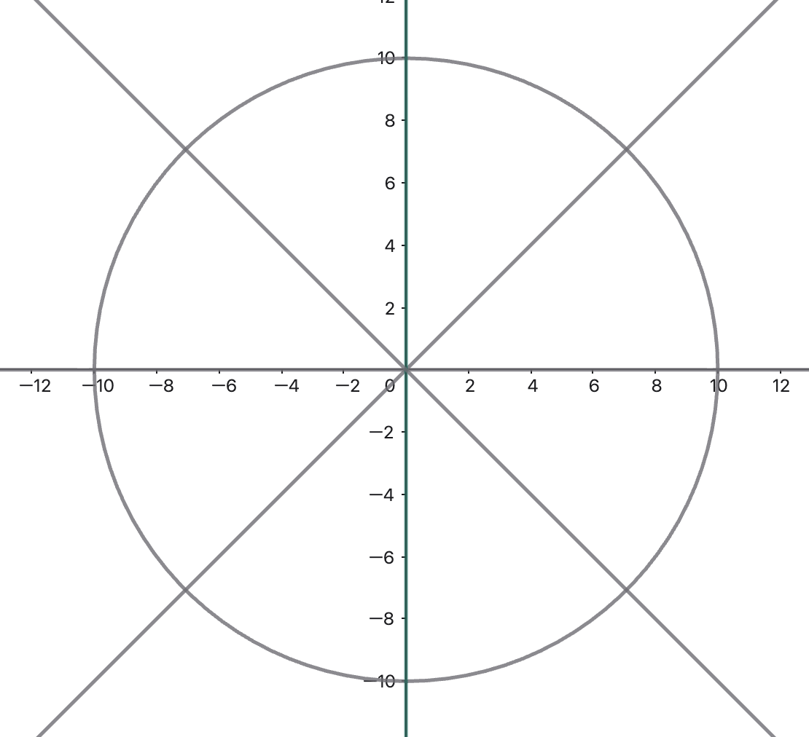
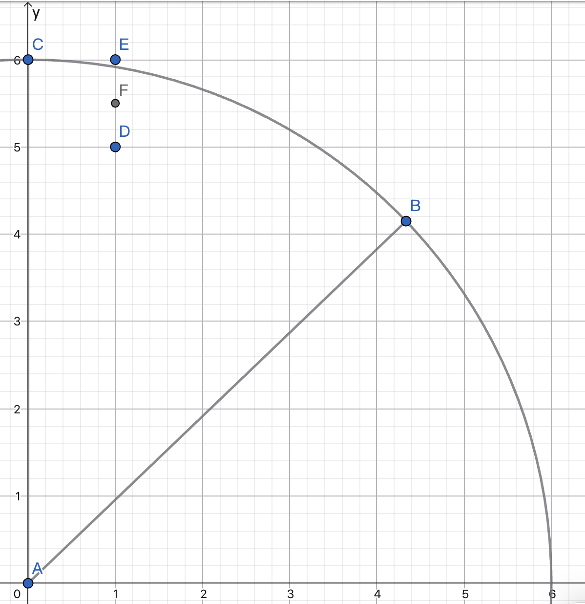

# 计算机中圆的绘制

## 前言

在上一篇中，我们大致了解了计算机是如何画出一条直线的，通过直线/线段组合我们还可以得到一些常见的图形。然而，几何世界中还存在着一些非线性的图形，这其中我们最熟悉的当属圆了，所以在本篇，我们简单地了解一下圆的绘制方式。

## 一些尝试

在盲无目的地一头扎进计算之前，我们先逐步理清思路，做一些简单的尝试：首先，圆也同直线一样，拥有对应的几何方程。借用最初画直线的想法，我们直接解方程可以得到 $y$ 关于 $x$ 的函数，利用函数便能通过 $x$ 的值得到 $y$ 的值。

考虑最简单的情况，我们以圆心在原点 $(0,0)$，半径为 $R$ 的圆为例。它的标准方程为：

$$
x^2+y^2 = R^2
$$

很容易地能够得到我们想要的函数：

$$
y =\pm\sqrt{R^2-x^2}
$$

基于此函数，以及 $x$ 和 $y$ 的定义域，我们分四个象限去讨论，然后将每次算出的 $y$ 的值进行四舍五入。如果就画出圆这个问题而言，我们已经解决了，但是很明显，这里又出现了我们不想要的情况：

1. 复杂的开方运算，甚至比乘法还要糟心；

2. 如果我们对函数 $y=\sqrt{R^2-x^2}$ 关于 $x$ 求导（也可以从切线斜率来理解，更加直观），那么有：

    $$
    \begin{aligned}
    & \frac{dy}{dx}=-\frac{x}{\sqrt{R^2-x^2}}\\
    \\
    所以有：& \lim_{x \rightarrow R^-}{|\frac{dy}{dx}|}=\frac{R}{0^+}=+\infty
    \end{aligned}
    $$
    

    所以当 $x$ 的值越来越接近 $R$ 的时候，$x$ 每自增 $1$，$y$ 可能会变化好几个单位，又会出现那种视觉上的断裂；

当然，圆的表示不仅有标准方程，一个比较特殊的是极坐标参数方程。虽然利用极坐标方程可以消除开方运算，用角度来做步进，并借助一些三角公式来进行递推，但仍然免不了浮点数的运算，并且对于角度步长的把控要求较高。如果有读者感兴趣，可以自行了解。

所以接下来，我们需要进行方案优化，解决上面的两个问题。

关于第二个问题，如果我们采用和画直线一样的处理方式，无非是很麻烦的，因为整个圆表面切线的斜率是不断变化的。我们可以很好地利用圆的对称性，将其分为八等分。这样一来，我们只需要画出其中一个卦限的点，其他卦限的点我们都可以利用坐标对称快速完成。

而且在第二卦限内，我们还不用愁纵坐标变化过快的问题，切线的斜率绝对值在 [0,1] 之间。如此，我们把 **第二个缺陷解决了**。

第一个问题我们通过学习 Bresenham 的画圆算法来解决。

## Bresenham 画圆算法

我们只分析第二卦限的情况，其他卦限的点均可以通过对称当前卦限画的点获得。

 

（上面这个图用作参考，便于理解理论推导）

算法从点 $(0,R)$ 出发，沿顺时针方向进行绘制。假设我们现在确定了像素点 $(x_k,y_k)$，对于下一个像素点，我们有两个选择：

1. 正右方像素点 $P_1(x_k+1,y_k)$；
2. 右下方像素点 $P_2(x_k+1,y_k-1)$；

同样的，我们需要让选择的点尽可能靠近理想圆弧，所以找两个待选像素点所连线段的中点：

$$
M (x_k+1, y_k-\frac{1}{2})
$$

将中点代入圆的隐式函数：

$$
F(x, y)=x^2+y^2-R^2
$$

$$
令：\color{red}{d_k=F(M)=(x_k+1)^2+(y_k-\frac{1}{2})^2-R^2} \tag{1}
$$

于是我们就构造出了一个判别式 $d_k$，这个式子本来是反映点和圆的位置关系的，同时又能帮助我们找到理想的像素点：

1. $d_k<0$：中点在圆内，所以圆弧从中点上方经过，所以正右方 $P_1$ 像素点离圆弧更近，且 $y_{k+1} = y_k$
2. $d_k=0$：中点在圆上，两个像素点离圆弧一样近；
3. $d_k>0$：中点在圆外，圆弧从中点下方穿过，所以右下方 $P_2$ 像素点离圆弧更近，有 $y_{k+1}=y_k-1$

继续套用直线算法的思路，接下来我们推导判别式的增量。

1. 如果 $d_k<0$，选择 $P_1$ 像素点，有 $x_{k+1}=x_k+1, y_{k+1}=y_k$。下一个待测试的中点为 $(x_k+2,y_k-\frac{1}{2})$，于是有：

$$
  d_{k+1} - d_k = (x_k + 2)^2 - (x_k + 1)^2 = 2x_k + 3
$$

$$
  \color{red}{d_{k+1} = d_k + 2x_k + 3} \tag{2}
$$

2. 如果$d_k\geq0$，选择$P_2$像素点，有 $x_{k+1}=x_k+1, y_{k+1}=y_k-1$，下一个待测试的中点为 $(x_k+2,y_k-\frac{3}{2})$，作差有：

$$
  d_{k+1} - d_k = [(x_k + 2)^2 - (x_k + 1)^2] + [(y_k - \frac{3}{2})^2 - (y_k - \frac{1}{2})^2] = 2(x_k - y_k) + 5
$$

$$
  \color{red}{d_{k+1} = d_k + 2(x_k - y_k) + 5} \tag{3}
$$

  这个递推式中虽然还有乘法，但是是乘2，恰好可以用位移运算来替代，所以至此，我们**解决了平方运算的麻烦**。

最后，我们计算起点$(0,R)$对应的判别式：

$$
\begin{aligned}
d_0 &= F(1, R - \frac{1}{2}) \\
&=1^2 + (R - \frac{1}{2})^2 - R^2 \\
&=\color{blue}{1.25 - R}
\end{aligned}
$$

至此，我们仿佛已经解决了所有问题，模仿着推导完了公式。

但是！这个1.25是个浮点数，这很不友好，难道我们最终还是摆脱不掉浮点计算吗？其实不然，这里当属整个算法最巧妙的部分：

回顾我们的算法推导，自始至终我们的目的只有一个：**选择下一个理想像素点**。至于过程中我们怎么弯弯绕绕都没有关系，直到最后我们将选择像素点的任务和判别式$d_k$挂了钩，问题变成了**计算并判断$d_k$的符号**。所以，**我们并不关心这个判别式计算的结果是多少，我们只关心它的符号是正是负。**

再观察$(2)(3)$这两种情况的递推公式，不论哪一种，每一步的增量都是一个整数，而我们的初始半径$R$也是整数，这说明判别式永远可以写成`某个整数+0.25`的形式；又因为我们只关心结果符号，如果整数是正数，那么符号自然不变，如果整数是个负数，哪怕是最大的-1加上0.25也不会改变符号。所以，这个0.25对于我们的判断是没有任何影响的，自然我们可以将其舍弃，得到最终完美的整数判别式初值：

$$
\color{red}{d_0=1-R} \tag{4}
$$

现在，浮点数我们也解决了，所有开头提出的问题都得到了处理。最后需要提一嘴的是，如果我们在第二卦限计算，那么我们计算的临界值就是$x=y$，需要注意范围。

整个算法推导结束。

---

示例：

同样的，我们手算一道题目，来熟悉一下整个算法的执行过程，就拿一开始的那个参考图为例：

圆心$(0,0)$，半径$R=6$，初始判别式$d_0=1-R=-5$

1. 在第二卦限中，点亮起始像素点$(0,6)$，$d_0=-5$；
2. $d_0<0$，选择正右方像素点$(1,6)$，更新$d_1=d_0+2\times0+3=-2$；
3. $d_1<0$，选择正右方像素点$(2,6)$，更新$d_2=d_1+2\times1+3=3$；
4. $d_2>0$，选择右下方像素点$(3,5)$，更新$d_3=d_2+2\times(2-6)+5=0$；
5. $d_3\geq0$，选择右下方像素点$(4,4)$，更新$d_4=d_3+2\times(3-5)+5=1$；

当前像素点坐标为$(4,4)$，满足$x=y$，所以绘制结束。

## 结语

首先，我是觉得直线和圆的Bresenham算法比较有趣，所以专门在此分享出来，同时也希望能够帮助到一些想了解的人。这些内容算不上很高大上，但是用来做初步的理解和学习还是不错的，能够很好地引发一些思考，比如像最后处理浮点数的那一部分我就觉得很精彩。

考虑到我也是在初步摸索着学习这些内容，文章中可能有表达不当之处，还请各位指正，非常感谢！
