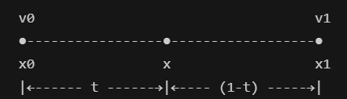
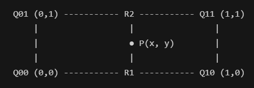
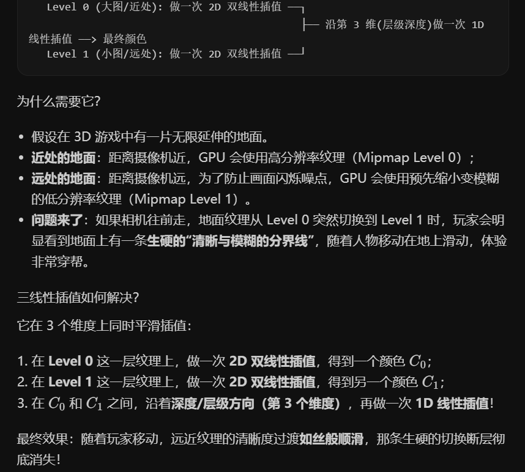
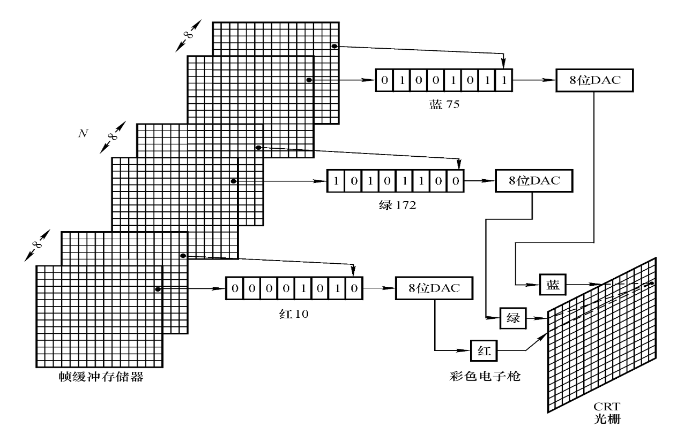
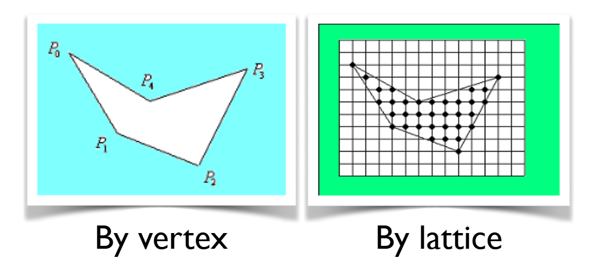
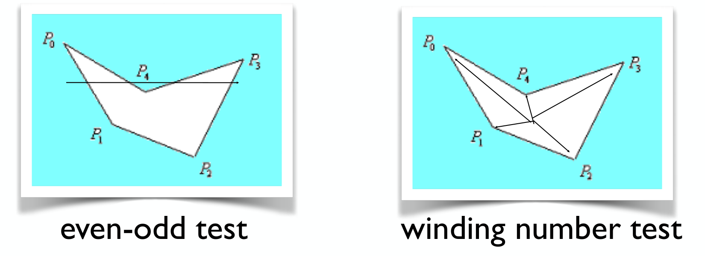
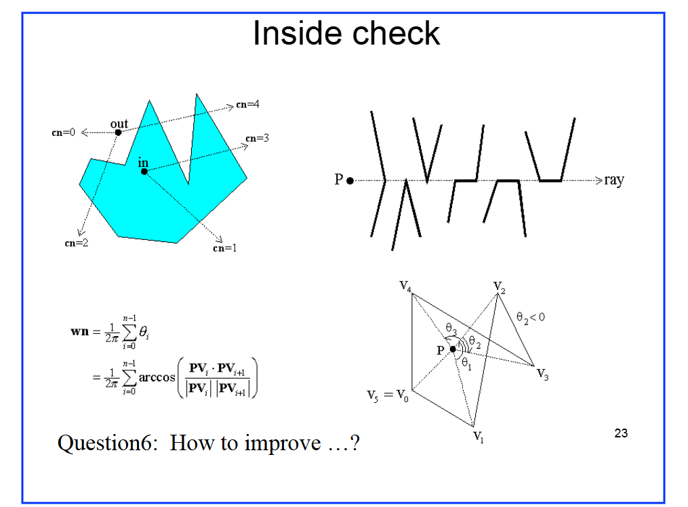

# ch2

（这一章节的笔记是做的最难受的）

首先，关于计算机画图形到屏幕上，我们只需要牢记两个词就可以了：**离散**与**像素点**。用一句话来说：显示器屏幕本质是离散的像素点矩阵。

下面的这一部分内容是关于照相机拍照成图的过程理解，如要跳过，正文在[光栅化](#光栅化)

## 关于连续和离散的一些了解

1. **图像传感器**

    无论是手机还是相机中的图像传感器，它们都是由底层的感光单元排列组成的，而感光单元的本质是光电二极管。光电二极管的工作方式为：光子打到硅片，激发出电子，电子产生电流。所以光线越强，激发的电子越多，电流越强，数值越大。

2. **图像传感器为什么需要滤波阵列？**

    上面提到了感光单元的工作方式，很明显，这种方法无法判断光子的颜色（波长）。为了解决这个问题，我们在感光单元上覆盖微透镜和颜色滤波阵列。

3. **什么是滤波阵列？**

    滤波阵列（Color Filter Array CFA）：

    1. 滤波，在这里就指“滤光”，比如放置特定颜色的玻璃，只让特定颜色的光线通过，其他颜色的光都被反射或者吸收；
    2. 阵列，就是将这些微小的滤波镜片组合到一起，一次有成百上千个，组成一个二维网格。

    例如课件第4页 的 中的6种CFA排列方案：

    - 垂直条纹：按R,G,B规律顺序排列。结构简单，但水平方向分辨率急剧下降，极易产生单向的严重锯齿和摩尔纹；
    - Bayer 拜尔阵列：50%G, 25%R, 25%B。因为人眼视网膜对于绿光的敏感度远高于红蓝光，因为分配双倍的绿色采样点；
    - Pseudo-random 伪随机排列：打破周期性，高频混叠，消除特定方向规则的摩尔纹；
    - Complementary colors  CMY/CMYG：采用青Cyan，品红Magenta，黄Yellow。互补色滤镜允许更多光谱分量通过（透光率高），暗光性能好，但需通过色彩矩阵变换解算回 RGB，会放大色度噪声。
    - 全色/泛色阵列（Panchromatic / Kodak CFA 2.0 - RGBW）：图中的白色方块为 Clear / Panchromatic（全色/无滤镜单元），优势为：白色像素不滤除任何可见光光子，进光量提升 2~4 倍，大幅提高暗光信噪比（SNR）。
    - Burtoni CFA：非对称交错错位排列，用于平衡对角线方向的分辨率

4. **什么是柯达 RGBW 传感器（作为例子理解）**

    其中的W就是指White，或者是P(Panchromatic  全色/泛色)，二者含义是一样的。

    因为传统的滤波阵列都太浪费光了，比如bayer阵列，对于每个滤光镜片，有大约2/3的光都被吸收或者反射了，即浪费了。当到了夜晚或者暗光环境中，光子数量较少时，像素就会充满雪花般的噪点。

    Q：引入W像素也带来了新的挑战，因为W是完全透明的，所以它无法分辨颜色，那么要怎么处理呢？

    A：因为人眼对于明暗轮廓很敏感，但是对于颜色分辨率很迟钝。所以RGBW传感器将任务分为了两半：W像素负责当骨架，全速采集全分辨率的明暗画面；RGB像素用来低分辨率地采集色彩信息；最后使用算法融合，合成暗光下噪点极低的高清图像。

5. **RGBW 图像重构管线**

        解释了 RGBW 传感器如何利用亮度和色度分离原理，重构出完整分辨率的彩色图像。

    1. 首先，分别提取出P全色像素和RGB色彩像素
    2. 对提取出的P像素进行两种操作：
        - 对P像素进行空间插值，得到全分辨率明度图；
        - 对P像素进行局部平均，得到低分辨率明度图；
    3. 对于RGB像素，进行去马赛克插值，得到低分辨率的初始彩色图
    4. 用低分辨率彩色图减去低分辨率明度图，得到低分辨率下的色差图像，对色差进行插值放大，得到全分辨率色差图
    5. 用之前计算的全分辨率明度图和该全分辨率色差图进行相加融合，就得到了最终的全分辨率色彩图。这样既得到了低噪点图像，又保留了准确色彩

    >  关于明度图和色差图的解释和理解：
    >
    > 明度图：也就是一张纯粹的黑白灰度图，没有色彩，只有明暗对比
    >
    > 色差图：任何一个彩色像素都可以拆分为两个部分$真实颜色 = 明度 + 色差$，色差的含义是这个位置在脱离了明暗影响后，纯粹偏向某个颜色的程度

6. **失真**

    字面含义就是失去了真实面貌。因为现实世界中光纤，物体表面等都是连续的，而计算机采样时是离散的，通过计算、压缩、插值等操作后，输出画面会和现实世界有偏差，这就是失真。

    一些常见的失真类型有：

    1. 模糊失真：锐利/细节被抹平，一些边缘的跳变被插值抹平，变得很糊；
    2. 走样/锯齿失真：当采样率不够高时，倾斜直线在屏幕上呈现出阶梯状的锯齿，或者是出现摩尔纹；
    3. 色彩失真/伪彩：黑白交界的高对比度边缘凭空出现紫色或者绿色的杂边；

7. **分辨率**

    从计算机图形学的角度来理解，大概有三个角度：

    1. 像素分辨率/网格分辨率：即离散的像素网格数量，比如1920×1080 (1080p)，以及3840×2160 (4K)，本质指的是计算机帧缓冲区中离散采样的网格点总数

    2. 空间密度分辨率 (PPI/DPI )：对于同样的1920×1080，放在手机屏幕和大幕布的效果是不一样的，前者画面非常精细，而后者每个像素却非常大，为了区分，引入空间密度。

        PPI (Pixels Per Inch)：每英寸长度里面有多少个像素点

        $PPI = \sqrt {水平像素^2+垂直像素^2} / 屏幕物理对角线尺寸(英寸)$

    3. 颜色/灰度分辨率：测量一个像素的亮度时，我们的刻度尺有多精细？比如测量一个像素的亮度，我们是使用 8-bit 共256份还是使用 10-bit 共1024份，不同的刻度对应的细密程度不同，越精细越能反映微弱的光影起伏

8. **线性插值、双线性插值、三线性插值**

    插值：也即知道几个锚点的数据，按照一定的权重，推测中间某个未知点的值。

    从线性到双线性、三线性其实是维度的递增

    - 线性插值：一般就是权重求和，越靠近某个点其值的权重越高

        $lerp(v_0,v_1,t) = (1-t)v_0 + tv_1 = v_0 + t(v_1 - v_0)$

        

    - 双线性插值：二维，在一个矩阵网格内计算。一共做了三次一维线性插值，横着两次，竖着一次。首先计算上下两边的中间点$R_1, R_2$，然后再通过$R_1, R_2$计算最终点$P$

        

    - 三线性插值：主要作用是在现代GPU的Mipmap（多级渐远纹理映射），大致内容如下：

        

---

## 光栅化 {: #光栅化 }

- **什么是光栅化(Rasterization)**

    光栅化，又称**扫描转换(Scan Conversion)**。严格来说，它是一个数学计算和离散采样的过程：就是判断图元覆盖了哪些离散的像素格子，然后给这些格子填入颜色数值的计算过程。

- 图元：指的是硬件渲染管线能够直接识别、处理并绘制的最基本的几何元素。常见的主流图形API，比如OpenGL, DirectX, Vulkan中，图元主要分为：点、线、三角形

    > 为什么三角形是最基本的图元？而且3D渲染中，几乎很多复杂的模型最终都会被切分成成千上万个三角形网络。
    >
    > 1. 天然共面：不共线三点处于同一个平面，不会像四边形那样发生空间扭曲易于插值：
    > 2. 利用三角形内部的任意点属性，都可以通过重心坐标来进行简单高效的插值硬件加速：
    > 3. 现在GPU的光栅化硬件针对三角形遍历与边界测试做了极致的优化通用性强：
    > 4. 任何复杂多变性都可以无歧义地三角化

- 光栅化的两个核心步骤

    1. 确定位置。几何离散化，我们要在屏幕上确定究竟哪些格子被这个几何图元覆盖了。这个过程就叫做光栅化
    2. 确定颜色/着色。确定了这些像素之后，每个像素应该填充什么颜色？
    
- 光栅化之后的显示输出过程

    1. 首先在光栅化之后，显卡内存中存放的是已经算好的一帧完整的画面，它存放在帧缓冲存储器中；
    2. 显示芯片定时从帧缓冲中读出数据；
    3. 数模转换器（DAC）将存储的二进制数字信号转换为模拟电压来驱动物理显示部件
    4. 彩色电子枪与逐行扫描：红、绿、蓝三路模拟电压信号分别输入对应的彩色电子枪，控制发射电子束的强弱。电子束在偏转磁场控制下，从屏幕左上角开始，自左向右横向扫描一行，扫完一行后快速回扫到下一行起点，从上到下逐行铺满整个屏幕。由于荧光粉受激发光以及人眼的视觉暂留特性，高速扫描的离散光点在人眼中合成了连续完整的彩色图像。

    图示过程如下：

    

- 关于帧缓冲存储器

    帧：视频或者游戏是由一幅幅静止的图片连续播放组成的，其中每一幅单独的画面就叫做帧；

    缓冲：显卡把下一幅画面临时存放，等待显示器来取

    帧缓冲存储器实际上就是一个与屏幕分辨率一致的二维数据矩阵，比如某台电脑的分辨率是1920×1080， 那么其帧缓冲存储器也就是一个1920×1080的矩阵，每个存储器对应一个像素点。早期计算机会使用单缓冲机制，现代显卡和图形API普遍采用双缓冲或者三缓冲。

    - 单缓冲

        工作方式：显卡计算下一刻游戏/视频的画面并存放进入帧缓冲存储器中，显示器读取存储器中的值并显示到屏幕上。

            但是这经尝会出现画面撕裂的问题，因为显示器是一行一行往下扫描的，显示器和显卡的速度不协同。可能显示器上半部分显示的是某个FPS游戏开枪前的画面，但是因为显卡已经计算出了开枪后的画面并写入了缓冲，那么下半部分显示器就会显示开枪后的画面，我们需要解决这个问题，于是引入双缓冲甚至三缓冲

    - 双缓冲

        也就是准备了两个一模一样的帧缓冲，但是分为前后缓冲区。前缓冲负责给显示器读取显示，后缓冲区则是让显卡时刻计算修改。直到显卡把后缓冲区画好了，并且显示器刚好把前缓冲区的一帧全部扫描完到了最底部，驱动程序直接修改前后缓冲区的指针，完成调换。

## **直线光栅化**

详见：[光栅化直线](CGblog1_drawingLine.md)

## 圆的光栅化

详见：[光栅化圆](CGblog2_drawingCircle.md)

补充：极坐标参数法与增量计算

参数方程形式为：

$$
x = x_c + r\cos\theta, \quad y = y_c + r\sin\theta
$$

令角度以微小增量 $\Delta\theta$ 步进，即 $\theta = i \cdot \Delta\theta$。

为了避免每一步都重新计算三角函数，利用三角和角公式：

$$
x_{i+1} = r\cos(\theta_i + \Delta\theta) = r\cos\theta_i\cos\Delta\theta - r\sin\theta_i\sin\Delta\theta = x_i\cos\Delta\theta - y_i\sin\Delta\theta
$$

$$
y_{i+1} = r\sin(\theta_i + \Delta\theta) = r\sin\theta_i\cos\Delta\theta + r\cos\theta_i\sin\Delta\theta = y_i\cos\Delta\theta + x_i\sin\Delta\theta
$$

通过旋转递推可显著减少浮点三角函数调用。

## 光栅化多边形

- **多边形的两种表示形式**

    1. 顶点表示(by vertex)：用顶点坐标序列描述出边界。优点是便于进行缩放平移旋转等几何变换，缺点是无法直接控制内部像素的颜色。
    2. 点阵表示(by lattice)：用内部覆盖的像素点阵表示，是最终进入帧缓冲显示的物理形式。

    

- **多边形填充**

    本质：完成从顶点表示到点阵表示的转换

- **多边形内外性测试 (Inside Check)**

    在多边形填充之前，我们需要确定平面上的像素点究竟是位于多边形内部还是外部。

    常用方法为**射线法**：从待测点 $P$ 出发，向任意方向引出一条无穷长射线，统计射线与多边形所有边界线段的相交情况。

    - **奇偶测试 (Even-Odd Test)**

        统计射线与多边形所有边界的交点总数，然后根据交点数来进行判断：

        1. 若交点个数为奇数，则点位于多边形内部；
        2. 若为偶数，则位于多边形外部；

        > 用一个情景类比来不严谨地证明一下这个奇偶判断的原理：
        >
        > 首先，一个多边形，不论是凹多边形还是凸多边形，我们都将其看作一个封闭的空间，比如一个由墙围起来的院子。并且我们知道，走到无穷远处一定是在这个院子外面的，而射线的一端是无穷长的。
        >
        > 对于内部的点来说，要到院子外面，就必须要翻出一道墙。如果中途又不小心翻进了院子，要出去就必须再翻一次。所以最终无论翻了多少次，这个次数总是一个奇数；
        >
        > 对于外部的点，如果翻进了院子，那么要想出去，就势必得再翻一次，这是一一对应的。等到通往无穷远，也就是翻出了院子，那么翻墙次数自然是偶数。
        >
        > 有了这个规律，我们就可以通过奇偶次数来判断点的位置了。

    - **环绕数测试 (Winding Number Test)**

        将待测点 $P$ 与多边形各顶点相连，计算沿多边形边界逆时针走完一圈时，边对点 $P$ 张开的有向夹角总和。夹角总和除以 $2\pi$ 即为环绕数 $wn$：

        $$
        wn = \frac{1}{2\pi} \sum_{i=0}^{n-1} \theta_i
        $$

        这里的$\theta_i$是有向角，如果视线逆时针转动，角度记为正$(+)$；顺时针就是负$(-)$，最后根据环绕数判断：

        1. 若环绕数 $wn \ne 0$，则点在多边形内部；
        2. 若环绕数 $wn = 0$，则点在多边形外部。

        > 继续借用上面的情景来讲，就是说如果院子中有一个木桩，上面连着一个绳子，我们拉着绳子沿着围墙完整走一圈回到起点，这时候木桩也会被绳子绕一整圈。而如果是外面的位置，那么绳子就不会绕过木桩。

        

    - **边界与特殊情况处理**

        

        - 关于奇偶测试

            1. 理想情况是图1所示，考虑临界情况，比如外部点不穿过边，那么相交次数就是0，也满足偶数；内部点只穿过一条边，次数为1，满足奇数。所以这个方法是方向无关的。

            2. 特殊情况是射线可能会正好穿过多边形顶点，或者与某条边界边重合。考虑图2的六种情况：

                - 正常穿过一条边，算1次；

                - 穿过顶点，有两种情况，算2次或者0次；

                - 穿过水平边：

                    如果水平边两端一上一下，算1次；

                    如果水平边两端在同侧，算0次或2次；

        - 关于环绕数测试的一些理解

            将式子写开成向量的点乘公式，算出点到每一边两端的夹角。考虑图4有角度小于0的特殊情况（顺时针为负角），实际上，正因为有正负，内部点累加起来刚好是$2\pi$，外部的加起来刚好为0

        - 两种方式的改进

            两种数学方式很优美，但是效率不太行，扫描反余弦公式和模长的平方根计算的开销极大，而奇偶测试又要写很多条件分支处理特殊情况。整个计算复杂度为$O(\text{像素总数} \times \text{多边形边数})$，效率极低。

            图形学利用扫描线的行间连续性和边的连通性，引入了基于边表 (Edge Table ET) 和活性边表 (Active Edge Table AET) 的扫描线多边形填充算法，大幅提升了多边形光栅化的处理效率。（可以深入了解）https://zhuanlan.zhihu.com/p/80471730

## 其他内容了解

1. **3D DDA 算法与三维体素空间**

    将二维直线的光栅化思想扩展到三维离散空间，即得到 3D DDA 算法。

    - 核心思想：在由三维体素 (Voxel Grid) 构成的离散空间中，计算一根连续空间光线所穿过的所有离散体素单元。
    - 计算方式：寻找光线方向矢量中变化最快的主坐标轴作为主步进方向，另外两个坐标轴根据斜率增量递推步进。
    - 典型应用：常用于光线投射 (Ray Casting)、光线步进 (Ray Marching)、体绘制以及三维物理引擎中的视线相交检测与碰撞检测。

2. **曲线的常见表示方法**

    在几何造型和图形显示中，曲线主要有三种数学表达形式：

    1. 显式表示 (Explicit Curve)：形如 $y = f(x)$，每一个自变量 $x$ 唯一对应一个函数值 $y$。缺点是无法表示具有闭合环路或在局部出现垂直切线的几何曲线。
    2. 参数表示 (Parametric Curve)：形如 $x = x(t), y = y(t)$，其中参数 $t \in [t_0, t_1]$。这是计算机辅助设计和图形建模中最推崇的形式，通过均匀或自适应改变参数 $t$ 即可平滑生成曲线点，易于表示任意形状的自由曲线和闭合曲线。
    3. 隐式表示 (Implicit Curve)：形如 $g(x, y) = 0$。其优势在于容易判断给定点与曲线的相对空间位置：点在曲线上时 $g=0$，点在曲线一侧时 $g>0$，在另一侧时 $g<0$。常用于距离场计算和碰撞检测。
