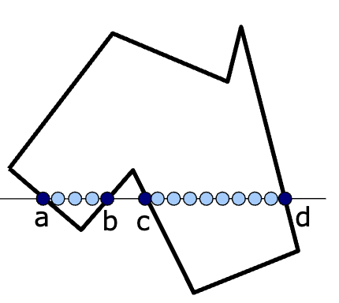

# 扫描线填充算法

作为ch4的补充

## 问题引入

问题：给定多边形边界的顶点序列和一个填充色，把多边形内部覆盖的所有像素都涂上颜色。输入是顶点表示的多边形，输出是点阵表示，所以我们需要判断每个像素是在内部还是外部。之前在ch2提到过判断方法，但是这里的扫描线填充不做逐个像素的判断，而是先求出边界和扫描线的交点，再用交点把一行切成若干段。

解决方法是使用不同的填充算法，主要有这三种：

1. 扫描线填充，scan-line fill；
2. 边界填充，boundary fill；
3. 泛滥填充，flood fill。

下面主要介绍第一种算法。为了对照，这里补充其余二者的标准定义：

- 边界填充从区域内一点出发，沿四邻域或八邻域扩散，遇到边界色就停止；

- 泛滥填充从区域内一点出发，把与种子颜色相同的连通区域整体替换成新颜色，也就是绘图软件里的油漆桶；

两者的差别在于停止条件，边界填充看颜色是不是边界色，泛滥填充看颜色是不是和种子相同。

光栅系统上的区域填充可以分为两类，对应两种思路：

一是提到的扫描线法，求出每条扫描线与区域的交叠区间，逐区间填充。适合多边形、圆这种边界能用方程或顶点序列描述的简单对象；

另一种是种子类方法，即从区域内部一个已知点出发，向外扩散，直到碰到边界条件。这种方法适合边界复杂、甚至无法用方程描述的对象，也适合交互式填充。

| 对比     | 扫描线填充           | 边界填充与泛滥填充       |
| -------- | -------------------- | ------------------------ |
| 输入     | 边界顶点或边方程     | 内部种子点加颜色条件     |
| 判断依据 | 交点奇偶性           | 像素颜色与连通性         |
| 适用对象 | 多边形、圆等简单图形 | 任意复杂区域，交互式操作 |
| 速度     | 快，可用整数增量     | 慢，需要反复读像素       |
| 典型用途 | 硬件光栅化           | 绘图软件的油漆桶         |

## 基本流程

一般需要三步，以上图为例：

1. 求出扫描线y等于某个值时和多边形所有的交点；
2. 吧交点按x从小到大排序；
3. 相邻两个交点两两配对，配对区间内进行填色；

这样的一段连续区间叫做span，我们称区间的两个端点叫做span extrema。整个填充过程就是生成一串span然后画出来。

因为做配对这件相对比较麻烦，而整条线上的点只有两种状态：在多边形内部以及不在内部。所以可以使用奇偶校验来完成这件事。具体来讲：初始状态在多边形外部，记作偶；每次经过多边形边界就进行变换，并且当状态为奇时进行

1. **奇偶规则**

    第 8 页把配对规则形式化为奇偶规则：

    - 奇偶标志初始为偶，表示当前位置在区域外；
    - 每遇到一个交点翻转一次；
    - 标志为奇数表示在内部，需要填色；标志为偶数表示在外部，不填。

    这和从左往右数交点的思路完全等价。图上标了 o 和 e 表示偶和奇，可以看到每跨过一条边就切换一次。写成代码就是维护一个布尔量，遇到交点取反，为真时开始记录区间起点，为假时把区间画出来。

2. **为什么可以流水线**

    第 7 页强调扫描线法的一个工程优点：填充顺序与渲染顺序一致，都是从下往上逐行处理，所以可以边算边填，也可以把不同扫描线分给不同处理器并行。这是它比种子填充更适合硬件的原因，现代显卡的光栅化本质上就是按扫描线或按 tile 批量生成片元。

## 三、顶点与水平边的处理

1. **问题**

    扫描线正好穿过多边形顶点时，这个交点算一次还是两次。算错会让配对错位，内部被填成外部，或者外部被填成内部。

    课件第 5 页的例子中，扫描线穿过 a、b、c、d 四个位置，其中 b 和 c 是多边形的局部极值点，a 和 d 是普通穿越点。

2. **课件的判定规则**

    第 6 页给出的解法是沿多边形边界按顺时针或逆时针统一走一遍，观察每条边在 y 方向是单调增还是单调减：

    - 扫描线经过顶点时，如果两条边在 y 方向的方向发生反转，也就是该顶点是局部极大或局部极小，这个交点算两次；
    - 如果方向没有反转，两条边一进一出，这个交点只算一次。

    图上的标注就是这么来的：b、c 处 y 方向反转，标 2；a、d 处方向连续，标 1。直观理解是局部极值点像折返跑，射线在这里连着穿进穿出两次；普通穿越点只是路过，穿进穿出各一次但只占一个位置。

3. **更省事的实现**

    实际代码很少逐个顶点判断方向，而是用半开区间统一处理：每条边的有效 y 范围取 $[y_{min}, y_{max})$，也就是到达上端点的那条扫描线不再使用这条边。

    这样每种顶点都自动得到正确结果：

    - 局部极小点：两条边都从这里开始，都进入待用表，算两个交点；
    - 局部极大点：两条边都在这里结束，都已被删除，算零个交点；
    - 普通穿越点：一条边结束被删，一条边开始被加入，算一个交点；
    - 水平边：两端 y 相同，区间为空，自动被排除。

    这正是 ch4.md 里提过的技巧，两处可以对照看。课件第 9 页把这两种情况画成了 A 和 B 两张图，A 是单调穿越算一次，B 是方向反转算两次，和上面的规则一一对应。

4. **水平边**

    课件没有专门讨论水平边，但上述规则隐含了它必须跳过。原因是水平边与扫描线重合，交点不是离散的，无法用单个 x 表示；而它的两个端点已经分别由相邻的斜边计入，跳过它不会丢失配对信息。实现时直接把 $y_1 = y_2$ 的边跳过即可。

## 四、加速手段

第 10 页列出三条，第 11 页又补了一条：

1. **按扫描线并行**：每条扫描线相互独立，可以分配给不同处理器。这是最直接的并行粒度，但负载不均衡，因为不同行的 span 数量差别很大。
2. **增量求交**：从当前扫描线的交点推出下一条扫描线的交点，避免每行都重新解一次直线方程。这是后面第五节的主题。
3. **活性边表**：只维护当前扫描线真正穿过的那些边，不必每行遍历全部边。大多数边只在很短的 y 区间内活跃，这个优化效果最明显。
4. **先用线段算法求交点表**：对每条非水平边单独用 Bresenham 或中点算法光栅化，把每条扫描线上的交点记录下来形成一张表，填充时直接查表配对。好处是求交完全用整数，坏处是每条边都要单独走一遍，而且需要额外的存储。

## 五、增量求交

1. **浮点写法**

    设边的斜率是 $m = \Delta y / \Delta x$，扫描线每次只移动一个单位高度，$\Delta y = 1$，于是交点横坐标每行的增量是

    $$x_{k+1} = x_k + \frac{1}{m} = x_k + \frac{\Delta x}{\Delta y}$$

    闭式解是

    $$x_k = x_0 + \frac{k}{m}$$

    也就是第 k 条扫描线上的交点可以由起点直接算出来，不必逐行累加。逐行累加的好处是每行只做一次加法，闭式解的好处是不会积累误差，两者在实现里可以按精度需求选。

2. **整数计数器写法**

    第 13 页给了一个只用整数加法的版本，以斜率 $m = 7/3$ 为例，也就是 y 增加 7 时 x 增加 3：

    - 计数器初值 0，每推进一条扫描线，计数器加 3；
    - 当计数器达到或超过 7，交点横坐标加 1，计数器减 7。

    这样每行只做一次加法和一次比较，横坐标按 3/7 的节奏前进，永远不会积累浮点误差。第 15 页的图用方格画了这条线的推进过程，蓝色方块标出每一行的交点落在哪一列，旁边的 decrement 标注就是计数器减 7 的时刻。

    这个思路和 Bresenham 画线完全一致，只是这里的对象换成了交点横坐标。两者的区别在于 Bresenham 求的是线段经过的所有像素，而这里每条扫描线只需保存一个交点值，供配对使用。

    用通式写出来就是：每行把计数器加上 $\Delta x$，超过 $\Delta y$ 就进位并把计数器减 $\Delta y$。这实际上是在用整数模拟 $k \cdot \Delta x / \Delta y$ 的商和余数，商就是横坐标的增量，余数就是计数器。

## 六、边表与活性边表

1. **边表 ET**

    预处理阶段把所有边按较小的 y 值分桶，形成一个桶排序的边表，课件叫 sorted edge table。每个桶对应一条扫描线，桶内存放从这一行开始进入的边。水平边不进表。

    每个边条目有三个字段：

    | 字段 | 含义 | 用途 |
    | --- | --- | --- |
    | ymax | 上端点的 y 值 | 判断这条边何时离开活性表 |
    | xmin | 下端点处的 x 值 | 这条边在当前行的初始交点 |
    | 1/m | 横坐标每行的增量 | 逐行更新交点 |

    桶内按 xmin 排序，这样合并进活性表时可以快速保持有序。

2. **活性边表 AET**

    第 16 页和第 19 页说明，AET 存放当前扫描线穿过的边，按当前 x 排序。每换一行做三件事：

    - 从 ET 的对应桶里取出新开始的边，插入 AET；
    - 删掉 ymax 等于当前 y 的边；
    - 剩下的边把 x 加上 1/m。

    插入排序在这里很合适，因为相邻两行之间边的左右相对次序很少改变，新边的数量也很少，每次只需要在局部调整。

    课件第 19 页的原话强调三点：每条边只加到它开始的那条扫描线；每个条目存 x 交点、ymax 和 1/m；边的顺序按 x 从左到右维护。这三句话就是 AET 的全部内容。

3. **两个表的配合**

    第 17 页和第 18 页用五边形 1-2-3-4-5 演示两个表。ET 的下标是 y 值，每个桶链出这一行开始的边；AET 的条目随扫描线推进不断变化，x 字段每行都在更新。

    课件在 AET 图上标了 a、b、c、d 四个交点，对应那条扫描线与四条边的四个交点，排列顺序就是按 x 排好序的顺序。图上 y 值较小的行显示两条活跃边，接近顶点 5 的行显示四条，直观反映了活跃边的数量变化。

## 七、算法步骤

第 21 页把整个流程写成三步：

1. 从 ET 中最小的非空 y 开始；
2. 扫描线桶 SLB 置空；
3. 当当前 y 不超过最高点 y 时循环：

    - 把 ET 中 y 对应的桶合并进 SLB，按 xmin 排序；
    - 在 SLB 中把 x 值取整后两两配对，填充像素；
    - 删掉 ymax 等于当前 y 的边；
    - 对 SLB 中剩下的边把 xmin 加上 1/m；
    - y 加 1。

关于取整：第 21 页写的是 fill pixels between rounded pairs，也就是配对后对两个端点分别四舍五入取整，得到整数列号，再填充这个闭区间。交点一般是小数，取整是把它落到像素列上的必要步骤。

关于删除时机有一个细节值得说清。课件把删除放在填充之后，等价于把每条边的有效范围当成闭区间 $[y_{min}, y_{max}]$。闭区间在局部极值点会贡献两个重合的交点，只要这两个交点相邻，配对结果和半开区间一致；但如果重合点落在排序列表中间，就可能和两侧的点配对，把该断的地方连起来。稳妥的做法是填充前删除，或者干脆按半开区间定义，这样不依赖重合点是否相邻。

## 八、完整走查

课件第 20 页到第 31 页用 11 条边 e1 到 e11 演示了一遍，其中 e1 没有出现在边表里。图里的边画成几段折线，形状不必深究，重点是表结构和每行数值的变化。

1. **边的数据**

    | 边 | xmin | ymax | 1/m |
    | --- | --- | --- | --- |
    | e2 | 2 | 6 | -2/5 |
    | e3 | 1/3 | 12 | 1/3 |
    | e4 | 4 | 12 | -2/5 |
    | e5 | 4 | 13 | 0 |
    | e6 | 6 2/3 | 13 | -4/3 |
    | e7 | 10 | 10 | -1/2 |
    | e8 | 10 | 8 | 2 |
    | e9 | 11 | 8 | 3/8 |
    | e10 | 11 | 4 | -3/4 |
    | e11 | 6 | 4 | 2/3 |

    e5 的 1/m 等于 0，说明它是竖直边，横坐标始终是 4。其余边的横坐标按各自的 1/m 每行变化。

    图里还标了一条 e1，它没有出现在课件给出的边表里。从位置看它应该是底部那条水平边，正好演示了水平边不进表这条规则。

2. **边表分桶**

    按每条边的较小 y 值分桶后得到：

    | y | 新进入的边 |
    | --- | --- |
    | 0 | e10、e9 |
    | 1 | e2、e11 |
    | 6 | e7、e8 |
    | 7 | e3、e4、e5 |
    | 11 | e6 |

    课件第 20 页的图左侧就是这个分桶表，右侧是这些边画出来的形状。

3. **逐行运行**

    把每行求出的交点排序后配对，得到的填充区间如下。x 值写成小数，方便和课件上的分数对照。

    | y | 排序后的交点 | 填充区间，未取整 | 本行动作 |
    | --- | --- | --- | --- |
    | 0 | e10 11，e9 11 | 无，两个交点重合 | 从 ET 取入 e10、e9 |
    | 1 | e2 2，e11 6，e10 10.25，e9 11.375 | 2 到 6，10.25 到 11.375 | 取入 e2、e11 |
    | 2 | e2 1.6，e11 6.67，e10 9.5，e9 11.75 | 1.6 到 6.67，9.5 到 11.75 | 各边 x 加 1/m |
    | 3 | e2 1.2，e11 7.33，e10 8.75，e9 12.125 | 1.2 到 7.33，8.75 到 12.125 | 各边 x 加 1/m |
    | 4 | e2 0.8，e11 8，e10 8，e9 12.5 | 0.8 到 8，8 到 12.5 | 填完删 e11、e10 |
    | 5 | e2 0.4，e9 12.875 | 0.4 到 12.875 | 各边 x 加 1/m |
    | 6 | e2 0，e7 10，e8 10，e9 13.25 | 0 到 10，10 到 13.25 | 取入 e7、e8，填完删 e2 |
    | 7 | e3 0.33，e4 4，e5 4，e7 9.5，e8 12，e9 13.625 | 0.33 到 4，4 到 9.5，12 到 13.625 | 取入 e3、e4、e5 |

    填充时再把区间两端分别四舍五入成整数列号，例如第 2 行实际画第 2 到 7 列和第 10 到 12 列。

    这张表里有几个值得注意的地方：

    - 第 0 行两个交点重合在 11，配对得到零宽区间，什么也不画。这正对应 e10 与 e9 在顶点处相交的情况。
    - 第 4 行 e11 和 e10 都到达 ymax，交点都是 8，填完后从表中删除。下一行就只剩 e2 和 e9 两条边。
    - 第 6 行 e2 到达 ymax，同时在 ET 的 y 等于 6 的桶里取入 e7 和 e8，活跃边数量没有减少，但成员换了一批。
    - 第 7 行一次加入三条边 e3、e4、e5，活跃边增加到六条，排序后得到三个 span。e5 是竖直线，横坐标一直是 4，所以它和 e4 的交点在这一行重合。
    - 第 7 行之后活跃表里还有 e3、e4、e5、e7、e8、e9 六条边，e6 要到 y 等于 11 才进入，课件讲到这里就停了，后面的行按同样的规则继续。

    把整张表看成状态机，每一行只做四件事：合并新边、排序、配对填充、删边并增量更新。除了排序，全是加减法。

## 九、复杂度与优缺点

1. **复杂度**

    - 预处理建 ET 是 O(E)，E 是边数，桶排序不需要比较。
    - 每条扫描线要对活跃边排序，活跃边数记为 k，最坏 O(k log k)，用插入排序在边次序基本不变时接近 O(k)。
    - 填充像素的总量与填充面积成正比，每个像素只写一次。

    总体开销由填充面积主导，这也是扫描线法快的根本原因：它不逐个像素做内外测试，而是算一次交点就填一整段。

2. **优点**

    - 每个像素只访问一次，没有重复判断；
    - 顺序与光栅化一致，便于流水线和并行；
    - 只维护很小的数据结构，内存开销与边数成正比，与画面分辨率无关；
    - 便于和着色算法结合，按行处理时顺便做插值就能得到 Gouraud 或 Phong 着色的效果。

3. **缺点与坑**

    - 需要预处理边表，边数很多时建表本身也有成本；
    - 浮点求交会积累误差，需要整数增量或定期重算；
    - 顶点处理不当会导致配对错位，半开区间是避免这个问题最省事的办法；
    - 对自交多边形，奇偶规则会把自交形成的区域交替填成空洞，这未必是用户想要的效果，环绕数规则会给出另一种结果；
    - 只适用于能用边界描述的区域，边界未知的位图区域还得用种子类算法。

## 十、小结

这份课件的主线可以概括成一句话：扫描线填充把二维的填充问题降成了一维的区间问题，再用两张表把逐行计算变成增量和查表。

具体拆开是四层：

1. 几何层：每条扫描线与多边形求交，交点排序后两两配对，配对依据是奇偶规则；
2. 顶点层：顶点处按 y 方向是否反转决定算一次还是两次，用半开区间可以统一处理；
3. 数据结构层：边表按 ymin 分桶，活性边表按当前 x 排序，两者配合只维护活跃边；
4. 数值层：交点横坐标用 1/m 增量更新，用整数计数器可以完全避开浮点误差。

和 ch4.md 对照着看会更完整：那边讲了扫描线填充为什么快、连贯性从哪来、种子填充怎么做，这边把 ET 与 AET 的结构、每行的具体动作和一份完整走查补齐了。两边都强调的半开区间技巧，是顶点处理里最值得记住的一条。
