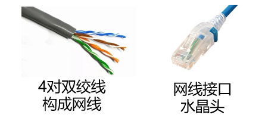
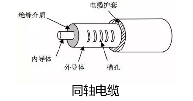
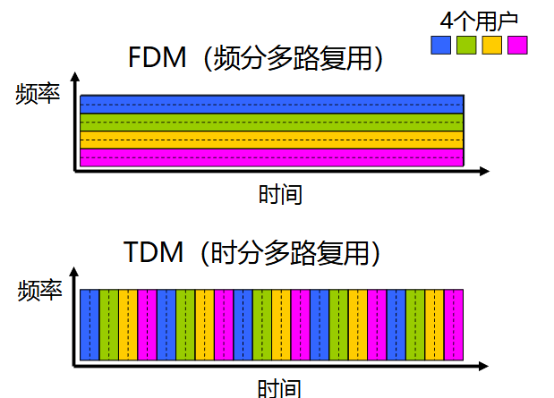
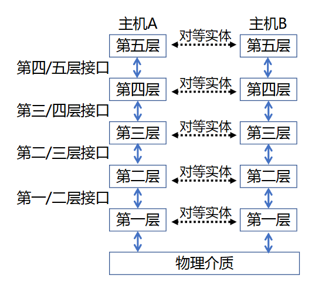
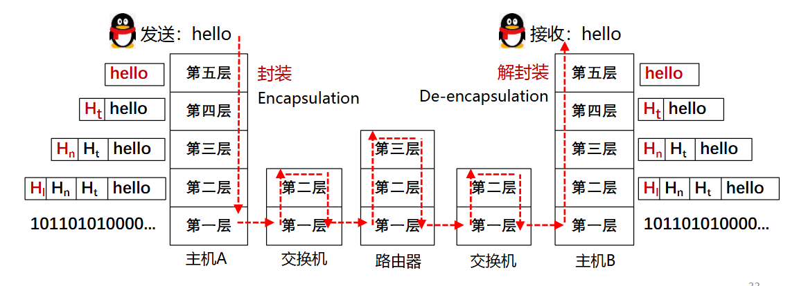
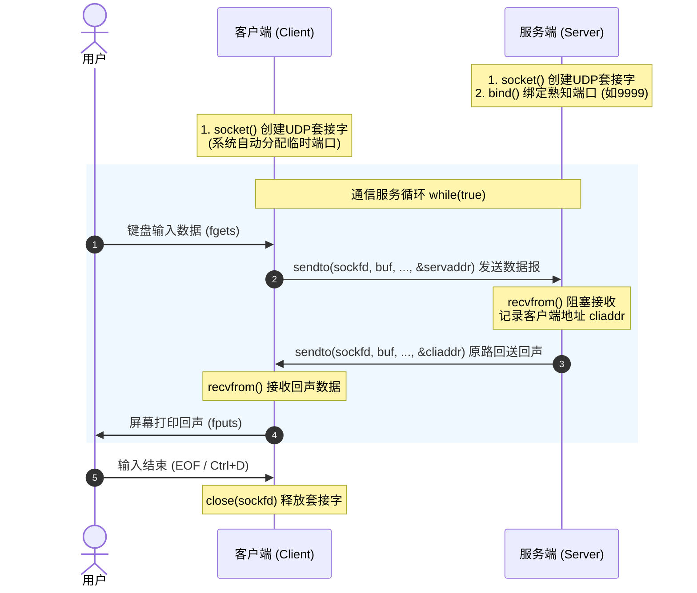
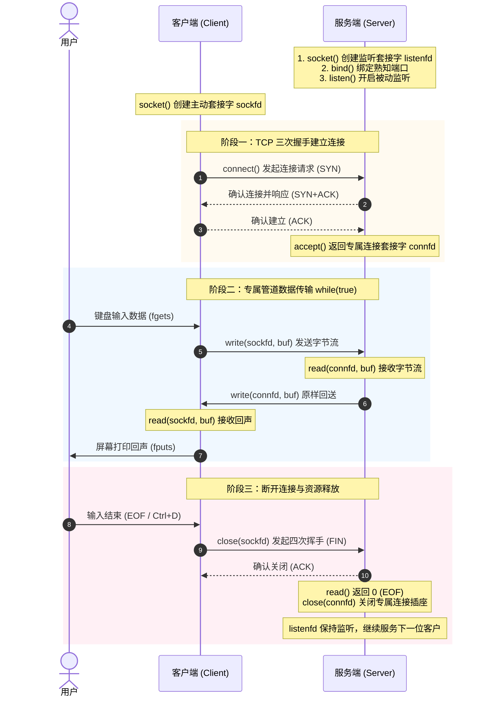
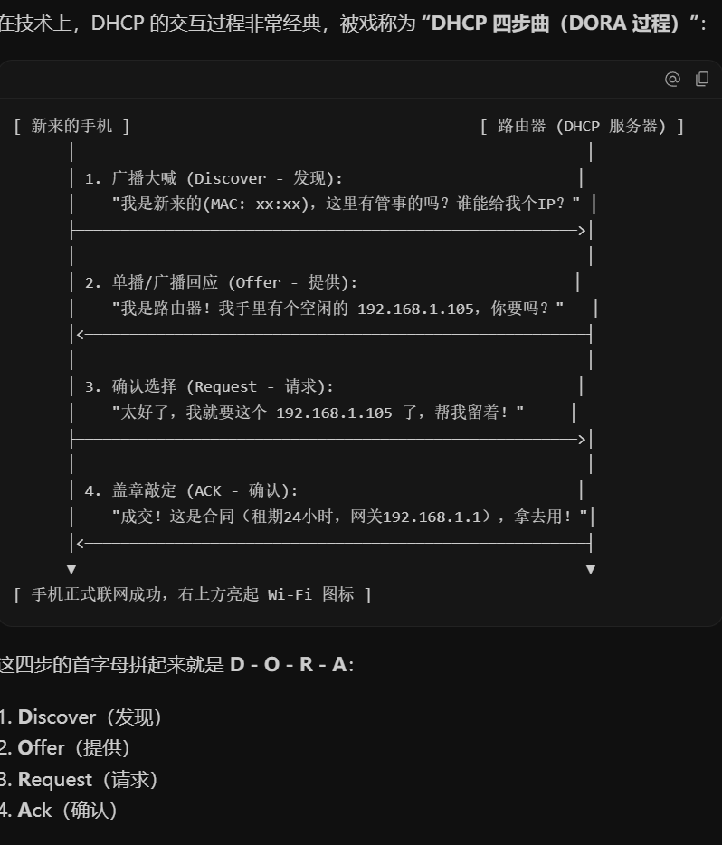

## CH1

### 网络实例

#### 网络分类与构成

-  按地域规模进行网络分类

    1. 个域网 PAN (Personal Area Network)：

        覆盖范围小，大致在半径10米内，常见于一些便携式、通信设备。比如：智能手表、手环，蓝牙耳机等

    2. 局域网 LAN (Local Area Network)：

        局部地区形成的区域网络，小到办公室，大到整个校园，一般是由单一机构管理。典型技术与应用有：有线以太网、无线 WLAN（即 Wi-Fi）、打印机共享等等。

    3. 城域网 MAN (Metropolitan Area Network)：

        其范围多能覆盖一个城市。一般是由运营商或者政府部门统筹建设，用来连接同城内的多个局域网。比如：有线电视网络等。

    4. 广域网 WAN (Wide Area Network)：

        覆盖范围极大，可以跨越省份，甚至是国家和大洲。常见设施有：海底光缆、卫星通信等。其中，因特网 (Internet) 就是全球最大的广域互联网络。

        > Internet 和 internet 的区分
        >
        > Internet：互联网/因特网，是一个专有名词。特指覆盖全球的、使用 TCP/IP 协议的互联网络。
        >
        > internet：互连网，是一个通用名词，来源于 inter-network（互联网络）。泛指把任意两个或者多个计算机网络用路由器连在一起形成的集合，它们的通信协议不一定是 TCP/IP。

- 互联网的层级结构
  
    ISP (Internet Service Provider)：网络服务提供商。

    1. Tier-1 ISP：
    
        第一层，全球最高级别的网络运营商，拥有跨大洲的全球骨干网，比如：中国电信，美国AT&T。它们之间免费交换流量，不需要交过路费

    2. Tier-2 ISP：
    
        即地区ISP，覆盖一个国家或特定大区域的网络，比如：中国移动、教育网。因为这些网络无法直达全球，所以需要向Tier-1 ISP购买转接服务，并支付流量费

    3. 本地 ISP：
    
        接入网络。直接面向家庭、公司、校园网等最终用户提供宽带上网服务。

    4. IXP / IX (Internet Exchange Point)：
    
        互连网交换点。允许同级的地区 ISP 之间在此直接交换流量，无需向上绕路主干网。这既大幅降低了通信时延，又省去了向高级 ISP 支付的流量费。

- 互联网的构成

    1. 网络边缘：
       
        即主机或端系统，比如：手机、电脑、智能手表等。主机主要用来运行程序、产生信息并发送给互联网，接收数据并提供给应用程序。

    2. 网络核心：
       
        即互联端系统的分组交换设备以及通信链路。比如：路由器、交换机；光纤、电缆。

#### 网络边缘

- **接入网 (Access Network)**
  
    就是指将主机连接到边缘路由器之间的这一段网络基础设施

    边缘路由器：主机去往远端系统路径上的第一台路由器
    
    常见的接入网有以下形态：
    
    1. 光纤入户 / FTTH Fiber To The Home
       
        主流的高速接入方式，主要分为有源光网络(AON Active Optical Network)和无源光网络(PON Passive Optical Network)；
        
        - **有源光网络**
        
           ​	中间需要有通电的交换机/路由器设备来中继放大信号。维护成本高、容易断电故障。
    
        - **无源光网络**
        
           ​	目前全球和中国最普及的家庭宽带技术。“无源”指的是从运营商机房到家的整条光纤路上，中间所有分线设备都不需要通电。通过无源分光器（本质就是一组高精度的光纤耦合器）将一根主光纤中的光信号物理拆分成8路、16路甚至64路，分别接到各个户家里
        
           ​	局端为 OLT（光线路终端 Optical Line Terminal），一般就是运营商放在局端机房，比如街道机房或者小区机房的光纤总管，同时也兼为发射机和接收机。一台OLT可以拉出成百上千跟主干光纤，通过分光器为光猫提供网络汇聚
          
          ​	用户端为 ONT (光网络终端，俗称光猫)，放在家中弱电箱的盒子
        
          ​	具有带宽大、线路极其稳定的优势。
       
    2. 数字用户线 DSL (Digital Subscriber Line)：
       
        ​	利用传统电话线的双绞铜线传输高频数据。
        
        ​	用户端通过分路器 (Splitter) 将高频数据信号与低频语音信号分离（不同频率互不干扰），数据进入调制解调器，再汇聚到局端的 DSLAM (数字用户线接入复用器) 进入互联网。
      
        ​	典型特点是上下行速率不对称（ADSL，下行快、上行慢）。我国已基本全面升级为 FTTH，欧美部分国家仍有大量使用。
    
    3. 同轴电缆 Cable 与混合光纤同轴网 HFC (Hybrid Fiber-Coaxial)：
       
        ​	利用传统的有线电视同轴电缆接入上网。采用 HFC 结构，主干段使用光纤传输，接入家庭段使用同轴电缆连接至电缆头端 (Headend)。
      
        ​	其核心特点是多家庭共享介质（同一片区的用户共享电缆头端总带宽，用网高峰期可能会抢占带宽），上下行速率同样不对称。
    
    4. 无线接入网 (Wireless Access Network)：
    
      ​	通过无线基站或无线接入点 (AP) 将移动终端连接到路由器。主要分为两大类：
  
  - 无线局域网 WLAN (Wireless LAN / Wi-Fi)：主要覆盖建筑物内或周边短距离（数十米），遵循 IEEE 802.11 系列协议（如 Wi-Fi 6 理论峰值可达 9.6 Gbps）。
  - 广域移动蜂窝网络 (Cellular Network)：由移动通信运营商基站覆盖（数公里范围），包括 4G/5G 移动网络，实现全地域无缝漫游。
  
  5. 实际企业与家庭混合组网：
  
      ​      现实中的接入网通常是有线与无线的混合体（如台式机接有线以太网，手机平板连 Wi-Fi）。家用无线路由器通常是一个高度集成的小盒子，内部集成了：Wi-Fi 无线接入点 (AP)、以太网交换机、路由器 (含 NAT 地址转换与防火墙)，甚至集成了调制解调器 (光猫)。
  
- **物理介质**

    - 传输单元：bit 

        > 存储常用Byte做单位，进制为$2^{10}$
        >
        > 传输常用Bit做单位，进制为$10^3$

    - 物理媒体：发射机和接收机之间的具体链路介质
        - 引导型介质：信号在固体介质中传播，如：铜、光纤
        - 非引导型介质：信号自由传播，如：无线电

    以下为一些常见的物理媒体：

    1. 光纤：

        玻璃纤维携带光脉冲，每个脉冲代表一位信号，用于高速点对点传输。

        中继器相距很远，对电磁噪声免疫。

    2. 双绞线：

        两根绝缘铜线互相缠绕为一对。

        电话线：1对双绞线。

        网线：4对双绞线。

        

    3. 同轴电缆：

        两根同心铜导线，双向传输。

        

    4. 无线电：

        电磁频谱中各种波段携带的信号，没有物理的电线，不依赖介质。

        易受传播环境影响，比如：反射、物体阻挡、噪声干扰等。

        无线链路类型，按照范围从小到大有：蓝牙，无线局域网/WiFi，广域/4G/5G，地面微波，卫星。

#### 网络核心

- 网络核心概述

    ​	由互联端系统的分组交换设备，比如：路由器、交换机，和各级通信链路构成的网状网络，目标是将海量端系统互联起来。

- 网络核心的两大功能：路由与转发

    ​	数据分组在网络核心中依靠**逐跳 (hop-by-hop)** 方式从一个路由器转发到下一个路由器，最终抵达目的地。核心路由器主要承担两大功能：

    1. **<span id="routing">路由 (Routing)</span>：**

        ​	全局操作。路由是一个过程：路由器中的 CPU 通过与全网其他的路由器交流，掌握全网的拓扑图；然后利用路由算法和路由协议，找出最佳路径，并生成路由表 (Routing Table)。

        > 既然转发要看路由表，那么按道理路由表既可以静态被指定也可以动态调整，即对应两种路由方式：
        >
        > - 静态路由：网络管理员在登陆路由器后台后，定死一条规则：凡是发送给某网段的包，一律发给指定端口。例如：家用的路由器一般都是静态的，即默认路由。
        >
        > - 动态路由：网络核心的成千上万个路由器之间，不停地运行路由协议，进行相互交流，交换各自链路的拥堵程度和时延，然后再根据各自情况算出一张最优的路由表。

    2. 转发 (Forwarding)：

        ​	本地操作。当路由器接收到一个数据包后，其硬件芯片通过查看包头上的 IP 地址，并通过查看路由表，找到对应的出接口，并利用内部总线将这个包发出，这就是转发。

- **典型数据交换方式**

    1. **电路交换 (Circuit Switching)：**

        ​	它的核心就是：先占用通道，然后独享通道并进行通信。

        ​	过程类似于打电话，首先进行拨号，与对方建立连接，此时网络在两者之间找到一条路径并锁定预留出来；一旦对方接通，这条通路就专属于打电话的双方；直到电话结束，该通路资源才被释放还给系统。（对于以前的座机多为电路交换，现在的手机通信基本都是分组交换）

        - 优点

            1. 稳定，通路没人抢，通信质量高

        - 缺点

            1. 资源浪费。当自己不用的时候，该资源无法被别人使用；
        2. 缺乏弹性。中间有一个交换机坏了，整个通话会直接中断，比如挂号重新拨打；
            3. 不论是下面提到的哪种多路复用，都无法应对 **突发(burst)流量**。电话是连续的，但是上网浏览页面我们需要快速加载，然后再花较长时间浏览；所以前面的加载能力受限，后面浏览又极度浪费资源，这种方法不实用

        

        ​	**电路交换的多路复用**

        ​		即一根粗光缆/铜线不可能只给一个人用，要进行多路复用，主要有FDM和TDM两种方式

        1. FDM：频分多路复用  Frequency-Division Multiplexing。切出不同的频率，就像收音机不同的电台一样。整条通路的频段切分成多个小的子频段，分别分配给多个用户，没人独占一个子频段使用；

        2. TDM：时分多路复用。时间被切成小时段，每个小时段分给一个用户，比如第1ms分给用户1，第2ms分给用户2 ...

            

        

    2. **报文交换 (Message Switching)：**

        - 报文：通常指一个完整的数据块。报文交换就是指不把数据切碎，直接将完整的数据包裹打包发给网络

        - **存储转发机制(Store-and-Forward)：**路由器需要接收到完整的整个数据报文后，才能开始向下一跳发送。

        - **传输延迟/发送延迟/单跳时延：$L/R$​（其中 $L$​ 为报文长度Length，单位bit；$R$​ 为链路传输速率Transmission Rate，单位 bps）**

        - 缺点：如果报文较大，中间路由器较多，延时会巨大

        

    3. **分组交换 (Packet Switching，也称包交换)：**

        - 将大报文拆分成多个较小的数据块，称为分组 (Packet)。
        - 在每个小分组前面添加包含源IP地址和目的IP地址的信息
        - 同样采用存储-转发机制，但由于分组体积小，多个分组可以在各链路间流水线式并发传输，极大降低了整体时延。
        - 统计多路复用 (Statistical Multiplexing)：不同于之前提到的FDM和TDM，该方法的核心是：谁有需求谁就发送。不发时不会占用资源，网络信道利用率高。
        - 优点：延迟小、灵活性高、抗毁性强，适合有海量突发数据传输需求的互连网


### 协议与分层结构

- 网络协议与设计目的

    1. 网络协议 (Network Protocol)：
       
        ​	为在网络中进行数据交换而建立的规则、标准或约定。通信双方必须共同遵守，互相理解。
        
        协议三要素：
        - 语法：规定传输数据的格式，即怎么讲。
        - 语义：规定所要完成的功能，即讲什么。
        - 时序：规定各种操作的先后顺序，即双方讲话的次序。

    2. 协议设计目标：
       
        网络协议设计主要为了解决五个核心问题：可靠性、资源分配、拥塞控制、自适应性以及网络安全。

- 协议分层结构

    1. 分层的必要性：

        ​	计算机网络极其复杂且高度异构，传输介质多样，接入方式各异，新技术层出不穷。分层结构能够将复杂的大系统拆分成清晰独立的模块：各层功能独立，接口统一，下层技术的演化不会影响上层应用。

    2. 体系结构核心术语：

        - 层次栈 (Protocol Stack)：网络使用分层结构，每一层都使用下一层提供的服务，并为上一层提供自己的服务。
        - 对等实体 (Peer)：不同机器上处于同一层次的活动实体。比如图示主机A和主机B 的第4层就叫做对等实体
        - 接口 (Interface)：相邻两层之间的边界，定义了下层向上层提供哪些具体服务原语。对应到图中垂直方向的尖头
        - 网络体系结构：层和协议的集合称为网络体系结构，具体系统使用的一组协议实现称为协议栈。

        

    3. 数据的封装与解封装：

        ​	从第五层开始往下依次为：应用层、传输层、网络层、数据链路层、物理层；

        整个数据的封装过程大致为：

        1. **应用层(application layer)**：产生原始数据，比如：hello；
        2. **传输层(transport layer)**：在外面套上第四层头部，例如写明：发往端口80，用来防止丢包的TCP序号
        3. **网络层(network layer)**：继续套第三层头部，比如：源IP与目的IP地址；
        4. **数据链路层(data link layer)**：套第二层：比如：下一跳的MAC物理网卡地址；
        5. **物理层(physical layer)**：将上面的整串完整包裹，转换成物理介质上的二进制光/电信号，并发射出去

        

        接收端进行层层解封装，最终还原出原始数据；

        > **<span style="color:#FF0000;">协议数据单元 PDU (Protocol Data Unit)</span>**：不同层对应的数据传输单元，即某一层协议工作时认同和处理的标准数据包裹
        >
        > 1. **应用层为消息或报文 (Message)；**
        > 2. **传输层为报文段或段 (Segment)；**
        > 3. **网络层为包或数据报或分组 (Packet)，加上IP地址头，打包成IP数据包**
        > 4. **数据链路层为帧 (Frame)；**
        > 5. **物理层为比特或比特流 (Bit)。**

- 服务原语与服务和协议的关系

    1. 两类基本服务：
    
        - **面向连接服务**：按照电话系统模型建立。通信前先建立连接并确认，数据传输过程保持同步与确认，通信结束后释放连接。对应到现实就是传输层著名的TCP协议（三次握手，可靠传输，四次挥手）
        - **无连接服务**：按照邮政系统模型建立。数据包携带完整的目标地址直接发出，传输过程无需提前建立连接，也不需要逐跳应答。对应到计网现实就是网络层的IP协议以及传输层的UDP协议

    2. 服务原语 (Service Primitives)：
    
        原语：就是计网中相邻两层之间打交道时的一套基础标准动作指令/系统调用

        ​	用户进程用来访问下层服务所调用的一组基本操作。面向连接的核心原语包括：连接请求、接受响应、请求数据、应答、请求断开、断开连接。
    
    3. 服务与协议的关系：
    
        - 协议是水平的：对等实体之间通信必须遵守的规约。
        - 服务是垂直的：下层实体向上层实体提供的功能，上层实体通过接口使用下层实体的服务。
        - 实体使用本层的协议来实现它向上层承诺提供的服务。

### 参考模型

- **OSI 7 层参考模型 (Open Systems Interconnection 开放系统互连)**

    由国际标准化组织 ISO 提出的 7 层理论模型：

    1. 物理层 physical layer

        ​	核心任务就是解决数字信号0/1和光电信号的转换

        ​	除此之外，物理层还会规定一些标准，比如：机械接口、电气信号标准、时序接口、传输介质等

    2. 数据链路层 data link layer

        ​	负责相邻结点到相邻节点(Hop-to-Hop)的数据传输，相邻就是指没有经过路由器，直接用一根网线/同一WIFI/交换机 连在一起的两台设备，叫做一跳(One Hop)：电脑和家用路由器也算，路由器和运营商机房也算。

        ​	主要职责如下：

        - 成帧 Framing：给比特流断句，在一段数据开头加上帧头 Header，结尾加上帧尾 Trailer，打包成一个帧
        - 错误检测与纠正：在帧尾放置一个校验码，接收端收到帧后重新算一遍校验码，如果对不上就说明路上传输出错了，要求重传
        - MAC地址：共48位，常写成`00:1A:2B:3C:4D:5E`这种十六进制。该层需要在帧头写明源MAC地址和目标MAC地址
        - 流量控制：接收方控流接收数据，避免缓存爆满
        - 共享信道上的访问控制（MAC Medium Access Control）：MAC地址的名字就来源于这个子层。主要防止多台设备同时发射电磁波，在空中装车变成乱码，这时候就要遵循MAC协议，进行举手发言规则，先确认信道中没有人说话，然后再发送

    3. 网络层 Network Layer

        ​	负责从源主机到目的主机(Host-to-Host)的数据传输，比如从我的电脑，跨过很多个路由器，送到北京的百度服务器。

        ​	主要职责如下：

        - 路由 Routing：之前已经提到过[路由](#routing)
        - 路由协议：路由器之间的通信规范
        - 服务质量控制 QoS Quality of Service：负责区分优先级，紧急的内容优先转发；并做负载均衡，将流量分摊到多条路上
        - 异构网络互联：对于5G蜂窝网、家用WIFI、机房光纤，它们的物理层和数据链路层的帧格式完全不同，而IP协议的封装标准是统一的，所以可以在全球穿梭

        > 为什么有了 MAC 地址还需要 IP 地址？MAC 地址是烧录在网卡上的扁平物理地址，没有层次结构；IP 地址具有层次化的网络拓扑结构，能够支持全球路由器进行高效的路由汇总和查表寻路。

    4. 传输层 Transport Layer

        ​	负责从源进程到目的进程 (Process-to-Process)，比如从电脑的Chrome进程到百度服务器上的Web进程；

        ​	传输层在数据包头上加上源端口号和目的端口号，通过端口号区分主机上的不同进程。

        ​	分为**可靠传输模式**与**不可靠传输模式**：

        - **TCP transmisson control protocol:**

            ​	可靠传输模式的代表协议，稳定，不出错。发包前先三次握手建立连接；丢包了会自动重传；乱序了会自动排好序；对方忙不过来会减速/控流；网络堵了会避让/拥塞控制。**缺点：慢、开销大。**

            ​	主要用于比较严谨的场景，比如网页浏览(HTTP/HTTPS)，文件下载(FTP)，发邮件等

        - **UDP user datagram protocol：**

            ​	不可靠传输模式的代表协议，快。不建立连接，把应用层数据加个 8 字节的端口号头部直接往网上一扔，不管对方收没收到，丢了也不重传。**优点：极快、无延迟、头部极轻量。**

            ​	主要用于卡顿可接受，延迟不接受的场景，比如音视频通话，FPS网游

    5. 会话层 Session Layer

        ​	在应用程序之间建立、管理和维持会话，并使会话获得同步

    6. 表示层 Presentation Layer

        ​	关注所传递信息的语法和语义，管理数据的表示方法、数据结构转换、加密解密和数据压缩

        - 数据格式转换与语法转换：比如把对象序列化成通用格式，JSON、XML等，把图片转成JPEG/PNG格式
        - 数据加密与解密：比如HTTPS中的TLS/SSL 加密
        - 数据压缩与解压缩：比如网页传输前先用Gzip压缩一下大小，对方接收后再解压

    7. 应用层 Application Layer

        应用层$\neq$应用程序，而是指这些APP用来通信的协议规矩。

        直接面向用户的网络应用程序，提供便捷的网络服务调用接口。


- **TCP/IP 参考模型**

    **Transmission Control Protocol**  传输控制协议

    **Internet Protocol**  互联网协议

    ​	TCP/IP参考模型诞生于冷战背景之下，用其中最主要的两个协议TCP/IP命名。最初是ARPA（美国国防部高级研究计划局）建立了ARPANET，即阿帕网，这就是现代互联网的鼻祖，后面Vint Cerf何Bob Kahn在1974年发表论文，设计了TCP/IP协议，1983年ARPANET正式规定所有接入网络的电脑全部改用此协议。

    互联网实际采用的 4 层事实标准：

    1. 层次划分：
       
        - 网络接口层 (Host-to-Network Layer) / 链路层：描述了链路为无连接的互联网层必须提供的基本功能，定义主机与传输线路之间的接口。
        - 互联网层 (Internet Layer)：以 IP 协议为核心，允许主机将数据包注入网络并独立传输至目的地。
        - 传输层 (Transport Layer)：允许源主机与目的主机上的对等实体进行端到端通信，提供 TCP 协议（面向连接可靠字节流）与 UDP 协议（无连接不可靠数据报）。
        - 应用层 (Application Layer)：包含所有高层协议（如 DNS、HTTP、FTP、SMTP 等），吸收了 OSI 模型中表示层与会话层的功能。

    2. 设计哲学（端到端原则）：
       
        - 摒弃了电话系统中笨终端与聪明网络的设计思路，采用聪明终端与简单网络。
        - 网络核心功能尽可能简单，只负责通过路由表快速转发 IP 分组，丢失恢复等复杂工作交给边缘端系统，极大提升了网络的可扩展性。
        - IP 沙漏模型：中间唯一的 IP 层实现了 IP over everything（可以在各种底层物理网络上运行）以及 Everything over IP（可以支撑各种各样的上层网络应用）。

    3. OSI 模型与 TCP/IP 模型的对比与不足：
       
        - OSI 的不足：时机糟糕（推出时 TCP/IP 已随 UNIX 广泛普及并免费使用）；模型过于复杂，会话层和表示层内容很少，数据链路层和网络层又过于繁杂，且差错控制等功能在不同层反复出现；属于官方强加标准。
        - TCP/IP 的不足：未严格区分服务、接口和协议等核心概念；通用性较差，不适合描述其他协议栈；网络接口层混淆了接口与分层，且未包含物理层与数据链路层等重要底层细节。

    4. 教学采用的 5 层折中模型：
       
        结合 OSI 的概念清晰性与 TCP/IP 的实用性，自顶向下分为：应用层、传输层、网络层、数据链路层、物理层。

### 计算机网络性能度量指标

- 速率、带宽与吞吐量

    1. 比特率 Bit Rate
        - 也称数据率，主机在数字信道上传送数据的速率
        - 单位是b/s，也写作bps（bit per second），还有kbit/s、Mbit/s 等，进率遵循十进制，即 1Kbps = 1000bps
    2. 带宽 Bandwidth
        - 网络通道传送数据的能力，即**单位时间**内某条信道所能通过的最高数据率，单位同样为 bit/s
    3. 包转发率与线速 Packet Per Second, PPS
        - 交换机或路由器等设备以包为单位的处理与转发速率。线速转发指网络设备端口在满负荷工况下，对数据包转发速率达到了该物理线路允许的最高极限速度。
    4. 吞吐量 Throughput 与有效吞吐量 Goodput

        - 吞吐量：单位时间内通过某个网络、信道或接口的实际数据量总量，单位是b/s
        - 有效吞吐量：单位时间内目的端真正正确接收到的有用数据量，排除了因丢包产生的重复重传数据和协议冗余开销。

- 网络时延体系

    **时延 (Delay / Latency)** 指数据从网络一端传送到另一端所需的总时间。数据在端到端传输过程中的总时延由四部分相加构成：

    1. **传输时延 / 发送时延：**
       
        ​	主机或路由器将数据分组推送到传输物理介质上所需要的时间。
        
        ​	计算公式为：数据分组长度 L (bit) 除以 链路传输速率 R (bit/s)，即 $d_{trans} = L / R$。

    2. **传播时延：**
       
        ​	电磁波在物理信道介质中传播一定距离所花费的时间。
        
        ​	计算公式为：两节点间的物理距离 Distance (m) 除以 电磁波在该介质中的传播速度 c (m/s)，即 $d_{prop} = \text{Distance} / c$。
        
        > **在光纤和铜线介质中，电磁波的传播速度通常约为光速的三分之二，即大约每秒 20 万公里 ($2 \times 10^8\text{ m/s}$)。**

    3. 节点处理时延：
       
        ​	主机或路由器在收到数据分组后，对分组进行分析所花费的时间。包括检查首部差错、校验数据完整性以及检索本地路由表决定输出接口等。现代高速路由器该时延通常在微秒级别。

    4. 排队时延：
       
        ​	数据分组在路由器的输入输出缓冲区队列中等待处理和发送所经历的时间。排队时延完全取决于网络当前的拥塞程度和瞬时到达流量，变动幅度极大且难以精确预测。

- 往返时延与时延带宽积

    1. 往返时延 RTT (Round-Trip Time)：
       
        ​	从发送方发送一个数据包开始，到发送方收到接收方返回的确认信息所经历的总耗时。

       ​	网络诊断工具 Ping 主要就是通过计算 ICMP 报文的 RTT 来评估链路连通质量与时延水平。
       
    2. 时延带宽积 (Bandwidth-Delay Product)：
       
        ​	传播时延与链路带宽的乘积，计算公式为：时延带宽积 = 传播时延 $\times$ 带宽。
        
        ​	其物理意义为按比特计数的链路物理容量。代表发送端连续发送数据时，当发出的第一个比特刚好抵达链路终点瞬间，整条物理管道中正在向前传播的比特总数。只有当链路管道充满比特时，信道才得到了最充分的利用。

- 丢包率、利用率与时延抖动

    1. 丢包率 (Packet Loss Rate)：
       
        ​	传输过程中丢失的数据包数量占全部发送数据包总数的比率。网络丢包绝大多数并非物理线缆损坏，而是因为路由器排队队列溢出，新到达的分组无处存放而被主动丢弃。

    2. 利用率 (Utilization)：
       
        ​	某信道被实际使用的时间占总时间的百分比。网络利用率过高会导致排队时延急剧上升，通常当利用率超过百分之五十时，网络时延就会显著恶化。

    3. 时延抖动 (Jitter)：
       
        ​	时延在时间上的变化不稳定性。主要源于网络中各路由器排队队列长短的剧烈起伏。时延抖动对于网页浏览等非实时应用影响有限，但对语音通话、视频会议和在线游戏等多媒体交互业务会带来严重的卡顿脱节体验。

### 网络安全基础

- 常见网络威胁与攻击形式

    1. 互联网早期的安全缺陷：

        因特网最初由科研和军方机构设计时，假设环境是一组相互信任的用户连接到一个透明的网络中，底层 TCP/IP 体系未内置强制加密与身份防伪机制，为后续安全威胁埋下了根源。

    2. 常见恶意软件：

        - 病毒 (Virus)：需要依赖用户的主动交互（如打开带毒邮件附件、运行未知程序）才能完成感染并寄生扩散的恶意代码。
        - 蠕虫 (Worm)：无须用户进行显式交互即可独立在网络中运行和传播的程序。通过持续扫描网络中存在系统漏洞的主机进行自动化自主入侵，典型代表如利用永恒之蓝漏洞传播的 WannaCry 勒索病毒。

    3. 拒绝服务攻击 DoS 与分布式拒绝服务攻击 DDoS：

        Denial of Service attack

        ​	攻击者制造海量虚假垃圾流量占用网络带宽或系统处理能力，使正常合法用户的请求无法获得响应。攻击者通常先通过病毒程序感染大量联网设备构建僵尸网络 (Botnet)，再通过僵尸网络集中对目标主机发动分布式流量轰炸。

    4. 数据截获与伪造：

        - 数据包嗅探 (Packet Sniffing)：在共享局域网中，攻击者通过将网卡设置为混杂模式，被动读取并记录传输线路上经过的所有明文数据包。
        - IP 欺骗 (IP Spoofing)：攻击者伪造数据包首部的源 IP 地址，用于冒充合法可信系统身份或干扰安全追溯。

- 核心网络安全防御手段

    1. 身份认证：通过凭证、令牌等机制确认通信实体身份的真实性。
    2. 数据加密：利用对称加密或非对称加密算法保证数据在线路传输中的机密性。
    3. 完整性检查与数字签名：通过哈希校验与数字签名机制检测数据传输过程中是否被恶意篡改，并提供抗抵赖性。
    4. 防火墙与隔离：部署在网络边缘和核心边界处的专用安全检查屏障，依据既定安全规则严格过滤异常网络流量，隔离保护内部网络。

### 标准化组织与互联网演进

- 核心标准化组织与 RFC 机制

    1. 官方国际标准组织：
       
        - ISO (国际标准化组织)：制定了国际标准 ISO 7498，即著名的 OSI 7 层网络参考模型。
        - ITU (国际电信联盟)：联合国专门机构，下属 ITU-R 负责无线频谱分配，ITU-T 负责制定全球电信网络标准。

    2. 工程与行业组织：
       
        - IEEE (电气和电子工程师协会)：全球最大的专业技术组织，在通信领域最著名的贡献是制定了 IEEE 802 系列局域网标准，包括以太网标准 802.3 与无线局域网 Wi-Fi 标准 802.11。
        - W3C (万维网联盟)：负责制定 Web 技术的通用标准，包括 HTML、CSS、DOM 等规范。

    3. 互联网事实标准与 IETF：
       
        - IETF (互联网工程任务组)：制定互联网核心标准（如 TCP、IP、HTTP 等）的民间国际权威机构。
        - RFC 文档 (Request For Comments，请求评注)：互联网核心标准的公开发布形式，向全球免费公开。任何标准均需经过工作组充分讨论、邮件列表论证以及实际代码运行验证，最终才被正式确立为 RFC 事实标准。
        - IETF 的核心文化：信奉粗略共识与可运行代码，拒绝单一行政权威与空洞投票，一切以代码工程实测有效为准。

- 互联网发展里程碑

    1. 早期诞生阶段：
       
        - 1969 年：美国国防部高级研究计划局建立 ARPANET，首次在实际工程中采用分组交换技术，最初连接 UCLA、SRI、UCSB 与犹他大学 4 个节点。
        - 1983 年：ARPANET 全面改用 TCP/IP 协议族，标志着现代互联网的正式诞生。

    2. 商业化与技术演化阶段：
       
        - Web 1.0 时代（1993 到 1999 年）：以 Mosaic 和网景浏览器商用为起点，以静态网页浏览、门户网站为主，通信以用户单向下载数据为主，对下行带宽要求高。
        - Web 2.0 时代（2000 到 2007 年）：以社交媒体、博客、网络视频为代表，用户开始大量主动产生并上传内容，对双向带宽提出更高要求。
        - 移动互联网时代（2007 年至今）：由 3G、4G、5G 蜂窝网络与智能手机浪潮推动，网络走向随时随地连接，并进一步向云服务、物联网、智能网联汽车等万物智联领域扩展。

    3. 我国互联网发展关键节点：
       
        - 1987 年：建成国内第一个电子邮件节点，发出中国第一封电子邮件（越过长城，走向世界）。
        - 1994 年：通过 64K 专线正式全功能接入国际互联网；同年启动中国教育和科研计算机网 CERNET 建设。
        - 近年发展：全面建成全球最大规模的 5G 网络与光纤宽带基础设施，大规模推进纯 IPv6 主干网部署。


## 网络应用与套接字编程

> 网络请求通信大致过程：
>
> 1. 网络应用程序启动，向操作系统申请了一个端口号（比如：5001）；
> 2. 应用程序产生一个请求，并进行发送；
> 3. 其中请求带有源IP（主机内网IP地址，由路由器分配，比如192.168.1.2）和目标IP地址信息，一般目标IP都是自家的路由器
> 4. 路由器再进行NAT/网络地址转换，将源IP地址换成全家公用的公网IP地址（比如115.233.12.34），并挑选一个端口（比如60001）；同时记录NAT映射表，将新端口与旧端口以及对应主机的内网IP映射，如果有人发送到新端口，路由器就知道了要将数据发送给该主机；
> 5. 服务器接收请求并发送数据，抵达的目标是路由器
> 6. 路由器查看回包，发现目标是 115.233.12.34:60001，查表得到这个数据是属于内网192.168.1.2的，路由器将此时的目标IP改为192.168.1.2，以及修改端口号
> 7. 此时路由器再局域网WIFI中喊话/ARP协议，寻找192.168.1.2对应的网卡MAC地址是多少，收到主机应答后，贴上该MAC地址，通过WIFI电波发送给主机
> 8. 电脑网卡收到后，查看包上的端口号，投递给对应的应用进程

### 应用程序架构

主流的架构是**客户-服务器体系结构，即：C/S架构，Client/Server**。

- 服务器：是一台一直工作的主机，运行服务器程序，具有永久的IP地址和端口号，被动等待客户请求；
- 客户端：运行在用户终端上的程序，需要时会向服务器发出请求，客户之间彼此不通信


### 进程标识

​	利用IP地址我们可以确定到主机，但是主机中的多个程序无法区分，于是我们使用端口号来区分不同进程，比如`192.168.2.1:6001`

​	网络通信中的完整端点标识由主机 IP 地址与端口号构成的二元组决定


### 套接字

​	之前我们提到过五层模型，对于传输层和网络层，它们都基本被锁在操作系统内核中。所以如果我们要和传输层沟通，还需要寻找一个接口，这个接口就是Socket。Socket的本质就是操作系统提供给程序员的以套网络编程API接口。

​	Socket，翻译过来就是插孔/插座。通俗理解，这里其实指操作系统发过来的一个办事窗口，而我们编写程序时用到的函数名就是具体操作的动作。

​	下文中常出现的`fd`指的是 file descriptor 文件描述符

#### 套接字地址

​	主机要想跟服务器通信，首先程序需要在发包前讲对方的IP地址和对方的端口号装进一个C语言结构体变量里。

套接字地址主要有两种：

- 通用地址

    由于在设计Socket API时，网络世界拥有多种协议，比如还有IPv6、UNIX本地通信等，不同的协议，地址的长短完全不一样

    所以操作系统设计了一个虚父类：

    ```c
    struct sockaddr {
        u_char  sa_len;      // 整个信封的总长度
        u_short sa_family;   // 地址家族（如 AF_INET 代表 IPv4，AF_INET6 代表 IPv6）
        char    sa_data[14]; // 14 字节的混杂大口袋：把 IP 和端口全挤在这 14 个字节里
    }; // 总大小：16 字节
    ```

    

    缺点是sa_data[14]中将IP和端口号混在了一起，程序员不方便将对应的IP和端口填进去

- IPv4地址

    专门定制的大小一样但是划分更清晰的子类 struct sockaddr_in

    ```c
    struct sockaddr_in {
        sa_family_t    sin_family; //显式申明这是IPv4
        in_port_t      sin_port;   //2子节,用来填写端口号,使用大端字节序,利用函数htons()转换
        struct in_addr sin_addr;   //4子节,存放32位IPv4地址
        char           sin_zero[8];//8个子节的0,用来凑大小
    }; // 总大小:16子节
    ```


两种地址的配合方式：自己在编写时使用更方便的IPv4地址，在交给系统函数时使用强制类型转换即可：

```c
struct sockaddr_in servaddr; // 用IPv4的专用信封填数据
servaddr.sin_family = AF_INET;
servaddr.sin_port = htons(9999);
...
// 传给函数时，强制类型转换成通用地址形式交差：
bind(sockfd, (struct sockaddr *)&servaddr, sizeof(servaddr));
```


#### 创建套接字

在C语言中调用函数来向OS要一个套接字：

```c
#include <sys/socket.h>
int socket(int domain, int type, int protocol);
```


其中包含了三个参数：

1. `domain`：地址协议族，网络层选择谁？填写不同内容表示使用不同的网络层协议

    `AF_INET`：使用IPv4

    `AF_INET6`：使用IPv6

    `AF_UNIX`：代表同一台Linux电脑内部两个进程通信，不走网卡

2. `type`：服务类型，传输层选择谁？

    `SOCK_STREAM`：流式套接字。代表底层使用TCP协议

    `SOCK_DGRAM`：数据报套接字。代表底层使用UDP协议

3. `protocol`：具体协议

    通常填0，前两个参数就能够确定唯一协议了，系统会自动选默认协议


返回值： 成功返回正整数，这个整数就是**套接字描述符 Socket Descriptor**；否则为-1，并设置错误码`error`


#### 套接字描述符

“一切皆文件”：在 Linux 系统中，程序通过访问套接字描述符来进行网络通信。套接字描述符在类型上与普通文件描述符完全兼容，因此在套接字描述符上的发送、接收数据行为，可以直接使用普通的文件读写系统调用来完成。

```c
#include <unistd.h>
int read(int fd, void *buf, size_t count);
int write(int fd, void *buf, size_t count);
```


- `read`：从描述符 `fd` 中读取（接收）长度为返回值的字节数至 `buf` 中。
- `write`：向描述符 `fd` 中写入（发送）`buf` 中长度为返回值的字节数。


#### 绑定套接字地址：bind()

用来将服务器本地套接字地址（IP + 端口号）与创建好的套接字描述符 `socket_fd` 绑定。

```c
#include <sys/socket.h>
int bind(int socket_fd, const struct sockaddr *sa, socklen_t sa_len);
```


参数说明：

1. `socket_fd`：调用 `socket()` 创建返回的套接字描述符
2. `sa`：本地套接字地址结构体指针（传入时将填好的 `struct sockaddr_in` 强制类型转换为通用地址类型 `const struct sockaddr *`）
3. `sa_len`：地址结构体的长度，即 `sizeof(servaddr)`

返回值：成功返回 0；出错返回 -1，并设置错误码 `errno`。

> 为什么只有服务器需要调用 `bind()`，而客户端不需要？
>
> - **服务器必须显式调用 `bind()`**：服务器属于被动等待连接的一方，必须拥有固定的熟知端口，客户端才能根据公开的地址寻址并接入。
> - **客户端通常不需要调用 `bind()`**：客户端属于主动发起连接的一方，使用哪个临时端口无所谓，操作系统会在其发起通信时，自动在 1024 ~ 5000（或临时端口池）之间分配一个未被占用的端口号。


#### 关闭套接字：close()

客户和服务器在通信结束之后，都可以调用 `close()` 关闭一个套接字并释放资源。

```c
#include <unistd.h>
int close(int fd);
```

根据套接字类型不同，底层的处理行为有所差异：

- **当实参 `fd` 为 TCP 套接字描述符时**：调用 `close()` 会引起本地进程向远程进程发送关闭连接的消息（触发 TCP 四次挥手）。
- **当实参 `fd` 为 UDP 套接字描述符时**：调用 `close()` 会引起为此描述符分配的资源被操作系统内核直接释放。

返回值：成功返回 0；出错返回 -1。


1. 创建套接字 socket：

    向内核申请创建套接字，返回套接字描述符。参数包括地址族（如 IPv4 对应的 AF_INET）、套接字类型（TCP 对应 SOCK_STREAM，UDP 对应 SOCK_DGRAM）以及特定协议号。该描述符在 Linux 中与普通文件描述符兼容，可直接使用 read 和 write 进行数据读写。

2. 绑定地址 bind：

    将套接字描述符与本地地址及端口进行绑定。服务器必须显式调用以公布自己的熟知端口供客户端寻址；客户端通常无需调用，由操作系统自动为其分配 1024 到 5000 之间的临时端口。

3. 监听套接字 listen：

    TCP 服务器专用调用。将主动套接字转变为被动监听套接字，并设置参数 backlog 用于限定系统未完成连接队列的最大长度。

4. 接受连接 accept：

    TCP 服务器专用调用。从已完成三次握手的连接队列中取出一个就绪的客户端连接，返回一个全新的套接字描述符（已连接套接字），专门用于与该客户端进行后续数据交互。

    > 核心区别：监听套接字全程只有一个，负责持续等待新的连接；已连接套接字在每次建立连接后单独生成，数据交互完毕后即可关闭。此机制允许服务器并发服务多个客户。

5. 发起连接 connect：

    TCP 客户端专用调用。客户端通过该接口向目标服务器的 IP 和端口主动发起建立连接的请求，底层触发 TCP 三次握手过程，调用过程为阻塞状态直至连接建立完毕或超时出错。

6. 数据收发与关闭 close：

    - TCP 收发：直接面向连接通道调用 read 和 write，或者使用 send 和 recv。
    - UDP 收发：由于无连接，每次收发必须显式指定目标地址或获取来源地址，分别调用 sendto 与 recvfrom。
    - 关闭连接 close：对于 TCP 套接字，调用会向对端发送断开连接通知并触发四次挥手；对于 UDP 套接字，调用则直接通知内核释放该描述符占用的系统资源。


#### 基于 UDP 的套接字通信流程

以回音服务为例

> **回音服务**：客户端发给服务端的内容，服务端原封不动的将内容再发还给用户端

UDP 属于**无连接、不可靠的数据报服务**。通信双方无需事先建立连接通道，每次通信以独立数据报为单位。

##### 专属数据收发接口

因为 UDP Socket没有固定的对端连接，每次发送必须指定目标地址，每次接收也需要记录来源地址以便回复：

```c
#include <sys/socket.h>
// 发送数据
ssize_t sendto(int socket_fd, const void *buff, size_t nbytes, int flags,const struct sockaddr *to, socklen_t addrlen);

// 接收数据
ssize_t recvfrom(int socket_fd, void *buff, size_t nbytes, int flags, struct sockaddr *from, socklen_t *addrlen);
```


- **`sendto()` 参数说明**：
  1. `socket_fd`：调用 `socket()` 创建返回的 UDP 套接字描述符，指示通过哪一个插座发送数据。
  2. `buff`：指向存放待发送数据的内存缓冲区指针。
  3. `nbytes`：本次实际发送数据的字节数。
  4. `flags`：传输控制标志位，通常填 `0`（使用默认阻塞行为）。
  5. `to`：指向目的套接字地址结构体（包含对端 IP + 端口）的指针。
  6. `addrlen`：目的套接字地址结构体的内存大小（字节数），即 `sizeof(servaddr)`。
  - *返回值*：成功返回实际发送的字节数；出错返回 -1。

- **`recvfrom()` 参数说明**：
  1. `socket_fd`：调用 `socket()` 创建返回的 UDP 套接字描述符，指示从哪一个插座接收数据。
  2. `buff`：指向用于接收数据的内存缓冲区指针。
  3. `nbytes`：该缓冲区能够容纳的最大字节数（避免内存溢出）。
  4. `flags`：传输控制标志位，通常填 `0`。
  5. `from`：出参指针，调用返回时，操作系统会将发送方的套接字地址（对端 IP + 端口）自动写入该结构体中；如果不关心对端地址可填 `NULL`。
  6. `addrlen`：传入传出参数，调用前传入 `sizeof(cliaddr)`，调用返回后系统更新为对端地址的实际字节数；如果不关心可填 `NULL`。
  - *返回值*：成功返回实际读取接收到的字节数；出错返回 -1。

##### 2. 通信时序与交互流程



##### 3. 核心机制要点

- **服务端并发能力**：UDP 服务端全程只需要**一个套接字描述符**。`recvfrom()` 收到的消息可以来自不同客户端，单次 `sendto()` 响应完毕后即可立即处理下一个客户端请求。
- **地址通配 `INADDR_ANY`**：服务端在 `bind` 时常将 IP 设置为 `htonl(INADDR_ANY)`，表示监听本机所有网卡接口上的传入流量。
- **客户端 IP 转换 `inet_pton`**：客户端通过 `inet_pton(AF_INET, argv[1], &servaddr.sin_addr)` 将人类可读的点分十进制字符串 IP 转换为 32 位网络字节序二进制整数。


#### 基于 TCP 的套接字通信流程

同样以回音服务为例

TCP 属于**面向连接、可靠的字节流服务**。在传输数据之前，必须通过三次握手建立端到端的专用虚拟管道。

##### 1. 核心设计：监听套接字 vs 连接套接字

TCP 服务器并发服务的核心在于将套接字划分为两类：

- **监听套接字（`listenfd`）**：相当于酒店大堂的“迎宾员”，专门驻守在熟知端口上等待并接收新的客户端连接请求。
- **已连接套接字（`connfd`）**：相当于“包厢专属服务员”，每当成功接收一个客户端连接，内核便生成一个全新的 `connfd`，专门用于与该客户端进行一对一的数据收发。数据交互结束后关闭 `connfd`，而 `listenfd` 持续保持监听。

##### 2. 专用系统调用接口

```c
#include <sys/socket.h>

// 1. 服务端设置监听
int listen(int socket_fd, int backlog);

// 2. 客户端发起连接
int connect(int socket_fd, const struct sockaddr *servaddr, socklen_t addrlen);

// 3. 服务端接受连接
int accept(int socket_fd, struct sockaddr *cliaddr, socklen_t *addrlen);
```

- **`listen()` 参数说明**：
  1. `socket_fd`：待转为监听状态的套接字描述符（将默认的主动套接字转变为被动套接字）。
  2. `backlog`：监听队列的最大长度（即已完成三次握手、等待进程调用 `accept` 取出的连接队列上限）。
  - *返回值*：成功返回 0；出错返回 -1。

- **`connect()` 参数说明**：
  1. `socket_fd`：客户端通过 `socket()` 创建的本地套接字描述符。
  2. `servaddr`：指向目标服务器套接字地址结构体（包含服务器公网/内网 IP 与熟知端口）的指针。
  3. `addrlen`：服务器地址结构体的大小，即 `sizeof(servaddr)`。
  - *返回值*：成功返回 0；出错返回 -1。底层触发 TCP 三次握手，调用过程会一直阻塞直至连接建立成功或超时出错。

- **`accept()` 参数说明**：
  1. `socket_fd`：处于监听状态的服务端套接字描述符（`listenfd`）。
  2. `cliaddr`：出参指针，用于保存成功接入的客户端 IP 地址与端口号；若不关心可填 `NULL`。
  3. `addrlen`：传入传出参数，调用前传入 `sizeof(cliaddr)`，返回时内核将其修改为对端地址的实际大小；若不关心可填 `NULL`。
  - *返回值*：成功返回一个**全新的套接字描述符（连接套接字 `connfd`）**，后续的数据传输（`read` / `write`）均通过该描述符进行；出错返回 -1。若已完成连接队列为空，调用会处于阻塞等待状态。

##### 3. 通信时序与交互流程



##### 4. 核心机制要点

- **管道模型与读写简化**：一旦连接建立成功，TCP 连接等价于双向字节流管道。数据收发无需再指定地址，直接调用底层标准文件读写函数 `write()` 和 `read()`（或 `send()` / `recv()`）。
- **生命周期解耦**：客户端退出触发四次挥手后，服务端读到 `read() == 0`（即 EOF），从而关闭对应的 `connfd` 并释放资源，主服务循环继续等待下一个客户。


## 补充说明

Q：既然每个设备有独立的IP，那么如果某个设备损坏了，这个IP还会被空出来重新分配使用吗？如果会的话，怎么知道这个设备是损坏了？不再被使用了？

​	会。无论是公网IP还是内网IP，都会被迅速回收。

​	一般情况下，当我们的手机正常关闭WIFI，操作系统都会向路由器DHCP服务器给出包 DHCP Release，路由器就会将这个IP标为空闲；

​	对于设备意外损坏的情况，路由器是通过一种租期机制来了解情况的。不同的环境、设备有不同的租借时间；一般情况下，如果租期过去50%后，设备还在正常工作，那么就需要主动地向路由器喊话，报告自己的状态并更新租借时间；如果设备突然出问题了，那么在规定时间后，路由器就会自动收回该IP，通常收回前还会在局域网中发出一个ARP探测包，询问是否还有设备使用该IP，确保无误后再进行收回并重新分配给别人


Q：子网掩码是什么？DNS是什么？

​	我们提到了局域网和外网的区分，但是电脑需要进行判断。对于统一局域网内的设备，我们只需要进行交换机广播即可，不需要找网关；如果是要传到外面，那么就打包交给默认网关。

​	上面的这种区分就是由子网掩码决定的。IP地址由网络号和主机号两部分组成，但是它区分不了内外。比如我的电脑IP是`192.168.1.100`，子网掩码是`255.255.255.0`。如果目标IP是`192.168.1.105`，前三段完全一样，电脑就会判定是局域网设备，直连；如果是`192.168.2.5`，那么就会把数据丢给网关

​	DNS(Domain Name System)：域名系统

​	我们上网通常使用的是域名，比如`www.baidu.com`，但是计算机和路由器只读数字IP，所以在这两者之间，我们需要做一个转换，或者说查询

​	DNS就像是一个查号台，当我们在浏览器地址栏输入域名回车后，电脑就会询问DNS这个域名对应的真实IP是什么；DNS服务器，比如电信配置的DNS，就会翻阅全球分布式域名账本，直到找到对应的IP地址；当我们的电脑拿到真实IP后，才开始打包TCP数据包，并发送向目的地址


Q：网关和默认网关有什么区别？为什么特意强调默认网关？


1. 公网IP、私网/内网IP以及运营商的汇聚网关

    ​	首先，在理想的独立宽带情况下，公网IP是分配给家路由器的外部接口，即：WAN口。不过对于现在的很多普通宽带，因为运营商手中的IPv4地址不太够用了，所以不会直接给路由器分配一个公网IP，而是分配给运营商机房里的设备

    ​	汇聚网关：对于一个2000户的小区，电信可能只愿意拿出4个真正的公网IP来给这个校区。要让这2000户都能上网，运营商会在小区机房放置一台性能极强的设备，叫做**BRAS（宽带远程接入服务器）或汇聚网关/核心路由器**。而对于每家的光猫，BRAS会为其分配一个大内网IP，最终的数据还是在运营商的汇聚网关统一做NAT转换后流向全国骨干网，这种技术叫做CGNAT（运营商级网络地址转换）

2. 光猫(Optical Modem)/ONT 光网络终端

    - 光猫，即**光调制解调器（Modulator-Demodulator，简称Modem）**，因为读音像“猫”，所以民间俗称光猫。
    - 光猫的作用就是将光缆中的光脉冲编程网线中的电脉冲，反之亦然。
    - 光猫一般是一个单独的小盒子，放置在家中的弱电箱中。入户光纤中的激光脉冲进入光猫，光猫进行光电信号转换，电信号顺着网线水晶头进入家用路由器的WAN接口，然后再通过路由器内部一系列操作传到主机。不过也有将光猫一起塞进去的多合一设备，比如光猫路由一体机，但是这也只是将光猫的激光接收头焊在同一块板子上，从网络逻辑上来看，光猫始终是在WAN接口之前处理光电信号转换任务的

3. 网关(Gateway)

    ​	网关，可以理解为一个总大门。当我们想要访问不在局域网网段中的IP时，比如百度的公网服务器，那么这个地址就会被打包丢给默认网关。在家中，默认网关一般就是路由器的**内网IP**。

    ​	从配置角度来看，网关是一个IP地址；但是从本质来看，网关是一个节点/接口

4. 路由器

    ​	路由器的作用就是路由，其内部核心就是一张路由表(Route table)，数据包上面写着目标IP，路由器查看后会查阅路由表，找到前往该IP应该走几号网口，走哪个下一跳

    ​	路由器和路由器之间，主要通过有线/万兆光纤来进行交流的；路由器之间通过OSPF、BGP等动态路由协议互通情报。无线主要是留给最后的人机通信的，因为WIFI无线电波容易受干扰，带宽低，延迟抖动也很大。

    - 大企业网络

        大企业网络中，只不过是将下面提到的几个功能模块解耦，让每个功能模块都有对应的性能更强的设备来负责，所以这种方式也能处理更复杂的网络规模

    - 家用多合一路由器

        家用路由器多为集成的路由器，主要包含以下几个 功能模块：

        1. 路由器核心：内部维护路由表，决定数据包应该走哪条路，用来连接外部世界和内部世界

        2. NAT转换器：将内网成千上百的设别IP统一替换为公网IP送到外面；以及将外网返回的数据准确拆包送回内网的对应电脑

        3. DHCP服务：新设备连入网络时，负责记录谁来了，并为其分配一个内网IP、子网掩码、网关和DNS服务器地址

        4. (内部)交换机（LAN口转发）：家用路由器背后通常有4个LAN口，他们之间通过硬件芯片相连。统一网络内的设备互传文件，直接通过它高速转发，不需要经过路由大脑。交换芯片中有一个MAC地址表（CAM表），它会记录某个网口连着的电脑的MAC地址

            一些使用交换机的例子：手机向电视投屏、办公室网络共享打印机、局域网联机我的世界、智能家居设备联动

        5. 无线AP模块：将网线中的电信号调制成2.4GHz/5GHz的电磁波，并通过天线发出；同时监听空气中的微弱电磁波，转回电信号

        可以通过下面的一张图来理解整体过程：

    ```mermaid
    flowchart TD
        %% 外部物理介质与光猫
        Fiber["入户光纤<br/>(激光脉冲 / 光信号)"] -->|"光纤跳线"| Modem["<b>光猫</b><br/>进行光电信号转换"]
        
        Modem -->|"网线"| WAN
        
        %% 家用多合一路由器子图
        subgraph Router ["家用多合一无线路由器"]
            WAN["WAN 接口<br/>(连接外部网络)"] <--> Core["<b>路由器核心 (CPU)</b><br/>路由选路 / 查路由表"]
            Core <--> NAT["NAT 转换引擎<br/>(公网与私网 IP 转换)"]
            
            Core --> Switch["<b>内部交换芯片 (Switch)</b><br/>二层 MAC 地址高速转发"]
            
            DHCP["DHCP 服务<br/>(自动分配内网 IP)"] <--> Switch
            Switch <--> AP["无线AP模块<br/>(Wi-Fi射频芯片+天线)"]
        end
        
        %% 终端设备
        Switch -->|"有线网线(LAN 口)"| PC["电脑/NAS 存储"]
        AP -.->|"无线电波(Wi-Fi 信号)"| Phone["手机/平板等设备"]
    
        %% 样式美化
        classDef fiberStyle fill:#fff3e0,stroke:#ff9800,stroke-width:2px,color:#d84315;
        classDef modemStyle fill:#e1f5fe,stroke:#03a9f4,stroke-width:2px,color:#0277bd;
        classDef routerStyle fill:#f3e5f5,stroke:#ab47bc,stroke-width:2px,color:#4a148c;
        classDef switchStyle fill:#e8f5e9,stroke:#4caf50,stroke-width:2px,color:#1b5e20;
        classDef deviceStyle fill:#f5f5f5,stroke:#9e9e9e,stroke-width:1px,color:#333;
    
        class Fiber fiberStyle;
        class Modem modemStyle;
        class Core,NAT,WAN routerStyle;
        class Switch,AP,DHCP switchStyle;
        class PC,Phone deviceStyle;
    ```

5. NAT

    ​	NAT，network address translation，网络地址转换。该技术的提出与上世纪末IPv4地址快用竭了有关。

    ​	核心思想：内网中的成千上万台机器，各自随便用私网IP，只有走出局域网向外通信时，才换上公网IP。

    NAT主要有以下几类：

    1. 静态NAT / SNAT

        一个内网IP永久绑定一个固定的公网IP，比如一个学校

    2. 动态NAT / DNAT

    3. NAPT/PAT 端口地址转换

6. DHCP

    DHCP, dynamic host configuration protocol，动态主机配置协议

    

7. ICMP 

    Internet Control Message Protocol 互联网控制报文协议

    位于网络层/第三层

    ​	ICMP协议本身不传用户的业务数据，只传递网络通不通，哪里出错了的控制与报错信息。平常用的ping命令就是在用ICMP回声请求报文。ICMP报文时装在IP数据包中的，不属于第四层，是辅助IP协议工作的。

8. 以太网

    ​	一句话概括：**以太网(Ethernet)是当今世界具有垄断地位的 有线局域网技术标准**

    ​	由来：19世纪，科学家假设宇宙中充满了一种看不见摸不着的神秘介质，光就是通过这种介质传播的，科学家将其命名为**以太(Ether)**。后来施乐公司的工程师发明了一个技术，将铜缆把办公室的电脑串起来，任何一台电脑往铜缆发射信号，所有的电脑都能被动感知并接收这个信号。梅特卡夫觉得这个铜缆就像以太一样，所以他就把这个技术命名为**以太网**

    ​	以太网不是孤立的协议，它跨越了物理层和数据链路层的全套技术规范，在国际标准编号叫做：**IEEE 802.3**

9. 防火墙

    ​	防火墙是部署在不同安全区域之间的安全防护系统，比如不受信任的互联网与受信任的内网，依据事前设定的规则，对于跨越边界的数据流进行处理，决定是否放行、拦截或者警告

    ​	防火墙的演进：包过滤防火墙，状态检测防火墙，下一代防火墙

10. IP地址

    ​	IP地址的本质就是一串固定长度的二进制数字，它的数量是有限的

    ​	IPv4使用32位二进制数表示，总数为$2^{32}$约为43亿，然而到了今天，这个数量完全不够分配，所以现在的IPv4极度依赖NAT借用公网IP打补丁。

    ​	IPv6使用128位二进制数，总数约340万亿亿亿亿个，这个数量很庞大，基本不用考虑用完的问题

11. 内网与内网穿透

     ​	前面提到了内网相关的内容，总的来说就是我们向外访问总是要通过一个大门，也就是公网IP。我们向外访问时，内网的核心网关会记录我们的请求，所以对方可以顺着记录将结果回复过来；这样就有一个问题，如果外面的人想要直接访问我们，就会被大门拦住，因为它不知道这个人是谁？不知道信息是谁发来的，以及要发给谁？为了安全，网关就会丢弃数据包，拒绝连接。

     - 内网穿透（NAT traversal）

         ​	理解了上面的过程后，我们很容易能想到：只要在外面找到一个中介，我们就能和外界搭一个专属的桥梁。

         ​	比如我租了一个有读理公网IP的云服务器，我们主动地向外建立长连接，并且永不挂断，这样就有一个持久的TCP通道；当朋友访问中介时，云服务器就会接收朋友的操作数据，并顺着刚才一直开通的通道，传回给我们的主机

         ​	游戏的联机加速有虚拟互联网的方式，也有比较高级的 NAT打洞技术，可以直接在双方之间建立起P2P直连通道


