## ch2

### 物理层基本概念

​	**物理层**，其**本质就是一套规范和协议**，最终目的是完成从**$比特流 \rightarrow 物理信号 \rightarrow 比特流$​​**  的转换和传递任务。

> 所以物理层既不是连接计算机的物理设备，也不是用来数据传输的物理媒体，而是一种协议

​	于物理信号而言，无非就是三种形式：/**光、电、电磁波**。但是正因为有差异，为了不让上层去适配不同的介质，我们就需要在物理层将这些特性封装，为数据链路层提供一个统一且透明的比特流传输服务。

我们可以将参与通信的设备划分为两类：

- DTE（Data Terminal Equipment）：数据终端设备

    ​	即数据的起点或终点，比如：个人电脑、服务器、路由器等。它们具有数据处理的能力，关心产生数据和消费数据

- DCE（Data Circuit-terminating Equipment）：数据电路终结设备

    ​	位与DTE和传输介质之间，负责信号转换，比如：调制解调器、光猫。它们不关心数据，只负责将DTE发来的电平转换为可传输的信号

> 物理层协议的本质：DTE 和 DCE 之间的约定，规定了二者之间的**接口特性**

接口特性主要又包含四个方面：机械、电气、功能、过程。分别回答了这几个问题：长什么样？通什么电？各个引脚干什么用？时序如何？

- 机械特性（Mechanical）

    规定接口的物理结构和几何外形，引脚数量和排列方式，固定与锁止结构等。比如：RJ-45水晶头

- 电气特性（Electrical）

    规定信号线上的电压范围、传输速率、传输距离、高低电平含义等。比如：V.28标准采用负逻辑；V.11/以太网采用双绞线差分电平

- 功能特性（Functional）

    指明某根特定引脚或者某条信号线的功能作用与业务含义，将接口上的各个引脚分为：数据线、控制线、定时线、地线等

- 过程特性（Procedural）

    规定进行通信操作时，各个信号线做出动作的先后顺序。

物理层常用标准

- 点对点线路（Point-to-Point）

    ​	指的是一条物理线路只连接两个节点。通信双方独占信道，不存在多个设备抢信道的问题。

    ​	代表性标准有 EIA RS-232-C。用于低速、串行的数据终端与调制解调器等模拟通信设备之间的物理连接。

- 广播通信线路（Broadcast）

    ​	指一条公共传输介质上挂载了多个网络节点。某个结点发出的信号，物理上会被信道上的所有其他结点同时收到，这就是经典的局域网形态。

    ​	以太网物理层命名规则：

    ​	比如`10BASE-T`：其中的10指的是数据率，10Mbps；BASE指的是传输类型，代表基带传输 Baseband；T指的是介质标识，代表双绞线。如果后缀是数字，比如`10BASE-5`，代表同轴电缆的最大传输距离，代表粗缆500米；如果后缀是字母，比如`T、F、S、L`，分别代表介质类型：T 双绞线、F 光纤、S 短波长光纤、L 长波长光纤

### 数据通信基础

#### 信道传输与傅立叶分析

- 起因：方波失真

    ​	在计算机内部芯片和主板总线中，我们将信号建模为理想的方波：高电平为1，低电平为0，电平跳变是垂直的；

    ​	然而，当方波通过长距离物理介质进行传输时，对端示波器捕捉到的波形却发生了严重失真。直角被抹平成了圆弧，波峰波谷变钝，前后脉冲相互交叠无法辨认。这种前后符号相互干扰的情况就叫做**码间串扰（ISI，Intersymbol Interference）**

    > ​	对于内部芯片而言，电平的跳变本质也应该是一个波形变化，只不过时间远小于时钟周期，所以这个变化完全可以忽略不计。而且高低电平的区分是通过设置阈值的，所以电平的过渡过程会被无视。
    >
    > ​	但是对于计算机网络，导线的长度远大于芯片内部的导线，所以原来的信号就会被拉长，在网线中就会呈现出一个较大的波形。从0和1到网线信号，靠的就是物理层。

- 想法：剖析信号

    ​	网络中，信息是以电磁信号的形式传输的。所以我们可以从时间和频率两个角度来分别分析这个信号。

    - 时域观
        1. 对于模拟信号：可以看到信号强度随着时间的变化，是平滑、连续的；
        2. 对于数字信号：信号强度在一段时间内保持一个定值，然后又变为另外一个恒定值
    - 频域观
        1. 当一个信号的所有频率成分是某一个频率的整数倍时，该频率被称为**基本频率**；
        2. 信号的周期等于基本频率的周期

    

    从时间维度我们只能看到电平起伏，无法解释物理介质为什么会抹平信号直角，所以要从频率观出发：

    ​	**傅里叶分析：任何有理周期信号，本质上都可以分解为一系列不同频率、不同振幅的纯正弦波/余弦波之和。**

    ​	

    为什么是高频率撑起了方波的棱角？

    1. 从数学角度看，棱角就是一个突变的过程，而高频对应的就是短周期，所以它的变化就更迅速；
    2. 低频波平缓，勾出周期轮廓和波浪圆弧；高频波剧烈密集，用于抵消多余的平滑圆弧，将直角边修垂直；

    

        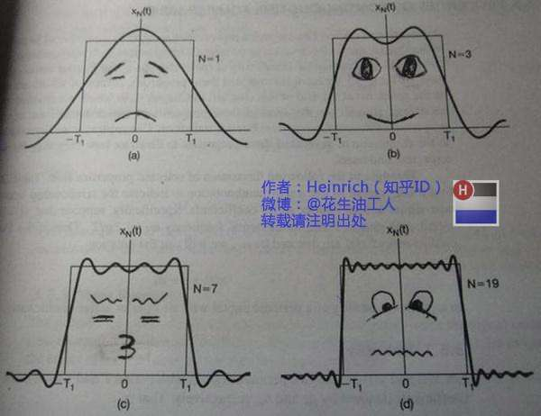
    

    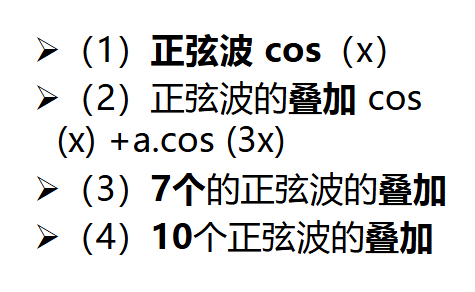

- 内容：傅立叶分析的数学表达与物理参数

    设任意周期为 $T$ 的周期性电信号为 $g(t)$，其傅立叶级数展开式为：

    $$
    g(t) = \frac{1}{2}c + \sum_{n=1}^{\infty} a_n \sin(2\pi n f t) + \sum_{n=1}^{\infty} b_n \cos(2\pi n f t)
    $$

    各参数意义：

    1. **基波频率（基频）**：$f=1/T$。决定了信号最基础的重复周期，对应 1 次谐波；
    2. **高次谐波频率**：$n f$（$n=2,3,4,\dots$）。频率为基频整数倍的高频正弦波分量；**其中2次谐波就是2f，N次就是Nf**
    3. **振幅系数**：$a_n$ 与 $b_n$ 分别代表第 $n$ 次谐波的正弦分量与余弦分量幅度权重；
    4. **直流分量**：$\frac{1}{2}c$。表示信号在单周期内的平均电压偏置。

    基于三角函数系的正交性，在周期 $[0, T]$ 内对信号积分，可求得各项系数：

    $$
    c = \frac{2}{T} \int_{0}^{T} g(t) \, dt
    $$

    $$
    a_n = \frac{2}{T} \int_{0}^{T} g(t) \sin(2\pi n f t) \, dt
    $$

    $$
    b_n = \frac{2}{T} \int_{0}^{T} g(t) \cos(2\pi n f t) \, dt
    $$

- 实践：信道滤波

    ​	对于双绞线、铜线这类的金属导线，物理传输介质受分布电容、电感和电阻的影响，它们本质上是一个**低通滤波器**——允许低频信号平稳通过，但对高于某一截止频率 $f_c$ 的高频信号产生剧烈衰减。

    ​	**介质允许通过的频率范围，即为信道的带宽（Bandwidth），更严谨地说，$带宽 = 该范围的最高截止频率 - 该范围的最低截止频率$**

    ​	所以当方波信号进入介质时，高频谐波被大量滤除，只有一些低次谐波能够到达对端，对应的最终的波形结果也有不同：
    
    1. 信道带宽极窄：仅允许1次谐波通过，高频被全部截断，方波彻底退化为了正弦波；
    2. 信道带宽适中：允许前2-4次谐波通过，波形演变呈平缓的波浪状；
    3. 信道带宽充裕：比如允许前8次谐波通过，波形接近方波

    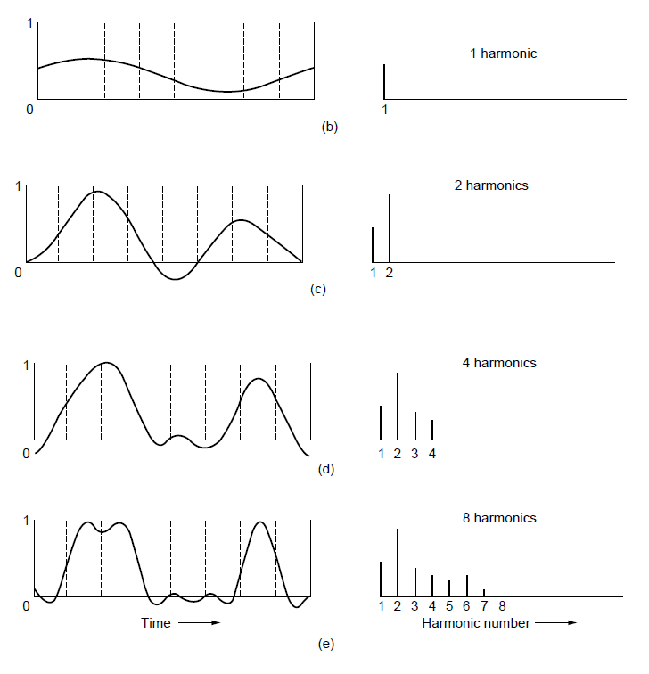

> 启示：数字通信的接收端不需要完美的方波。只要信道保留了足够的低次谐波，那么接收端就可以在每个时钟周期对电平采样，然后根据阈值判定高低电平，便可以还原出比特流。

#### 信道极限容量理论

信号：

- **频谱**：一个信号所包含的频率的范围；
- **绝对带宽**：信号的绝对带宽等于频谱的宽度；
- **有效带宽/带宽**：有些信号的带宽是无限的，但是信号的主要能量集中在相对窄的频带内，这个频带就叫做有效带宽
- 带宽和信息承载能力的关系：正相关。带宽越宽，信息承载能力越强

信道：

- **有限带宽**：信道有截止频率$f_c$​​，从0到$f_c$​​的振幅衰减较弱，$f_c$​​以上衰减较强，所以$0$​​~$f_c$​​就是信道的有限带宽
- 可以接入滤波器，来限制用户的带宽
- 通过信道的谐波次数越多，信号越逼真

信道计算：

- 波特率：每秒钟信号变化的次数，也叫调制速率、码元速率
- 信号值：通常指一个信号码元(Symbol)所能呈现的离散状态/电平的种类数
- 信号状态数（M）：信号有几种不同的电平或相位状态
- 每个信号值携带的比特数（n）：每个信号表示了几个bit
- 比特率：每秒钟运了多少个bit，单位bps。二者的关系取决于信号值和比特位的关系：**$比特率 = 波特率 \times log_{2}M = 波特率 \times n$**
- 若一个信号允许有M种离散状态，那么每一个信号状态所能代表的信息量为：**$n = log_{2}M$**

> 计算：对于比特率为Bbps的信道，发送8位所需时间是8/B秒，即8位为一个周期，则一次谐波频率是$f_1 = B/8 Hz$。若音频线路的截止频率为3000Hz，请问能通过信道的最高次谐波为多少次？
>
> A：**$N = f_c / f_1 = 3000/(B/8) = 24000/B$​**
>
> 即：**用截止频率除以基波频率/一次谐波频率**
>
> 结论：**有限带宽限制了数据的传输速率**
>
> 解释：因为要想提高数据传输速率，每个bit在时间轴上的持续时间就要缩短，那么电平跳变也要在极端的时间内完成；对应到频域上，就是依赖于高频正弦波；所以当信道的有限带宽比较低时，即对应的截止频率比较低，所以能允许通过的谐波次数就低，所以导致无法传输高频正弦波，导致数据传输速率受限

问题：传输速率能够无限提升吗？

​	我们的假设是：因为接收端在周期中心进行采样，那么我们是否加快震荡频率就能够不断地提高数据传输速率？

​	答案是否定的。限制传输速率的原因主要有两个：**信道有限带宽引起的码间串扰**，以及**热噪声不可避免**。

- 想法：理想信道 vs 有噪信道的两步推导

    为了量化通信极限，通信理论奠基者从两个不同维度建立了数学模型：

    1. 奈奎斯特/Nyquist：假设信道处于绝对理想、无任何噪声的状态，纯粹探究有限带宽 $W$ 对码元波形跳变速率的刚性物理限制；
    2. 香农/Shannon：将模型拓展至存在随机高斯热噪声的真实物理信道，从信息论底层推导信息无差错传输的绝对上限。

- 两大公式

    1. **奈奎斯特定理(Nyquist’s Theorem)**

        任意信号通过带宽为 $W\text{ Hz}$ 的理想低通滤波器时，每秒采样 $2W$ 次就能完整重现该信号信息。若码元传输速率超过 $2W$，就会产生严重的码间串扰（ISI）。

        - **极限码元速率（波特率）**：

        $$
        S_{\max} = 2W \quad (\text{Baud})
        $$

        - **极限数据传输速率（比特率）**：若离散信号的状态数（电平级数）为 $M$ 级，每个码元携带 $\log_2 M$ 比特信息，则：

        $$
        C = 2W \log_2 M \quad (\text{bps})
        $$

        > 理论启示：对于给定带宽 $W$ 的无噪信道，若想继续提高比特率，唯一的途径就是**提高调制阶数 $M$**（让每个脉冲表示更多电平状态）。但 $M$ 越大，相邻电平差越微弱，接收端区分电平的难度急剧上升。

    2. **香农公式（加性高斯白噪声信道）**

        现实中的信道充满电子热运动引起的随机高斯白噪声。信号功率与噪声功率的比值称为**信噪比（SNR）**，在工程上常用分贝（$\text{dB}$​）表示：

        其中：
        
        **S（Signal）**：代表**信号的平均功率**（有用信号的强度），单位通常是瓦特（W）或毫瓦（mW）。

        **N（Noise）**：代表**噪声的平均功率**（干扰杂质的强度），单位同样是瓦特（W）或毫瓦（mW）。

        **S/N**：两者直接相除得到的**纯比值（无量纲）**，直观意思就是：**有用信号的威力是背景噪声的多少倍**。
        $$
        \text{SNR}(\text{dB}) = 10 \log_{10}\left(\frac{S}{N}\right)
        $$
        
        香农定理指出，带宽为 $W\text{ Hz}$、信噪比为 $S/N$ 的任意信道，其理论极限信息传输容量 $C$ 为：
        
        $$
        C = W \log_2\left(1 + \frac{S}{N}\right) \quad (\text{bps})
        $$
        
        > 理论启示：香农公式与信号电平数 $M$ 完全无关。它证明了信道容量存在不可逾越的物理极限——无论编码多么精妙、电平分得多细，都无法打破该上限；但只要传输速率低于 $C$，理论上就一定存在某种编码方法可以实现完全无差错传输。

- 实践：两大定理对比与综合计算

    在实际通信工程与考试解题中，信道的真实最大传输速率受两者中的**更严苛者（短板）**约束：

    $$
    C_{\text{real}} = \min\left(2W \log_2 M, \, W \log_2\left(1 + \frac{S}{N}\right)\right)
    $$

| 对比维度 | 奈奎斯特准则（Nyquist） | 香农公式（Shannon） |
| :--- | :--- | :--- |
| **信道假设** | 理想信道（无噪声、带宽受限） | 实际信道（有高斯白噪声、带宽受限） |
| **决定因素** | 取决于带宽 $W$ 和信号电平数 $M$ | 取决于带宽 $W$ 和信噪比 $S/N$ |
| **与 $M$ 的关系** | 随 $M$ 增加而单调增大 | 与 $M$ 完全无关（物理绝对天花板） |
| **工程指导** | 提示通过多进制调制提升波特率利用效率 | 提示提升信噪比（加大发射功率、抑制噪声）或扩充频带 |

#### 数据传输方式

依照不同的维度，可以对传输方式进行划分：

- 数字通信和模拟通信

    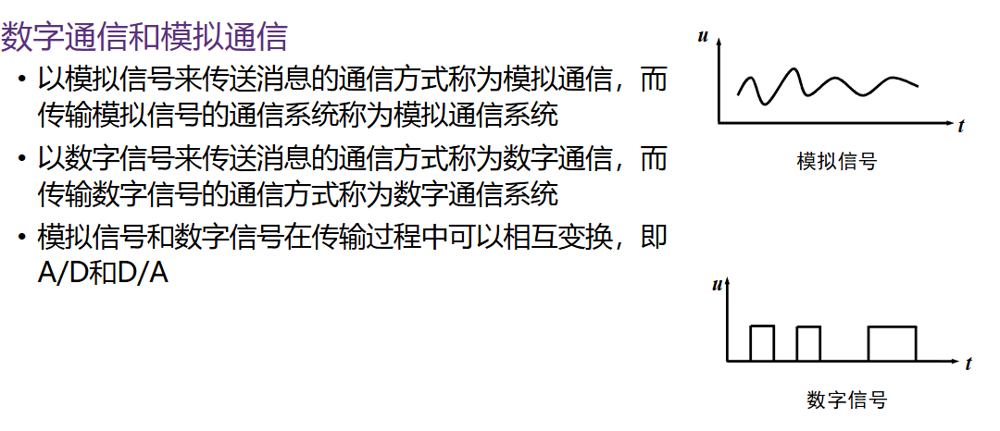

- 传输时空顺序

    1. **串行传输**

        数据在一个信道上按位依次传输；

        所需线缆少、投资低；

        在发送和接收端需要分别进行并/串和串/并转换

        是远距离与现代高速数据通信，如：以太网、USB、PCIe的绝对主流；

    2. **并行传输**

        数据在多条并行信道上同时传输，如 8 位一组；

        短距离传输速率高，但长距离传输时各条导线物理特性不一致，极易发生时钟不同步与线间串扰，成本高昂；

- 按照传输方向与时间关系

    1. **单工（Simplex）**

        信号只能单向传递，没有反向反馈通路，如传统无线广播、寻呼机；

    2. **半双工（Half-Duplex）**

        通信双方均可收发，但不能同时进行，需双向交替，如对讲机、早期以太网，存在收发转换延迟；

    3. **全双工（Full-Duplex）**

        双方可同时收发数据，如电话通信、现代以太网

- 按照发收两端同步方式

    1. **异步传输（Asynchronous）**

        以单个字符为单位独立传输，每个字符前后分别附加**起始位**与**停止位**。

        字符与字符之间的间隔时间完全任意，接收端依赖本地高频时钟（通常为比特率的 16 倍）在每位中心对齐采样；

    2. **同步传输（Synchronous）**

        以数据块或帧（Frame）为单位连续发送，传输过程中双方必须严格保持位同步（Bit Synchronization）与帧同步（Frame Synchronization），无需起止位开销，信道利用率高。

- 按照是否搬移频谱

    1. **基带传输（Baseband）**
    
        不搬移数字信号频谱，直接在传输线上发送原始电脉冲信号。频带从直流或低频开始，适用于局域网近距离有线信道；
    
    2. **频带传输（Passband）**：利用调制解调器将基带信号搬移到高频模拟载波上进行传输，适用于广域电话网、无线电磁波及长途光纤信道。

#### 基带传输&数据编码技术

首先，我们要尝试去理解信号的发送与接收：

​	对于发送端和接收端，它们内部都有一个时钟，比如一个石英晶振做的时钟；

​	对于接收端而言，它需要采样，它也需要一个规定。我们假设数据传输1个bit的时间，接收端的时钟晶振了16次，那么我们约定每当芯片中的数字计数器数到第8次的时候，对数据线采样一次；

​	知道了采样，我们再回到数据传输的过程中。因为我们永远无法让两个时钟的频率保持完全的一致，换言之，任意两个时钟总是有偏差的；

​	比方说，发送端的时钟认为的$1 \mu s$实际上是$1.0001 \mu s$，而接收端的则实际上是$0.9999 \mu s$，即稍微走快了一点；

​	如果此时，线路上发送端发来了10000个1，总共占到了$10001 \mu s$​​​，这段时间对于接收端，它一共采样了10001次，所以就会凭空多出来了一个1；然而实际生活中，可能连续几十个相同电平就会出现这种误差，这是我们不想遇到的；

​	而如果数据是经常跳变的就不会出错，主要是因为接收端会捕捉到这个跳变，不论是上升沿还是下降沿，在捕捉到这个变化后，其内部的计数器就会清零，重新开始数，所以之前的误差也就被一笔勾销了；

通过上面的分析，我们也就明白了为什么**不能直接在线路上使用纯高低电平**

为了解决这个问题，我们找到的办法是：**将时钟脉冲塞进数据信号**。通过设计规则，让电平在每个比特周期的特定位置强制跳变，接收端只要捕捉到跳变，就能动态地校准时钟，实现同步。

具体而言，有以下的几种编码机制：

- **不归零码**

    - **NRZ：Non-Return to Zero**
    - 其中低电平表示0，高电平表示1；

    缺点：

    1. 像前面提到的，缺乏自同步；

    2. 难以分辨一位的开始和结束；

    3. 高低电平的连续出现会导致信号直流分量增加；

        > 直流分量：就是信号在一段时间内的“平均电压”，对应的就是频率为0Hz的恒定部分
        >
        > $总信号 = 直流分量 + 交流分量$​

- **反向不归零码**

    - **NRZI：NRZ Inverted**
    - 不管电平是高还是低，只看它翻不翻转；
    - 常用于USB传输；
    - 遇到1，电平发生翻转；遇到0，电平保持不变。这是**逢“1”变化NRZ**，当然也有反过来的情况，就是逢“0”变化NRZ；

    优点：

    1. 对于连续的1，电平会进行翻转，有了时钟跳变沿，解决了直流分量

    缺点：

    1. 对于连续的0，还是没有办法处理

- **曼彻斯特编码**

    - **Manchester**，也叫做相位边码
    - 不管是0还是1，在每个周期正中间，电压进行一次跳变
    - 发0，前半段低，后半段高；发1，相反；

    优点：

    1. 自同步
    2. 没有直流分量

    缺点：

    1. 编码效率只有50%，为了多传1个bit，中间要多跳一次
    2. 接收端是看向上跳变还是向下跳变的，如果水晶头或者双绞线的正负极反了，传输的0和1都会颠倒；于是引出了差分曼彻斯特

- **差分曼彻斯特编码**

    - **Differential Manchester**
    - 每一位中间都有一个跳变，表示时钟；
    - 周期开头有跳变，表示0；周期开头无跳变，表示1；

    优点：

    1. 接收端只检测电平的动作，不在乎变高变低；
    2. 解决了曼彻斯特编码的问题
    
    
    
    对于初始变化，差分曼彻斯特有两种情况。周期开头无跳变就是指顺延上个电平，不进行变化。
    
    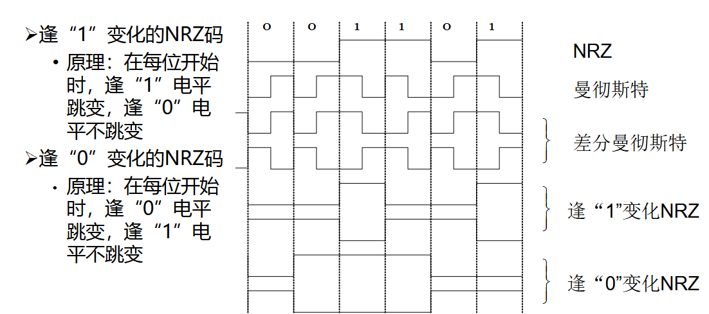

快速以太网的 4B/5B 高效编码

由于曼彻斯特编码效率仅有 50%，如果要在百兆以太网实现 100Mbps 传输，线路需要承受高达 200M Baud 的波特率，因此百兆以太网引入了 4B/5B 块编码：

1. 映射：发送端每次将 4 个比特的数据映射为一个预先设计好的 5 位码字
2. 时钟：在 $2^5 = 32$ 个可选码字中，精心挑选出 16 个“连续的 0 不超过 3 个”的码字映射为数据，其余码字作为控制或非法码；
3. 优点：编码效率从曼彻斯特的 50% 跃升至 **$4/5 = 80\%$​**，极大地缓解了高频信道压力。

#### 频带传输

在前面讨论的数据编码中，我们都是将数字脉冲直接施加在导线上，这叫做**基带传输**。

但是为什么不能在无线通信或者长途光纤通信中直接发送矩形电脉冲呢？

主要受限于两个部分：

1. 天线尺寸的物理限制：根据电磁辐射原理，天线尺寸通常需要达到电磁波波长 $\lambda$ 的 $\frac{1}{4}$ 才能有效向空中辐射电磁能量。基带脉冲的频率主要集中在低频，其波长可达几十甚至上百公里，手机里根本造不出这么巨大的天线；
2. 介质衰减与信道隔离：自由空间的大气层对低频信号衰减极大，而且如果所有人都在空气中直接发射低频脉冲，所有的通信信号就会在低频段相互撞车混淆，无法实现多路复用。

因此，我们需要一种全新的思路：**频带传输（Passband）**。

- 想法：引入高频正弦载波（“石头与纸条”）

    我们可以请出一列高频、易于在空间或光纤中远距离穿梭的正弦电磁波作为运输工具，称之为**载波（Carrier）**。

    载波本身就像一辆**空载的卡车**（或者一块飞石），它本身不包含任何有效信息，但在数学上具有极其纯净的形式：

    $$
    s(t) = A \sin(\omega t + \varphi)
    $$

    载波拥有三个天然的物理自由度：**振幅 $A$、角频率 $\omega$、初始相位 $\varphi$**。

    我们将基带数据“搭载”到载波上的过程就叫做**调制（Modulation）**：通过改变载波的高矮（振幅）、快慢（频率）或翻转角度（相位），将低频数据搬移到适合介质远距离传输的高频频段上。接收端收到后再把这些特征提取出来（**解调**），还原为 0 和 1。

- 内容：基础调制与高阶正交调制

    根据调制载波的不同参数，基础数字调制分为三种经典方式：

    1. **幅移键控（ASK：Amplitude-Shift Keying）—— 调幅**
        - **原理**：保持载波的频率与相位恒定，仅改变载波的**振幅 $A$**；
        - **规则**：通常规定高振幅代表 `1`，无载波（或低振幅）代表 `0`；
        - **特点**：实现最为简单，但抗干扰能力较差（信道中的噪声最容易直接叠加并破坏振幅）。
    2. **频移键控（FSK：Frequency-Shift Keying）—— 调频**
        - **原理**：保持载波的振幅与相位恒定，用**不同的频率 $\omega$** 分别代表不同的数据；
        - **规则**：例如振动密集的较高频率代表 `1`，振动平缓的较低频率代表 `0`；
        - **特点**：抗噪声性能优于 ASK，但在频域上占用的带宽更宽。
    3. **相移键控（PSK：Phase-Shift Keying）—— 调相**
        - **原理**：保持载波的振幅与频率恒定，通过改变载波的**初始相位 $\varphi$** 来表达数据；
        - **规则**：例如正弦波从正半周起跑（相位 $0^\circ$）代表 `0`，波形颠倒 $180^\circ$ 起跑（相位 $180^\circ$）代表 `1`；
        - **特点**：抗干扰性能优异（噪声很难瞬间改变波形的起跑相位），是现代高速无线通信（如 Wi-Fi、4G/5G）最核心的基石。

    思考：如果一个载波周期只代表 1 个 bit，速率仍然受限。根据之前学到的波特率与比特率关系，怎样才能让每个波形周期运载更多的 bit？——**提高调制阶数 $M$（高阶调制）**！

    4. **高阶调制与星座图（Constellation Diagram）**
        - **BPSK（二相相移键控）**：使用 2 个相反的相位（如 $0^\circ, 180^\circ$），每个符号只能表示 2 种状态（$M=2$），携带 $\log_2 2 = 1$ 比特；
        - **QPSK（四相相移键控）**：使用 4 个相互正交的相位（$45^\circ, 135^\circ, 225^\circ, 315^\circ$），每个符号能表示 4 种状态（$M=4$），一次性携带 $\log_2 4 = 2$ 比特；
        - **16-QAM（正交振幅调制）**：不仅调相位，还同时调振幅！在平面上形成 16 个离散的状态点（$M=16$），每个符号可携带 $\log_2 16 = 4$ 比特信息。

        > **星座图（Constellation Diagram）**：
        >
        > 用于直观展示多进制调制信号中每个码元状态在复平面上的分布。点到原点的距离代表该状态的**振幅大小**，点与实轴的夹角代表其**相位**。星座图上点与点之间的距离越远，抵抗噪声破坏的能力就越强；点越密集，虽然传输的信息量越大，但对信噪比的要求也越苛刻。

    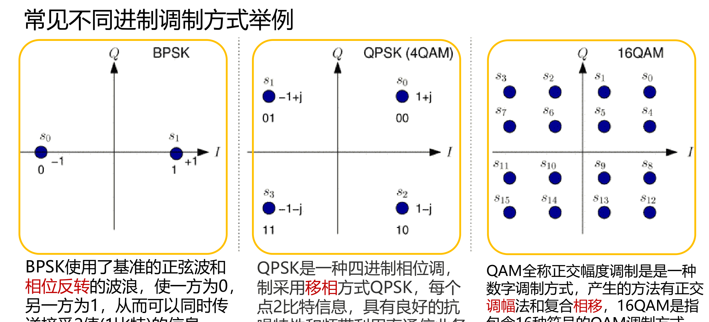

#### 通信系统性能度量指标

对于一个数据通信系统，我们究竟该用什么标准来衡量它“跑得快不快”、“传得稳不稳”？主要依赖以下几个核心指标：

- **波特率（Baud） vs 比特率（bps）**

    这是通信领域最容易混淆的一对概念。我们可以用**“卡车运货”**来直观区分：

    - **波特率（调制速率 / 码元速率 $R_B$）**：
        - 含义：单位时间内信号状态发生跳变（或产生波形变化）的次数，即**每秒钟开过去多少辆卡车**；
        - 单位：波特（$\text{Baud}$ 或 $\text{B/s}$）。
    - **比特率（数据传输速率 / 传信率 $R_b$）**：
        - 含义：单位时间内信道真正传输的有效二进制信息总量，即**每秒钟总共运送了多少个 bit 的货物**；
        - 单位：比特每秒（$\text{bps}$ 或 $\text{b/s}$）。
    - **二者的换算关系**：
        若一个信号码元允许呈现 $M$ 种不同的离散状态（即每辆卡车能装 $\log_2 M$ 个 bit），则：

        $$
        R_b = R_B \log_2 M
        $$

        > 当且仅当系统使用最普通的二进制调制（$M=2$）时，$R_b = R_B$，波特率与比特率在数值上才相等；而在使用 PAM4（$M=4$）或 16-QAM（$M=16$）等高阶调制时，比特率将成倍高于波特率。

- **带宽（Bandwidth）的双重语境**

    同一个词汇“带宽”，在不同技术背景下有着截然不同的物理意义：

    1. **通信领域（模拟视角 / 物理信道）**：
        - 指物理介质所能允许通过的**最高截止频率与最低截止频率之差**（频带宽度）；
        - 单位：赫兹（$\text{Hz}$）。例如话音信道带宽约为 $3.1\text{ kHz}$，Wi-Fi 信道带宽常为 $20\text{ MHz}$ 或 $80\text{ MHz}$。
    2. **网络领域（数字视角 / 数据链路）**：
        - 指网络链路单位时间内所能承载的**最高数据传输速率**（信道极限信息通量）；
        - 单位：比特每秒（$\text{bps}$）。例如日常所说的“千兆网卡”、“百兆家庭宽带”。

    > **二者的内在纽带**：根据香农公式与奈奎斯特准则，物理信道的模拟带宽（$\text{Hz}$）严格决定了该信道能支撑的数字传输速率（$\text{bps}$）的物理上限。网络领域借用“带宽”一词，本质上是用信道的信息承载能力来代指网络通道的宽窄。

- **频带利用率（$\eta$）**

    频谱资源是不可再生的稀缺资源。为了衡量一个通信系统对分配给它的宝贵频带资源的“压榨效率”，我们引入**频带利用率**：

    - **定义**：单位带宽（每赫兹）内所能实现的数据传输速率；
    - **计算公式**：

        $$
        \eta = \frac{R_b}{W} \quad (\text{bps/Hz}) \quad \text{或} \quad \eta = \frac{R_B}{W} \quad (\text{Baud/Hz})
        $$

    - **工程启示**：在分配带宽 $W$ 固定的情况下，采用 QPSK、16-QAM 甚至 1024-QAM 等高阶调制技术，能够大幅提升系统的频带利用率 $\eta$，在有限的无线频谱中挤出更高的网络速率（但前提是信噪比足够高）。

- **误码率（BER：Bit Error Rate）**

    衡量通信系统在噪声和干扰环境中“传输可靠性与质量”的统计指标：

    - **定义**：接收端判决出错的码元或比特数 $n_e$ 占总传输码元或比特数 $n$ 的比率；
    - **计算公式**：

        $$
        P_e = \frac{n_e}{n}
        $$

    - **产生误码的物理本质**：信道中无法消除的随机噪声（如电子热运动引起的加性高斯白噪声）或码间串扰（ISI），导致接收端在特定采样时刻测得的电平或相位越过了判决门限，造成了 $0 \to 1$ 或 $1 \to 0$ 的比特翻转。信噪比（SNR）越高，误码率越低。

### 传输介质

什么是传输介质?

​	发送器和接收器之间的通路

​	网络体系结构中的第0层

传输介质主要分为两大类：

- 导引型传输介质：铜线、光纤...
- 非导引型传输介质：大气层、真空、水....

分类的依据是信号的传输是否被介质约束，导引型就是被介质限制住，沿着固定的路径传输；而非导引型就是向四周传播，没有约束。

#### 导引型传输介质

- **双绞线（Twisted Pair）**

    1. 结构：两根具有绝缘保护层的铜导线按照一定密度绞缠在一起。

        - 双绞线中两根铜线传输的是大小相等、方向相反的差分电流；
        - 绞缠既可以抵消两根线产生的电磁辐射；外界电磁波干扰会在两根线上感应出几乎相同的噪声电压，也会被抵消；
        - 绞合越致密，对于外界电磁干扰和线对间近端串扰的抵御能力越强

    2. 分类：
        - 无屏蔽双绞线（UTP：Unshielded Twisted Pair）：价格低、轻便柔软、易于弯折，广泛用于普通办公网络和家庭网络
        - 屏蔽双绞线（STP / FTP / SFTP）：在双绞线外层，或者每个线对外部包裹金属编织网或者铝箔屏蔽层。能够有效抵抗强电磁干扰环境，但成本较高。常见于工业车间、机房强电走线

    3. 常用类别与性能：

        分类的依据是绞合的致密程度，越致密，抵抗能力越强。

        - 3 类线（Category/Cat 3）：早期电话线与 10Mbps 传统以太网/10BASE-T；
        - 5 类线与超 5 类线（Cat 5e）：支持百兆/100BASE-TX及千兆/1000BASE-T以太网，单位长度绞合密度显著高于 3 类线；
        - 6 类线与超 6 类线（Cat 6A）：线芯更粗并常带十字骨架隔离，支持万兆/10GBASE-T短距或全长传输。

    4. 网线水晶头与接线规范（EIA/TIA 568A / 568B）：
        - RJ-45 接头包含 8 个金属引脚引线；
        - 568B 线序（工业界最常用）：白橙、橙、白绿、蓝、白蓝、绿、白棕、棕；
        - 568A 线序：白绿、绿、白橙、蓝、白蓝、橙、白棕、棕（本质是将 1-3 与 2-6 针脚对调）；
        - 直通线 vs 交叉线：两端采用相同线序（如均做 568B）的线为直通网线，用于连接不同类型设备（如电脑连交换机）；两端分别采用 568A 和 568B 的线为交叉网线（用于同种设备互联）。现代网卡已普遍支持 Auto MDI/MDIX 自动反转，线缆类型差异被硬件自适应屏蔽。

- **同轴电缆（Coaxial Cable）**

    1. 结构：

        中心是铜芯线，即内导体；

        外包一层绝缘材料；

        绝缘材料外有一层网状编织的导电屏蔽层，即外导体；

        以及最外层的塑料保护外套。

        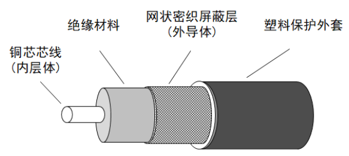

    2. 分类：

        - **基带同轴电缆（阻抗 $50\,\Omega$）**：专门用于传输数字基带电脉冲，曾广泛用于传统早期以太网：
            - `10BASE5`（粗同轴电缆）：电缆较硬，最大有效传输距离 $500\text{ m}$；
            - `10BASE2`（细同轴电缆）：电缆较软易铺设，最大有效传输距离 $185\text{ m}$。
        - **宽带同轴电缆（阻抗 $75\,\Omega$​）**：是有线电视网的标准传输电缆，利用频分复用技术传输宽带射频模拟/数字信号，最高频率达几百兆赫兹，传输距离可达几十公里。

- **光纤（Optical Fiber）**

    1. 原理

        **全反射（Total Internal Reflection）**。高折射率内芯，低折射率包层，当入射角大于临界角发生全反射。

        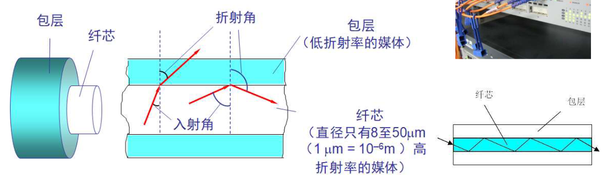

    2. 三种实用光纤
        - 多模突变光纤：也叫阶跃光纤。

            多模：纤芯较粗，多数光波以不同入射角进入纤芯；

            突变：纤芯和包层交界面发生阶跃突变

            特点：因为光波角度各异，所以到达终点的时间差异大/模式色散大，光脉冲被严重展宽，仅适用于小容量、短距离场景

        - 多模渐变光纤：

            多模：同理

            渐变：纤芯折射率沿径向向外逐渐减小

            特点：光线在纤芯中呈平滑的正弦波状弯曲传播。由于外围折射率低，光速更快，补偿了传播路程的差距，模式色散显著减小，适用于中距离传输；

        - 单模光纤（Single-mode Fiber）：

            原理：纤芯直径极小，接近光的波长，光线在纤芯内仅沿轴线直线传播，彻底消除了模式色散

            特点：具有**极大的带宽**和极低的衰减，适用于长途大容量干线网络。

    3. 收发器件与低损耗波段

        - 发送端器件

            1. 发光二极管 LED：成本低、光谱宽。多用于多模光纤
            2. 注入激光二极管/半导体激光二极管 LD：功率大、方向性好、谱线纯净。用于单模光纤

        - 接收端器件

            1. 光敏二极管：利用光电效应进行光信号转化

                具体可分为PIN光电二极管和APD雪崩光电二极管

        - 通信低损耗三大窗口：光信号在光纤中的衰减主要来自材料吸收损耗和瑞利散射。**工业上通常选用光损耗极小的三个波长窗口：$0.85\,\mu\text{m}$、$1.30\,\mu\text{m}$ 与 $1.55\,\mu\text{m}$**

- **电力线载波通信（PLC：Power Line Communication）**

    利用既有的高压、中压输电线或低压入户配电电缆（220V/380V），将高频数据信号调制其上进行传输。
    - 优点：无需单独重新铺设通信线缆，覆盖范围广，成本极低；
    - 缺点：家庭电器的开关动作会引入严重的突发脉冲噪声与电磁谐波干扰，信道衰落剧烈且阻抗不稳定，难以保障超高速持续传输质量，主要应用于智能电网抄表与特定智能家居控制。

#### 非导引型传输介质

利用自由空间传播无线电磁波

根据不同频段电磁波的传播机理，分为下面几种方式：

- 短波通信

    波长短、频率高；频段3~30MHz

    依靠地表上放60-400km的电离层反射来实现超远距离通信

    - 多径传播：电波经过电离层不同高度的多次反射以及地表多重折射，形成多条传播路径到达接收端，由路程差导致的相位不同互相干涉叠加；
    - 电离层衰落：电离层电子密度受太阳黑子活动和昼夜交替影响剧烈波动，通信质量不稳定

- 散射通信

    利用大气层中物理介质的不均匀性进行微弱散射传播

    - 对流层散射
    - 流星余迹散射

- 地面微波接力通信

    频段：300MHz~300GHz

    因为波长短，频率极高，所以几乎无法沿着地表绕射，且会穿透电离层而不被反射，所以主要呈直线视距传播

    - 中继接力站：类似于古代的烽火台，每个四五十公里建一座
    - 环境敏感：波长与雨滴尺寸相当，易受暴雨影响

- 光波传输

    光波（包括红外线、可见光、紫外线）波长远小于无线电波，具有极高的方向性；

    红外线通信：成本低，方向性强，但是无法穿透墙壁。应用有家用遥控器等

    大气激光通信：激光束在大气中点对点直线传输，速率高、频积宽，但易受大雾等天气影响

    可见光通信：室内白光LED灯具的告诉微弱明暗闪烁，速率可达Gbps级，抗干扰，多功能合一

### 无线与卫星通信

无线，即摆脱线缆的限制。其中的卫星通信于今相对重要一些

卫星通信：利用人造地球卫星作为中继站，转发或反射无线电电磁波，在两个或多个地球站之间建立通信

主要由以下部分组成：

1. 通信卫星：中继站
2. 地球站：发射端与接收端
3. 跟踪遥测以及指令系统：监控卫星状态，下达机动指令
4. 监控管理系统：统筹调度

现代主流卫星通信系统：

1. 同步轨道通信卫星系统
    - 公转周期=24h，地面观察相对静止；
    - 覆盖面积大：只要三颗120°的基本可实现全覆盖，除了南北极；
    - 高时延：通信距离长，往返时延大
2. 低轨道卫星系统
    - 如SpaceX Starlink
    - 卫星在近地太空轨道
    - 低时延，高吞吐，媲美光纤
    - 单星在地面站上空过顶窗口时间仅有几分钟，需要发射成千上万的小卫星组成链路，进行接力

### 多路复用技术

为何要用多路复用？

​	为每个人提供一个独立的信道是不现实的，同时为了降低成本，一般情况下我们都使用公用信道。对于公用信道，我们要尽可能提高使用效率，避免相互干扰，于是诞生了多路复用。

​	所以**复用(Multiplexing)**的本质为：通过一种机制，让多个信道共同分享同一条物理传输信道，在互不干扰的前提下，最大化物理信道的传输能力。

常见的多路复用机制

- **频分复用**

    1. FDM，frequency division multiplexing
    2. 将物理信道的总带宽分割为互不重叠的子频带，各路用户信号被调制到不同的载波中心频率上，这些不同频率的电磁波叠加为一个符合信号后同时向前传播
    3. **相邻子频带之间有防护频带**，避免干扰；所以**总带宽为有效频带和保护频带之和**
    4. 常见应用有传统调频、有线电视

    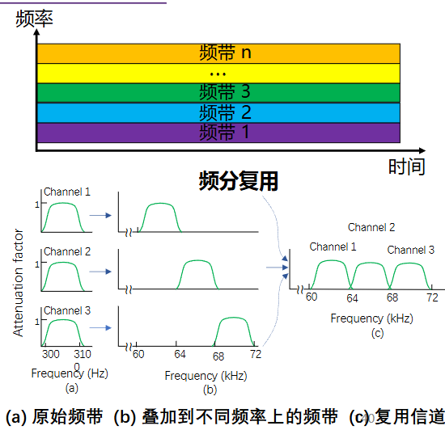

- **时分复用**

    1. TDM：time division multiplexing
    2. 将时间轴划分为一段段等长的TDM帧/时分复用帧，每个帧内再细分为若干固定序号的时隙，各路用户按顺序轮流独占一个专属时隙
    3. 用户在不同时间轮流占用信道资源
    4. 局限性：适合传输速率恒定的模拟语音通信，对于计网数据通信的突发性，处理能力不太行

    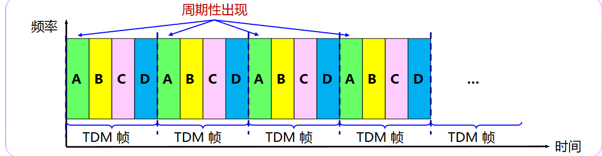

- **统计时分复用**

    1. STDM：Statistical TDM，异步时分复用
    2. 针对TDM闲置浪费的缺陷，STDM实行按需动态分配时隙
        - STDM 帧内的时隙数明显少于接入系统的总用户数；
        - 集中器（Multiplexer）动态扫描各个用户输入缓存，哪个用户有数据要发，就临时给它分配一个时隙填入 STDM 帧；
        - 由于时隙不再与用户序号固定绑定，STDM 传输的每个时隙内必须额外携带用户源地址/目的地址标识；
        - 优点：极大地提高了计算机突发数据在干线上的传输效率。

    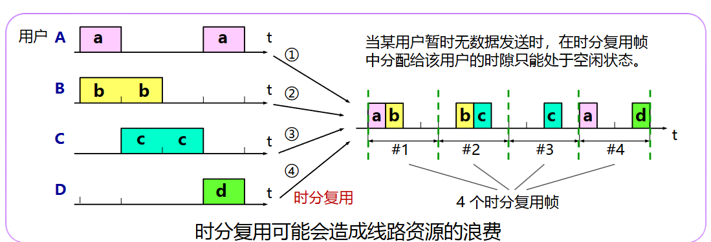

- **波分复用**

    1. WDM：Wavelength Division Multiplexing
    2. 原理：光的FDM。利用一根光纤来同时传输多个光载波信号
    3. 机制：发送端，多个不同波长的激光二极管，将多路数字信号条知道不同颜色的光载波上（不同波长）；利用合波器将多数光汇聚到一个单模光纤中传输；接收端，利用分波器将各波长光信号精准分离，送入光解调器

    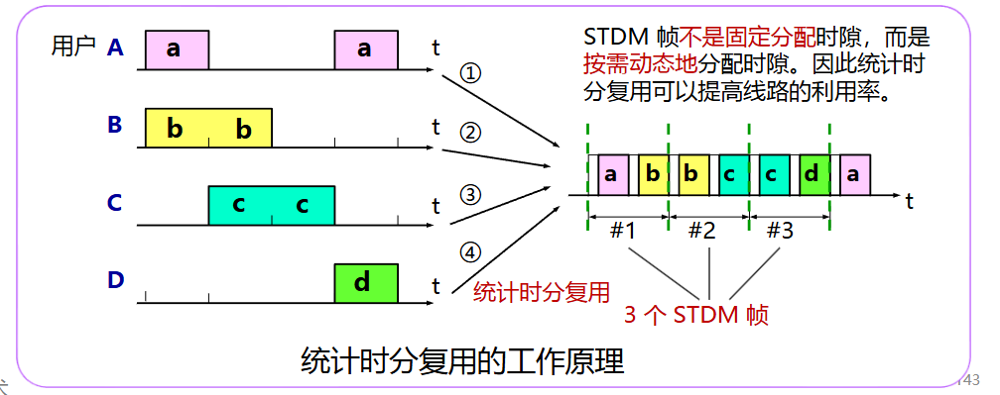

- **码分复用**

​	码分多址，CDMA：code division multiple access。是利用码序列相关行实现的多址通信，基本思想是靠不同的地址码来区分的地址。

​	允许多个用户在同一时间传输，也允许他们使用完全相同的频带

- 编码原理：码片序列（Chip Sequence）

    1. 比特时间，即传输一个比特的时间。**$比特时间 = 1/数据传输速率$​**
    2. 每个站点被预先分配一个长度为m bit的码片序列
    3. **如果发送比特0，则发送自己的m bit码片序列**
    4. **如果发送比特1，则发送码片序列的二进制反码**
    5. **若不发送，则静默，即全0**

- 码片序列的正交关系

    1. **不同站点的码片互相正交**：任何两个不同站点 $S$ 与 $T$ 的码片向量，其规格化内积必为 0：

    $$
    \mathbf{S} \cdot \mathbf{T} \equiv \frac{1}{m} \sum_{i=1}^{m} S_i T_i = 0
    $$

    2. **自身内积归一化**：任何码片向量与自身的规格化内积恒等于 1：

    $$
    \mathbf{S} \cdot \mathbf{S} \equiv \frac{1}{m} \sum_{i=1}^{m} S_i^2 = 1
    $$

    3. **与反码内积**：任何码片向量与其反码的规格化内积恒等于 -1：

    $$
    \mathbf{S} \cdot (-\mathbf{S}) = -1
    $$

    

    

        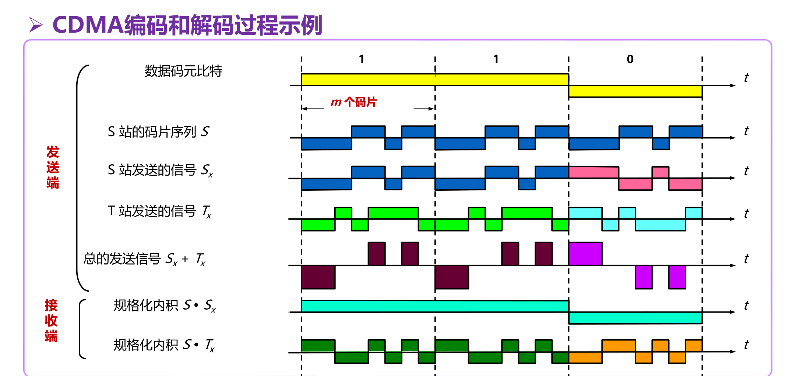
    

> 例题：
> 设系统有 4 个站，分配的码片序列分别为：
>
> - $A = (-1, -1, -1, +1, +1, -1, +1, +1)$
> - $B = (-1, -1, +1, -1, +1, +1, +1, -1)$
> - $C = (-1, +1, -1, +1, +1, +1, -1, -1)$
> - $D = (-1, +1, -1, -1, -1, -1, +1, -1)$
>
> 接收端在信道上收到混合码片向量 $M = (-1, +1, -3, +1, -1, -3, +1, +1)$。
> 问各站发送情况？
>
> **解法**：分别求内积：
> - $A \cdot M = \frac{1}{8} \times [(-1)(-1) + (-1)(1) + (-1)(-3) + (1)(1) + (1)(-1) + (-1)(-3) + (1)(1) + (1)(1)] = \frac{8}{8} = +1 \implies$ **A 发送了 1**
> - $B \cdot M = \frac{1}{8} \times (1 - 1 - 3 - 1 - 1 - 3 + 1 - 1) = \frac{-8}{8} = -1 \implies$ **B 发送了 0**
> - $C \cdot M = \frac{1}{8} \times (1 + 1 + 3 + 1 - 1 - 3 - 1 - 1) = \frac{0}{8} = 0 \implies$ **C 未发送数据**
> - $D \cdot M = \frac{1}{8} \times (1 + 1 + 3 - 1 + 1 + 3 + 1 - 1) = \frac{8}{8} = +1 \implies$ **D 发送了 1**

- **正交频分复用**
    1. OFDM：Orthogonal FDM
    2. 信道分为若干正交子信道；
    3. 将高速串行数据比特流，转换为几十路低速并行数据流；
    4. 将各子数据流分别调制到各个正交子载波上并行发送。
