# ch3 数据链路层基础

裸比特流有三个问题：

1. 没有边界，不知道一帧的起点和终点；
2. 可能有出错、丢失等问题；
3. 速率不匹配，发的太快会把接收方撑爆；

所以这一章的目的就是解决这三个问题，将物理层送上来的裸比特流，变成一条网络层可以使用的链路。

数据链路层概述

1. 位置：位与先前提到的五层模型中的第四层，介于网络层和物理层之间，向上提供服务接口，向下调用服务；

2. 功能

	- 成帧（Framing）：比特流划分，用于区分边界和纠错；
	- 差错控制（Error Control）：处理传输中出现的差错；
	- 流量控制（Flow Control）：发送方发送速率不能大于接收方的处理速率，避免缓冲区溢出

3. 服务

	按照确认和连接两个唯独进行划分，有三种服务类型：

	- 无确认、无连接服务（Unacknowledges connectionless）

	  不握手、不确认、不重传，如果帧丢了或者坏了，没有后手处理。

	  常见的技术应用比如以太网/有线局域网，因为有线网线的信道质量高，一般情况下不会出现误码的情况，所以不需要进行 ACK 回复，能节省信道带宽。

	  再比如说音视频通信，宁可画面丢帧也不愿意干等 ACK 回复。如果真出现了丢帧，可以交给传输层的 TCP 去处理重传

	- 有确认、无连接（Acknowledged connectionless）

		不握手、但是有接收方 ACK 回复，发送端没收到回复要进行局部快速重传。

		技术应用如 WIFI，与有线传输相比，无线更容易被环境和介质影响，误码率高。但是 WIFI 不能像以太网一样让上层重传，因为这个过程的延时太久了，WIFI 必须在数据链路层这一跳解决问题，发过去没收到 ACK 网卡就要立马重发一次

	- 有确认、有连接（ACknowledged connection-oriented）

		三方握手、传输过程中进行严格的帧编号、顺序交付、错误重传等。
	
		常用于高延迟、高误码的场景，比如卫星通信，深空探测等


## Framing

成帧。“帧”是数据链路层的 PDU，即协议数据单元，所以成帧的意思就是“组成帧”。

如果从收发两方考虑，发送方的任务是将网络层交下来的分组包装，添加帧头和帧尾，组成帧，即封装成帧（Frame Encapsulation）；而接收方严格来讲是做解封装（Decapsulation）。

**分组和帧的关系**：网络层的分组对应到帧就是有效载荷部分，一般是 1:1 对应的，如果 packet 太大也可能会被切分为多块部分。头标（Header）和尾标（Trailer）则是添加的控制信息，头标内容如：目的 MAC 和源 MAC、IPv4 还是 IPv6 的协议分类、帧序号和确认号 ACK 等；尾标比如：帧校验序列；

**为什么要成帧？**——就先前提到的五层网络体系结构而言，不论是哪一层的 PDU，其本质都可抽象为比特流。而比特流无非是 01 的组合序列，我们要想准确得到每一帧，就得知道每帧的开头和结尾。成帧就是在做这个区分加密以及接收解密的任务。

---

成帧的方式：

- 字节计数法（Byte count）
- 带字节填充的定界符法（**Flag** bytes with byte stuffing）
- 带比特填充的定界符法（**Flag** bits with bit stuffing）
- 物理层编码违例（Physical layer coding violations）

---

### byte count

在每一帧的开头专门用一个 byte 写一个数字，表示这一帧总共有包含字节（包含这个 byte 本身）接收端在读到数字后就知道了这一帧的总长，然后根据长度读取完整个帧，再开始阅读下一帧。

如图所示：

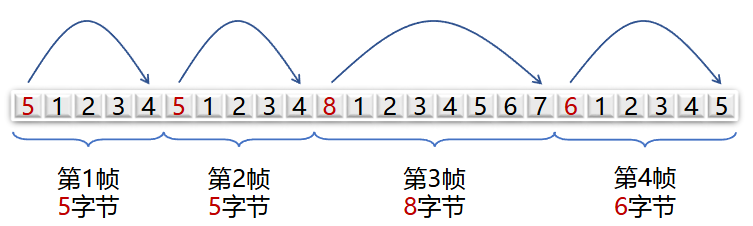


这种方法的缺点也很明显，如果因为噪声等原因导致了传输出错，比如某一帧的计数头被干扰，那么就会导致后续所有的帧都发生错位。所以在实际生活中很少单独使用该方法。

---

### flag bytes with byte stuffing

带字节填充（byte stuffing）的定界符法

为了区分开每一帧，我们就在每一帧的开头和结尾放一个特殊的标记字节/定界符，叫做 `FLAG`。比如十六进制的 0x7E，即 01111110；

特殊情况：因为定界符本身是一个二进制数字，但是数据中有可能本来就有 0x7E，为了处理这种情况，我们再定义一个转义字符 `ESC`，通常取 0x7D；

通过一张图理解：

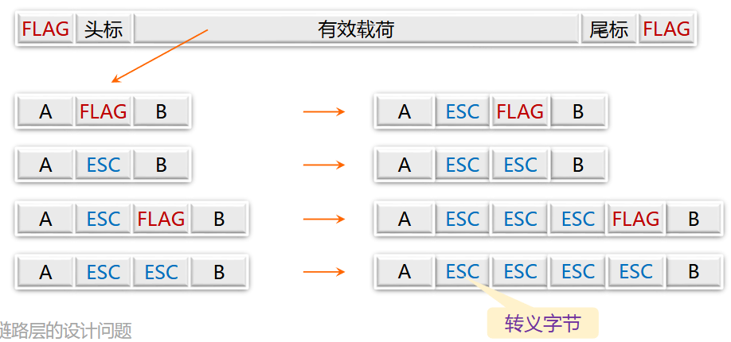

接收方的处理很机械：

1. 逐个字节看；
2. 读到转义字符 `ESC`，后一个字节无条件当作有效载荷，不再检查；
3. 读到定界符 `FLAG`，就是帧的边界；

- 缺点：这种方法是面向字节的，所以如果传输的数据不是严格按照 8 位字节对齐的任意位串，处理比较麻烦。这也是字节填充和比特填充的根本区别。

---

### flag bits with bits stuffing

带比特填充的定界符法

这里我们假设使用的 `FLAG` 还是 01111110，与 byte stuffing 不同的是，我们要求发送端发送数据载荷时，只要数到连续的 5 个 1，不管下一个 bit 是 0 还是 1，都要强行塞入一个 0，如下图所示：

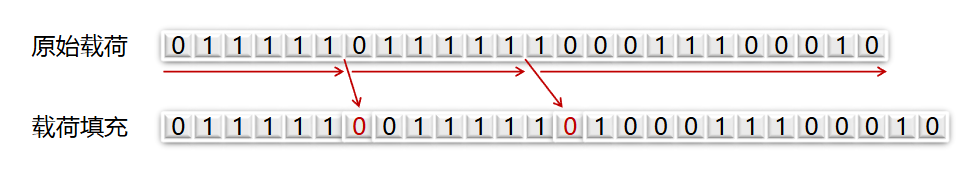

接收方处理：

1. 当出现连续 5 个 1bit 时，如果下一个 bit 是 0，那么就是有效载荷，丢弃 bit 0；
2. 如果下一个比特是 1，那么就连同后面的一个 bit 0 构成 `FLAG`，一帧结束；

​	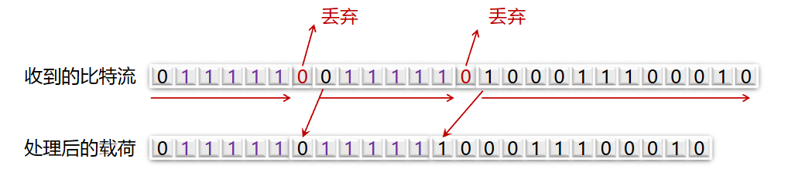

---

### 物理层编码违例

前面两种填充方法都有一种情况：数据部分可能出现定界符对应的值。为了完全规避这种情况，我们尝试挑一个数据部分不可能出现的码字当定界符。

有如下三种做法：

- 4B/5B 编码。4 比特数据映射成 5 比特，32 个码字只用了 16 个，剩下 16 个空着，正好拿来当定界符，比如 00110 这个组合不在合法码字里。
- 前导码。链路上有一段很长的前导序列，数据部分不会出现这种长串，可以拿它当定界符。传统以太网、802.11 都使用此方法。
- 曼彻斯特编码。正常信号在每个周期中间必有一次跳变，如果出现持续的高电平或持续的低电平，就是违例码，可以当定界符。应用比如：802.5 令牌环。

## 差错检测和纠正

先疏通整个逻辑关系：

1. 首先，数据在信道中难免会被噪声影响，就可能出现各种问题，比如：

	- 差错（incorrect）：数据发生错误
	- 丢失（lost）：接收方未收到
	- 乱序（out of order）：先发后到，后发先到
	- 重复（repeatedly delivery）: 一次发送，多次接受

2. 我们有几个解决方案：检错、纠错、重传

	- 检错：判断有没有错，但不能定位；
	- 纠错：判断有没有错，并且可以定位和纠正，接受端自主地进行数据恢复；
	- 重传：检错后申请重新传输

	所以更详细地说应该是 `检错+纠错` 和 `检错+重传` 两种方案

3. 想要检错，我们就得提供多余的信息来负责这个任务，这些就是冗余信息，或者说校验信息；

4. 纠错也是同理，需要冗余信息来定位出错的位置，而且纠错天生就带有着检错的能力，不过纠错也分不同的方式；


一个简单的例子是发送每一位 bit 时连续传三份，如果三份中有一位出错，就可以纠错。比如要发送信息 `0100101`，连发三份就是 `000111000000111000111`。不过这种方式冗余信息占比太高，占到 2/3，效率低下。

所以差错控制的目标就是 **既要保证一定的检测和纠错能力，又要尽可能减少冗余信息量**

两个策略：

- **检错码（error-detecting code）**

	因为检错码没有纠正的能力，所以它需要申请重传，所以适用于高可靠、误码率低的信道，比如：光纤链路；

	这种检错后重传的机制也叫做 ARQ（automatic repeat request）

- **纠错码（error-correcting code）** 

	纠错码则主要用于错误发生频繁的信道上，比如：无线链路、Wi-Fi；纠错码还大量用在物理层，以及实时流媒体、内容分发这类不能重传的场合

	使用纠错码的技术通常称为 前向纠错（FEC, forward error correction），前向的意思就是从发送端到接收端的方向


### 码字、码率、海明距离

码字（code word）：包含 m 个数据位和 r 个校验位的 n 位单元，其中 n = m + r

码率（code rate）：码字中不含冗余部分所占比例，m/n

海明距离（Hamming distance）：两个码字之间不同对应比特的数目，比如 `00101111` 和 `00000000` 的海明距离为 5

---


### 典型检错码

---

#### **奇偶校验（parity check）**

最简单基础的校验码

- 原理

	奇偶校验，即判断整串数据中 1 的总个数。使用一位校验位，发送方和接收方要共同约定好一个校验规则，分“偶校验”和“奇校验”两种。

	打个比方：如果一个发送方有 7 位有效数据 `1011010`，双方约定使用偶校验，那么此时已经满足总共 4 个 1，是偶数，所以只在最后添加一个校验位 `0`，变为 `10110100`；反之，如果双方约定使用“奇校验”，那么校验位就要变为 `1`，即 `10110101`。

	接收方查错时，根据双方采用的校验规则，然后统计数据中的 1 的个数（包含校验位），如果满足校验规则，则说明无错，反之报错；

- 缺点

	很明显，当变坏的位数为奇数时，我们能校验出来，如果是偶数个，那么就会漏检，效率和准确率都比较低；

- 改进

	使用二位奇偶检验，可以纠错。每行每列都添加一个校验位，这样单个位错会同时影响到行列，定位到具体位置。

	例如：我们要传一个 16bit 的数据，将其排成 $4\times4$ 的矩阵，横竖都计算偶校验。假如此时（3，2）的 bit 变坏了，此时就能通过行列确定唯一 bit 并进行修改

	​	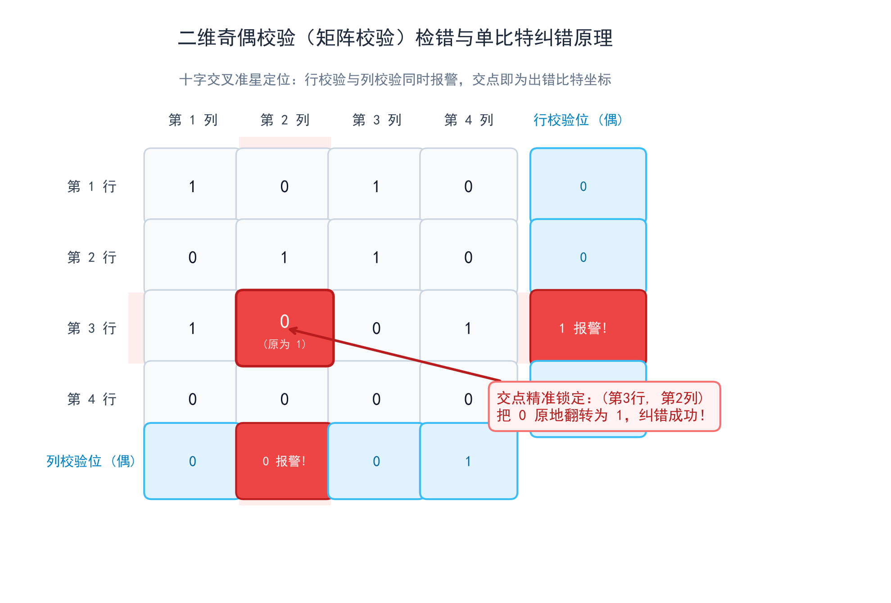

---

#### **校验和 (Checksum)**

常用于 TCP/IP 体系中的网络层和传输层

- 原理

	将数据按 16 位分组，做反码求和（端回进位），然后再按位取反，接收方验证时将所有数据加在一起，如果不出错结果会是全 1

	例如：发送方的两个数据 `1110011001100110` 和 `1101010101010101`，求和后得到 `1 101101110111011`，因为有进位，进位数字要重新卷回加到末尾，得到结果 `101101110111100`，再按位取反 `0100010001000011`，这个值就是校验和，将校验个贴在数据后面一起发送过去。

	接收方需要做的就是将数据和校验和按照反码加法加在一起，如果最后是全 1，那么证明无错误；如果出现了任意一个 0，则说明数据被噪声影响了

---

#### **CRC 循环冗余校验**

**CRC，cyclic redundancy check**，数据链路层广泛使用

- 原理

	主要用到了模 2 除法，以及除法中的余数。

	> 模 2 运算：一种在二进制数上定义的运算体系
	>
	> - 加减法运算：不考虑进位和借位，加减法的操作等价于亦或运算
	>
	> 	| num1 | num2 |     加法     |     减法      |
	> 	| :--: | :--: | :----------: | :-----------: |
	> 	|  0   |  0   | $0\oplus0=0$ | $0\ominus0=0$ |
	> 	|  0   |  1   | $0\oplus1=1$ | $0\ominus1=1$ |
	> 	|  1   |  0   | $1\oplus0=1$ | $1\ominus0=1$ |
	> 	|  1   |  1   | $1\oplus1=0$ | $1\ominus1=0$​ |
	>
	> - 乘法运算：和普通二进制乘法一致，满足逻辑与/AND
	>
	> - 除法运算：不存在借位操作，也不比较值的大小。先对齐最高有效位，如果被除数部分高位是 1 那么就给商记 1，否则为 0，之后和常数除法的步骤一样；注意，做减法时执行的是模 2 减法。
	>
	> 	比如说：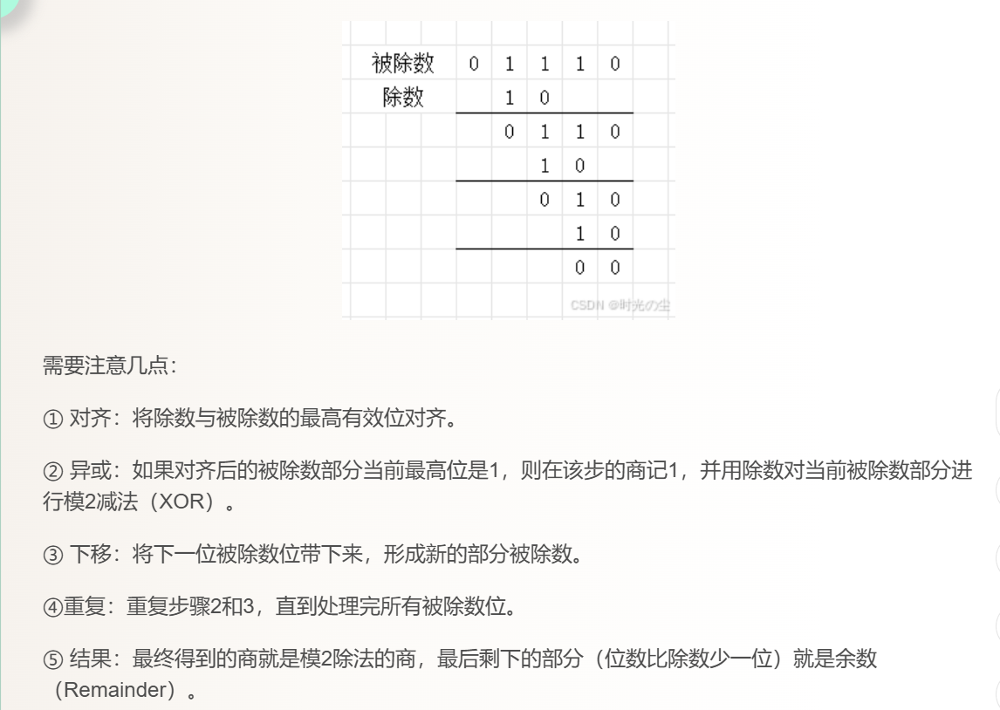

- 过程

  1. 假设我们要传 k 位有效数据 $D$，为二进制位模式；

  2. 如果要生成 n 位 CRC 校验码，那么收发双方要事先约定好一个 n+1 位的二进制位模式 G，也叫做 **生成多项式**，其中 G 的最高位是 1；

  3. 将原始数据 $D$ 乘以 $2^n$，也即在 k 位有效数据后添加 n 个 0。再用得到的结果模 2 除以生成多项式 G，得到的最终余数 R 就是 CRC 校验码（n 位，**不足时前面用 0 补齐**）；

  4. 用最终的校验码替换最初在数据后添加的 $n$ 个 0，得到的结果就是实际传输数据；

  	> 或者说将 $D$ 乘以 $2^n$ 然后加上校验码，但因为模 2 运算中加减法的效果是一样的，所以也可以说是 **减去** 了校验码。这样对应到常数除法运算中的 $\frac{被除数-余数}{除数}=商$ 也比较好理解。

  5. 接收方使用收到的数据模 2 除以多项式 $G$，如果余数为 0，则数据完好；否则数据被破坏；

- 检错能力

  能检查出不超过 n 位的突发错误。

  几个结论；

  1. G 至少有三项时，能检出所有双比特错；
  2. G 含有 x+1 这个因子时，能检出所有奇数个错；
  3. 长度超过 n 位的突发错，不一定能检出，但漏检概率很低。

- 四个国际标准

  CRC-12 = $x^{12} + x^{11} + x^3 + x^2 + x + 1$

  CRC-16 = $x^{16} + x^{15} + x^2 + 1$

  CRC-CCITT = $x^{16} + x^{12} + x^5 + 1$

  CRC-32 = $x^{32} + x^{26} + x^{23} + x^{22} + x^{16} + x^{12} + x^{11} + x^{10} + x^8 + x^7 + x^5 + x^4 + x^2 + x + 1$

- 例题

  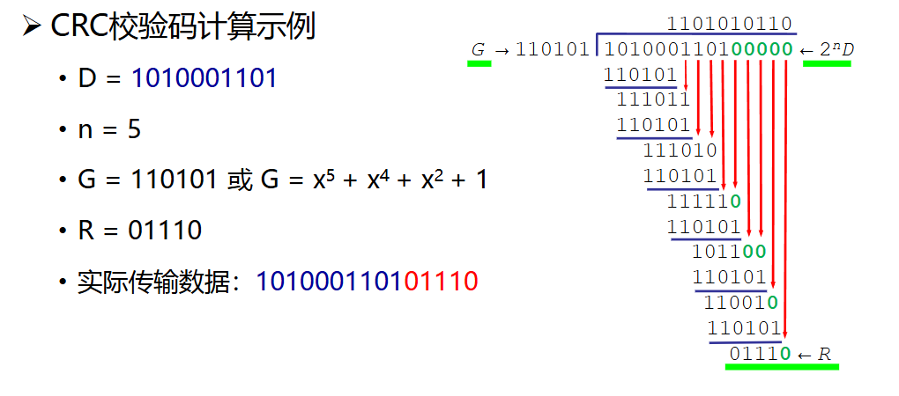

---

### 典型纠错码

检错码只需要判断出有无错误即可，纠错码需要定位到错误位置，并进行纠正。

我们做如下假设和理解：假设要传的有效数据为 m 位，校验码有 r 位，总长度为 n = m + r，我们的目标是纠正单比特错（无论哪一位翻转，接收方都能找出并纠正）

有效数据为 m 位，意味着一共有 $2^m$ 种不同的真实数据，加上校验码之后，这 $2^m$ 个正确的完整串，就是 **合法码**；如果一个合法的串的其中一位翻转，考虑所有情况，会有 n 种可能；

接收方在收到 n 位长的串时，要想能够断定这就是当初发来的那个数据，要考虑两种情况：

1. 传输良好，数据没被噪声影响变坏，唯一正确的 1 种情况
2. 路上被噪声影响，错了 1 位，共 n 种情况

所以要想让一个合法数据被认出来，不论是有错还是没错，这 n+1 种情况都要被规划为一个类中，专供这一个数据使用，也就是 n+1 个位模式；

有了上面的内容，我们就能得到一个不等式。对于 $2^m$ 个不同的合法数据，每一个要被认出来，都需要独占(n+1)种情况，所以总共就需要 $(n+1)\times2^m$ 种情况，而我们的 n 位串总共只有 $2^n$​种组合，所以我们需要的情况是不能超过这个界限的，所以有：

$(n+1) \times 2^m \leq 2^n$

将 n = m + r 代入，即可化简得到：

<span style="color:#FF3333;">**$2^r \geq m + r + 1$​** </span>

这就是海明不等式，用来确定海明码中校验位的最小数量。

同时，**只要是纠正一位错的二进制码，都必须满足这个式子，在信息论中这叫做 Hamming Bound 海明界**

---

#### hamming code

海明码

##### 海明码概述

用一句话总结：海明码就是多个奇偶校验组合得到的纠错码。

以 $(15,11)$ 海明码为例，理解整个编码过程：

这里的 15 指的是编码总长度为 15 位，11 指的是数据位，则校验位就是 4 位，满足 $m+r+1=16\leq16=2^r$；

首先挑出 4 个校验位，它们专门放在 $2^k(1,2,4,8)$ 的位置，至于为什么这么做，先按下不表；

因为码字一共 15 位，15 个数，如果用二进制数来一一对应至少需要 4 位，并且其中 `0000` 是多余出来的，我们把所有的数都列出来：

| Decimal | Binary | $2^3/1000$ | $2^2/0100$ | $2^1/0010$ | $2^0/0001$ |
| :-----: | :----: | :--------: | :--------: | :--------: | :--------: |
|    0    |  0000  |            |            |            |            |
|    1    |  0001  |            |            |            |     1      |
|    2    |  0010  |            |            |     1      |            |
|    3    |  0011  |            |            |     1      |     1      |
|    4    |  0100  |            |     1      |            |            |
|    5    |  0101  |            |     1      |            |     1      |
|    6    |  0110  |            |     1      |     1      |            |
|    7    |  0111  |            |     1      |     1      |     1      |
|    8    |  1000  |     1      |            |            |            |
|    9    |  1001  |     1      |            |            |     1      |
|   10    |  1010  |     1      |            |     1      |            |
|   11    |  1011  |     1      |            |     1      |     1      |
|   12    |  1100  |     1      |     1      |            |            |
|   13    |  1101  |     1      |     1      |            |     1      |
|   14    |  1110  |     1      |     1      |     1      |            |
|   15    |  1111  |     1      |     1      |     1      |     1      |

看 $2^k$ 对应列中值为 1 的格子，假如这个格子对应行的十进制数为 $i$，那么 15 位编码数据的第 $i$ 个数（应该是从后往前数，末尾为第 1 位）就是该 $2^k$ 校验位负责监管的。具体来讲：

| 校验位 | 负责的位                   |
| ------ | -------------------------- |
| p1     | 1, 3, 5, 7, 9, 11 , 13 ,15 |
| p2     | 2 ,3 ,6 ,7 ,10 ,11 ,14 ,15 |
| p4     | 4 ,5 ,6 ,7 ,12 ,13 ,14 ,15 |
| p8     | 8 到 15                    |

假设我们发送的编码数据为 `0101010x101x1xx`，其中的 `x` 都是校验位。因为每个校验位都管理了一批对应位的数据，这每个组都可以看作是一个奇偶校验。根据四个组的奇偶校验结果，用具体的校验位值替换 `x`，就能得到编码后的数据。

如果有一位发生了错误，比如上面例子中的第 7 位，由 1 变为了 0。因为 7 这个数字是同时由 $2^2,2^1,2^0$ 这三个校验位同时负责监管的，所以这三组奇偶校验都会返回错误，我们就将这三个校验位对应的值加起来，即 4+2+1 = 7，便找到了错误位，我们直接将 0 换为 1 就完成了纠错。

> 上面的说法比较啰嗦，有更直白的方式：
>
> 15 位数据，假如第 i 位出了错，只要是包含了第 i 位的奇偶校验，它们都会出现错误，这个校验位就被记为 1，没错的则为 0。因为这四个校验位的组合就是一个 1-15 中的数，是唯一的，所以我们自然就能确定一个唯一的数，就是这个错误比特的位数。

可以借助图像理解：

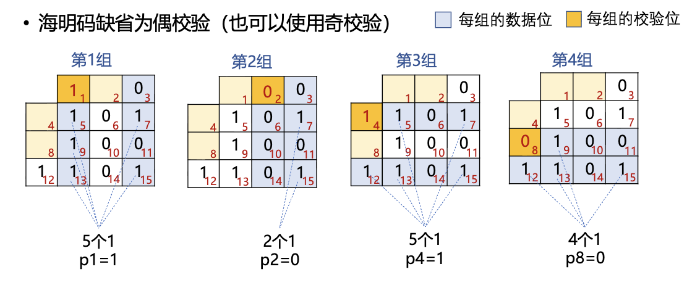

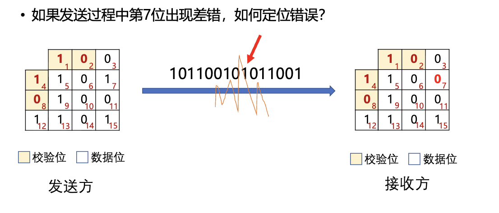

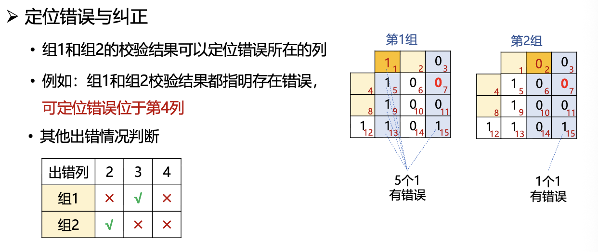

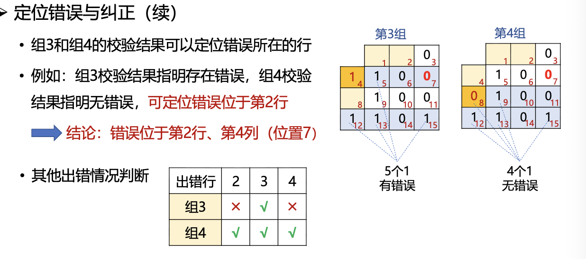

##### 关于海明码

- 海明码规模与扩展海明码

	1. 前面使用了 $(15,11)$ 海明码作为了例子，所以实际上海明码也确实分很多类，比如 $(3,1), (7,4), (31,26)$ 等等，并且随着数据越长，校验位 $r$ 占总长度的比例急剧下降

	2. 因为计算机硬件更喜欢字节对齐大小的数据，比如 8，16，32，64 位等，而不是我们的 11 位，假如现在有一个 8 位数据，我们可以这样规定：

		首先将 m = 8 带入海明不等式，验证得到当 r = 4 时才能满足需求。我们还要在数据最开始添加一位全局奇偶校验位 $P_0$，这样码字的总长度就变为了 8+4+1 = 13 位。

		利用四位校验，我们依旧能确定到唯一的错误位并纠错，同时添加了全局奇偶校验位，这样实现了两位检错。因为如果两位出错，全局校验是没问题的，但是局部的海明累加器发现内部有问题。

		接受端可以根据下表进行判断：

		| $P_0$ | 海明累加 $S$ | 结果和处理                      |
		| ----- | ----------- | ------------------------------- |
		| 正常  | $S=0$       | 完全无错                        |
		| 报错  | $S\neq0$    | 单比特错，出错位置为 $S$         |
		| 报错  | $S\neq0$    | 双比特错，无法纠正，需要重传    |
		| 报错  | $S=0$       | 仅全局校验位 $P_0$ 出错，数据完好 |

- 海明码纠正突发错误

	原因：普通海明码只能纠一位错，而现实的物理信道中，这种错误往往是连着好几个比特的，，即 **突发错误(Burst Error)**。

	处理：一次性将多个码字组成矩阵，比如将 $k$ 个码字组成 $k \times n$ 矩阵，按列发送，接收方再恢复成矩阵；

	原理：按列发时，如果传输途中受到一连串噪声干燥，导致了连续几个比特的破坏，这样恢复后，这些错误也会平摊开，对于每一行来说只错了一个比特，于是就可以利用海明码进行纠错了。


#### Reed-Solomon Code

RS 码，全称为里德-所罗门码（Reed-Solomon Code）。

##### RS 码概述

思考一个问题：前面海明码已经可以纠错，为什么还要搞出个 RS 码？

原因在于操作的基本单位不同：
- 海明码是基于比特的，只能纠正单比特错，并且海明码无法应对突发错误。
- RS 码是基于符号(Symbol) 设计的，一个符号是 m 位二进制，比如 m = 4 就是 4 位一个符号，m = 10 就是 10 位一个符号。

这样有个好处：RS 码只要纠正了 1 个 Symbol，就等于纠正了这个符号里的连续多个 bit，所以它对抗突发错误的能力更强。

##### 参数与规则

RS 码通常记作 (n, k) RS 码：

- k：表示有 k 个数据符号(Message Symbols)；
- n：编码后的总符号数(Codeword Symbols)；
- n - k：校验符号数(Parity Symbols)；
- m：每个符号包含的 bit 数，运算定义在有限域 $GF(2^m)$ 上。

纠错能力：
$$
\begin{aligned}
& \color{red}{n - k = 2t \quad \Longrightarrow \quad t = \frac{n - k}{2}} \\
&t：表示该编码能够纠正的错误符号数量
\end{aligned}
$$

> 为什么校验符号数必须是 $2t$？
>
> 因为每个 Symbol 包含多位信息，不仅要找错误位置，还要看错成了什么值。纠正一个符号错，需要一个符号提供位置信息，还需要一个符号提供数值信息。所以纠正 t 个错要给出 2t 个校验符号。

##### 编码过程

跟 CRC 几乎一样，只是将运算换到有限域中。

以（15，11）RS 码，m = 4 为例了解编码过程：同样的，这里的 11 表示数据符号数，15 表示总的编码符号数，那么校验数据就是 n - k = 2t = 4 个 Symbols；假设原始数据为 [1, 2, 3, 4, 5, 6, 7, 8, 9, 10, 11]，其中每个数为一个 Symbol。

1. 在数据后面补 $2t=4$ 个 0，并用多项式的形式表示；

2. 除以生成多项式
	$$
	\color{red}{g(x) = \prod^{2t-1}_{j=0}{(x-\alpha^{j})}}
	$$
	即：$g(x) = \prod^{3}_{j=0}{(x-2^j)} = (x-1)(x-2)(x-4)(x-8) = x^4+15x^3+3x^2+x+12$

3. 取最终的余数[3, 3, 12, 12]加到补了0的原始数据中；

	> 在有限域$GF(2^m)$里的计算也是加减法完全等价的，所以这里的“加”其实可以理解为“减”；而在除法过程中的减法也满足异或运算，可以将系数展开为二进制数然后进行计算。

4. 得到最终的编码，也可以用多项式表达$C(x)$；

##### 解码过程

1. 计算伴随式(Syndrome)：无错时把 α 的各次幂代进码字多项式，结果都是 0；有错时结果是 S，它只跟错误有关，跟原始数据无关。
2. 定位错误位置并求出错误值： v 个错就有 2v 个未知数，位置 X 和值 Y；有 2t 个方程，所以 t 个错以内可解。
3. 恢复原始信息。把错误多项式 E(x) 加到收到的 R(x) 上，纠完删掉冗余符号，剩下的就是原始数据。


##### 实际应用

- **高速以太网**：在 200G/400GBASE-R 中广泛采用 **RS(544, 514)** 编码。每个符号为 10 bit（$m=10$），校验符号为 $544 - 514 = 30$ 个（$2t=30$），能够纠正整整 $t=15$ 个符号的错误！
- **分布式云存储**：华为云等公有云对象存储中的纠删码（Erasure Code, EC），底层数学根基就是 RS 算法，通过数据分块加冗余分块，允许任意挂掉几块硬盘仍能完整还原数据。

##### RS 码的编解码流程（以课件中的 $(15, 11)$ 为例）

2. **解码与纠错三步走：**
	- **第一步：计算伴随式（Syndrome）**
		接收端收到含错数据 $R(x) = C(x) + E(x)$，将根代入计算 $S_i = R(\alpha^i) = C(\alpha^i) + E(\alpha^i) = 0 + E(\alpha^i) = E(\alpha^i)$。
		若 $S_i$ 全为 0，说明无差错；若不全为 0（课件中算出 $S = [2, 10, 9, 1]$），说明有差错，且 **综合征只与错误 $E(x)$ 有关，与发送的原本数据毫无关系**！
	- **第二步：定位错误位置与计算错误大小**
		设错误位置为 $X_1, X_2$，错误值为 $Y_1, Y_2$。构造错误位置多项式 $\Lambda(x) = (1+X_1 x)(1+X_2 x) = 1 + \Lambda_1 x + \Lambda_2 x^2$。利用已知的 $S_i$ 联立方程组：
		$$
		\begin{cases}
		S_2 + \Lambda_1 S_1 + \Lambda_2 S_0 = 0 \\
		S_3 + \Lambda_1 S_2 + \Lambda_2 S_1 = 0
		\end{cases}
		$$
		代入 $S$ 解出 $\Lambda_1 = 14, \Lambda_2 = 14$，分解因式 $\Lambda(x) = (1+4x)(1+10x)$，得出位置因子 $X_1 = 4 = 2^2$（位置 2 项）、$X_2 = 10 = 2^9$（位置 9 项）。
		再代回求出错误幅值 $Y_1 = 4, Y_2 = 6$，得出错误多项式 $E(x) = 6x^9 + 4x^2$。
	- **第三步：恢复原始信息**
		在有限域中加减等价，$C(x) = R(x) \oplus E(x)$，直接将对应位置的错误修正，再删掉末尾 4 个校验符号，完美还原出原始数据。

> **工业延展（课件第 55 页）：云存储 Erasure Code（纠删码）**
> 公有云对象存储把硬盘或存储节点视为 EC 纠错码存储池。对象大小不确定时，若补零填充会浪费存储空间；若不补零，则需要多次覆盖写来保证原子性，降低吞吐量。业界如华为云提出了 On-line Streaming Erasure Coding 和 Flex Erasure Coding 来兼顾存储效率与计算复杂度。


## 基本的数据链路层协议

## ### 假设和事件

这一节开始讨论如何设计协议来实现两台机器之间稳定正确地收发数据。通过假设减少限定条件，后续每去掉一个假设就需要一个新的更加完善的协议来工作。

三条基础假设如下：

1. 分层进程独立。即网络层、链路层和物理层分别运行在独立进程中，通过API消息调用和交互；
2. 提供可靠服务。链路层向上提供可靠的面相连接的服务，网络层随时有数据可以交到链路层；
3. 只处理通信错误。我们假设主机不会断电、重启、蓝屏等系统崩溃，仅仅考虑数据在新到中发生的丢失和错误。

所有协议都使用同一套规则：发送方和接收方各跑一个无限循环，等待事件发生，再按事件类型动作。

事件主要分为三种；

1. frame_arrival，**帧到达**；
2. cksum_err，**帧出错**；
3. timeout，**超时**。


一些数据结构和常用的原语对应的伪代码，可以对照理解工作方式

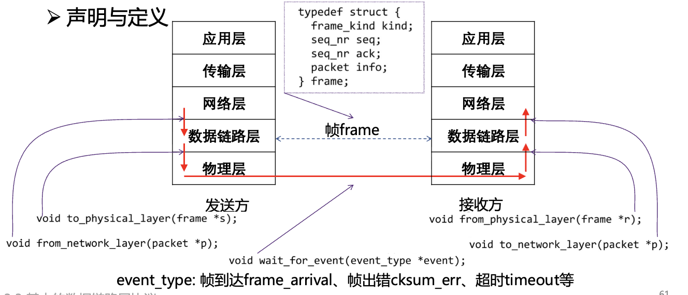

```c
typedef struct {
    frame_kind kind;  // 帧类型：数据帧、ACK、NAK 等
    seq_nr seq;       // 帧序列号
    seq_nr ack;       // 确认号
    packet info;      // 网络层数据分组（Payload）
} frame;
```

- `from_network_layer(&packet)`：从网络层获取数据；
- `to_network_layer(&packet)`：将解封装后的数据递交给网络层；
- `to_physical_layer(&frame)`：将帧传给物理层发送；
- `from_physical_layer(&frame)`：从物理层接收到达的帧；
- 事件驱动循环：一个死循环，调用 `wait_for_event(&event)` 监听底层和上层事件：
  - `frame_arrival`：物理层收到了一个帧；
  - `cksum_err`：收到了一个坏帧（校验和错误）；
  - `timeout`：定时器超时（发出去的数据很久没收到回复）；


### Utopian Simplex Protocol

乌托邦式单工协议

是一种理想世界中不存在的完美协议，它有四个假设：

1. 单工信道：数据只往一个方向传；
2. 完美信道：帧不会丢失也不会损坏；
3. 始终就绪：双方的网络层永远有数据要发、也永远有空接受；
4. 瞬间完成：收发都能瞬间处理无穷多的数据；

既然什么问题都不存在，那么协议也什么都不用做，收发双方的处理方式如下：

- 发送方：不断循环从网络层拿数据 $\to$ 打包成帧 $\to$ 交给物理层发送。
- 接收方：不断循环等待物理层帧到达 $\to$ 提取数据 $\to$ 递交给网络层。

这对应的是无确认无连接服务。该协议没有差错控制和流量控制，算是一个理想的起点，后续新添加的机制都是为了弥补现实的漏洞。


### Stop-and-Wait 停等协议

#### 无错信道单工停等式协议

A Simplex Stop-and-Wait Protocol for an Error-Free Channel

去掉假设“瞬间完成”，传输、接收、处理都需要时间，所以发送方发得比接收方处理快，接收方会被**淹没（Overwhelming）**。

引入基于反馈的流量控制：**停等机制（Stop-and-Wait）**

- 发送方每发送一帧后，必须停下来等待；
- 接收方成功接收并处理完这一帧后，向发送方回复一个确认帧——**ACK**；（所以物理上应需要双向链路，实际用的应是半双工）
- 此时因为信道依然假设无差错，确认帧里面放什么内容都无所谓，甚至可以是一个没有任何有效载荷的空帧，也叫 **哑帧 dummy frame**；
- 发送方只有在收到这个 ACK 后，才被允许继续发送下一帧。

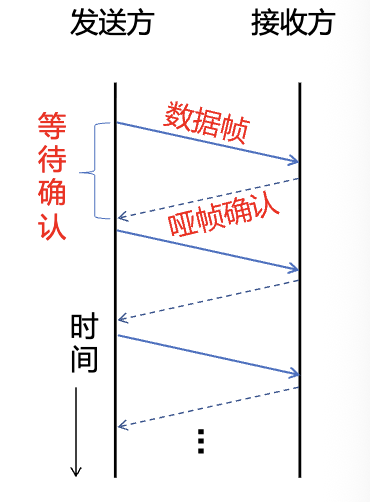


### 有错信道上的停等协议

A Simplex Stop-and-Wait Protocol for a Noisy Channel

去掉完美信道的条件，现在信道速度有限，而且数据会出错甚至丢失，具体来说：

- 帧被破坏，接收方靠校验可以发现，但是发送方不知道；
- 帧丢失，接收方什么都没收到，发送方同样不知道；

这两种情况，发送方都是一直在干等，而收不到确认这件事本身没有任何反馈，所以发送方会一直等待ACK，双方会陷入死锁。

1. 对于帧丢失，我们可以使用**计时器（Timer）**解决。发送方每发送一帧就开启定时器，如果规定时间内没有收到ACK，触发timeout，默认这一帧丢失，自动重发。

	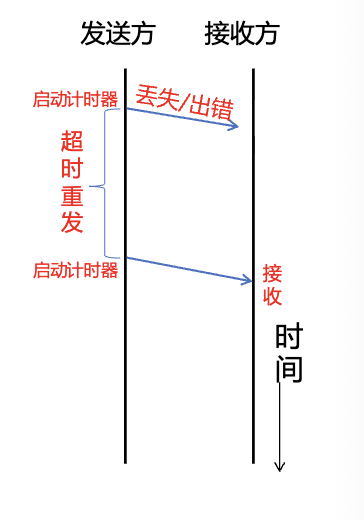

2. 还有一种情况，接收方收到了数据，并且发送了ACK，但是ACK在路上丢了，A又重发了数据。这时候，如果接收方不加以分辨，很可能将两份一样的内容交给网络层，造成重复交付。

	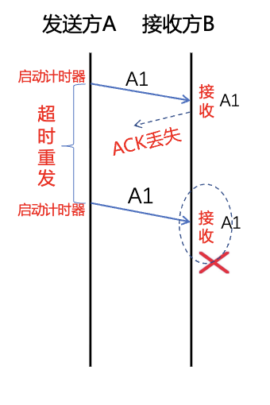

	解决方式是给数据帧添加**序列号（Sequence Number, SEQ）**

	> 在**停等协议**中，我们只需要**1位/1bit的序列号就足够**了。
	>
	> 因为停等协议每次只发一帧，所以接受端唯一需要区分的就是当前帧和它的下一帧，所以只需要0和1交替循环即可区分新帧和重传帧。

	序列号同时还解决了一个问题，我们可以通过检查ACK是否正确来确认对方是否收到。举个例子：发送方发送序号0的数据，接收方收到并回复ACK0，但是路上比较慢，超时了；发送方重传数据，这次接收方收到回复后，发送方也收到了；发送方这次发送序号1的数据，接收方收到并回复ACK1，但此时我们之前卡了很久的第一个ACK0传到发送方了，和发送方等待的ACK对不上，所以不接受，这就是错误确认的情况。

	这套超时重发+序号重拍的机制，叫做**自动重复请求（ARQ, Automatic Repeat reQuest）**，也称作**肯定确认重传（PAR, Positive Acknowledgement with Retransmission）**

	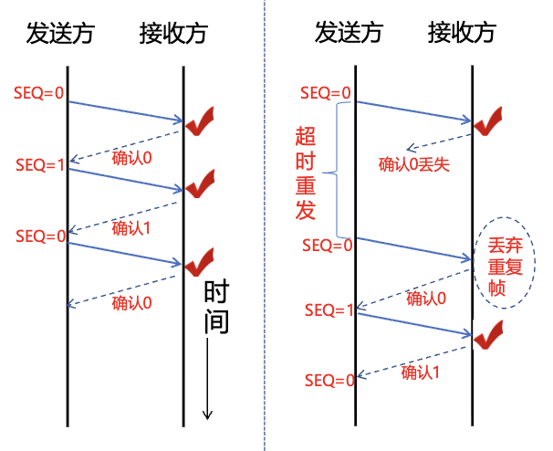

- 停等协议的工作流程

	发送方：

	1. 序号初始化为0，发送一帧，启动定时器；
	2. 等待三种结果：正确的确认、错误的确认、超时；
	3. 收到正确确认，发送下一帧，重置定时器；
	4. 超时或收到错误确认，重发当前帧；

	接收方：

	1. 期待 0 号帧；
	2. 收到正确帧，交给网络层，回该帧的确认；
	3. 收到错误帧，回上一个成功接收帧的确认。


### 停等协议的效率与利用率

一些基本量：

1. $F$：帧长，单位 bit
2. $B$：带宽，单位 bit/s
3. $t_{frame}$：发送一帧的时间，等于$\frac{F}{B}$
4. $D$：单程传播时延，等于$\frac{物理距离 d}{电磁波传输速率v}$，通常双绞线/光纤中的波速约为 $2\times10^8 m/s$
5. $2D$：往返传播时延

在停等协议的一个周期中，忽略接受端处理时延和短小的 ACK 传输时间，发一帧用$t_{frame}$，等待往返需要$2D$，所以

**总周期**为：
$$
\color{red}{T_F = t_{\text{frame}} + 2t_{\text{prop}}}
$$
**利用率**为：
$$
\color{red}{U = \frac{t_{frame}}{t_{frame}+2D}=\frac{1}{1+2a}}
$$

$$
其中:a = \frac{D}{t_{frame}}
$$

这里的a是一个无量纲量，是传播时延和发送时延的比值，它衡量了链路有多“长”。

还有一个值：**时延带宽积$2BD$** 。表示信道里最多能装多少比特。

> 补充：时延带宽积（$2BD$）归一化表示法
>
> 有些教材，如 Tanenbaum 喜欢把单帧发送时间归一化为 1，并将信道速率 $B$ 换算为“每秒能发多少帧”：
>
> - $D$（Delay）：单向传播时延（即 $t_{\text{prop}}$）；
> - **$2D$**：往返传播时延；
> - **$2BD$**：往返 **时延带宽积（Bandwidth-Delay Product, BDP）**，物理含义是 **“数据在往返的路上时，整条信道管道最多能容纳的帧数”**；
> - **$w$**：连续发送的帧数。在停等协议中，发 1 帧就必须停下等待确认，所以 **$w = 1$**。
>
> 此时信道利用率公式写为：
> $$
> \color{red}{\text{link utilization} \le \frac{w}{1 + 2BD}}
> $$
>
> * 两式完全等价：$2a = \frac{2 t_{\text{prop}}}{t_{\text{frame}}} = \frac{2D}{F/B} = \frac{2BD}{F}$，本质上就是折算成“帧数”的时延带宽积 $2BD$。
> * 为什么说“当 $w = 1$ 时，利用率 $\le 50\%$”？
> 	因为在有一定物理距离的实际链路中，往返传播时延往往大于发送单个短帧的时间（即往返时延带宽积 $2BD \ge 1$）。代入公式得：
> 	$$U \le \frac{1}{1 + 2BD} \le \frac{1}{1 + 1} = 50\%$$
> 	发送方绝大部分时间都在干等 ACK 回来，信道利用率极低！这就是为什么要引入 **流水线和滑动窗口**（把 $w$ 撑大，使 $w \ge 1 + 2BD$）。

#### QUIZ 2

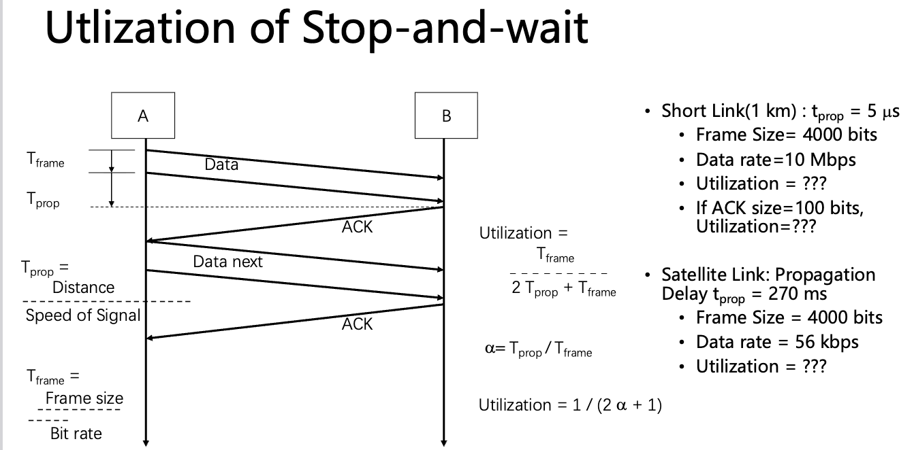

1. 短距离局域网：$1\text{ km}$ 链路，带宽 $10\text{ Mbps}$，帧长 $4000\text{ bits}$，$t_{\text{prop}} = 5\ \mu\text{s}$。
   $t_{\text{frame}} = \frac{4000}{10^7} = 400\ \mu\text{s}$。此时 $a = \frac{5}{400} = 0.0125$。
   利用率 $U = \frac{1}{1 + 2 \times 0.0125} \approx 97.5\%$，利用率很高。
2. 卫星链路：
   信道带宽 $1\text{ Mbps}$，帧长 $1000\text{ bits}$，单向传播时延 $270\text{ ms}$（卫星通信典型值）。
   - 发送时延 $t_{\text{frame}} = \frac{4000}{56000} = 71.4\text{ms}$；
   - 往返传播时延 $2t_{\text{prop}} = 540\text{ ms}$；
   - 总周期 $T_F = 71.4 + 540 = 611.4\text{ ms}$；
   - **信道利用率 $U = \frac{71.4}{611.4} \approx 11.7\%$**


### 长肥网络

 LFN, Long Fat Network

定义：带宽时延积明显大于 10 的 5 次方 bit，约 12 kB 的网络，叫长肥网络。例如卫星通信、跨洲光纤专线等。

从quiz中我们能够发现，这里的数据传输，71.4ms在发，540ms在等。

直觉上的解法是增大帧长，延长发送时延，让a变小，按照利用率公式来看，利用率好像变高了。

但实际上因为帧的最大长度受信道**比特误码率（BER, Bit Error Ratio）**的制约。所以帧越大，帧在空中遭遇噪声出错的概率是指数级暴增的，一旦坏掉整帧必须要重传，这样收益会被吃掉，而且还会引发更多的丢包和重传，雪球越滚越大，吞吐量不升反降。

最终的解决方法是，保持适中的帧长，摒弃低效的停等模式，允许发送方不等确认连续发送多个帧，这就是流水线协议和滑动窗口协议


## 滑动窗口协议

**滑动窗口协议，Sliding Window Protocols。**

停等协议的缺点是无法将信道填满，利用率不高，所以我们让发送方连续发多个帧。这样又有两个问题：

1. 一次能发多少帧？
2. 中间某一帧出错或者丢失怎么办？

这就是本章节讨论的内容。

- 窗口机制

	通信收发双方分别维护一个缓冲区，这个缓冲区就是 **窗口(Window)**，具体分为：

	- 发送窗口（$W_T$）：发送方在没有收到任何 ACK 的情况下，最多可以连续发出的帧数量
	- 接收窗口（$W_R$）：接收方允许连续接收和缓存的帧数量

- 窗口滑动工作机制

  1. 发送端：

  	每发送一帧，发送窗口的下限保持不动，可用额度减少（下图的意思是发出后就要移动下限，实际上已发送未确认的帧依旧是在窗口中的，下限并不会动，只有收到 ACK 后上下限同时动）；

  	当收到新的 ACK 后，发送窗口向前滑动，释放出新的可用发送额度。

  2. 接收端：只有落入接收窗口内部的帧序号才会被接收。每当**期待的最小序号帧**正确收到并递交给上层后，接收窗口也向前滑动一步。

    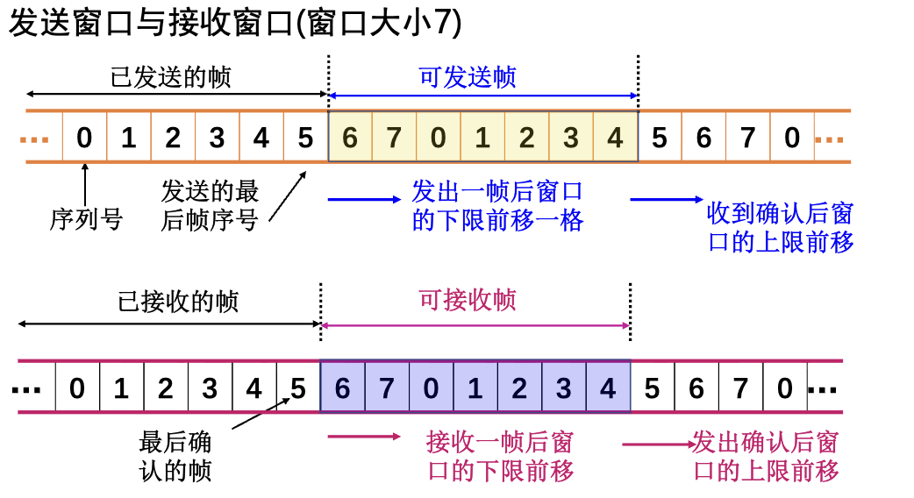

    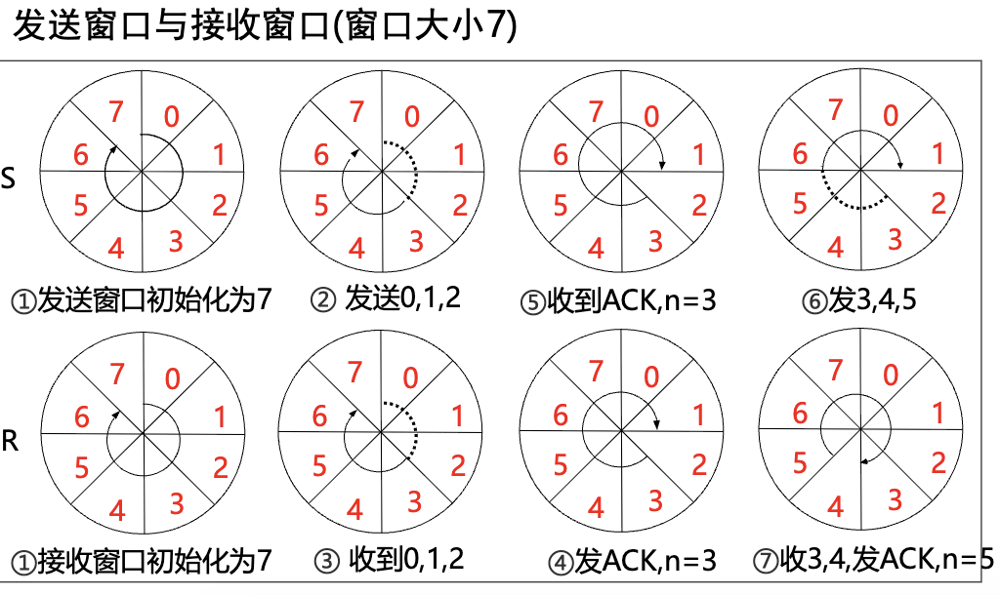

  3. 累计确认（Cumulative ACK）：接收端不必每收到一帧都发一个 ACK，可以对按序到达的最后一个帧发一次确认，表示“该帧及之前的所有帧均已正确收到”。

  4. **稍带确认（Piggybacking）**：在双向通信中，如果接收端正好也有数据要回传给发送端，可以把 ACK 编号直接塞到回传的数据帧头里一起带回去，极大地节省了单独发送 ACK 控制帧所占用的带宽。

    流量控制的方法：若接收端缓冲区满，可回传 **`RNR`（Receive Not Ready）** 报文暂停对方发送。

- 一个简单的滑动窗口协议实现

	这里用最简的 1-bit 滑动窗口协议来说明。发送窗口和接收窗口大小均为 1，序号空间仅有 0 和 1。它本质上就是停等协议和双向稍带确认的结合体，机器既是接收方又是发送方

	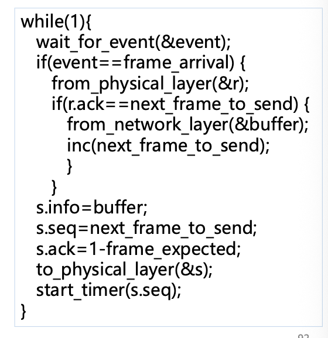

	最下方是组装待发的数据帧 `s` 的过程，`s.info` 为帧载荷，`s.seq` 为当前要发的帧序号，`s.ack` 是发送方做的稍带确认，告诉对方前一帧已经成功收下；`to_physical_layer(&s)` 是交给物理层进行发送，`start_timer` 为计时器。

	首先在循环中监听事件，`wait_` 是挂起等待事件；如果事件是 `frame_arrival` 即收到了一个帧，先从网卡把这个帧读出来到 `r`，然后再进行判断，对方确认的帧是否是我们刚刚发出去的，然后进行一个简单分支；如果是的话就从网络层读取新 packet 装到 buffer，同时改变发送序号；如果不是，则会 timeout，进入到挂起等待事件。


---

### 回退 N 协议

#### 协议概述

**回退 N 协议，GBN，Go-Back-N**

- 核心思想

	接收方按照严格顺序接收帧。如果收到期待帧，比如 2 号帧，就接收并且窗口前移，回复 ACK2；当接收端收到一个出错帧或者乱序帧，不论后续紧接着到的的帧是否完好并且正确，接收方都一律丢弃，并回复上一个正确收到的 ACK1。

- 设计与处理

	1. **接收窗口为 $\color{red}1$**，只能按顺序接受帧
	2. **发送窗口大小限制** 为：$\color{red}{1 < W_T \le 2^n - 1}$（$n$ 为帧序号的二进制位数）
	3. 定时器设计：发送端只为最早发送但还未被确认的那一帧维护一个定时器
	4. 超时动作：发送端必须退回到出错的那一帧，将该帧以及之后发过的所有帧全部重新发一次

	> **Q：为什么限制 GBN 的发送窗口？**
	>
	> 举个例子，假如我们用 3 bit 序列号，则一共有 8 个号，即 0～7。
	>
	> 假如发送窗口取 $W_T=2^n=2^3=8$，发送方一次醒把 0～7 这 8 个号全部发完，接收方全部正确收到，接收窗口滑动，等待下一轮的 0 号帧，并向发送方发回 ACK。
	>
	> 如果此时这些 ACK 都在路上丢了，那么发送方定时器发现 timeout，就会重传，重新发送旧的 0 号帧。这时候，接收方无法判断这个 0 号帧是丢了的旧数据还是新一轮数据，产生了二义性，为了避免这种情况，所以要留空一个位置。

- 过程分析

	1. 回退 N 步协议允许发送方发送多个分组而不用等待确认，最多可以发送 $W_T$ 个；发送方收到期望 ACK 后进行窗口滑动，再发送新进入窗口的 PDU，始终保持窗口中有 $W_T$ 个 PDU 未确认；超时重发要回退窗口，超过最大重发次数 $N_{max}$ 要做特殊处理；

	2. 接收方按序接收，回复 ACK(k)表示对第 k 及以前编号的 PDU 的确认，期望接收第 k+1 号 PDU

		> 也有流派认为 ACK(k)是确认第 k-1 及以前的 PDU，期望接收第 k 号，因为这种理解在实现时可以利用指针便于发送端操作，所以现代协议更倾向于使用 k-1 的理解，比如 TCP 协议

	3. 正常情况下，收发双方根据帧确认进行窗口移动；

	4. 假如发送过程中 2 号包丢失，发送方没有收到接收方的 ACK2，后续的 3、4 号包都收到了接收方返回的 ACK1；

	5. 一段时间后，发送端确认 timeout，没有收到 ACK3、ACK4，进行重传；

#### GBN 优缺点

- **优点**：接收方逻辑极其简单，不需要分配任何额外的乱序缓存空间（$W_R=1$）。
- **缺点**：在信道误码率较高时，仅仅因为丢了一帧，就会导致后面已经顺利到达的大量正常帧被无辜连累重传，严重浪费网络吞吐量。

---

### 选择重传协议

#### 协议概述

**选择重传，SR，Selective Repeat**

- 核心思想

	GBN 协议带来的性能惩罚比较严重，SR 协议则允许接收方把乱序到达的好帧先暂存起来，只重发错帧

- 设计与处理：

	1. **接收窗口大小**：$\color{red}{W_R > 1}$

	2. **发送窗口大小：$\color{red}{1<W_T\leq2^{n-1}}$，且应小于等于序号空间的一半**

		> **Q：为什么 SR 的窗口尺寸必须满足 $W_T + W_R \le 2^n$（通常 $W_T = W_R \le 2^{n-1}$）？**
		>
		> A：保证新旧窗口所涵盖的序号区间绝对不能有任何交叠，比如一个 3bit 编号，SR 窗口最大只能对半分，开到 4

	3. 接收端内部有缓冲区，如果 2、3 号帧丢失，后续的 4、5 号帧正常到达，接收方会将其先缓存在接收窗口中；同时接收方回复 NAK2、NAK3，告诉发送方缺少 2 号、3 帧，需要补发；发送发再次重发并到达后，接收方确认所有帧都正确接收后，再将 2、3、4、5 号帧按顺序交付给网络层，最后移动接收窗口。

	4. 发送端的定时器设计需要为每一个发送出去的帧独立分配，哪个帧的定时器超时，或者收到接收方回复的对应帧的 NAK，就单独重传那个出错的帧。

		- **差分定时器链表/软件多定时器队列（timer queue）**

			要为每个帧都独立设置定时器是不现实的，每次 tick 修改 CPU 都得遍历数组来修改数据，这个开销是巨大的，所以我们使用一个差分链表来维护所有定时器，如图所示：

			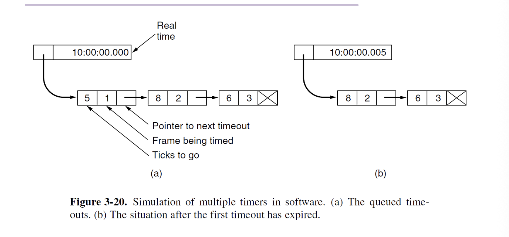

			其中，每个节点记录三个内容：相对于前一个节点的时间差、为第几号帧定时、指向下一个要超时的节点。还有在左上角的真实时间。

			以图中数据为例，工作时，第一个节点在 5 个 tick 后超时；每个 tick 过来后，CPU 只需要将第一个节点中的 5-1 = 4，后续节点都无需修改；直到第一个节点的 tick 归零，将其从链表头部弹出，表头变为第二个节点，继续执行刚才的操作。

- 过程分析

	1. 发送方依旧可以发送多个分组，与 GBN 协议不同的是，这里的接收窗口大小大于 1；
	2. 正常情况正常收发，窗口右移；
	3. 假如发送方一次发送包 0～4，发送过程 2 号包丢失，此时依旧能返回 ACK0、ACK1、ACK3、ACK4；在收到 ACK2 之后发送端已经移动到 2～6 了，所以 packet5、6 也可以被发送；此时接收方将 3、4、5、6 均缓存，只等待分组 2 的计时器超时后重发；
	4. 重发接收到后，整理好所有内容交付给网络层

> **Q：SR 的效率一定永远高于 GBN 吗？**
> 不一定。 在 **反向 ACK 频繁丢失** 的恶劣网络环境下，选择重传 SR 的效率反而可能不如 GBN。
> 因为 GBN 采用 **累积确认**，后面的 ACK 可以自动为前面丢失的 ACK“补票”；而 SR 依赖对每个帧的独立确认，若 ACK 丢了，发送端哪怕接收端早就收到数据，也只能傻傻超时并重复发送该数据帧。

---

#### GBN vs SR 

| 维度 | 停-等协议（Stop-and-Wait） | 回退 N 协议（GBN） | 选择重传协议（SR） |
| :--- | :--- | :--- | :--- |
| **发送窗口 $W_T$** | $W_T = 1$ | $1 < W_T \le 2^n - 1$ | $1 < W_T \le 2^{n-1}$ |
| **接收窗口 $W_R$** | $W_R = 1$ | $W_R = 1$ | $W_R = W_T \le 2^{n-1}$ |
| **失序到达帧处理** | 丢弃 | **坚决丢弃**，不缓存 | **在窗口内暂存缓存** |
| **确认方式** | 逐帧确认 | **累积确认**（ACK $k$ 代表确认至 $k$） | **单帧独立确认 / NAK** |
| **定时器数量** | 1 个 | **1 个**（绑在最老未确认帧上） | **多个**（每个未确认帧独立计时） |
| **重传范围** | 仅当前单帧 | **超时后回退重传整窗所有帧** | **仅针对性重传出错的单帧** |
| **复杂度与开销** | 极低 | 接收端无需缓存，逻辑简单 | 接收端需要较大缓存，硬件开销较高 |

---

### 滑动窗口协议链路利用率公式汇总

设单向传播时延与发送时延之比为 $a = \frac{t_{\text{prop}}}{t_{\text{frame}}}$，信道中单帧出错的概率为 $P$：

#### 1. 无差错信道下的滑动窗口利用率
- **常规情况（单向数据传输 / ACK 耗时可忽略，课件第 87 页）**：
  - 当窗口大小 $W \ge 1 + 2a$ 时：发送窗口足够大，ACK 还没回来之前新数据已经源源不断发出，流水线完全充满：
    $$U = 1 = 100\%$$
  - 当窗口大小 $W < 1 + 2a$ 时：发完 $W$ 个帧后必须停下来等 ACK，管道没填满：
    $$U = \frac{W \cdot t_{\text{frame}}}{t_{\text{frame}} + 2t_{\text{prop}}} = \frac{W}{1 + 2a}$$
- **双向捎带确认情况（Piggybacking，课件第 88 页）**：
  若反向传输同样大小的数据帧来捎带 ACK（即 $t_{\text{frame}} = t_{\text{ACK}}$），往返周期变为 $2t_{\text{frame}} + 2t_{\text{prop}}$，此时：
  $$U = \begin{cases} 1 & (W \ge 2a + 2) \\ \frac{W}{2 + 2a} & (W < 2a + 2) \end{cases}$$

#### 2. 有差错信道下的 ARQ 链路利用率
引入几何分布，一帧成功传输所需的平均发送次数为 $N_r = \sum_{i=1}^\infty i P^{i-1}(1-P) = \frac{1}{1-P}$：

- **停-等 ARQ**：
  $$U_{\text{Stop-Wait}} = \frac{1-P}{1 + 2a}$$
- **选择重传 ARQ（Selective Reject / SR）**：
  $$U_{\text{SR}} = \begin{cases} 1 - P & (W \ge 1 + 2a) \\ \frac{W(1-P)}{1 + 2a} & (W < 1 + 2a) \end{cases}$$
- **回退 N ARQ（Go-Back-N / GBN）**：
  $$U_{\text{GBN}} = \begin{cases} \frac{1 - P}{1 + 2aP} & (W \ge 1 + 2a) \\ \frac{W(1-P)}{(1 + 2a)(1 - P + WP)} & (W < 1 + 2a) \end{cases}$$


## 数据链路协议实例

### PPP 协议（Point-to-Point Protocol）

**点对点协议**，由 IETF 制定，编号RFC 1661，是目前通信网络中使用最广泛的数据链路层协议之一（多用的其实是变体PPPoE）。例如：拨号连接、路由器间串行链路等

设计目标是两个能够：能够在不同链路上运行，能够承载不同的网络层分组。特点就是简单、灵活。

- 实现的功能
	1. 用帧定界符封装成帧；
	2. 用填充技术实现透明传输，字节填充和零比特填充都有；
	3. 帧的差错检测；
	4. 实时监测链路工作状态；
	5. 设置链路最大传输单元 MTU；
	6. 网络层地址协商机制；
	7. 数据压缩协商机制。
- 未实现的功能
	1. 帧数据的纠错。PPP 只检错，PPP 是**不可靠传输协议**；
	2. 流量控制。点到点链路上不做流控；
	3. 可靠传输。**PPP 不用帧序列号**。不可靠网络里可能有带序号的工作方式，但 PPP 本身不用；
	4. 多点连接。PPP只支持点对点，不支持多点线路；
	5. 单工和半双工。PPP 只支持全双工。

#### PPP协议的构成

**封装（Encapsulation）**：即成帧方法。能够将各种网络层的packet封装到帧中。同时既支持面向字节的异步链路，也支持面向比特的同步链路。IP数据报是帧的信息部分，长度受MTU限制。

**LCP（Link Control Protocol）**：数据控制协议。 用来建立、配置、测试、关闭数据链路，双方可以协商各种选项，比如：MTU、认证方式等。

**NCP（Network Control Protocol）**：网络控制协议族。 是一族协议，每个支持一种网络层协议，比如 IP、OSI 网络层、DECnet、AppleTalk 各有自己的 NCP。**IP 控制协议叫 IPCP，负责动态分配 IP 地址和 DNS。**

三者的分工：LCP 管链路本身，NCP 管链路上面跑什么，封装管数据怎么装。

#### 帧格式

```
+------+------+------+--------+-------------+------+------+
| 7E   | FF   | 03   | 协议 2B | 信息 ≤1500B | FCS2 | 7E   |
+------+------+------+--------+-------------+------+------+
   F      A      C      协议      有效载荷      FCS    F
```

- 标志字段 F(Flag)：固定为 `0x7E`（`01111110`），作为帧定界符；

- 地址字段 A(Address)：固定为 `0xFF`，因为是点到点链路，不需要具体寻址，仅为兼容历史规范；

- 控制字段 C(Control)：固定为 `0x03`，代表无编号信息；

	字段A和C没有实际携带信息，默认值而已，LCP 协商时甚至可以把它们省掉；

- 协议字段(Protocol)：标明信息部分是什么类型的数据：0x0021 是 IP 数据报，0x8021 是 NCP 数据，0xC021 是 LCP 数据。

- 信息部分(Information)：有效载荷，受 MTU 限制（默认 1500 字节）；

- 尾部两个字段FCS和F是帧检验序列：FCS 是 CRC 校验的帧检验序列，默认 2 字节。

#### 透明传输机制

如果在信息载荷中碰巧出现了与 `0x7E` 一模一样的二进制序列，需要进行特殊处理：

1. 异步传输时，用字节填充：
	定义转义字符为 `0x7D`。所有需要转义的字符，都在前面插入一个 0x7D，并将原字节与 `0x20` 进行异或运算：
	- 0x7E（Flag 标志） $\to$ 转变为(0x7D, 0x5E)
	- 0x7D（转义字符自身） $\to$ 转变为(0x7D, 0x5D)
	- 0x03（ETX 文本结束符） $\to$ 转变为(0x7D, 0x23)
	- 0x11（XON 恢复传输控制符） $\to$ 转变为(0x7D, 0x31)
	- 0x13（XOFF 暂停传输控制符） $\to$ 转变为(0x7D, 0x33)
	- 0x91（带奇偶校验的 XON） $\to$ 转变为(0x7D, 0xB1)
	- 0x93（带奇偶校验的 XOFF） $\to$ 转变为(0x7D, 0xB3)
	- 凡是数值小于 `0x20` 的 ASCII 控制字符，均按上述规则转义。接收端进行相反操作即可无损还原。
2. 同步传输时，如 SONET/SDH 链路，使用零比特填充（前面提到过）：
	- 硬件扫描比特流，只要遇到 **连续 5 个 1**，不管后面是什么，立刻 **强行插入一个 0**；
	- 接收端硬件扫描比特流，遇到连续 5 个 1 后接 0，直接将这个 0 删除还原。

#### PPP工作状态机

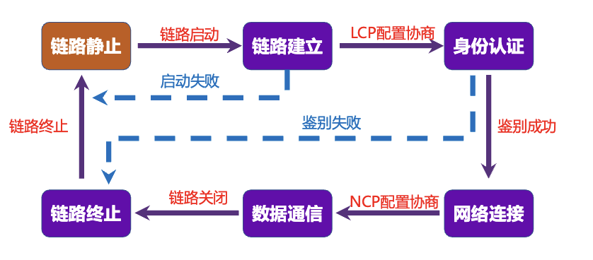

**链路静止**：起点也是终点，双方还没有链路。物理层可用时进入建立阶段，触发事件如：检测到载波、管理员配置。PC 拨号时路由器检测到调制解调器的载波并应答，就是这一步。

**链路建立。** LCP 交换配置包来建链。协商的选项包括最大帧长、用哪种鉴别协议、是否省略地址和控制字段。LCP 发 Configure-Request，对方可以回四种之一：

- Configure-Ack，全部接受；
- Configure-Nak，都理解但不能接受，需要改参数；
- Configure-Reject，有选项不认识或不能接受，需要谈；
- 另外还有 Terminate-Request 和 Terminate-Ack 用于关链路。

LCP 一共 11 种帧：4 种配置、2 种关闭、2 种拒绝、2 种回送、1 种丢弃。拒绝类的两种是 Code-reject 和 Protocol-reject，回送类的是 Echo-request 和 Echo-reply，丢弃类是 Discard-request。

**身份认证。** 可选，默认不做。如果要认证，必须在链路建立阶段就协商好用哪种认证协议。认证没完成，不能推进到网络层。认证失败，直接去链路终止。这个阶段只允许 LCP、认证协议、链路质量监控这三类包，其他一律丢弃。

**网络连接。** 每个网络层协议要由各自的 NCP 单独配置。NCP 可以随时打开和关闭。NCP 打开后，PPP 才能承载对应的网络层包；没打开时收到这类包必须丢弃。这个阶段的流量是 LCP、NCP、网络层包的各种组合。

**数据通信。** 双方互发分组，或者发 Echo 帧检查链路状态。

**链路终止。** 触发原因很多：载波丢失、认证失败、链路质量不达标、空闲计时器到期、管理员关闭。LCP 交换 Terminate-Request 和 Terminate-Ack。发送方收到应答或者重启计数器到期后断开；接收方发完应答后，至少等一个重启时间才能断，要给对方留出收到的时间。此后回到链路静止。这个阶段的非 LCP 包一律丢弃。


LCP 帧分类

LCP 通过交换不同类型的帧来管理链路生命周期，共分为 4 大类 11 种帧：

1. **配置型帧（4 种）**：
	- `Configure-Request`：发送方提出配置选项请求；
	- `Configure-Ack`：接收方认可并完全接受所有选项；
	- `Configure-Nak`：所有选项都理解，但部分参数不接受（要求修改）；
	- `Configure-Reject`：部分选项无法识别或绝不能接受，需要重新协商。
2. **链路终止型帧（2 种）**：
	- `Terminate-Request`：请求关闭链路；
	- `Terminate-Ack`：同意并确认关闭链路。
3. **异常拒绝型帧（2 种）**：
	- `Code-Reject`：收到未知的代码请求（可能协议版本不兼容）；
	- `Protocol-Reject`：被请求的网络层协议未知或不受支持。
4. **链路测试与维护型帧（3 种）**：
	- `Echo-Request`：回送请求（测试链路双向连通性与时延）；
	- `Echo-Reply`：回送应答；
	- `Discard-Request`：丢弃请求（用于链路性能测试，接收端收到后直接默默丢弃）。


### PPPoE 协议（Point-to-Point Protocol over Ethernet）

#### 为什么需要 PPPoE

以太网的优点是简单、成本低、极其普及；但它本质上是一个**多路广播网络**，安全性低，缺乏原生的用户身份认证，不好管理，同时也没有访问控制和按流量/时长计费的机制；

PPP的优点恰好补上：点对点信道，有认证机制，提供访问控制和计费；

PPPoE 就是把两者接起来：PPP 帧直接封装在以太网帧的有效载荷中，在以太网上跑 PPP，从而拿到认证、加密、压缩这些能力，实现按用户的访问控制和计费。运营商普遍支持这套，因为它能精确到账号。这也是家中电信宽带拨号上网：ADSL、光纤到户 FTTH的核心底层技术！

#### 组网方式

1. 机构共用：让买了服务的机构的路由器充当 PPPoE Client，和运营商的PPPoE Server建立一个回话，整个机构局域网内的所有电脑共享这条线路，主机上不用安装客户端软件；

	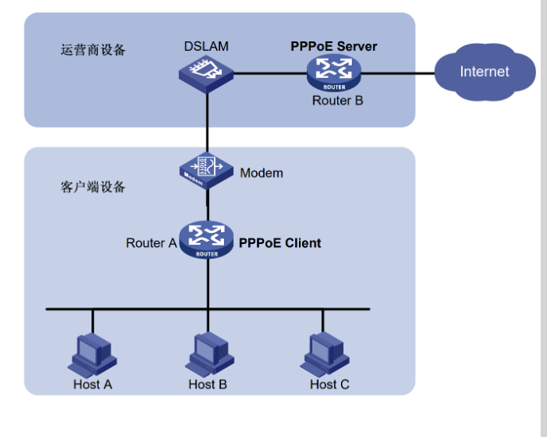

2. 独立客户端：每台主机各自安装一个PPPoE拨号客户端，PPP会话建立在每台主机和运营商路由器之间。一台主机一个会话，一个账号。好处是运营商能按用户计费和限速，家庭宽带用的就是这种。

	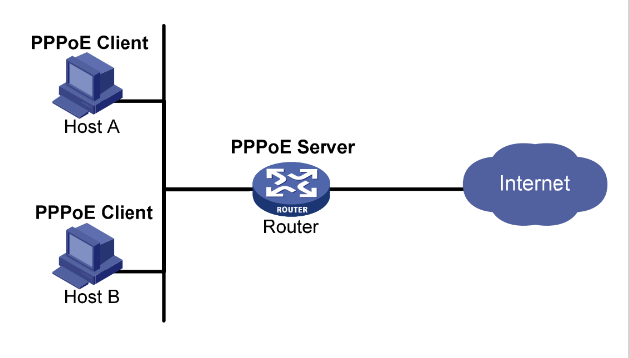

#### 报文格式

首先了解**以太网帧**封装格式：

```
目的MAC地址 6Byte | 源MAC地址 6Byte | 类型 2Byte | 载荷 | 帧校验FCS 4Byte
```

所以实际上，将PPPoE帧装进以太网帧就是替换载荷部分：

```
目的MAC地址 6Byte | 源MAC地址 6Byte | 类型 2Byte | PPPoE帧 | 帧校验FCS 4Byte
```

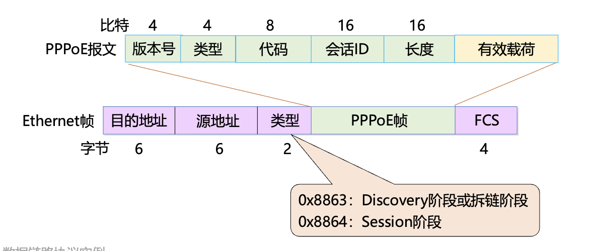

其中以太网头部的Type(类型)字段分**阶段**

- 0x8863，发现阶段和拆链阶段；
- 0x8864，会话阶段。

因为PPPoE传数据需要先找到服务器，确定好一条会话，拿到会话编号，然后才能开始传数据，最后还要拆掉会话。所以生命周期分为发现和会话两个阶段。

两个阶段的载荷有区别：**会话阶段**的载荷是：PPPoE 头，加 PPP 协议字段，加真正的数据。里面的 PPP 协议字段告诉对方，这是 IP 还是 LCP，和前面讲的完全一致；**发现阶段**的载荷是：PPPoE 头，加若干标签。这里没有 PPP 协议字段，装的是一串类型、长度、值，用来表达“我想要什么服务”“我叫什么名字”“我能提供什么”。

所以接收方接收到帧后需要根据类型来对应解析。


PPPoE帧具体如下：

```
| 版本号(4位) | 类型(4位) | 代码Code(8位) | 会话ID(16位) | 长度(16位) | 有效载荷(Payload) |
```

- 版本号（Version）：4 bit，固定为 `0x1`；
- 类型（Type）：4 bit，固定为 `0x1`；
- 代码（Code）：说明报文类型，区分报文具体功能
  | Code | PPPoE 报文类型 | 作用说明 |
  | :---: | :--- | :--- |
  | 0x09 | **PADI**（Active Discovery Initiation） | 发现初始报文——客户端主动发现发起广播寻找服务器 |
  | 0x07 | **PADO**（Discovery Offer）或 **PADT**（Terminate） | 发现提供报文——服务器单播回应 Offer<br />或<br />发现终止报文——任意一方请求终止会话 |
  | 0x19 | **PADR**（Discovery Request） | 发现请求报文——客户端单播请求会话 |
  | 0x65 | **PADS**（Discovery Session-confirmation） | 发现会话确认报文——服务器单播确认并下发 Session ID |
  | 0x00 | **Session Data** | 会话数据——会话阶段正常传输的 PPP 数据 |
- 会话 ID（Session ID）：16 bit，在 Discovery 阶段由服务器分配，与客户端和服务器的 MAC 地址共同唯一锁定一条通信隧道；
- 长度（Length）：16 bit，定义后面有效载荷的字节长度。
- 有效载荷：数据内容

#### PPPoE的三个工作阶段

1. 发现阶段

	目的：拿到对方的以太网地址；确定会话ID；

	是核心阶段，包含四步握手：

	- Client 广播 PADI，说明自己想要什么服务；
	- 所有 Server 收到后，比较自己能提供的服务，能提供的就单播回 PADO；
	- Client 可能收到多个 PADO，选最先到的那个，单播 PADR；
	- 被选中的 Server 分配唯一的会话 ID，用 PADS 回给 Client。

	结束后进入会话阶段

2. 会话阶段

	先做PPP协商，根普通PPP一样分为三段：

	- LCP 阶段，建立、配置、检测链路，认证协议的类型也在这里定；
	- 认证阶段，按 LCP 协商的结果做；
	- NCP 阶段，配置网络层，常用 IPCP 配 IP 地址和 DNS。

	协商结束后开始传数据

3. 终止阶段

	两种结束方式

	- PPP 自身结束
	- 或者任一方发 PADT。PADT 在会话建立后的任意时刻都可以单播发送。

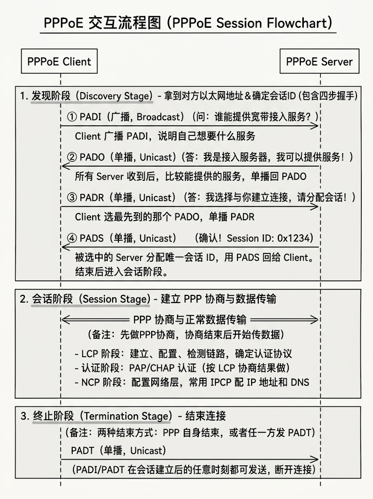

