# ch3 数据链路层基础

## 数据链路层概述

1. 位置：位与先前提到的五层模型中的第四层，介于网络层和物理层之间，向上提供服务接口，向下调用服务；

2. 功能

	- 成帧（Framing）：比特流划分，用于区分边界和纠错；
	- 差错控制（Error Control）：处理传输中出现的差错；
	- 流量控制（Flow Control）：发送方发送速率不能大于接收方的处理速率，避免缓冲区溢出

3. 服务

	根据有无确认以及有无连接这两个维度来区分不同的服务类型

	- 无确认、无连接服务（Unacknowledges connectionless）

		不握手、不确认、不重传，如果帧丢了或者坏了，没有后手处理。

		常见的技术应用比如以太网/有线局域网，因为有线网线的信道质量高，一般情况下不会出现误码的情况，所以不需要进行 ACK 回复，能节省信道带宽。再比如说音视频通信，宁可画面丢帧也不愿意干等 ACK 回复。如果真出现了丢帧，可以交给传输层的 TCP 去处理重传

	- 有确认、无连接（Acknowledged connectionless）

		不握手、但是有接收方 ACK 回复，发送端没收到回复要进行局部快速重传。

		技术应用如 WIFI，与有线传输相比，无线更容易被环境和介质影响，误码率高。但是 WIFI 不能像以太网一样让上层重传，因为这个过程的延时太久了，WIFI 必须在数据链路层这一跳解决问题，发过去没收到 ACK 网卡就要立马重发一次

	- 有确认、有连接（ACknowledged connection-oriented）

		三方握手、传输过程中进行严格的帧编号、顺序交付、错误重传等。

		常用于高延迟、高误码的场景，比如卫星通信，深空探测等


## Framing

成帧。数据链路层的 PDU（protocol data unit），即协议数据单元是帧，所以成帧的意思就是“组成帧”。

成帧是个统称，如果分开从发送方和接收方考虑：发送方的任务是将网络层的分组包装，添加帧头和帧尾，组成帧，即封装成帧（Frame Encapsulation）；而接收方严格来讲是做解封装（Decapsulation）。

**分组和帧的关系**：网络层的分组对应到帧就是有效载荷部分，一般是 1:1 对应的，如果 packet 太大也可能会被切分为多块部分。头标（Header）和尾标（Trailer）则是添加的控制信息，头标内容如：目的 MAC 和源 MAC、IPv4 还是 IPv6 的协议分类、帧序号和确认号 ACK 等；尾标比如：帧校验序列；

**为什么要成帧？**——就先前提到的五层网络体系结构而言，不论是哪一层的 PDU，其本质都可抽象为比特流。而比特流无非是 01 的组合序列，我们要想准确得到每一帧，就得知道每帧的开头和结尾。成帧就是在做这个区分加密以及接收解密的任务。

---

成帧的方式：

- 字节计数法（Byte count）
- 带字节填充的定界符法（**Flag** bytes with byte stuffing）
- 带比特填充的定界符法（**Flag** bits with bit stuffing）
- 物理层边码违例（Physical layer coding violations）

---

### byte count

我们容易想到：可以在每一帧的开头专门用一个 byte 表示一个数字，代表这一帧总共有几个字节（包含这个 byte 本身）

如图示：

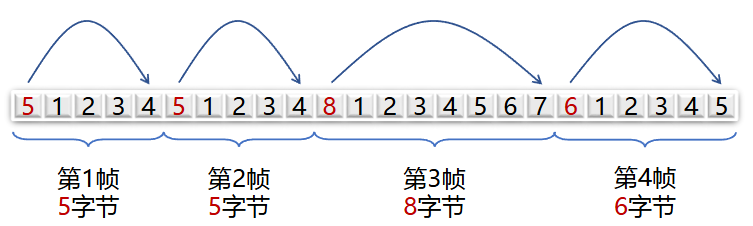

接收端在读到数字后就知道了这一帧的总长，然后根据长度读取完整个帧，再开始阅读下一帧。

但是这种方法的缺点也很明显，如果因为噪声等原因导致了传输出错，比如某一帧的计数头被干扰，那么这样就会导致后续的所有帧边界全部错位，所以这种方法基本知识一种理念上的考虑，实际工业中基本不用。

---

### flag bytes with byte stuffing

带字节填充（byte stuffing）的定界符法

为了区分开每一帧，我们就在每一帧的开头和结尾放一个特殊的标记字节，叫做 `FLAG`。比如十六进制的 `0x7E`，即 `01111110`；

特殊情况：因为标记字节本身是一个二进制数字，而有效载荷部分有可能包含这个与定界符相同的字节，为了处理这种情况，我们再定义一个转义字符 `ESC`，通常取 `0x7D`；

通过一张图理解：

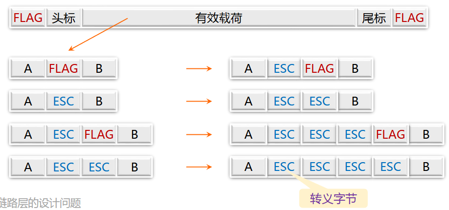

接收端的处理方式为：扔掉第一个 ESC，保留后面的部分作为有效载荷

- 缺点：这种方法是面向字节的，所以如果传输的数据不是严格按照 8 位字节对齐的任意位串，处理比较麻烦

---

### flag bits with bits stuffing

带比特填充的定界符法

这里我们使用的 FLAG 还是 `01111110`，但是与 byte stuffing 不同的是，我们要求发送端发送数据载荷时，只要数到连续的 5 个 1，不管下一个 bit 是 0 还是 1，都要强行塞入一个 0，如下图所示：

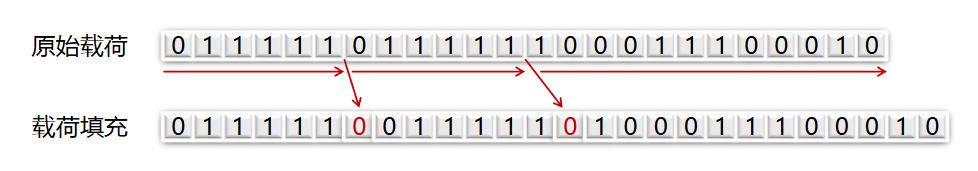

接收方处理：当出现连续 5 个 1bit 时，如果下一个 bit 是 0，那么就是有效载荷，丢弃 bit 0；而如果下一个比特是 1，那么就连同后面的一个 bit 0 构成 `FLAG`，一帧结束。

​	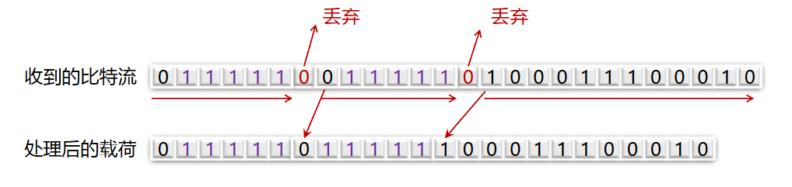

## 差错检测和纠正

先疏通整个逻辑关系：

1. 首先，数据在信道中难免会被噪声影响，就可能出现各种问题，比如：

	- 差错（incorrect）：数据发生错误
	- 丢失（lost）：接收方未收到
	- 乱序（out of order）：先发后到，后发先到
	- 重复（repeatedly delivery）: 一次发送，多次接受

2. 我们有几个解决方案：检错、纠错、重传

	- 检错：处理问题的第一步，先找到问题；
	- 纠错：接受端自主地进行数据恢复；
	- 重传：检错后申请重新传输

	所以更详细地说应该是 `检错+纠错` 和 `检错+重传` 两种方案

3. 要想检错，我们就得提供多余的信息来负责这个任务，这些就是冗余信息，或者说校验信息；

4. 纠错也是同理，需要冗余信息来定位出错的位置，而且纠错天生就带有着检错的能力，不过纠错也分不同的方式；


一个简单的例子是发送每一位 bit 时连续传三份，如果三份中有一位出错，就可以纠错。比如要发送信息 `0100101`，连发三份就是 `000111000000111000111`。不过这种方式冗余信息占比太高，占到 2/3，效率低下。

所以差错控制的目标就是 **既要保证一定的检测和纠错能力，又要尽可能减少冗余信息量**

两个策略：

- **检错码（error-detecting code）**

	因为检错码没有纠正的能力，所以它需要申请重传，自然适应于高可靠、误码率低的信道，比如光纤链路；

	这种检错后重传的机制也叫做 ARQ（automatic repeat request）

- **纠错码（error-correcting code）** 

	纠错码则主要用于错误发生频繁的信道上，比如无线链路；纠错码同时也可以当一个检错码使用

	使用纠错码的技术通常称为 前向纠错（FEC, forward error correction），前向的意思就是从发送端到接收端的方向


### 码字

码字（code word）：包含 m 个数据位和 r 个校验位的 n 位单元，其中 n = m + r

码率（code rate）：码字中不含冗余部分所占比例，m/n

海明距离（Hamming distance）：两个码字之间不同对应比特的数目，比如 `00101111` 和 `00000000` 的海明距离为 5

---


### 典型检错码

---

#### **奇偶校验（parity check）**

最简单基础的校验码

- 原理

	奇偶校验，即判断整串数据中 1 的总个数。发送方和接收方要共同约定好一个校验规则，分“偶校验”和“奇校验”两种。

	打个比方：如果一个发送方有 7 位有效数据 `1011010`，双方约定使用偶校验，那么此时已经满足总共 4 个 1，是偶数，所以只在最后添加一个校验位 `0`，变为 `10110100`；反之，如果双方约定使用“奇校验”，那么校验位就要变为 `1`，即 `10110101`。

	接收方查错时，根据双方采用的校验规则，然后统计数据中的 1 的个数（包含校验位），如果满足校验规则，则说明无错，反之报错；

- 缺点

	很明显，当变坏的位数为奇数时，我们能校验出来，如果是偶数个，那么就会漏检，效率和准确率都比较低；

- 改进

	使用二位奇偶检验，可以纠错。

	例如：我们要传一个 16bit 的数据，将其排成 $4\times4$ 的矩阵，横竖都计算偶校验。假如此时（3，2）的 bit 变坏了，那么此时就能通过行列确定到唯一 bit 并进行修改

	​	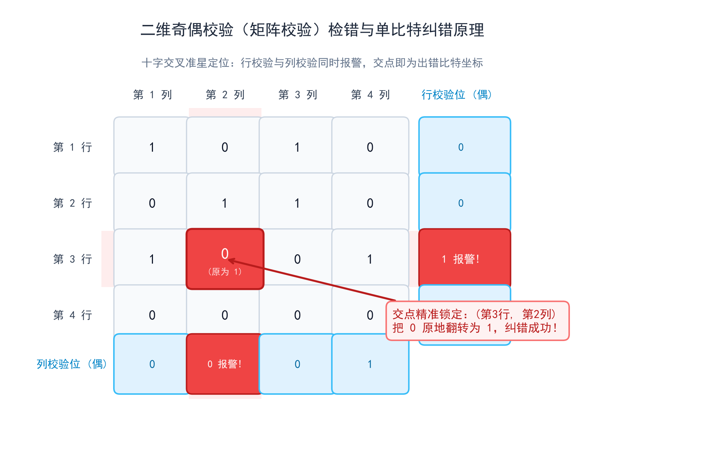

---

#### **校验和 (Checksum)**

常用于 TCP/IP 体系中的网络层和传输层

- 原理

	将发送的数据求和，端回进位，然后再按位取反，接收方验证时将所有数据加在一起，如果不出错结果会是全 1

	例如：发送方的两个数据 `1110011001100110` 和 `1101010101010101`，求和后得到 `1 101101110111011`，如果有进位，进位数字要重新卷回加到末尾，得到结果 `101101110111100`，再按位取反 `0100010001000011`（校验和），将这个数贴在数据后面一起发送过去

	接受方只需要将两个数据求和并将进位加到末尾，实际上和之前没什么区别，然后再加上校验和，如果最后是全 1，那么证明无错误；如果出现了任意一个 0，则说明数据被噪声影响了

---

#### **CRC 循环冗余校验**

**CRC，cyclic redundancy check**，数据链路层广泛使用

- 原理

	主要用到了模 2 除法，以及除法中的余数。

	> 模 2 运算：一种在二进制数上定义的运算体系
	>
	> - 加减法运算：不考虑进位和借位，加减法的操作等价于亦或运算
	>
	> 	|      |      |     加法     |     减法      |
	> 	| :--: | :--: | :----------: | :-----------: |
	> 	|  0   |  0   | $0\oplus0=0$ | $0\ominus0=0$ |
	> 	|  0   |  1   | $0\oplus1=1$ | $0\ominus1=1$ |
	> 	|  1   |  0   | $1\oplus0=1$ | $1\ominus0=1$ |
	> 	|  1   |  1   | $1\oplus1=0$ | $1\ominus1=0$​ |
	>
	> - 乘法运算：和普通二进制乘法一致，满足逻辑与/AND
	>
	> - 除法运算：不存在借位操作，也不比较值的大小，只要最高有效位对齐后被除数部分高位是 1 那么就给商记 1，否则为 0，然后和常数除法步骤一样，还有做减法时执行的是模 2 运算的减法。
	>
	> 	比如说：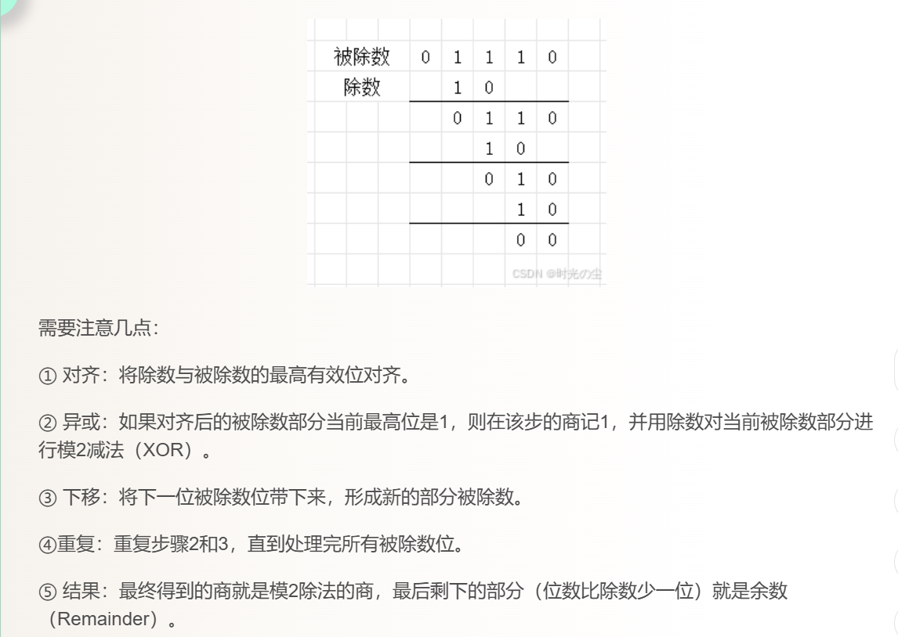

- 过程

  1. 假设我们要传 k 位有效数据 $D$，为二进制位模式；
  2. 如果要生成 n 位 CRC 校验码，那么收发双方要事先约定好一个 n+1 位的二进制位模式 G，也叫做 **生成多项式**，其中 G 的最高位是 1；
  3. 将原始数据 $D$ 乘以 $2^n$，也即在 k 位有效数据后添加 n 个 0。再用得到的结果模 2 除以生成多项式 G，得到的最终余数 R 就是 CRC 校验码（n 位，**不足时前面用 0 补齐**）；
  4. 用最终的校验码替换最初在数据后添加的 $n$ 个 0，得到的结果就是实际传输数据；

- 例题

  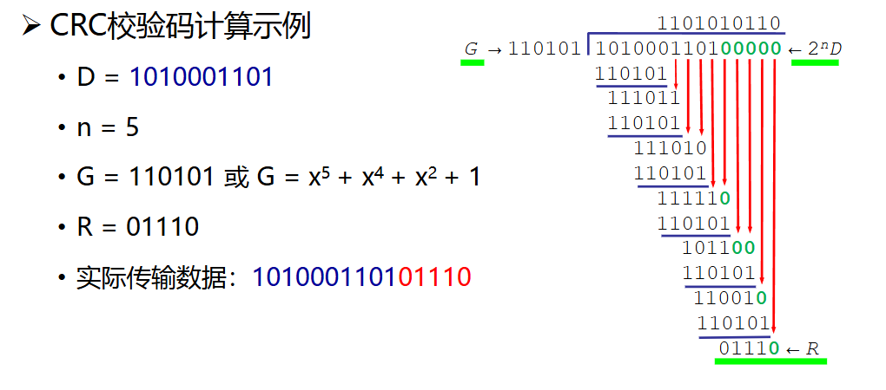

---

### 典型纠错码

检错码只需要判断出有无错误即可，纠错码则需要通过设计找到原先的正确数据。

我们做如下假设和理解：假设要传的有效数据为 m 位，校验码有 r 位，总长度为 n = m + r，我们的目标是纠正单比特错（无论哪一位翻转，接收方都能找出并纠正）

有效数据为 m 位，意味着一共有 $2^m$ 种不同的真实数据，加上校验码之后，这 $2^m$ 个正确的完整串，就是**合法码**；如果一个合法的串的其中一位翻转，考虑所有情况，会有 n 种可能；

接收方在收到 n 位长的串时，要想能够断定这就是当初发来的那个数据，要考虑两种情况：

1. 传输良好，数据没被噪声影响变坏，唯一正确的 1 种情况
2. 路上被噪声影响，错了 1 位，共 n 种情况

所以要想让一个合法数据被认出来，不论是有错还是没错，这 n+1 种情况都要被规划为一个类中，专供这一个数据使用，也就是 n+1 个位模式；

有了上面的内容，我们就能得到一个不等式。对于 $2^m$ 个不同的合法数据，每一个要被认出来，都需要独占(n+1)种情况，所以总共就需要 $(n+1)\times2^m$ 种情况，而我们的 n 位串总共只有 $2^n$​种组合，所以我们需要的情况是不能超过这个界限的，所以有：

$(n+1) \times 2^m \leq 2^n$

将 n = m + r 代入，即可化简得到：

<span style="color:#FF3333;">**$2^r \geq m + r + 1$​** </span>

这就是海明不等式，用来确定海明码中校验位的最小数量。同时，**只要是纠正一位错的二进制码，都必须满足这个式子，在信息论中这叫做 Hamming Bound 海明界**

---

#### hamming code

海明码

##### 海明码概述

用一句话总结：海明码就是多个奇偶校验组合，通过逐步筛选找到出错位置，并进行纠错的纠错码。

以$(15,11)$海明码为例，理解整个编码过程：

这里的15指的是编码总长度为15位，11指的是数据位，则校验位就是4位，满足$m+r+1=16\leq16=2^r$；

首先挑出4个校验位，它们专门放在$2^k(1,2,4,8)$的位置，至于为什么这么做，我们接着看；

因为码字一共15位，15个数，如果用二进制数来一一对应至少需要4位，并且其中`0000`是多余出来的，我们把所有的数都列出来：

| Decimal | Binary | $2^3/1000$ | $2^2/0100$ | $2^1/0010$ | $2^0/0001$ |
| :-----: | :----: | :--------: | :--------: | :--------: | :--------: |
|    0    |  0000  |            |            |            |            |
|    1    |  0001  |            |            |            |     1      |
|    2    |  0010  |            |            |     1      |            |
|    3    |  0011  |            |            |     1      |     1      |
|    4    |  0100  |            |     1      |            |            |
|    5    |  0101  |            |     1      |            |     1      |
|    6    |  0110  |            |     1      |     1      |            |
|    7    |  0111  |            |     1      |     1      |     1      |
|    8    |  1000  |     1      |            |            |            |
|    9    |  1001  |     1      |            |            |     1      |
|   10    |  1010  |     1      |            |     1      |            |
|   11    |  1011  |     1      |            |     1      |     1      |
|   12    |  1100  |     1      |     1      |            |            |
|   13    |  1101  |     1      |     1      |            |     1      |
|   14    |  1110  |     1      |     1      |     1      |            |
|   15    |  1111  |     1      |     1      |     1      |     1      |

看$2^k$的对应列，假如值为1的行对应的十进制数为i，那么15位编码数据的第i个数就是该$2^k$校验位负责监管的。比如说$2^0$负责其中的1、3、5...都是奇数，如果我们发送的编码数据为`0101010x101x1xx`，那么最末尾的校验位x就负责管理1、3、5...位置的比特，从后往前依次为x,1,1,1,0,0,0,0

其余四列同理。每个校验位都负责多位的比特，这样的话就可以利用奇偶校验，双方同时约定四个组用什么校验，校验码就依据奇偶校验的方法确定，用具体值把x替换后就得到了编码后的数据。

如果有一位发生了错误，比如上面例子中的第7位，由1变为了0。因为7这个数字是同时由$2^2,2^1,2^0$这三个校验位同时负责监管的，所以这三组奇偶校验都会返回错误，我们就将这三个校验位对应的值加起来，即4+2+1=7，便找到了错误位，我们直接将0换为1就完成了纠错。

> 上面的说法比较啰嗦，有更直白的方式：
>
> 15位数据，假如第i位出了错，只要是包含了第i位的奇偶校验，它们都会出现错误，这个校验位就被记为1，没错的则为0。因为这四个校验位的组合就是一个1-15中的数，是唯一的，所以我们自然就能确定一个唯一的数，就是这个错误比特的位数。

可以借助图像理解：

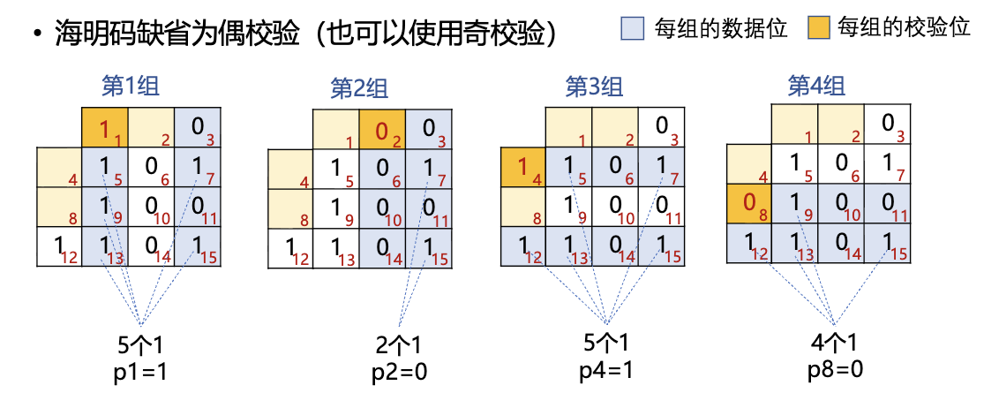

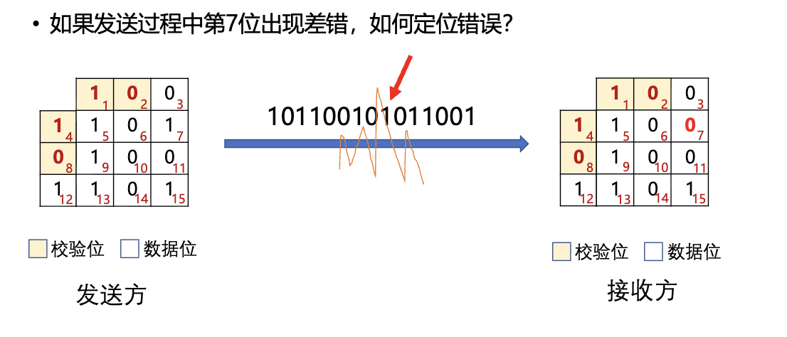

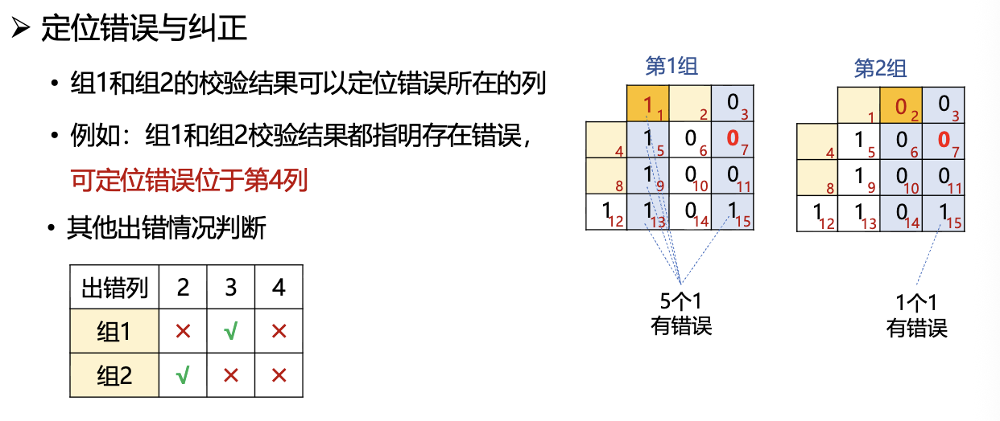

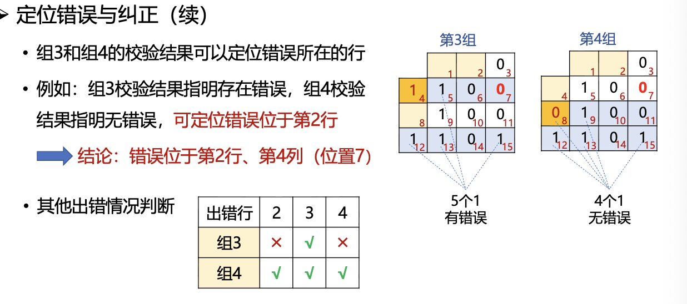

##### 关于海明码

- 海明码规模与扩展海明码

	1. 前面使用了$(15,11)$海明码作为了例子，所以实际上海明码也确实分很多类，比如$(3,1), (7,4), (31,26)$等等，并且随着数据越长，校验位$r$占总长度的比例急剧下降

	2. 因为计算机硬件更喜欢字节对齐大小的数据，比如8，16，32，64位等，而不是我们的11位，假如现在有一个8位数据，我们可以这样规定：

		首先将m=8带入海明不等式，验证得到当r=4时才能满足需求。我们还要在数据最开始添加一位全局奇偶校验位$P_0$，这样码字的总长度就变为了8+4+1=13位。

		利用四位校验，我们依旧能确定到唯一的错误位并纠错，同时添加了全局奇偶校验位，这样实现了两位检错。因为如果两位出错，全局校验是没问题的，但是局部的海明累加器发现内部有问题。

		接受端可以根据下表进行判断：

		| $P_0$ | 海明累加$S$ | 结果和处理                      |
		| ----- | ----------- | ------------------------------- |
		| 正常  | $S=0$       | 完全无错                        |
		| 报错  | $S\neq0$    | 单比特错，出错位置为$S$         |
		| 报错  | $S\neq0$    | 双比特错，无法纠正，需要重传    |
		| 报错  | $S=0$       | 仅全局校验位$P_0$出错，数据完好 |

- 海明码纠正突发错误

	原因：普通海明码只能纠一位错，而现实的物理信道中，这种错误往往是连着好几个比特的，，即突发错误(Burst Error)。

	处理：一次性将多个码字组成矩阵，比如将$k$个码字组成$k \times n$矩阵，按列发送，接收方再恢复成矩阵；

	原理：按列发时，如果传输途中受到一连串噪声干燥，导致了连续几个比特的破坏，这样恢复后，这些错误也会平摊开，对于每一行来说只错了一个比特，于是就可以利用海明码进行纠错了。


#### Reed-Solomon Code

RS 码，全称为里德-所罗门码（Reed-Solomon Code）。

##### RS 码概述

先思考一个问题：前面海明码已经可以纠错，为什么还要搞出个 RS 码？

原因在于**操作的基本单位不同**：
- 海明码是基于 **单个比特（bit）** 的，只能纠正独立的 1 位错。如果信道中遭遇一连串噪声打扰（突发错误），海明码单靠自己根本应付不来（必须借助交织矩阵打散）。
- RS 码则是基于 **符号（Symbol）** 设计的。它把若干个 bit（比如 $m=8$ 位，即 1 个字节；或者 $m=4$ 位，即 1 个十六进制数）打包成一个整体 Symbol。
- 这样带来的巨大好处是：**RS 码只要纠正了 1 个 Symbol，就等于同时纠正了这个 Symbol 里的连续多个 bit**！因此它天生就是对抗连续突发错误的利器。

##### 核心参数与黄金法则

RS 码通常记作 **$(n, k)$ RS 码**：
- $k$：原始数据包含的符号数（Message Symbols）；
- $n$：编码后的总符号数（Codeword Symbols）；
- $n - k$：增加的校验符号数（Parity Symbols）；
- $m$：每个符号包含的 bit 数，运算定义在有限域 $GF(2^m)$ 上。

纠错能力的黄金公式：
<span style="color:#FF3333;">**$n - k = 2t \quad \Longrightarrow \quad t = \frac{n - k}{2}$**</span>

其中 $t$ 表示该编码**能够纠正的错误符号数量**。
> **为什么校验符号数必须是 $2t$？**
> 因为每个 Symbol 包含多位信息，不仅有“哪个位置错了”（错误位置），还有“错成了什么值”（错误幅度）。纠正 1 个符号错，需要 1 个符号提供位置信息，再需要 1 个符号提供数值信息，所以纠正 $t$ 个错必须付出 $2t$ 个校验符号的代价。

##### 实际应用
- **高速以太网**：在 200G/400GBASE-R 中广泛采用 **RS(544, 514)** 编码。每个符号为 10 bit（$m=10$），校验符号为 $544 - 514 = 30$ 个（$2t=30$），能够纠正整整 $t=15$ 个符号的错误！
- **分布式云存储**：华为云等公有云对象存储中的纠删码（Erasure Code, EC），底层数学根基就是 RS 算法，通过数据分块加冗余分块，允许任意挂掉几块硬盘仍能完整还原数据。

##### RS 码的编解码流程（以课件中的 $(15, 11)$ 为例）

假设每个 Symbol 为 4 bit（$m=4$，取值 $0\sim15$），数据为 11 个 Symbol：$[1, 2, 3, 4, 5, 6, 7, 8, 9, 10, 11]$，需纠正 $t=2$ 个错误，故需 $2t=4$ 个校验符号，总码长 $n=15$。

> **有限域 $GF(2^4)$ 的运算规则（极其重要！）**：
> - **加法与减法完全等价**：两数相加减，就是将十进制数化为 4 位二进制做**按位异或（XOR，$\oplus$）**，没有进位和借位！
>   - 例如：$2 \ominus 15 = (0010)_2 \oplus (1111)_2 = (1101)_2 = 13$；
>   - 又如：$4 \ominus 1 = (0100)_2 \oplus (0001)_2 = (0101)_2 = 5$。
> - **乘法**：基于本原多项式（课件中为 $x^4 + x + 1$）取模运算。

1. **编码过程（类似 CRC 的多项式模除）：**
	- 补零：数据后补充 $2t=4$ 个 0，即 $[1, 2, 3, 4, 5, 6, 7, 8, 9, 10, 11, 0, 0, 0, 0]$，对应多项式乘以 $x^4$；
	- 选定生成多项式：$g(x) = \prod_{j=0}^{2t-1} (x - \alpha^j) = (x-1)(x-2)(x-4)(x-8) = x^4 + 15x^3 + 3x^2 + x + 12$；
	- 模 2 多项式除法（课件第 50 页）：用补零后的数据除以 $g(x)$，在有限域 $GF(2^4)$ 下求出余数；
	- 拼接：得到余数 $[3, 3, 12, 12]$，替换掉末尾的 4 个 0，得到发出的合法码字 $C(x) = [1, 2, 3, 4, 5, 6, 7, 8, 9, 10, 11, 3, 3, 12, 12]$。
	- **合法码字铁律**：$C(x)$ 必然能被生成多项式 $g(x)$ 整除，将根代入必有 $C(\alpha^i) = 0$。

2. **解码与纠错三步走：**
	- **第一步：计算伴随式（Syndrome）**
		接收端收到含错数据 $R(x) = C(x) + E(x)$，将根代入计算 $S_i = R(\alpha^i) = C(\alpha^i) + E(\alpha^i) = 0 + E(\alpha^i) = E(\alpha^i)$。
		若 $S_i$ 全为 0，说明无差错；若不全为 0（课件中算出 $S = [2, 10, 9, 1]$），说明有差错，且**综合征只与错误 $E(x)$ 有关，与发送的原本数据毫无关系**！
	- **第二步：定位错误位置与计算错误大小**
		设错误位置为 $X_1, X_2$，错误值为 $Y_1, Y_2$。构造错误位置多项式 $\Lambda(x) = (1+X_1 x)(1+X_2 x) = 1 + \Lambda_1 x + \Lambda_2 x^2$。利用已知的 $S_i$ 联立方程组：
		$$
		\begin{cases}
		S_2 + \Lambda_1 S_1 + \Lambda_2 S_0 = 0 \\
		S_3 + \Lambda_1 S_2 + \Lambda_2 S_1 = 0
		\end{cases}
		$$
		代入 $S$ 解出 $\Lambda_1 = 14, \Lambda_2 = 14$，分解因式 $\Lambda(x) = (1+4x)(1+10x)$，得出位置因子 $X_1 = 4 = 2^2$（位置 2 项）、$X_2 = 10 = 2^9$（位置 9 项）。
		再代回求出错误幅值 $Y_1 = 4, Y_2 = 6$，得出错误多项式 $E(x) = 6x^9 + 4x^2$。
	- **第三步：恢复原始信息**
		在有限域中加减等价，$C(x) = R(x) \oplus E(x)$，直接将对应位置的错误修正，再删掉末尾 4 个校验符号，完美还原出原始数据。

> **工业延展（课件第 55 页）：云存储 Erasure Code（纠删码）**
> 公有云对象存储把硬盘或存储节点视为 EC 纠错码存储池。对象大小不确定时，若补零填充会浪费存储空间；若不补零，则需要多次覆盖写来保证原子性，降低吞吐量。业界如华为云提出了 On-line Streaming Erasure Coding 和 Flex Erasure Coding 来兼顾存储效率与计算复杂度。

---

## 基本的数据链路层协议

前面讨论了成帧和检纠错，接下来看看如何具体设计协议来实现两台机器之间稳定、正确地收发数据。

### 定义与实现模型

在设计协议伪代码前，先明确链路层的运行环境与抽象假设（课件第 57~59 页）：

1. **分层实现的软硬件分工（课件第 57 页）**：
   - **物理层与部分链路层**：运行在专用硬件——**网络接口卡（NIC / 网卡）** 上，负责具体的比特流收发、物理信号调制、成帧定界和硬件校验；
   - **链路层的驱动与网络层**：作为操作系统内核的一部分运行在 CPU 上，以设备驱动程序的形式存在。
2. **三大基础假设**：
   - **分层进程独立**：网络层、数据链路层、物理层分别运行在独立进程中，通过 API 消息调用交互；
   - **面向连接的可靠服务**：链路层向上层屏蔽物理底层的各种不靠谱；
   - **只处理通信差错**：仅考虑数据在传输信道中发生的变异或丢失，不考虑主机断电、蓝屏等系统崩溃。
3. **数据结构与常用原语（课件第 59 页）**：
   ```c
   typedef struct {
       frame_kind kind;  // 帧类型：数据帧、ACK、NAK等
       seq_nr seq;       // 帧序列号
       seq_nr ack;       // 确认号
       packet info;      // 网络层数据分组（Payload）
   } frame;
   ```
   - `from_network_layer(&packet)`：从网络层获取数据；
   - `to_network_layer(&packet)`：将解封装后的数据递交给网络层；
   - `to_physical_layer(&frame)`：将帧传给物理层发送；
   - `from_physical_layer(&frame)`：从物理层接收到达的帧；
   - **事件驱动循环**：主体是死循环，调用 `wait_for_event(&event)` 监听底层和上层事件：
     - `frame_arrival`：物理层收到了一个帧；
     - `cksum_err`：收到了一个坏帧（校验和错误）；
     - `timeout`：定时器超时（发出去的数据很久没收到回复）。

---

### Utopian Simplex Protocol

乌托邦式单工协议

理想世界中不存在的“完美”协议

- 假设：
	- 单工通信：数据只能从发送端到接受端单向流动；
	- 完美信道：信道绝不出错，也绝不丢包；
	- 始终就绪、瞬间完成：发收双方的网络层始终处于就绪状态，且发送方要发多少就能瞬间发多少，接收方的处理速度无限快，永远不会被“淹没”。
- 处理方式：
	- 发送方：不断循环从网络层拿数据 $\to$ 打包成帧 $\to$ 交给物理层发送。
	- 接收方：不断循环等待物理层帧到达 $\to$ 提取数据 $\to$ 递交给网络层。
- 评价：没有差错控制，也没有流量控制，纯属理论起点。

---

### Stop-and-Wait

无错信道单工停等式协议

从理想迈入现实，考虑第一个问题，即接收方的处理速度是有限的

- 问题：
	如果发送端发得太快，而接收端来不及处理，接收端的输入缓冲区就会被填满并溢出，导致数据被丢弃。这叫做**接收方被淹没（Overwhelming）**。
- 解决方案：引入基于反馈的流量控制——**停-等机制（Stop-and-Wait）**。
	
	- 发送方每发送一帧后，必须停下来等待；
	- 接收方成功接收并处理完这一帧后，向发送方回复一个确认帧——**ACK**；
	- 此时因为信道依然假设无差错，确认帧里面放什么内容都无所谓，甚至可以是一个没有任何有效载荷的空帧，也叫**哑帧 dummy frame**；
	- 发送方只有在收到这个 ACK 后，才被允许继续发送下一帧。
	
	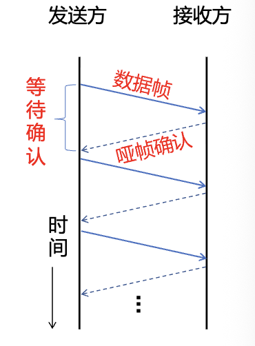
- 评价：成功解决了流量控制问题，保证了接收方不会被数据流淹没。

---

### PAR / ARQ

有错信道单工停等式协议

进一步限制条件：信道不仅速度有限，而且存在噪声，数据会出错甚至丢失。

- 问题与对策

  1. 问题一：数据在路上丢失，或者坏掉被接收方直接扔了
  	
  	- 后果：接收方没收到好帧，就不会发 ACK；发送方一直在傻傻等待 ACK，双方陷入永久死锁！

  	- 对策：发送方增加一个**计时器（Timer）**。发送一帧的同时开启定时器，如果规定时间内没收到 ACK（超时 `timeout`），就默认这一帧丢了，自动超时重发。
  	
  		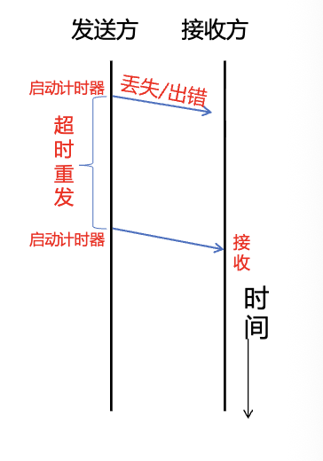
  	
  2. 问题二：ACK 丢了或延迟到达，导致接收方收到“重复帧”
  	- 场景：发送方发了帧 A1，接收方正确收到并回复 ACK。但这个 ACK 在半路上丢失了，或者在信道中传输太慢导致超时。发送方误以为帧 A1 丢失，于是超时重传了帧 A1。
  	- 后果：接收方再次收到一帧 A1，但接收方根本分不清这是“发送方发来的新数据”，还是“之前那帧的重发副本”，于是把两个一模一样的帧 A1 都交给了网络层，造成数据重复交付
  	- 对策：给每个数据帧打上**序列号（Sequence Number, SEQ）**

  > **停等协议需要几位序列号？**
  > 答案是：**1 bit（序号 0 和 1）就完全足够！**
  > 因为停等协议每次只发一帧，接收端需要区分的唯一二义性，就是“当前这帧（序号 $m$）”还是“它的下一帧（序号 $m+1$）”。因此只需要 0 和 1 交替循环（0, 1, 0, 1...）即可完美区分新帧与重传帧。

- **机制命名**：
	
	- 这种“超时重发 + 序号排重”的机制，被称为 **肯定确认重传（PAR, Positive Acknowledgement with Retransmission）**，也普遍称为 **自动重复请求（ARQ, Automatic Repeat reQuest）**。
	
- 停等协议完整工作流程
	- 发送方：发送帧（带 SEQ=0），启动定时器 $\to$ 收到正确的 ACK0 $\to$ 停止定时器，切换 SEQ 为 1，发送下一帧；若超时或收到错码，则重发当前帧并重置定时器。
	- 接收方：期待 0 号帧。若收到正确的 0 号帧，递交网络层，回复 ACK0，期待帧号切换为 1；若收到的不是期待的帧号，说明是重复帧，直接丢弃该数据，但**必须重新回复上一次成功的 ACK**，以促使发送方推进。

---

### 停等协议的性能瓶颈与长肥网络（LFN）

停等协议虽然逻辑严密且可靠，但存在一个致命的软肋：**效率极其低下！**

#### 链路利用率（Utilization）的数学计算

定义几个核心参数：
- 帧长 $F$（bits），信道带宽/发送速率 $B$（bps）；
- 每帧发送时延（Transmission Delay）：$t_{\text{frame}} = \frac{F}{B}$；
- 单向传播时延（Propagation Delay）：$t_{\text{prop}} = \frac{\text{物理距离 } d}{\text{电磁波传播速率 } v}$，通常双绞线/光纤中的波速约为$2\times10^8 m/s$
- 忽略接收端处理时延和短小的 ACK 传输时间，完成一次完整的“发帧 + 收确认”往返总周期为：$T_F = t_{\text{frame}} + 2t_{\text{prop}}$；
- 引入无量纲比例系数：
  $$
  \color{red}{a = \frac{t_{\text{prop}}}{t_{\text{frame}}}}
  $$
  

则无差错情况下，信道利用率 （link utilization）$U$，即信道真正用来发送数据的时间占比为：
$$
\color{red}{U = \frac{有数据通过时间}{(有+无)数据通过时间}=\frac{t_{\text{frame}}}{t_{\text{frame}} + 2t_{\text{prop}}} = \frac{1}{1 + 2a}}
$$

> 补充：时延带宽积（$2BD$）归一化表示法
> 
> 有些教材，如 Tanenbaum喜欢把单帧发送时间归一化为 1，并将信道速率 $B$ 换算为“每秒能发多少帧”：
> - $D$（Delay）：单向传播时延（即 $t_{\text{prop}}$）；
> - **$2D$**：往返传播时延；
> - **$2BD$**：往返**时延带宽积（Bandwidth-Delay Product, BDP）**，物理含义是**“数据在往返的路上时，整条信道管道最多能容纳的帧数”**；
> - **$w$**：连续发送的帧数。在停等协议中，发 1 帧就必须停下等待确认，所以 **$w = 1$**。
> 
> 此时信道利用率公式写为：
> $$
> \color{red}{\text{link utilization} \le \frac{w}{1 + 2BD}}
> $$
> 
> * 两式完全等价：$2a = \frac{2 t_{\text{prop}}}{t_{\text{frame}}} = \frac{2D}{F/B} = \frac{2BD}{F}$，本质上就是折算成“帧数”的时延带宽积 $2BD$。
> * 为什么说“当 $w = 1$ 时，利用率 $\le 50\%$”？
>   因为在有一定物理距离的实际链路中，往返传播时延往往大于发送单个短帧的时间（即往返时延带宽积 $2BD \ge 1$）。代入公式得：
>   $$U \le \frac{1}{1 + 2BD} \le \frac{1}{1 + 1} = 50\%$$
>   发送方绝大部分时间都在干等 ACK 回来，信道利用率极低！这就是为什么要引入**流水线和滑动窗口**（把 $w$ 撑大，使 $w \ge 1 + 2BD$）。


#### QUIZ 2

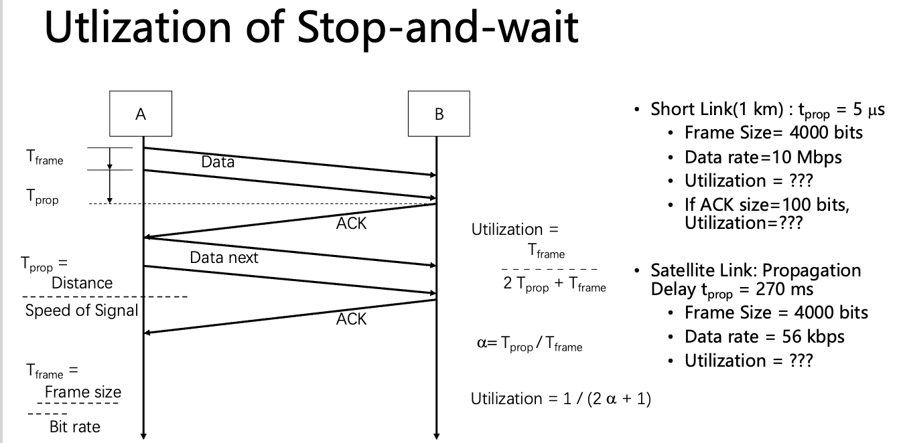


1. 短距离局域网：$1\text{ km}$ 链路，带宽 $10\text{ Mbps}$，帧长 $4000\text{ bits}$，$t_{\text{prop}} = 5\ \mu\text{s}$。
   $t_{\text{frame}} = \frac{4000}{10^7} = 400\ \mu\text{s}$。此时 $a = \frac{5}{400} = 0.0125$。
   利用率 $U = \frac{1}{1 + 2 \times 0.0125} \approx 97.5\%$，利用率很高。
2. **长距离/卫星信道（长肥网络 LFN, Long Fat Network）**：
   信道带宽 $1\text{ Mbps}$，帧长 $1000\text{ bits}$，单向传播时延 $270\text{ ms}$（卫星通信典型值）。
   - 发送时延 $t_{\text{frame}} = \frac{1000}{10^6} = 1\text{ ms}$；
   - 往返传播时延 $2t_{\text{prop}} = 540\text{ ms}$；
   - 总周期 $T_F = 1 + 540 = 541\text{ ms}$；
   - **信道利用率 $U = \frac{1}{541} \approx 0.18\%$！**

> **长肥网络（LFN, Long Fat Network，课件第 72 页）**：
> 如果一个网络的带宽-延迟乘积（Bandwidth-Delay Product, BDP）明显**大于 $10^5\text{ bits}$（约 $12\text{ KB}$）**，就被称为长肥网络。例如卫星通信、跨洲光纤专线等。
> 
> **深入思考：能不能靠“无脑增大帧长”来提高停等利用率？（课件第 74 页）**
> - 直觉上：增大帧长可以延长发送时延 $t_{\text{frame}}$，让 $a = \frac{t_{\text{prop}}}{t_{\text{frame}}}$ 变小，利用率公式分母变小，利用率看似升高了。
> - **现实痛点**：帧的最大长度受到信道**比特误码率（BER, Bit Error Ratio）**的致命制约！帧越大，整帧在空中遭遇噪声出错的概率呈指数级暴增，一旦坏掉整帧必须重新重传，反而引发更多的丢包和重传雪崩，吞吐量不升反降。
> 
> **长肥管道的困境与唯一破局之道**：
> 如果把通信链路比作一条很长很宽的水管，数据就像水流。停等协议在发送了一小滴水（1 帧）后，就必须关掉水龙头，干等整整半秒钟确认对方收到，然后才能放下一滴水。整条水管在 99.8% 的时间里都是完全干涸的！
> **破局之道**：保持适中的帧长，摒弃“发一帧等一帧”的停等模式，允许发送方不等确认连续发送多个帧——这就是**流水线协议（Pipelining）与滑动窗口协议**！

---

## 滑动窗口协议

**滑动窗口协议，Sliding Window Protocols。**

- 基本思想

	通信收发双方分别维护一个缓冲区，这个缓冲区就是**窗口(Window)**，具体分为：

	- 发送窗口（$W_T$）：发送方在没有收到任何ACK的情况下，最多可以连续发出的帧数量
	- 接收窗口（$W_R$）：接收方允许连续接收和缓存的帧数量

- 窗口滑动工作机制

	1. 发送端：每发送一帧，发送窗口的下限保持不动，可用额度减少（下图狭义地将发送出的帧挤出了窗口，实际上已发送未确认的帧依旧是在窗口中的，窗口下限并不会动，只有收到ACK后上下限同时动）；当收到新的ACK后，发送窗口向前滑动，释放出新的可用发送额度。

	2. 接收端：只有落入接收窗口内部的帧序号才会被接收。每当期待的最小序号帧正确收到并递交给上层后，接收窗口也向前滑动一步。

		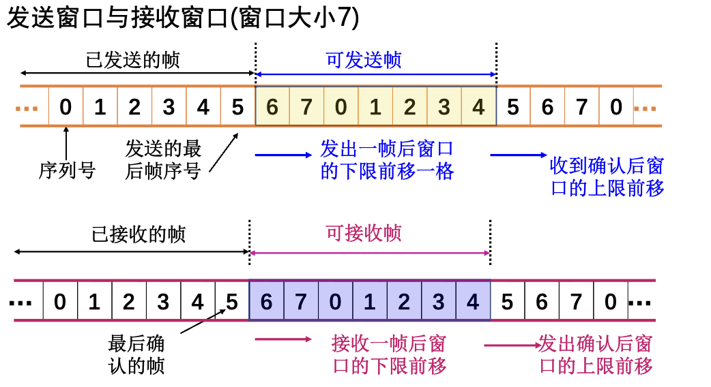

		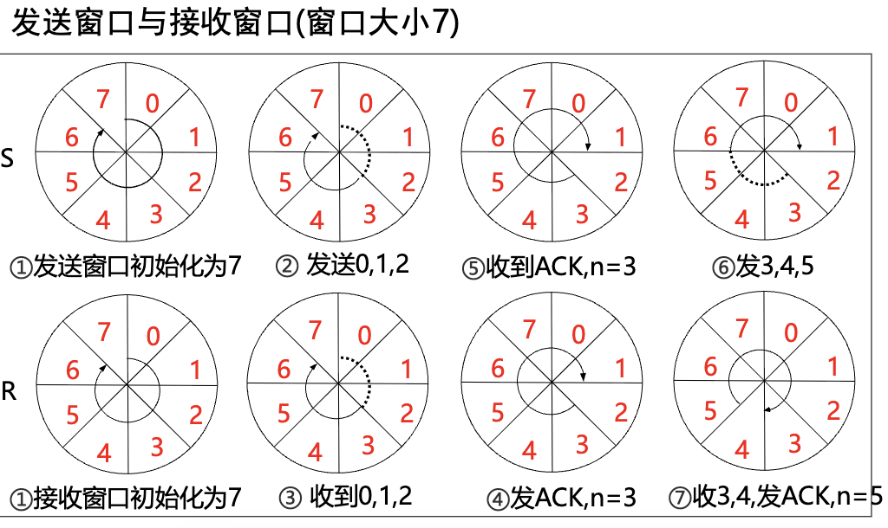

	3. 累计确认（Cumulative ACK）：接收端不必每收到一帧都发一个 ACK，可以对按序到达的最后一个帧发一次确认，表示“该帧及之前的所有帧均已正确收到”。

	4. **稍带确认（Piggybacking）**：在双向通信中，如果接收端正好也有数据要回传给发送端，可以把 ACK 编号直接塞到回传的数据帧头里一起带回去，极大地节省了单独发送 ACK 控制帧所占用的带宽。

		流量控制的方法：若接收端缓冲区满，可回传 **`RNR`（Receive Not Ready）**报文暂停对方发送。

- 一个简单的滑动窗口协议实现

	这里用最简的1-bit滑动窗口协议来说明。发送窗口和接收窗口大小均为1，序号空间仅有0和1。它本质上就是停等协议和双向稍带确认的结合体，机器既是接收方又是发送方

	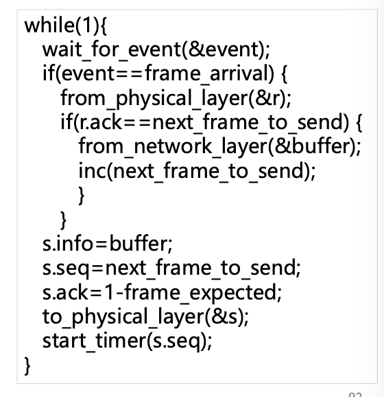

	最下方是组装待发的数据帧`s`的过程，`s.info`为帧载荷，`s.seq`为当前要发的帧序号，`s.ack`是发送方做的稍带确认，告诉对方前一帧已经成功收下；`to_physical_layer(&s)`是交给物理层进行发送，`start_timer`为计时器。

	首先在循环中监听事件，`wait_`是挂起等待事件；如果事件是`frame_arrival`即收到了一个帧，先从网卡把这个帧读出来到`r`，然后再进行判断，对方确认的帧是否是我们刚刚发出去的，然后进行一个简单分支；如果是的话就从网络层读取新packet装到buffer，同时改变发送序号；如果不是，则会timeout，进入到挂起等待事件。


---

### 回退N协议

#### 协议概述

**回退N协议，GBN，Go-Back-N**

- 核心思想

	接收方按照严格顺序接收帧。如果收到期待帧，比如2号帧，就接收并且窗口前移，回复ACK2；当接收端收到一个出错帧或者乱序帧，不论后续紧接着到的的帧是否完好并且正确，接收方都一律丢弃，并回复上一个正确收到的ACK1。

- 设计与处理

	1. **接收窗口为$\color{red}1$**，只能按顺序接受帧
	2. **发送窗口大小限制**为：$\color{red}{1 < W_T \le 2^n - 1}$（$n$ 为帧序号的二进制位数）
	3. 定时器设计：发送端只为最早发送但还未被确认的那一帧维护一个定时器
	4. 超时动作：发送端必须退回到出错的那一帧，将该帧以及之后发过的所有帧全部重新发一次

	> **Q：为什么限制GBN的发送窗口？**
	>
	> 举个例子，假如我们用 3 bit 序列号，则一共有8个号，即0～7。
	>
	> 假如发送窗口取$W_T=2^n=2^3=8$，发送方一次醒把0～7这8个号全部发完，接收方全部正确收到，接收窗口滑动，等待下一轮的0号帧，并向发送方发回ACK。
	>
	> 如果此时这些ACK都在路上丢了，那么发送方定时器发现timeout，就会重传，重新发送旧的0号帧。这时候，接收方无法判断这个0号帧是丢了的旧数据还是新一轮数据，产生了二义性，为了避免这种情况，所以要留空一个位置。

- 过程分析

	1. 回退N步协议允许发送方发送多个分组而不用等待确认，最多可以发送$W_T$个；发送方收到期望ACK后进行窗口滑动，再发送新进入窗口的PDU，始终保持窗口中有$W_T$个PDU未确认；超时重发要回退窗口，超过最大重发次数$N_{max}$要做特殊处理；

	2. 接收方按序接收，回复ACK(k)表示对第k及以前编号的PDU的确认，期望接收第k+1号PDU

		> 也有流派认为ACK(k)是确认第k-1及以前的PDU，期望接收第k号，因为这种理解在实现时可以利用指针便于发送端操作，所以现代协议更倾向于使用k-1的理解，比如TCP协议

	3. 正常情况下，收发双方根据帧确认进行窗口移动；

	4. 假如发送过程中2号包丢失，发送方没有收到接收方的ACK2，后续的3、4号包都收到了接收方返回的ACK1；

	5. 一段时间后，发送端确认timeout，没有收到ACK3、ACK4，进行重传；

#### GBN 优缺点

- **优点**：接收方逻辑极其简单，不需要分配任何额外的乱序缓存空间（$W_R=1$）。
- **缺点**：在信道误码率较高时，仅仅因为丢了一帧，就会导致后面已经顺利到达的大量正常帧被无辜连累重传，严重浪费网络吞吐量。

---

### 选择重传协议

#### 协议概述

**选择重传，SR，Selective Repeat**

- 核心思想

	GBN协议带来的性能惩罚比较严重，SR协议则允许接收方把乱序到达的好帧先暂存起来，只重发错帧

- 设计与处理：

	1. **接收窗口大小**：$\color{red}{W_R > 1}$

	2. **发送窗口大小：$\color{red}{1<W_T\leq2^{n-1}}$，且应小于等于序号空间的一半**

		> **Q：为什么 SR 的窗口尺寸必须满足 $W_T + W_R \le 2^n$（通常 $W_T = W_R \le 2^{n-1}$）？**
		>
		> A：保证新旧窗口所涵盖的序号区间绝对不能有任何交叠，比如一个3bit编号，SR窗口最大只能对半分，开到4

	3. 接收端内部有缓冲区，如果2、3号帧丢失，后续的4、5号帧正常到达，接收方会将其先缓存在接收窗口中；同时接收方回复NAK2、NAK3，告诉发送方缺少2号、3帧，需要补发；发送发再次重发并到达后，接收方确认所有帧都正确接收后，再将2、3、4、5号帧按顺序交付给网络层，最后移动接收窗口。

	4. 发送端的定时器设计需要为每一个发送出去的帧独立分配，哪个帧的定时器超时，或者收到接收方回复的对应帧的NAK，就单独重传那个出错的帧。

		- **差分定时器链表/软件多定时器队列（timer queue）**

			要为每个帧都独立设置定时器是不现实的，每次tick修改CPU都得遍历数组来修改数据，这个开销是巨大的，所以我们使用一个差分链表来维护所有定时器，如图所示：

			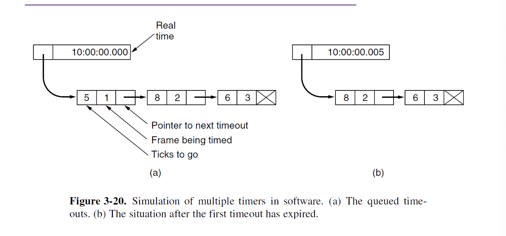

			其中，每个节点记录三个内容：相对于前一个节点的时间差、为第几号帧定时、指向下一个要超时的节点。还有在左上角的真实时间。

			以图中数据为例，工作时，第一个节点在5个tick后超时；每个tick过来后，CPU只需要将第一个节点中的5-1=4，后续节点都无需修改；直到第一个节点的tick归零，将其从链表头部弹出，表头变为第二个节点，继续执行刚才的操作。

- 过程分析

	1. 发送方依旧可以发送多个分组，与GBN协议不同的是，这里的接收窗口大小大于1；
	2. 正常情况正常收发，窗口右移；
	3. 假如发送方一次发送包0～4，发送过程2号包丢失，此时依旧能返回ACK0、ACK1、ACK3、ACK4；在收到ACK2之后发送端已经移动到2～6了，所以packet5、6也可以被发送；此时接收方将3、4、5、6均缓存，只等待分组2的计时器超时后重发；
	4. 重发接收到后，整理好所有内容交付给网络层

> **Q：SR 的效率一定永远高于 GBN 吗？**
> 不一定。 在**反向 ACK 频繁丢失**的恶劣网络环境下，选择重传 SR 的效率反而可能不如 GBN。
> 因为 GBN 采用**累积确认**，后面的 ACK 可以自动为前面丢失的 ACK“补票”；而 SR 依赖对每个帧的独立确认，若 ACK 丢了，发送端哪怕接收端早就收到数据，也只能傻傻超时并重复发送该数据帧。

---

#### GBN vs SR 

| 维度 | 停-等协议（Stop-and-Wait） | 回退N协议（GBN） | 选择重传协议（SR） |
| :--- | :--- | :--- | :--- |
| **发送窗口 $W_T$** | $W_T = 1$ | $1 < W_T \le 2^n - 1$ | $1 < W_T \le 2^{n-1}$ |
| **接收窗口 $W_R$** | $W_R = 1$ | $W_R = 1$ | $W_R = W_T \le 2^{n-1}$ |
| **失序到达帧处理** | 丢弃 | **坚决丢弃**，不缓存 | **在窗口内暂存缓存** |
| **确认方式** | 逐帧确认 | **累积确认**（ACK $k$ 代表确认至 $k$） | **单帧独立确认 / NAK** |
| **定时器数量** | 1 个 | **1 个**（绑在最老未确认帧上） | **多个**（每个未确认帧独立计时） |
| **重传范围** | 仅当前单帧 | **超时后回退重传整窗所有帧** | **仅针对性重传出错的单帧** |
| **复杂度与开销** | 极低 | 接收端无需缓存，逻辑简单 | 接收端需要较大缓存，硬件开销较高 |

---

### 滑动窗口协议链路利用率公式汇总

设单向传播时延与发送时延之比为 $a = \frac{t_{\text{prop}}}{t_{\text{frame}}}$，信道中单帧出错的概率为 $P$：

#### 1. 无差错信道下的滑动窗口利用率
- **常规情况（单向数据传输 / ACK 耗时可忽略，课件第 87 页）**：
  - 当窗口大小 $W \ge 1 + 2a$ 时：发送窗口足够大，ACK 还没回来之前新数据已经源源不断发出，流水线完全充满：
    $$U = 1 = 100\%$$
  - 当窗口大小 $W < 1 + 2a$ 时：发完 $W$ 个帧后必须停下来等 ACK，管道没填满：
    $$U = \frac{W \cdot t_{\text{frame}}}{t_{\text{frame}} + 2t_{\text{prop}}} = \frac{W}{1 + 2a}$$
- **双向捎带确认情况（Piggybacking，课件第 88 页）**：
  若反向传输同样大小的数据帧来捎带 ACK（即 $t_{\text{frame}} = t_{\text{ACK}}$），往返周期变为 $2t_{\text{frame}} + 2t_{\text{prop}}$，此时：
  $$U = \begin{cases} 1 & (W \ge 2a + 2) \\ \frac{W}{2 + 2a} & (W < 2a + 2) \end{cases}$$

#### 2. 有差错信道下的 ARQ 链路利用率
引入几何分布，一帧成功传输所需的平均发送次数为 $N_r = \sum_{i=1}^\infty i P^{i-1}(1-P) = \frac{1}{1-P}$：

- **停-等 ARQ**：
  $$U_{\text{Stop-Wait}} = \frac{1-P}{1 + 2a}$$
- **选择重传 ARQ（Selective Reject / SR）**：
  $$U_{\text{SR}} = \begin{cases} 1 - P & (W \ge 1 + 2a) \\ \frac{W(1-P)}{1 + 2a} & (W < 1 + 2a) \end{cases}$$
- **回退N ARQ（Go-Back-N / GBN）**：
  $$U_{\text{GBN}} = \begin{cases} \frac{1 - P}{1 + 2aP} & (W \ge 1 + 2a) \\ \frac{W(1-P)}{(1 + 2a)(1 - P + WP)} & (W < 1 + 2a) \end{cases}$$

---

## 数据链路协议实例

### PPP 协议（Point-to-Point Protocol）

**点对点协议**，由 IETF 制定（RFC 1661），是目前通信网络（拨号连接、路由器间串行链路等）中使用最广泛的数据链路层协议之一。

#### PPP 协议的三大构件
1. **成帧方法（Encapsulation）**：能够将各种网络层分组（IP、IPX 等）无缝封装到帧中，既支持面向字节的异步链路，也支持面向比特的同步链路；
2. **链路控制协议 LCP（Link Control Protocol）**：负责链路的建立、配置协商和状态测试（如协商最大帧长 MTU、认证方式等）；
3. **网络控制协议族 NCP（Network Control Protocol）**：负责为具体的网络层协议协商配置网络参数（最常见的是 IP 控制协议 **IPCP**，用来动态分配客户端 IP 地址和 DNS）。

#### PPP 到底实现了什么？没实现什么？（高频考点）
- **PPP 具备的功能**：封装成帧、利用填充技术实现透明传输、差错检测（CRC）、链路状态监测、最大传输单元协商；
- **PPP 不具备的功能（故意不做）**：
	- **不纠错、不重传**：只检错，算出的 FCS 不对就直接丢弃，属于**不可靠传输协议**；
	- **无流量控制**：没有滑动窗口流量控制；
	- **无序号**：不使用帧序号；
	- **仅限点对点**：只支持全双工点对点物理信道，不支持广播或多点连接。

#### PPP 帧格式深度拆解

```text
+----------+----------+----------+----------+-----------------------+----------+----------+
|  F (7E)  |  A (FF)  |  C (03)  | Protocol |      Information      |   FCS    |  F (7E)  |
|  1 byte  |  1 byte  |  1 byte  | 2 bytes  |     <= 1500 bytes     | 2/4 bytes|  1 byte  |
+----------+----------+----------+----------+-----------------------+----------+----------+
```
- **标志字段 F（Flag）**：固定为 `0x7E`（`01111110`），作为帧定界符；
- **地址字段 A（Address）**：固定为 `0xFF`，因为是点到点链路，不需要具体寻址，仅为兼容历史规范；
- **控制字段 C（Control）**：固定为 `0x03`，代表无编号信息；
- **协议字段（Protocol）**：标识信息字段里面装的是什么数据：
	- `0x0021`：IP 数据报；
	- `0x8021`：网络控制协议 NCP 数据；
	- `0xC021`：链路控制协议 LCP 数据。
- **信息部分（Information）**：有效载荷，受 MTU 限制（默认 1500 字节）；
- **帧检验序列 FCS**：2 字节或 4 字节的 CRC 校验码。

#### PPP 的透明传输机制
如果在信息载荷中碰巧出现了与 `0x7E` 一模一样的二进制序列，必须进行特殊处理：
1. **异步传输时 $\to$ 字节填充（Byte Stuffing，课件第 127~128 页）**：
	定义转义字符为 `0x7D`。所有需要转义的字符，都在前面插入一个 `0x7D`，并将原字节与 `0x20` 进行异或运算：
	- `0x7E`（Flag 标志） $\to$ 转变为 `(0x7D, 0x5E)`
	- `0x7D`（转义字符自身） $\to$ 转变为 `(0x7D, 0x5D)`
	- `0x03`（ETX 文本结束符） $\to$ 转变为 `(0x7D, 0x23)`
	- `0x11`（XON 恢复传输控制符） $\to$ 转变为 `(0x7D, 0x31)`
	- `0x13`（XOFF 暂停传输控制符） $\to$ 转变为 `(0x7D, 0x33)`
	- `0x91`（带奇偶校验的 XON） $\to$ 转变为 `(0x7D, 0xB1)`
	- `0x93`（带奇偶校验的 XOFF） $\to$ 转变为 `(0x7D, 0xB3)`
	- 凡是数值小于 `0x20` 的 ASCII 控制字符，均按上述规则转义。接收端进行相反操作即可无损还原。
2. **同步传输时（如 SONET/SDH 链路） $\to$ 零比特填充（Bit Stuffing）**：
	- 硬件扫描比特流，只要遇到**连续 5 个 1**，不管后面是什么，立刻**强行插入一个 0**；
	- 接收端硬件扫描比特流，遇到连续 5 个 1 后接 0，直接将这个 0 删除还原。

#### PPP 状态转换流程与 LCP 帧分类（课件第 131~145 页）

##### LCP 的 11 种帧类型（课件第 136~137 页）
LCP 通过交换不同类型的帧来管理链路生命周期，共分为 4 大类 11 种帧：
1. **配置型帧（4 种）**：
   - `Configure-Request`：发送方提出配置选项请求；
   - `Configure-Ack`：接收方认可并完全接受所有选项；
   - `Configure-Nak`：所有选项都理解，但部分参数不接受（要求修改）；
   - `Configure-Reject`：部分选项无法识别或绝不能接受，需要重新协商。
2. **链路终止型帧（2 种）**：
   - `Terminate-Request`：请求关闭链路；
   - `Terminate-Ack`：同意并确认关闭链路。
3. **异常拒绝型帧（2 种）**：
   - `Code-Reject`：收到未知的代码请求（可能协议版本不兼容）；
   - `Protocol-Reject`：被请求的网络层协议未知或不受支持。
4. **链路测试与维护型帧（3 种）**：
   - `Echo-Request`：回送请求（测试链路双向连通性与时延）；
   - `Echo-Reply`：回送应答；
   - `Discard-Request`：丢弃请求（用于链路性能测试，接收端收到后直接默默丢弃）。

##### PPP 6 个核心状态转换图

```text
[链路静止 Dead] 
       │ 物理层检测到载波 / 链路启动
       ▼
[链路建立 Establish] ◄─── LCP 协商配置（协商 MTU、认证协议等）
       │ 协商成功
       ▼
[身份认证 Authenticate] ◄─── PAP / CHAP 鉴别认证（可选阶段）
       │ 鉴别通过（若失败则直接进入 Terminate）
       ▼
[网络连接 Network] ◄─── NCP 协商（如通过 IPCP 分配 IP 地址）
       │ 协商配置成功
       ▼
[数据通信 Open] ◄─── 正常全双工双向收发 IP 数据报
       │ 链路关闭事件 / 发送 Terminate-Request
       ▼
[链路终止 Terminate] ◄─── 交换 Terminate-Ack 释放物理资源
       │ 
       ▼
[回到链路静止 Dead]
```

---

### PPPoE 协议（Point-to-Point Protocol over Ethernet）

#### 为什么需要 PPPoE？

- **以太网的痛点**：以太网（Ethernet）极其普及、成本低廉，但它本质上是一个**多路广播网络**，缺乏原生的“用户身份认证”、“访问控制”和“按流量/时长计费”的机制；
- **PPP 的长处**：PPP 原生支持极其强大的用户身份认证（PAP/CHAP）和计费管控；
- **强强联手**：**PPPoE（RFC 2516）** 将 PPP 帧直接封装在以太网帧的有效载荷中，实现了**在以太网广播信道上建立一条虚拟的点对点 PPP 安全隧道**。这也是千家万户电信宽带拨号上网（ADSL、光纤到户 FTTH）的核心底层技术！

#### 组网架构
1. **企业统拨模式**：机构内的路由器充当 PPPoE Client，与运营商的 PPPoE Server 建立唯一的 PPP 会话。局域网内的所有电脑共享这条线路，主机无需安装任何拨号软件。
2. **独立客户端模式**：每台主机各自安装 PPPoE 拨号客户端独立拨号，每台电脑独占一个账号，便于运营商精细化按用户计费。

#### PPPoE 报文封装与以太网类型（Type，课件第 151~152 页）

##### 1. 以太网帧封装格式
```text
+-------------------+-------------------+---------------+------------+-----------+
| 目的 MAC (6字节)  | 源 MAC (6字节)    | 类型 (2字节)  | PPPoE 报文 | FCS (4B)  |
+-------------------+-------------------+---------------+------------+-----------+
```
以太网头部中的 **Type（类型）字段**：
- **`0x8863`**：Discovery（发现）阶段或拆链阶段；
- **`0x8864`**：Session（会话）阶段。

##### 2. PPPoE 报文头结构（共 6 字节）
```text
+--------------+------------+--------------+------------------+----------------+---------------------+
| 版本号(4bit) | 类型(4bit) | 代码Code(8b) | 会话ID(16bit)    | 长度(16bit)    | 有效载荷(Payload)   |
+--------------+------------+--------------+------------------+----------------+---------------------+
```
- **版本号（Version）**：4 bit，固定为 `0x1`；
- **类型（Type）**：4 bit，固定为 `0x1`；
- **代码（Code）—— 区分报文具体功能（高频考点）**：
  | 代码值（Code） | PPPoE 报文类型 | 作用说明 |
  | :---: | :--- | :--- |
  | **`0x09`** | **PADI**（Active Discovery Initiation） | 客户端广播寻找服务器 |
  | **`0x07`** | **PADO**（Discovery Offer）或 **PADT**（Terminate） | 服务器单播回应 Offer，或任意一方请求终止会话 |
  | **`0x19`** | **PADR**（Discovery Request） | 客户端单播请求会话 |
  | **`0x65`** | **PADS**（Discovery Session-confirmation） | 服务器单播确认并下发 Session ID |
  | **`0x00`** | **Session Data** | 会话阶段正常传输的 PPP 数据 |
- **会话 ID（Session ID）**：16 bit，在 Discovery 阶段由服务器分配，与客户端和服务器的 MAC 地址共同唯一锁定一条通信隧道；
- **长度（Length）**：16 bit，定义后面有效载荷的字节长度。

#### PPPoE 的三大工作阶段与发现四步曲

PPPoE 完整生命周期包括：**发现阶段（Discovery） $\to$ 会话阶段（Session） $\to$ 终结阶段（Terminate）**。

其中最核心的是 **Discovery 阶段的四步握手**（用于确定谁是服务器并分配 Session ID）：

```text
   PPPoE Client                               PPPoE Server
        │                                          │
        │─── ① PADI (PPPoE Active Discovery) ────>│ (广播：谁能提供宽带接入服务？)
        │                                          │
        │<── ② PADO (PPPoE Discovery Offer) ──────│ (单播：我是接入服务器，我可以提供服务！)
        │                                          │
        │─── ③ PADR (PPPoE Discovery Request) ────>│ (单播：我选择与你建立连接，请分配会话！)
        │                                          │
        │<── ④ PADS (Session-confirmation) ────────│ (单播：确认！这是你的 Session ID: 0x1234)
        │                                          │
    ════╪══════════════════════════════════════════╪════ (进入 Session 阶段)
        │                                          │
        │<───────── PPP 协商与正常数据传输 ────────>│ (标准的 LCP 协商 -> PAP/CHAP 认证 -> IPCP 分配 IP)
        │                                          │
    ════╪══════════════════════════════════════════╪════ (会话结束)
        │                                          │
        │<──────────── PADT (Terminate) ───────────>│ (单播：任何一方发送 PADT 即可断开连接)
```

1. **① PADI（Active Discovery Initiation）**：
   客户端**广播**发送，寻找网络上可用的接入服务器（PPPoE Server）。
2. **② PADO（Active Discovery Offer）**：
   网络中能提供服务的 PPPoE Server **单播**回应，表示愿意提供接入。
3. **③ PADR（Active Discovery Request）**：
   如果客户端收到了多个服务器发来的 PADO，客户端通常选择最先收到的那个，向它**单播**发送请求。
4. **④ PADS（Active Discovery Session-confirmation）**：
   服务器收到请求后，生成一个全网唯一的 **Session ID**，**单播**回传给客户端。拿到 Session ID 后，双方正式进入 **Session 阶段**！
5. **⑤ Session 阶段与通信**：
   进入标准的 PPP 协商（先通过 LCP 协商链路参数，再进行用户名密码鉴别认证，再通过 IPCP 协商分配公网 IP 地址和 DNS），之后即可全速收发数据报。
6. **⑥ PADT（Terminate）**：
   当用户点击“断开连接”或者网络异常时，任意一方**单播**发送 PADT 报文，直接拆除该 Session 会话。

