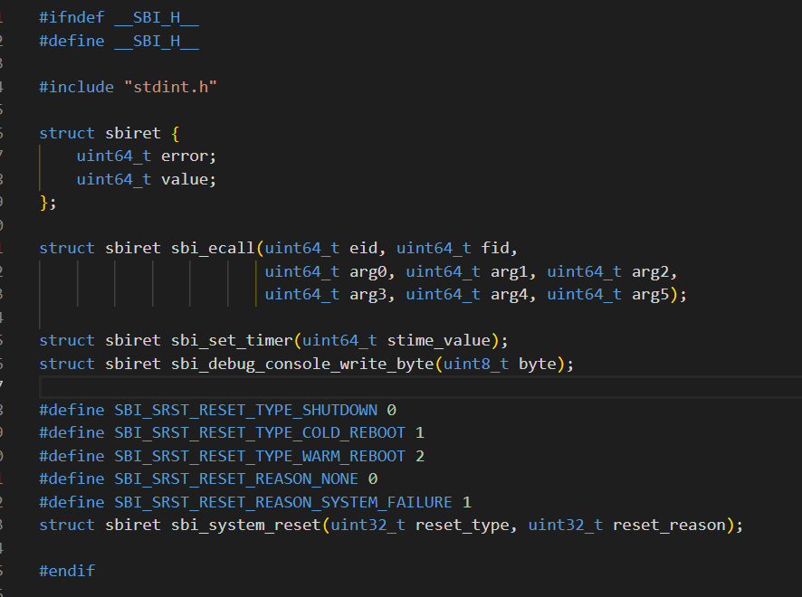
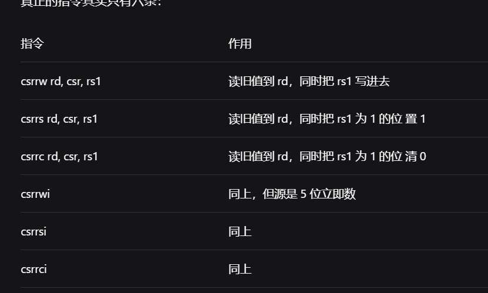
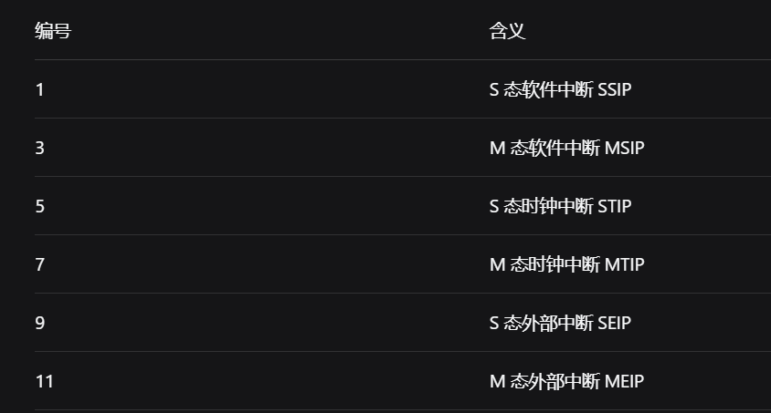
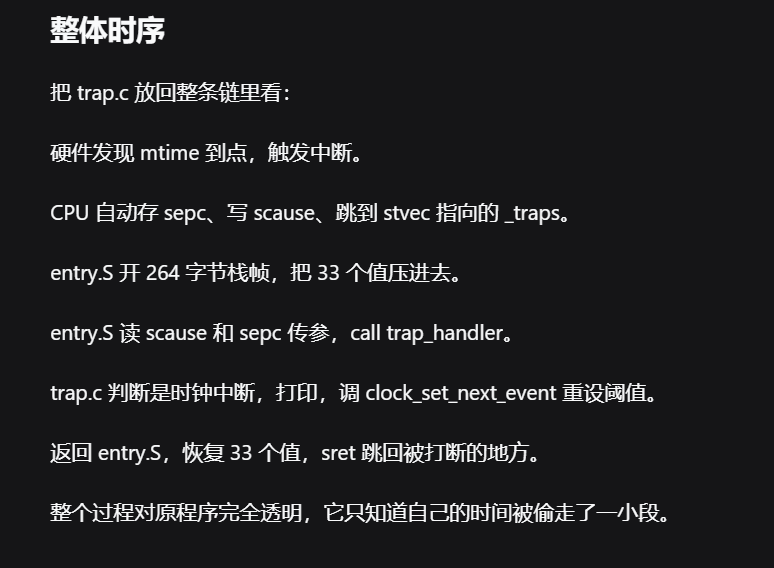

docker或者linux?

1. 实验验收到达即可


## lab0

### 实验理解

- GDB Dashboard的状态理解:

    `Assembly`: **反汇编结果**. 显示当前程序计数器PC正在执行的RISC-V汇编指令

    `Breakpoints`: **断点监控列表**. 显示我当前设置了哪些断点, 以及对应的位置, 被触发的次数

    `Expressions`: 自定义监视器. 类似 IDE 中的 Watch 窗口，用来追踪自定义表达式。

    `History`: 命令历史. 记录最近瞧过的调试命令

    `Memory`: 内存透视面板. 可用来指定监控某一块内存地址或栈顶内存. 比如: `dashboard memory watch $sp 32`: 即当前栈顶sp村的32字节内容

    `Registers`: **寄存器**. 列出32个通用寄存器中的十六进制数值

    `Source`: C语言源代码. 当拥有完整调试行号时, 此处会显示对应的C文件源码

    `Stack`: **函数调用栈帧**. 显示当前函数是由谁调用的, 或者是从哪层函数跳进来的. 其中数字越大的对应外层, 数字0对应的是栈顶

    `Threads`: **线程**. 显示正在调试的式哪一个物理核心(RISC-V称为Hart)

    `Variables`: 局部变量. 打印当前C函数内部的局部变量以及取值

    更加详细的一些描述:

    


### 知识扩充

1. Linux系统是由绝大部分的C语言加上部分汇编语言写成的

    

2. 镜像(Image). 这里的镜像, 指的是剥离了调试内容, 符号名, 端头部表, 测试元数据等的纯粹二进制机器码. 其体积更小, 专门喂给CPU/QEMU硬件执行, 比如实验中的: Image. 而实验中的vmlinux则是标准的ELF格式文件, 保留了上述提到的内容, 主要用来喂给GDB调试器.

    Kernel镜像, 即纯净CPU指令流二进制块: Image; 

    磁盘根文件系统镜像, 即硬盘扇区的镜像: rootfs.img

    

3. Shell和Ternimal的理解

    首先需要明确的是, Shell和Terminal是两个完全不同的东西, 但是二者的本质都是程序, 其中Terminal是一个GUI程序, 而Shell是一个CLI命令行程序: 

    ​	Terminal/终端的作用是: 申请一个窗口, 绘制文字像素, 以及监听鼠标和键盘事件; 

    ​	Shell则是用于接收终端传过来的字符, 并解析其中的含义, 再调动kernel去执行具体操作, 并将最终得到的结果返回. 

    在计算机发展初期, 终端是一个独立的机器, 它通过电缆和计算机连接. 程序员通过终端向计算机发送命令和请求, 计算机处理后将结果返回终端, 终端再进行处理, 并将结果绘制到显示屏上. 而"终端"这个名称也很好理解, 它就相当于计算机系统的末端, 并在此与人进行交互.

    另外, 对于Shell, 也有两种角度去理解它在计算机系统中的定位:

    - 如果对于狭义的操作系统, 那么就特指内核kernel, 那么Shell则是运行在kernel上方的一个普通的用户态程序. 
    - 如果对于广义的操作系统, 即我们熟悉的全家桶. 那么Shell则是跟随发布的一个基础组件

    但不论怎么讲, 如果从层级来看, Shell就是夹在人/终端和kernel之间的一个解释器, 充分发挥着"壳"的作用.

    

4. 如果用一句话来大致概括操作系统, 那就是: "**操作系统就是一个程序, 并且是一个死循环**"

    但是这句话没有提到一些比较细节的内容, 还需要注意以下几点:

    - 操作系统是一个由硬件事件驱动的, 永不退出的特殊系统软件, 包含死循环操作. 

        > 1. 为什么必须是死循环?
        >
        >     因为操作系统本身是物理硬件的最后一道防线, 普通程序可以return 0退出, 将控制权还给操作系统. 但是OS不能随意退出, 这可能会导致CPU失去指令指针, 从而使得计算机死机
        >
        > 2. 具体如何驱动?
        >
        >     平时休眠, 靠时钟中断, 键盘网卡等硬件中断, 以及用户程序的系统调用等来唤醒它
        >
        > 3. 为什么需要用中断来驱动, 不能顺序执行吗?
        >
        >     首先, 因为CPU的速度是ns级, 而外设速度是ms级, 二者速度相差巨大
        >
        >     其次, 如果没有中断, CPU需要执行轮询(Polling), 这会导致CPU大部分时间都在进行询问和检查, 算力被浪费.
        >
        >     当有了中断, CPU空闲时直接进入idle状态. 如果正在做其他计算, 在收到一个中断后, 它会停止当前任务, 转头先处理新任务, 然后再回去接着执行

    - OS本身是程序, 但是是运行在内核态的拥有特权的程序. 它不依赖软件提供底层环境, 它本身是管理者, 创造环境

    

5. 硬件的大致分类:

    - 主机核心: CPU, 内存条(RAM), 主板芯片组以及总线

    - 主机控制与存储: 硬盘, 显卡, 各种控制芯片(USB主控芯片, 声卡芯片, 网卡芯片等)

    - 外设: 

        ​	输入: 键盘, 鼠标, 摄像头, 麦克风, 触摸板; 

        ​	输出: 显示器屏幕, 扬声器; 

        ​	物理接口: USB, HDMI, 音频3.5mm孔, type-c口等

    

6. 什么是固件?

    ​	如果用一句话总结: **固件的本质是一个二进制程序, 编译后生成机器指令集. 又因为代码需要有物理载体, 固件代码就是通过物理芯片中的成千上万个特殊的晶体管开关状态给包装起来的.** 

    一个简单的对比: 

    ​	硬件: 看得见摸得着的物理电路;

    ​	软件: 保存在电脑上的可以安装和卸载的高级应用

    ​	固件: "固化"在硬件芯片里的软件 .

    ​	它一般被直接烧录(Flash)在主板或设备的非易失性存储芯片(如 EEPROM / SPI Flash ROM)中. 计算机刚刚通电的一瞬间, 内存(RAM)里是空的, 硬盘还没被读取, CPU 也什么都不知道. 这时候最先跑起来的就是固件, 它主要做下面的一些事: 

    - 硬件检查(POST, 上电自检): 检查 CPU 针脚是否正常、主板供电是否稳定、插了几根内存条、显卡是否点亮. 
    - 初始化最基础的芯片配置: 把内存控制器配置好, 让 RAM 能存取数据；初始化简单的串口或屏幕输出. 
    - 寻找并加载操作系统(Bootloader 职责): 固件去硬盘或网络上寻找操作系统的内核镜像, 把内核拷贝到内存中, 然后把 CPU 控制权交接(Jump)给内核, 固件的大部分初天使命就完成了. 

    常见的固件有: 

    - PC 电脑上的: 经典的 **BIOS**(Basic Input/Output System)以及现代的 **UEFI**. 
    - 路由器/嵌入式设备上的: U-Boot. 
    - 外设里面的: 你的鼠标、键盘、固态硬盘(SSD 控制器)、显卡里面其实都运行着各自专属的固件微代码. 
    - 实验中的例子: OpenSBI(Open Source Supervisor Binary Interface). 

    在 RISC-V 架构下, 计算机一开机运行在最高权限的 **M-mode(机器模式)**, 运行的就是 OpenSBI 固件. 它负责把底层硬件垫平, 然后降权到 S-mode 启动 Linux 内核. 

    > 至于为什么不将这一部分代码放入到硬盘, 这就牵扯到了先有鸡还是先有蛋的问题: 
    >
    > 1. 现代的硬盘的通信协议很复杂, 需要硬盘主控芯片, 文件系统驱动才能读出里面的文件；
    > 2. 所以要想读取硬盘中的操作系统代码, 首先需要读取硬盘驱动代码, 但是电脑刚启动时, 内存是空的, 所以也没有办法读取代码；而如果直接将驱动代码放入硬盘, 那么就会陷入死锁. 
    > 3. 只有一个电路极其简单, 接通电源就能直接读出字节的芯片才能够破局, 只要一通电, CPU无条件地从小芯片连接的物理地址抓取第一条指令；而这个芯片中的代码负责点亮内存, 初始化总线, 加载驱动, 最终解开硬盘, 成功唤醒操作系统
    >
    > 这也是为什么启动系统叫做“Bootstrap”(拔着自己的鞋把自己提起来)

    

7. 什么是内核 kernel

    ​	平时我们嘴里常说的“操作系统”(如 Ubuntu Linux、Windows 11、macOS), 实际上是一个庞大的全家桶(包含了图形桌面、终端命令、各种系统工具). 但操作系统的核心灵魂只有一个, 就是内核(Linux 内核、Windows NT 内核、XNU 内核). 

    

8. 什么是核显?

    核显(integrated Graphics / iGPU) . 在CPU芯片内部的一块图形计算单元. 而独显是主板上独立的一大块芯片, 它的性能更强大, 同时功耗也更大. 平时静音省电时, 一般都是核显在工作.


9. **什么是OpenSBI**

	SBI：supervisor binary interface，指的是运行在S态的操作系统内核如果通过ecall向运行在M态的底层固件（比如OpenSBI）申请服务的**接口规范**。

	而OpenSBI是一套固件软件，也就是根据上面提到的接口规范做出的一个固件程序。


10. 什么是Bootloader

	可以翻译为：引导加载程序。本质是一个固件程序

## Lab1

### 内容

#### GCC Extended Asm

**扩展内联汇编**

​	`spec`: specification 规范标准

​	标准C中是没有asm这个关键字的，所以**内联汇编说到底是编译器的扩展**，而不是C语言本身的语法。GCC和Clang都提供了这个扩展，并且语法通用。MSVC在32位下也有支持，但是要粗略的多，并且和前二者语法不匹配；到了x64直接不支持内联汇编了。

​	头文件中写的结构体，只是一个容器，用来将值装成C语言能够返回的东西；真正的核心是里面的内联汇编。

​	要分清，sbi.h文件中最开始的struct是**结构体**，而后面的都是返回结构体的**函数！！**

​	

mv ，是伪指令，即move。汇编器展开成：addi 目标，源，0；即将源寄存器的值抄到目标寄存器

ecall，从S态切换到M态

走完这八条，寄存器里的情况是：a7 里是 0x4442434e，a6 里是 0x2，a0 里是 0x30。

然后执行 ecall。CPU 进 M 态，OpenSBI 一看 a7 是 0x4442434e，知道你要用 Debug Console；再看 a6 是 0x2，知道你要写一个字节；于是把 a0 里的 0x30 送到串口。终端收到 0x30，按 ASCII 显示成字符 0。

不同的函数对应的功能不同，像sbi_debug_console_write_byte只写一个字节，后续的参数补0即可


1. 使用冒号来分隔汇编模板后面的各个操作数段；

语法的两种形式，第一种是四段：

```assembly
__asm__ 限定符(
	汇编指令
	:输出操作数
	[:输入操作数
	[:破坏描述]])
	
比如:

   __asm__ volatile (
        "instruction1\n"
        "instruction2\n"
        ......
        ......
        "instruction3\n"
        : [out1] "=r" (v1),[out2] "=r" (v2)
        : [in1] "r" (v1), [in2] "r" (v2)
        : "memory"
    );
```


所谓破坏描述，指的就是：这段汇编会在执行过程中将某些寄存器或者内存的内容覆盖掉，原来的值不再可信

第二种多一段，末尾加`:跳转标签`，这是asm goto用的，让一段汇编跳到C代码的某个标签；

“r”：是约束。表示操作数必须放在一个通用寄存器里。

“=”：是修饰符，不是约束。表示只写。

只有一个r的时候，方向由它的位置决定，出现在输入段就是只读，出现在输出段并且没有修饰符的情况下默认也是只写，不过一般都习惯写上=


**三个限定符**

- `volatile`

    通常扩展汇编是用来做输入输出的计算的，但是语句也可能有副作用，这时需要用`volatile`关掉一些优化，防止编译器把它删掉或者挪用位置。

- `inline`

    用来告诉编译器这段汇编足够小，为了内联可以按最小尺寸计算。实际项目里很少用。

- `goto`

     只配合 asm goto 使用，声明这段汇编可能跳到后面列出的标签之一。


spec：specification，规范，也即官方发布的正式标准文档。

四份手册文档的内容：

- Assembly Programmer's Manual 里主要是寄存器 ABI 命名、调用约定、CSR 编号表和重定位（%hi、%lo、%pcrel_hi 这些）；
- RISC-V Unprivileged Spec 是非特权指令集规范。它定义所有不带特权概念的指令，包括基础整数指令集、乘除扩展、原子扩展、浮点扩展、压缩指令，以及指令编码格式。它还定义了 csrrw、csrrs 这些访问 CSR 的指令本身，但不定义每个 CSR 里有什么位。
- RISC-V Privileged Spec 是特权级规范。它定义 M、S、U 三种模式怎么切换、trap 怎么发生怎么返回、每个 CSR 的位域含义，以及虚拟内存和页表格式。你 lab1 后半段用到的 sstatus、sie、stvec、scause、sepc，还有后面页表实验的 satp，全部以这份为准。我前面说 SIE 是 bit 1、STIE 是 bit 5，出处就是这里。
- RISC-V SBI Specification 是 S 态二进制接口规范。它定义内核在 S 态怎么通过 ecall 请求 M 态固件服务，包括每个功能的 EID 和 FID、参数放哪个寄存器、返回值怎么解释。你的 sbi_ecall 和那几个常量 0x4442434e、0x53525354、0x54494d45 都出自这份。


1. 目录架构:

``` text
├── arch
│   └── riscv
│       ├── include
│       │   ├── defs.h
│       │   └── sbi.h
│       ├── kernel
│       │   ├── head.S
│       │   ├── Makefile
│       │   ├── sbi.c
│       │   └── vmlinux.lds
│       └── Makefile
├── include
│   ├── printk.h
│   ├── stddef.h
│   └── stdint.h
├── init
│   ├── main.c
│   ├── Makefile
│   └── test.c
├── lib
│   ├── Makefile
│   └── printk.c
└── Makefile
```


1. arch，放和架构相关的内容

    其中include的两个文件，前者是CSR（Control and Status Register 控制状态寄存器）的宏，后者是OpenSBI接口用的声明；

    kernel里面是内核本体，head.S是汇编入口，sbi.c封装ecall，vmlinux.lds是链接脚本，Makefile负责自动化编译；

    高一层的Makefile，用来链接vmlinux、抽出Image等

2. include，通用头文件

    printk.h 声明格式化输出函数

    后两个都是自己写的类型定义

3. init，内核的C入口

    start_kernel以及test

4. lib，库函数

    只有printk.c的实现


2. head.S 文件

    ​	**内核第一条指令所在的地方**。QEMU加载完镜像，OpenSBI初始化硬件后，跳到0x80200000，执行的第一段代码就在这里

    ​	为什么要用汇编？

    ​	A：C函数一开头要用栈。编译器给每个函数生成的序言里第一步通常是调整 sp，函数里的局部变量、保存的返回地址全在栈上。而在设置 sp 之前，sp 是 OpenSBI 留下的残留值，根本没有合法的栈可指向。

    ​	boot_stack 标记这块区域的起点，.space 占出实际字节数，boot_stack_top 标记终点。链接脚本里 .bss 段的第一个收集项就是 `*(.bss.stack)`，所以这块栈会落在 .bss 的最开头。XYZ是占位符，要换成实际大小

    ​	la 是加载地址的伪指令，它会被汇编器展开成一对 auipc 加 addi，相对于当前指令的位置算出 boot_stack_top 的绝对地址。这里不能用 li，li 是加载立即数的，只能处理常数，而 boot_stack_top 的地址要等链接器把所有段摆好才知道，是个链接期才确定的值。用 li 会报重定位错误。

    ​	把地址装进 sp，栈就建好了。

    ​	用栈顶而不是栈底，因为栈向低地址方向增长，push 相当于 sp 减。sp 指向栈顶，往下用才是空的地方，指到栈底的话第一条 push 就写到栈外面去了。

    ​	call 是调用伪指令，展开成 auipc 加 jalr，同时把下一条指令的地址存进 ra。用 j 也能跳过去，但那不叫调用。start_kernel 是 C 函数，编译器按被调用的约定生成它，用 call 更规范。虽然它实际上永远不会返回。


3. sbi.c

    ​	SBI调用的封装层。内核跑在S态，但是输出字符，设置定时器这些事只能由M态的OpenSBI做，S态的唯一通路就是ecall指令。这个文件就是将这条通路包成几个好用的函数

    `sbi_set_timer`：EID 0x54494d45 表示 TIME 扩展，FID 是 0 表示这个扩展里的设置定时器功能，arg0 是 stime_value 也就是下一次中断的目标时刻。

    **sbi_debug_console_write_byte**：传的是：EID 表示 Debug Console 扩展，FID 是 2 表示写单个字节，arg0 是要写出去的那个字节。


4. defs.h

    ​	({})是GNU的语句表达时扩展，**不是标准C的语法，是GCC的**，作用是将一段代码块当成一个值来用，块中最后一句的值就是表达式的值，最后的__v决定了csr_read(...)返回了什么。

    ​	uint64_t __v：临时变量

    ​	`"csrr %0, " #csr` 是指令模板。csrr 是读 CSR 的伪指令。%0 是占位符，对应后面第一个操作数。#csr 是字符串化，把宏参数直接变成字符串。所以 csr_read(sstatus) 展开后就是 `csrr %0, sstatus`。

    ​	`"=r"(__v)` 是输出段，让编译器挑个寄存器接住读出来的值，过后写回 __v。

    ​	中间那个冒号之间是空的，因为读 CSR 不需要输入操作数。

    ​	`"memory"` 放在破坏描述里，防止编译器把这段汇编前后的访存顺序重排。


- 时钟中断处理

1. 改vmlinux.lds以及head.S

    **lds是链接脚本**，供连接器ld使用，通过-T参数传进去，用来指定每个段摆在哪个地址，怎么摆。

    head.S属于启动流程，OpenSBI跳过来后立刻执行

    entry.S里面的_traps是trap的入口，

    ​	先说清楚为什么的段名要改。原来的 head.S 在 .text.entry 段，链接脚本把它排在第一个，所以 _start 正好在 0x80200000。现在 _traps 要用 .text.entry，head.S 就得让位，搬到 .text.init 去，同时链接脚本要把 .text.init 排到 .text.entry 前面

    ​	顺序就是地址顺序。先 .text.init 再 .text.entry，_start 才在 0x80200000，_traps 紧随其后。

    **四个初始化**

    ​        trap，即陷阱，指的是：**CPU被打断，跳到别处执行，处理完再回来**的过程

    ​        首先第一行把entry.S中定义的 _traps 地址装进t0，第二行将它写进stvec，stvec的低两位是模式位，内部写的是函数真实地址，低两位天然为0，所以是Direct模式，**意思是所有的trap一律跳到 _traps**。

    ​        第一行t0赋1，第二行左移5位，得到0x20，即一个只有bit5是1的掩码；第三行 csrs 表示按**掩码置位**，效果是将sie的 bit 5变为1，其他位不变。**sie是“允许哪些类型的中断”**，**其中的bit 5叫SITE，supervisor timer interrupt enable，专门控制S态时钟中断**，置1相当于打开开关，允许这个中断

    ​        第一行将time寄存器的值读进a0，time是mtime的影子。第二行t-赋值10000000，对于10MHz时钟的一秒，第三行算出a0 =  现在+1秒；第四行call是调用函数，参数在a0里传，函数内部又走了sbi_ecall，最终由OpenSBI把a0的值写进**stimecmp**。写完之后闹钟就定在一秒后。是**设置中断过程的第一次**，点火

    这里直接把 10000000 写死了，等于 clock.c 里 TIMECLOCK 的值。你以后要是改了那个值，记得这里也改。

    ​        和第二部分一样的置位套路，不过掩码是0x2，置 sstatus 的 SIE 位，sstatus 是**全局开关**。打开之后时钟中断CPU才会响应。SIE 在 bit 1。同样先 li 再 slli 再 csrs。

    ​        最后call 跳转到main函数

    ​        然后进入后面的栈空间创建

    **顺序不能乱**

    stvec 必须在开中断之前设。要是先开了 sstatus[SIE]，而 stvec 还是 0，之间来了一个时钟中断，CPU 就跳到地址 0 去执行，直接崩。

    sie 要在 sstatus 之前开，这是逻辑顺序：sie 决定哪类中断被允许，sstatus 决定总开关。先配好具体类别，再打开总闸，这样总闸一开就是确定的配置。

    **一个预期中的报错**

    改完 make，链接会失败，报 undefined reference to `_traps`。这是正常的，因为 entry.S 还没写，stvec 那个符号无处可寻。


1. entry.S编写

    store doubleword

    - sd x1, 8(sp) 将x1的值写道sp+8的位置，占8个子节；

    - sp执行完addi后是新值，所以要先减去264，回到中断前的值，再存入栈中；

    - spec为什么存？

        sepc 是硬件在 trap 发生时自动写好的，存着被打断的那条指令的地址。

    - csrr 是伪指令。 csrr rd, csr 展开成 csrrs rd, csr, x0，只读。x0恒为0

        

    

2. trap处理函数

    先判断是中断还是异常，异常就打印未处理异常；是中断再看编号，等于5说明是时钟中断，打印并重设；否则是其他中断

    S态时钟中断编号

    

    

    

    **怎么判断是时钟中断**

    scause 的高位是标志位。最高位为 1 表示这次是 interrupt，为 0 表示 exception。

    剩下的低位是原因编号。S 态的时钟中断编号是 5，叫 STIP，也就是 supervisor timer interrupt pending。

    所以判断逻辑就是两步：先看最高位是不是 1，是的话再看低 8 位是不是 5。


​	


Q6：

1. debug启动以及gdb；

2. ``` bash
	b get_cycles() #函数前
	
	c
	finish
	#循环个几次,看返回的time的值
	```


Q3：

```bash
b sbi_ecall

c
disassemble sbi_ecall #找ecall地址

b *0x000000008020024c #ecall
c

info registers a0 a1 a6 a7 
#ecall后. a0-错误码 a1-返回值 a6-function ID a7-EID 扩展模块编号
c / si
info registers a0 a1 a6 a7
```


## Lab2

1. 首先是提到物理内存的管理，主要是文件`mm.c`（memory management），详细可以看代码注释；

2. 修改文件`defs.h`（definitions），用来给操作系统配置工具箱和系统参数。因为C语言本身没有直接操作CSR regs的语法，所以这里需要用内联汇编为两个宏，可以让其他C文件随时调用。

3. 关于\_start\_kernel：启动内核；\_ekernel（end-kernel）：内核程序占用终点

	内核本身确实是一直运行的死循环，但是我们编译的这个程序本身也有大小，是有边界的。对于QEMU，其默认的环境大小是128MB，所以剩余的空间都是空白内存，用使用来mm-init切块。

	eg：

	```text
	0x80000000：物理内存起点。OpenSBI固件运行区
	|
	|
	0x80200000：_start/_kernel启动内核
	|
	|
	0x80205000：假如说是_ekerrnel位置，内核程序终点
	|
	|
	0x88000000：物理内存终点
	```

4. 修改proc.h（process）：

	- 定义一些常量宏，

	- PCB结构定义。同时牵扯到了思考题1，为什么只保存s0-s11，主要是调用者保存和被调用者保存的区分；

	- 运行栈（run stack）的地址结构和划分，解决一页装下一个线程的问题；

		```text
			以下是一个线程的运行栈
		高	——————————————
				｜	｜
				｜	｜
		   	 ——————————————
		   	  task-struct		
		低	——————————————
		```


5. 线程分配以及一些额外处理

	- OS本身就是一个thread，但是我们自启动后没有位它分配一个task-struct，所以第一步是为其分配一个线程ID，我们将其记作线程idle，PID=0；
	- current是一个全局指针；

6. 什么是dummy()函数？

	是我们实验中的测试函数，一个死循环，用来显示当前正在处理线程信息；

	同时，因为一个新线程没有历史状态记录，所以首次切换到该线程的时候，无法读取历史状态进行恢复，需要在初始化的时候给定一个地址，也就是这里的dummy函数位置，让首次切换进入到该函数执行；

7. 理解一下 text.entry, .adta，即代码段、数据段等信息，在Entry.S文件中

8. 一些操作缩写，如ret, sres, mret，等，以及各种CSR regs

9. 线程切换

	分为上下两层理解：上层是C函数switch-to，用来做决策；底层汇编\_\_switch-to用来进行实际的硬件操作；

	C调用底层的\_\_switch-to汇编函数时，用到`prev`和`next`两个参数，分别进入寄存器`a0`和`a1`

	Task-struct结构：前面8*4bytes信息，后面有ra，sp，s[12]寄存器的存放。

10. 验收

	注意各个寄存器对应的值


