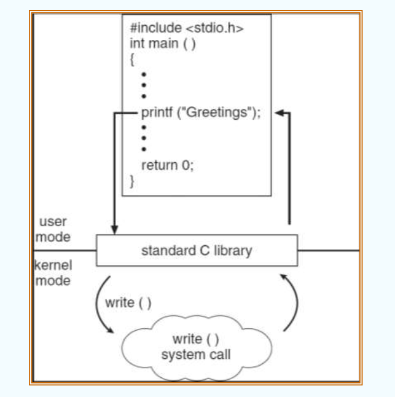
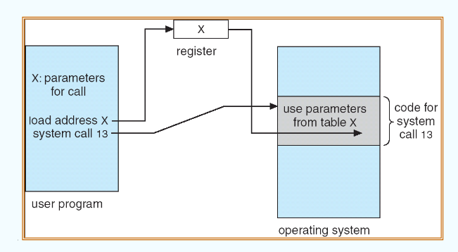

# CH2

## Operating System Structures

### 操作系统服务

操作系统为用户、程序以及系统自身提供了支撑和管理服务，我们可以从两个角度来了解这些服务：一个是用户的视角，一个是系统的视角

对于用户而言，操作系统总是做到以下事宜：

1. 用户界面 User Interface, UI

    - 人机交互的媒介；

    - 主要包括：命令行界面 CLI，图形用户界面 GUI，以及触控屏界面 Touch Screen；

2. 程序执行  Program Execution

    - 系统负责将程序加载到内存执行，并在执行结束时进行资源回收；
    - 程序在磁盘中以静态二进制可执行文件形式存在。操作系统为其分配内存地址空间，划分代码段、数据段与堆栈，将数据载入内存并设置程序计数器 PC 开始运行；
    - 当程序正常结束或发生除零、段错误等异常中断时，操作系统负责接管并终止程序，释放其占用的内存等资源

3. I/O 操作  I/O Operations

    - 运行中的程序通常需要进行输入输出操作。
    - 由于底层硬件外设的电气协议各异且直接开放读写存在安全隐患，用户程序不能直接操作硬件。操作系统屏蔽底层硬件细节，提供统一且受控的读写接口。

4. 文件系统管理  File-system Manipulation

    - 物理存储介质底层仅由物理扇区或块组成。操作系统构建树状目录结构，提供文件与目录的创建、删除、读写、检索与元数据管理。
    - 提供权限控制机制，例如读、写与执行权限划分，防止多用户与进程之间的越权访问。

5. 进程间通信  Communications

    - 并发执行的进程各自拥有独立的虚拟内存空间。当进程间需要数据协同与交互时，操作系统提供通信机制：
    - 共享内存 (Shared Memory)：操作系统将同一块物理内存映射到多个进程的地址空间中。数据直接在内存中读写，通信速度极快，但需要进程自行处理并发访问与同步互斥。
    - 消息传递 (Message Passing)：进程将数据封装为消息包交由内核转发，例如管道 Pipe、消息队列与网络套接字 Socket。数据通过内核中转，隔离性好，但存在用户态与内核态之间的数据复制开销。

6. 错误检测 (Error Detection)：

    - 操作系统持续监控系统软硬件状态，确保计算的正确性与系统稳定性。
    - 监控范围涵盖 CPU 与内存硬件故障、I/O 外设异常以及用户程序的运行报错。发生错误时，操作系统采取隔离措施防止整机崩溃，并记录错误日志。
    - 课件特别提及 Linux 下基于 eBPF 技术的 BCC 工具套件，可用于深入内核动态追踪与排查系统故障。

面向系统的服务主要包括以下内容：

1. 资源分配 (Resource Allocation)：

    在多任务并发与多用户环境下，系统需要公平且高效地为任务分配有限的硬件资源。
    
    针对 CPU 周期、内存空间与文件存储等竞争激烈的核心资源，操作系统内置专用调度与置换算法进行动态分配。
    
    针对打印机等独占型设备，系统提供通用的申请 Request 与释放 Release 互斥管理机制。

2. 统计与审计 (Accounting)：

    记录各个用户与任务消耗的计算资源总量，例如 CPU 执行时间、内存峰值与网络带宽等。
    
    用于系统性能分析、容量规划，也是云计算平台资源计费与容器资源限额的基础依据。

3. 保护与安全 (Protection and Security)：

    保护 (Protection)：侧重于内部资源访问控制，确保所有进程对系统资源的访问均合法受控，防止进程之间相互干扰。
    
    安全 (Security)：侧重于防御外部未经授权的访问与攻击，包括用户身份认证、网络防火墙与外设访问控制。
    
    木桶原理：系统的整体安全强度取决于最脆弱的一环，任何一个薄弱模块或配置缺陷都可能导致整体防线失效。

---

### 用户与操作系统接口 (User Operating System Interface)

操作系统接口是用户与系统交互的外层媒介。在系统结构中，它们通常作为用户态的系统程序运行，而非内核本身。

- **命令行接口  CLI**

    1. 命令行接口让用户直接输入字符命令，由命令行解释器Shell接收并解析；
    2. Shell通常作为独立的系统程序运行在用户空间，核心工作循环为读取用户命令、解析参数并调用执行；

    具体的执行方式还分为几种：

    1. 内置命令：执行具体操作的代码在Shell源码内部，这导致Shell很臃肿，并且如果要加一个新的命令需要修改Shell的源代码并重新编译，典型代表是早期的DOS系统；

    2. 独立程序方式：Shell负责解析字符串，而具体执行代码单独存放在硬盘上的小文件中，Shell会根据字符命令去找到对应的执行文件，然后创建一个子进程运行起来；

        优点：系统扩展功能时不需要修改Shell自身的代码，提高了扩展性和灵活性

- **图形用户界面  GUI**
    1. 用各种图标来表示文件以及用图形来完成文件归类等内容。比如，一个目录组织为文件夹，一个游戏的快捷方式表示为一个icon等；
    2. 现代操作系统通常结合了GUI和CLI，比如win系统以GUI为主，cmd和powershell为命令行工具；mac拥有Aqua图形界面等

---

### 系统调用

​	**系统调用 System Call**

​	系统调用是操作系统向运行程序提供的编程接口。内核始终控制着硬件，而普通应用程序运行在受限的用户态。因此系统调用是程序向内核合法请求文件读写、内存分配、进程创建等底层服务的合规途径。

常见的三大 API：

- Windows 系统的 Win32 API
- 类 UNIX 系统的 POSIX API，涵盖 Linux、UNIX 与 macOS
- 针对 Java 虚拟机的 Java API

之所以通过 API 间接调用而不是直接手写系统调用，主要是出于两点考虑：

1. 可移植性：遵循标准 API 编写的代码，在不同系统间移植时无需大幅重写底层系统调用；
2. 易用性：标准库 API 封装了复杂的硬件寄存器操作与错误处理细节，调用更简单安全。

**System Call 示例**

比如一个简单的文件复制命令`cp in.txt out.txt`，表面上简单的动作，其底层是由一长串系统调用完成的，主要包括：

1. 参数获取：终端打印提示信息，接收用户输入。涉及屏幕和键盘的读写系统调用；
2. 打开源文件：调用open打开，如果文件不存在报错并终止；
3. 创建目标文件：调用create或者open创建out.txt，如果文件已经存在还要进行冲突处理；
4. 循环读写数据：调用read读源文件，以及调用write写到目标文件；
5. 退出：调用close关闭两个文件，向屏幕打印完成信息，最后调用exit退出程序

**实现机制**

1. 首先，系统调用有很多类型和种类，这些系统调用在内核中都有对应的唯一整数编号，即系统调用号；
2. 系统调用接口维护了一张系统调用表，通过系统调用号作为索引，能够快速定位并跳转到对应的内核处理例程；

**调用过程**

1. 应用程序会先调用标准库函数；

2. 库函数将对应的系统调用号与参数放入指定位置，触发硬件陷阱指令，比如终端或者特权切换指令；

3. CPU从用户态切换到内核态，内核查表执行具体的system call代码，最后将执行状态和返回值反还给用户程序

    

    比如这个C语言printf函数的实现，首先是C代码中写的printf，这个函数本质是C libc中的一个普通函数，它其实没有操作硬件的权限；标准库内部调用了底层的write system call，然后进入内核态，内核接管后，通过显卡和终端硬件把字符显示出来；最后退出内核态，然后逐层返回到main函数。

在调用过程中，我们还要传参，来告诉内核我们要操作哪个文件、数据在哪块内存，要读多少、写多少等。

**传参方式**

1. 寄存器传参

    Registers

    - 在执行系统调用指令之前，编译器将几个参数存放在 CPU 通用寄存器中；

    优点：读写速度极快；

    缺点：容量有限，因为CPU中的通用寄存器数量不多，而且平时还要用于计算，如果一个system call需要传递较多参数，寄存器数量就不够了

2. 内存块或表格传参

    Block / Table

    - LInux和Solaris等现代OS普遍采用，参数数量和长度不再受寄存器限制；
    - 用户程序在自己的内存中划分出一块区域，像填表一样将所有参数按顺序写好；
    - 用户程序只需要用一个寄存器，并将这张参数表的内存首地址放入；
    - 调用system call，CPU切换到内核态
    - 内核的处理例程运行，从寄存器中拿到地址，然后顺着地址拿到所有参数

    

3. 堆栈传参：

    Stack

    - 与C语言函数调用类似。应用程序将参数依次Push放进栈内存，内核在处理时Pop拿到参数；

    优点：同样不受寄存器数量限制

**常见的 System Call**

1. 进程控制 (Process control)：创建进程、终止进程、等待子进程结束、分配与释放内存等；
2. 文件管理 (File management)：创建文件、删除文件、打开、关闭、读写文件及读取文件属性等；
3. 设备管理 (Device management)：请求设备、释放设备、读写设备缓冲区等；
4. 信息维护 (Information maintenance)：读取或设置系统时间、日期、获取进程或系统状态数据等；
5. 通信 (Communications)：建立与断开网络连接、发送与接收消息、挂载共享内存等；
6. 保护 (Protection)：控制资源访问权限、设置文件读写执行许可等。

---

### 系统程序

**系统程序 System Programs**

对于大多数普通用户，他们眼中的操作系统其实就是由这一系列系统程序组成的，而非底层的系统调用本身；

系统程序位于系统调用之上，为程序的开发与执行提供方便的环境；

主要包含以下几类：

1. 文件管理：用于创建、删除、复制、重命名、打印与列出文件和目录，例如 ls、cp、mv；
2. 状态信息：用于查询系统时间、空闲内存、磁盘空间与在线用户，例如 date、df、ps，以及 Windows 注册表工具；
3. 文件修改：用于创建与修改文件内容的文本编辑器，以及文本搜索和转换工具；
4. 编程语言支持：随系统提供的编译器、汇编器、解释器与调试工具，例如 GCC、GDB、Python；
5. 程序加载与执行：链接器、绝对加载器、重定位加载器等，负责将编译好的程序载入内存准备运行；
6. 通信与应用工具：支持进程间或机器间通信的工具，例如远程登录、邮件收发与网页浏览工具。

---

### 操作系统设计与实现

操作系统的内部结构因设计目标和所选硬件的不同而差异巨大。

设计目标分类

1. 用户目标：操作系统应方便好用、易学、可靠、安全并且运行速度快；
2. 系统目标：操作系统应易于设计、实现与维护，同时兼具灵活性、高可靠、无错误以及高资源利用率。

核心准则：机制与策略分离

- 机制 (Mechanism)：定义怎么做 (How to do it)，即底层提供怎样的能力与做事方式；
- 策略 (Policy)：决定做什么 (What will be done)，即具体何时选择哪个决策。

例如门禁刷卡系统中，磁卡读卡器和远程控制门锁是机制，而哪个人在什么时间段允许进入哪个房间是策略。

又如在操作系统内部：

1. 进程管理：上下文切换与时钟中断是机制；选择先来先服务、时间片轮转还是优先级调度则是策略；
2. 内存管理：分页寻址与缺页中断处理是机制；选择 FIFO 还是 LRU 页面置换算法则是策略；
3. 文件系统：磁盘块读写接口是机制；选择预分配还是动态追加空间则是策略。

机制与策略分离的最大优势在于灵活性：当后续需要调整调度算法或替换安全规则时，只需要修改上层的策略代码，而底层的硬件驱动与基础机制完全无需重写。

---

### 操作系统的体系结构演进

操作系统内核在历史上演进出了几种经典的结构模式：

**简单结构  Simple Structure**

- 代表系统：早期 MS-DOS；
- 结构特征：为了在有限硬件空间实现最多功能而编写，没有明确的分层与模块化。应用程序可以直接越过操作系统去访问底层的 BIOS 和物理硬件；
- 优缺点：结构紧凑，但完全缺乏保护机制，应用程序的错误极易导致整机崩溃或系统损坏。

**分层结构  Layered Approach**

- 结构特征：将系统自底向上划分为若干层。最底层 (Layer 0) 为硬件，最高层 (Layer N) 为用户界面。每一层只能调用其紧邻的下层所提供的功能与服务；
- 优缺点：模块化清晰，便于单独调试和验证；缺点是层级边界极难严格划分，且每一次操作层层传递会导致较高的跨层调用性能开销。

**宏内核  Monolithic Kernel**

- 代表系统：传统 UNIX、Linux；
- 结构特征：在系统调用接口之下的所有核心功能，包括进程调度、内存管理、文件系统和硬件驱动，全部打包常驻在内核空间运行；
- 优缺点：模块间都在内核空间直接函数调用，运行性能极高；但缺点是内核代码体积庞大，任何一个驱动程序出现缺陷都可能拖垮整个内核，维护与扩展成本高。

**微内核  Microkernel**

- 代表系统：Mach、QNX；
- 结构特征：奉行极简主义，尽可能将非核心功能（如文件系统、设备驱动）移出内核空间，作为普通服务运行在用户态；内核本身仅保留最核心的进程调度、极简内存管理与进程间通信 (IPC)；
- 优缺点：
    - 优势：安全可靠，外部服务崩溃不会导致内核死机；便于移植到新硬件平台，扩展性极佳；
    - 劣势：模块间处于不同地址空间，协作需要频繁进行用户态与内核态切换并通过消息传递 IPC 中转，导致明显的性能损耗。

**模块化内核  Loadable Kernel Modules, LKM**

- 代表系统：现代 Linux、Solaris；
- 结构特征：采用面向对象与组件化思想。内核保持核心功能的同时，将驱动程序、网络协议与文件系统实现为动态可加载模块；
- 优缺点：既保持了宏内核中模块直接调用的高性能，又拥有了类似微内核的灵活性，无需重新编译内核即可在运行时按需插拔新功能。

**混合与其他前沿结构**

- 混合结构 (Hybrid)：例如 macOS 的 XNU 内核，结合了 Mach 微内核的消息机制与 BSD 宏内核及驱动框架的优点；
- 外核 (Exokernel)：极简内核，仅负责底层的资源分配与硬件保护，将硬件抽象全交由应用级定制库实现，追求极致性能；
- 单一内核 (Unikernel)：将应用代码与所需内核代码静态链接在单一地址空间中，省去通用系统的繁琐开销，多用于微型虚拟机与云原生环境，启动时间仅需数十毫秒。

---

### 虚拟机与系统引导 

**Virtual Machines and System Boot**

**虚拟机 Virtual Machines**

- 基本概念：虚拟机将硬件与操作系统内核都视为底层物理硬件的延伸，向上提供与裸硬件完全相同的抽象接口。通过 CPU 分时调度与内存虚拟化，为上层创建多个独立隔离的运行环境；
- 核心价值：实现完全的强隔离与安全保护，为操作系统研发、测试与多系统兼容提供了理想载体；
- 典型技术：基于硬件虚拟化的 VMware，以及应用级虚拟化的 Java 虚拟机 (JVM)。

**系统引导与启动 System Boot**

- 引导程序 (Bootstrap Loader)：计算机加电开机时，硬件从固件 ROM（如 BIOS/UEFI）的预设固定内存地址读取初始代码，该程序负责定位磁盘上的内核、将其载入主存并启动运行；
- 课程实验 Lab 1 结合点（RISC-V / Xv6 启动流程）：
    - 计算机启动后首先处于最高特权级的机器模式 (Machine Mode)，执行 `start()` 函数；
    - 在机器模式下完成初始配置：将状态寄存器 `mstatus` 的先前模式设为管理者模式 (Supervisor Mode)，将返回地址寄存器 `mepc` 设为 `main` 函数入口地址，将页表寄存器 `satp` 置零以在管理者模式下禁用虚拟内存转换，将中断和异常委托给管理者模式，并配置时钟芯片产生时钟中断；
    - 执行一条关键的 `mret` 指令，实现特权级从 Machine Mode 降级并跳转至 Supervisor Mode，正式进入 Xv6 内核的 `main()` 入口执行。
