# CH3

## Processes

### Process Concept

​	在教材以及题目中，我们可能会看到 Job 和 Process 的混用，它们代表是同一个意思，只不过因为历史原因保留了一些习惯性叫法。在早期的批处理系统中，习惯叫 Job，后来的分时系统习惯叫 Process 或者 Task。

​	更多关于操作系统发展史的介绍：

1. [操作系统发展简史](https://blog.csdn.net/u013669912/article/details/140479330)
2. [操作系统发展历程 ](https://blog.csdn.net/DRZ_2000/article/details/104840733)
3. [我的笔记](xxxx.md)


**进程**，即“正在执行中的程序”，英文表达为：**a program in execution** 


**进程和程序的区别**

​	程序，是静态的，是一个可执行文件，保存在磁盘中；

​	进程，是动态的，指的是程序的执行过程


​	对于我们来说，可以根据进程的名称来区分不同的进程，比如：QQ进程，微信进程；但是从计算机的视角看，操作系统对进程的管理和理解与我们大不相同。以下，逐步了解进程的详细内容，并探索操作系统对于进程的管理


#### **Process in Memory**

​	对于计算机而言，一个进程要想存在，是脱离不了内存的。而一个进程在内存中通常包含了以下部分：

> 只是一种经典的划分，并不是说所有进程都只有这几种状态

<div style="display: flex; gap: 20px; align-items: center;">
  <!-- 左侧文字区域 -->
  <div style="flex: 0.6;">
    <ul>
      <li>text section：代码段。即编译后的二进制代码，放在进程运行期间的虚拟内存的最低位</li>
      <li>data section：数据段。存放程序的全局变量和静态变量</li>
      <li>heap：堆区。程序运行期间进行动态申请内存，向高地址方向生长</li>
      <li>stack：栈区。存放函数调用的局部变量</li>
      <li>program counter：PC</li>
    </ul>
  </div>
  <!-- 右侧图片区域 -->
  <div style="flex: 0.4; text-align: center;">
    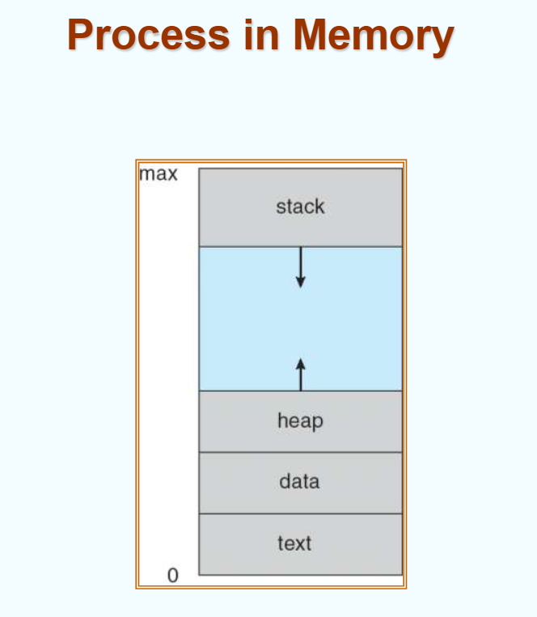
  </div>
</div>


#### Process State

​	进程在获取代码、数据、堆栈等资源后，便会作为一个对象参与系统调度。但是**一个CPU核心在任何时刻都只能处理一个进程**，并且一个进程往往会和外设进行交互，这是很费时间的，在当今的多任务环境下，为了CPU的效率，进程不可能一直独占CPU。

​	所以在一个进程的生命周期中，进程会因为各种情况进行不同的状态转换，具体来说有以下几种：

- 新建 (New)：进程创建中...
- 就绪 (Ready)：进程准备好运行，等待OS分配CPU资源
- 运行 (Running)：进程指令正在被CPU执行
- 等待/阻塞 (Waiting / Blocked)：进程因等待事件发生(如IO操作)而暂时无法进行
- 终止 (Terminated)：进程全部执行完或被异常终止

一张图总览状态变化关系

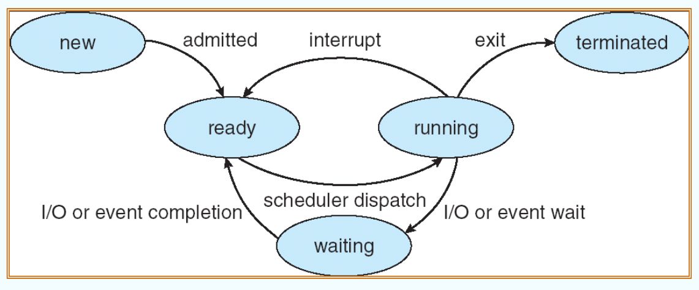


#### Process Control Block

​	**PCB，即：进程控制块**

​	既然进程的状态是时刻在变的，而进程又可能随时被中断打断，等再次回来时我们想要接续上次进程的状态继续执行，那么这个状态就需要被记忆。PCB就是操作系统用来管理和记录每个进程的所有状态信息的。

​	PCB主要包含了以下内容：

- process state：进程状态。[前面介绍过的内容](# Process State)

- program counter：程序计数器，指向下一条执行指令的地址

- CPU registers：寄存器。即进程离开CPU时，CPU内部所有通用和专用寄存器的备份，比如：所有的通用数据寄存器、栈指针寄存器sp、标志寄存器、甚至现代扩充的浮点寄存器和向量寄存器

- memory limits：内存管理信息。主要是划定该进程在内存中的位置，以及虚拟地址和物理地址的转换表。

    比如现代x86架构在切换进程时，操作系统会把PCB内的页表地址写入CPU的CR3寄存器

- list of open files：打开文件列表。记录了该进程当前占用了系统中的哪些外部持久化文件资源，主要就是在应用层写代码时打交道最多的文件描述符表。

    每个进程的PCB都有一个固定大小的指针数组，下标就是文件描述符数字，比如0代表标准输入，1代表标准输出，打开一个新文件后，可能就会将文件的内核指针放到数组的3下标下。这样做的目的是记录文件的独写偏移量offset，以及不同的打开模式等。

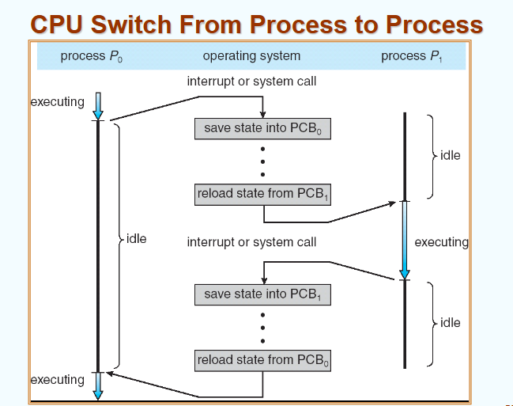

---

### Process Scheduling

#### Process Scheduling

​	1.1 中我们阐明了单个进程的现场信息由PCB记录和承载。在真实的操作系统中，系统里存着成百上千个并发进程，但是因为CPU核心有限，如果所有进程都去抢CPU的资源，系统就会崩溃。所以我们将这些PCB管理起来，让它们排队。

​	但是不同进程排队的原因也各不相同，于是我们使用不同的队列来安排它们：

**调度队列 Scheduling Queues**

1. 就绪队列 Ready Queue：存放在主存中，处于就绪状态，等待分配CPU的进程链表。

    ​	位与就绪队列的进程，其运行代码和数据都已经存放进了内存，只需要等待CPU分配时间片来执行即可。

2. 设备队列 Device Queue：等待各种设备响应的进程链表。

    ​	设备队列是交给硬件外设处理的。CPU在执行过程中，进程可能发起磁盘读写、键盘输入、等待网络数据包等操作；由于外设的速度比较慢，所以在得到这个结果之前，CPU都无法继续执行下去，所以就将这个进程踢出就绪队列，丢到设备队列中排队。

3. 作业队列 Job Queue：包含系统中所有进程的完整结合。

    ​	记录了系统中存在的所有进程，它的作用像是进程的“Buffer”。用户提交的所有任务，都是先排到外部磁盘存储的作业队列中，然后再通过长城调度器，每隔一段时间检查内存空间，当内存充裕时，再从作业队列里挑选合适的任务进入就绪队列。

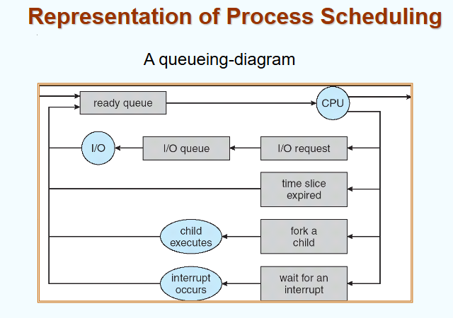

队列在内存的本质就是一条单向链表；

就绪队列是最终交付给CPU处理的进程队列；

进程在生命周期中会在上述各个队列之间动态迁移；

如下图所示：就绪队列中存放了不同的进程状态PCB；还有左侧各种设备队列，可以看到不同的设备后有序号，因为同一台设备可能有多个硬件，比如两个磁带机，两个磁盘等

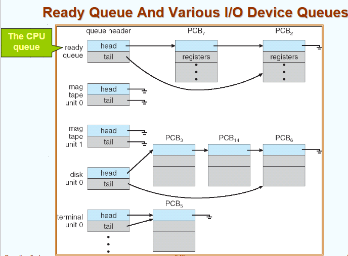


队列还需要调度器来管控

**调度器 Schedule**

- 什么是调度器？-- 调度器本质是内核中的一小段C语言算法程序

调度器分类：

1. 长程调度器 (Long-term scheduler / Job scheduler)：或作业调度器。负责决定把外存中的哪几个任务调入内存，正式为它们建立 PCB 并送入就绪队列，调用频率很低。
2. 短程调度器 (Short-term scheduler / CPU scheduler)：从就绪队列中挑选下一个分配 CPU 的进程。调用频率极高（毫秒级别），执行逻辑必须尽可能精简高速；

> ​	因为 long-term scheduler 和 short-term scheduler 都只负责往里搬东西，这导致整个队列缺少平衡管理。考虑一种极端的情况：有8个进程被长程调度器放进了内存，但是有一段时间，这10个进程都开始疯狂申请内存，这会导致内存告急；为了处理这种情况，我们加入中程调度器：
>
> ​	中程调度器 (Medium-term scheduler)：当系统内存吃紧时，将部分进程从内存换出到磁盘交换空间挂起，待内存空闲时再换入主存，即进程交换机制 (Swapping)。运行逻辑如下图：
>
> 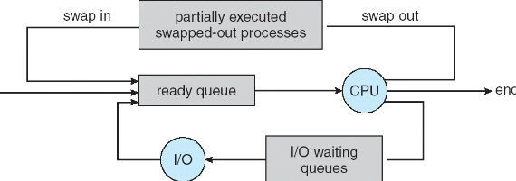


- 进程行为特征与调度平衡

	对于长程调度器，在挑选进程时，必须要考虑分析不同的进程特征，进程主要可以分为两类：

	1. I/O 密集型进程 (I/O-bound process)：主要时间花费在 I/O 操作上，伴随较多较短的 CPU 计算突发；
	2. CPU 密集型进程 (CPU-bound process)：主要时间花费在数值计算上，极少进行 I/O，CPU 计算突发周期很长；

	所以调度器要维持这两类进程的平衡搭配，不能完全偏向一方，否则会导致CPU繁忙而其他外设空闲；或者全部蜂拥向外设，CPU空闲


#### Context Switch

> **上下文切换：在计算机里，上下文就是指某个进程在运行时某一瞬间的现场记忆**

- 当 CPU 从一个进程切换到另一个进程时，操作系统必须先保存当前正在运行进程的现场（保存至其 PCB 中），随后加载新进程先前保存的现场（从其 PCB 中恢复）；
- 上下文切换时间是纯粹的系统开销，在切换期间 CPU 不执行任何有效计算工作；
- 切换速度受底层硬件支持影响，例如某些架构（如 SPARC）提供多套物理寄存器组，可实现快速切换。

---

### Operations on Processes

​	本节核心：进程的创建与终止

#### Process Creation

1. **Tree of Processes**

​	进程树。在现代操作系统中，绝大多数进程都不是凭空出现的，而是由一个已存在的父进程 (Parent process) 通过系统调用繁衍出子进程 (Children processes)，子进程又可以继续创建它的子孙进程，最终在整个系统中构成一棵层次清晰的进程树。

- 每个进程在系统中都有一个唯一的数字标识符，即进程号 **PID (Process Identifier)**；
- 进程树的顶点是系统的始祖根进程，其 **PID 固定为 1**。例如在典型的 Solaris 系统中，由 sched 调度器派生出 init；在现代 Linux 中为 systemd 或 init；在 macOS 中则为 launchd；
- 系统中的用户 Shell、图形桌面、系统服务等，追根溯源全都是从这个 1 号根进程一级一级派生下来的。

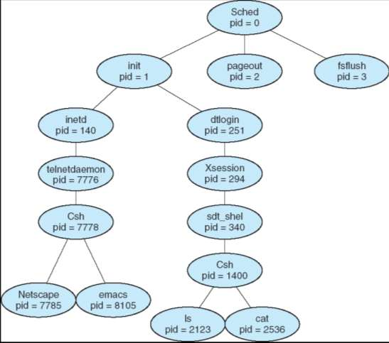

**2. Resource Sharing**

​	资源共享。子进程被创建时需要内存、文件和 I/O 资源，父子进程之间关于资源的继承存在三种设计：

- 共享所有资源 (Share all resources)：父进程拥有的数据、内存和打开的文件描述符，子进程全部直接共享访问；
- 共享父进程的部分子集 (Share subset of parent's resources)：父进程分配一部分资源限额给子进程，防止子进程创建过多任务把系统的全局资源耗尽；
- 完全不共享资源 (Share no resources)：子进程由操作系统从系统全局资源池中另行分配独立资源，与父进程互不相干。

**3. execution**

​	执行时序。子进程创建后，父进程与子进程在调度执行时序上有两种配合方式：

- 并发执行 (Execute concurrently)：父进程生完子进程后，双方各自独立排队争夺 CPU，并驾齐驱向前推进。例如 Web 服务器主进程接收到客户端连接后，立刻 fork 出一个子进程去处理具体的数据传输，而主进程自己继续并发监听下一个网络请求；
- 父进程等待子进程终止 (Parent waits until children terminate)：父进程主动调用系统调用（如 wait）将自己挂起阻塞，把 CPU 完全交给子进程。直到子进程全部执行完毕并返回退出状态，父进程才被唤醒继续往下执行。例如在命令行终端输入编译命令 `gcc main.c` 时，Shell 进程就会等待 gcc 子进程执行完毕，才会重新弹出命令提示符。

4. 地址空间与 UNIX 经典创建机制 (Address Space & fork/exec)

​	子进程被创建后的地址空间存在两种可能：

1. 子进程完全复制父进程的地址空间 (Child duplicate of parent)；
2. 子进程在地址空间中加载全新的程序代码 (Child has a program loaded into it)。

​	在 UNIX / Linux 系统中，操作系统并没有用一个臃肿的单一系统调用去同时完成创建与加载，而是精妙地拆解为两个独立的系统调用协同完成：

- **`fork()` 系统调用**：负责克隆生成新进程。子进程会完全复制父进程的地址空间（包含代码段、数据段、堆栈）以及打开的文件描述符列表，唯一不同的是它们拥有不同的 PID；
- **`exec()` 系列系统调用**：负责置换进程内容。在 fork 之后调用，它会用磁盘上指定的新可执行程序，彻底冲刷并覆盖掉当前进程原有的代码段、数据段和堆栈，从新程序的入口处开始执行。

> ​	**为什么要把创建与执行拆分为 fork 和 exec 两步？**  
> ​	这是 UNIX 极具智慧的解耦设计。正因为中间留有一段缝隙，子进程在调用 exec 加载新程序之前，可以自由地修改自己的运行环境。例如：修改自己的文件描述符表（把 1 号 stdout 重定向到文本文件，从而实现命令行的输出重定向 `>` 功能）、调整环境变量等，极大提升了系统的灵活性。

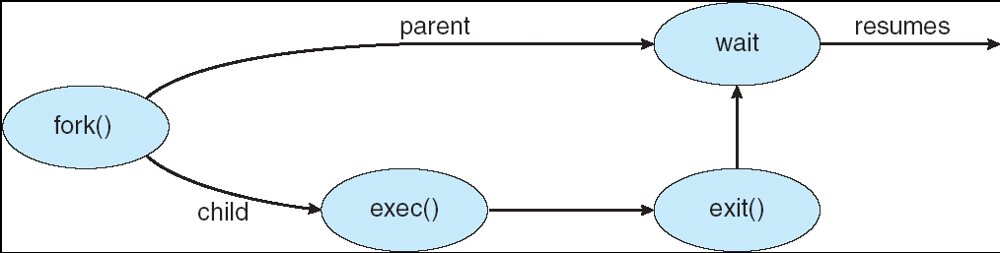

> ​	**关于 exec 族函数的后缀含义**：  
> ​	课件底部提到存在多种 exec API（如 `execve()`, `execv()`, `execle()`, `execvp()`, `execlp()` 等），它们的底层系统调用都是 `execve`，库函数通过不同后缀提供便捷调用：  
> ​	- `l` (List)：参数以可变参数列表逐个传入；  
> ​	- `v` (Vector)：参数以指针数组统一传入；  
> ​	- `p` (Path)：无需写死可执行文件的完整绝对路径，系统会自动在环境变量 PATH 包含的目录下检索该程序；  
> ​	- `e` (Environment)：允许额外显式传入自定义的环境变量数组。

**5. 经典 C 语言代码示例与解析**

​	课件展示了使用 `fork()`, `execlp()`, `wait()` 协同工作的标准 UNIX 编程范式：

```c
#include <sys/types.h>
#include <stdio.h>
#include <unistd.h>
#include <sys/wait.h>
#include <stdlib.h>

int main()
{
    pid_t pid;

    /* 1. 调用 fork() 派生新进程 */
    pid = fork();

    if (pid < 0) { 
        /* 返回值小于 0：说明创建失败（如系统进程数超限或内存不足） */
        fprintf(stderr, "Fork Failed");
        exit(-1);
    }
    else if (pid == 0) { 
        /* 返回值等于 0：当前处于子进程的执行上下文中 */
        /* 调用 execlp 用磁盘上的 /bin/ls 程序替换当前子进程的地址空间 */
        execlp("/bin/ls", "ls", NULL);
    }
    else { 
        /* 返回值大于 0：当前处于父进程的执行上下文中，pid 的值为刚创建的子进程 PID */
        /* 父进程调用 wait 等待子进程执行完毕 */
        wait(NULL);
        printf("Child Complete\n");
        exit(0);
    }
}
```

- **`fork()` 的神奇之处在于一次调用，两次返回**：
    - 在子进程中，`fork()` 返回 `0`，子进程据此得知自己是孩子，于是调用 `execlp` 去执行全新的任务（如列出目录的 `ls` 程序）；
    - 在父进程中，`fork()` 返回**新创建子进程的实际 PID（大于 0）**，父进程据此得知自己是父亲，于是调用 `wait(NULL)` 挂起等待；
    - 若系统资源不足发生故障，则返回负数。

---

#### Process Termination

​	当一个进程完成了它的历史使命，或者由于某种原因无法继续运行时，便进入进程终止流程。

**1. 正常主动退出 (exit)**

- 当进程执行完 main 函数的最后一条语句，或者在代码中显式调用了 `exit()` 系统调用时，进程请求操作系统将其注销；
- 操作系统接管后，回收该进程占用的物理内存、打开的文件描述符和 I/O 缓冲区等系统资源；
- 子进程可以通过 `exit(status)` 传递一个退出状态整数值，该状态码会被内核暂存，直到父进程通过 `wait(&status)` 读取。

**2. 异常被动终止 (abort)**

​	父进程有权通过系统调用（如 `abort()` 或发送 SIGKILL 信号）强行终止其派生出的子进程，常见原因包括：

- 子进程超出了分配给它的系统资源限额（例如内存泄漏吃光了配额）；
- 分配给子进程的任务已不再需要（例如用户在下载界面按下了取消下载按钮）；
- 父进程自身即将退出。

**3. 级联终止 (Cascading Termination)**

- 在某些操作系统设计中，明确规定**不允许子进程在没有父进程的情况下独立存活**；
- 一旦父进程因任何原因终止（正常退出或被异常杀死），操作系统会顺着进程树的血缘指针，将其所有子进程、孙子进程逐级全部强行杀死，这种机制被称为**级联终止 (Cascading termination)**。

**4. 孤儿进程与僵尸进程 (Orphan & Zombie)**

​	在不采用级联终止的类 UNIX 系统中，父子进程的生命周期异步性会引发两种经典的特殊进程形态：

- **孤儿进程 (Orphan process)**：
    - 父进程先于子进程终止，但子进程依然在后台运行；
    - 系统为了避免这些孤儿进程无人监管，会由**1 号根进程（init / systemd / launchd）主动领养并收养它们**，充当它们的养父，负责在它们最终退出时代为收尸。
- **僵尸进程 (Zombie process)**：
    - 子进程已经执行完毕 `exit()` 终止了，其代码和内存空间已被系统清空回收，**但其父进程尚未调用 `wait()` 来读取它的退出状态**；
    - 此时该子进程在操作系统进程表中的条目与 PCB 无法彻底删除（仍保留 PID 和退出码供父进程查阅），此时的子进程被称为**僵尸进程**；
    - 危害：若父进程长时间处于死循环而不调用 wait，系统中就会累积大量占用 PID 槽位的僵尸进程，最终可能导致系统耗尽进程号，无法创建新进程。

---

### Cooperating Processes

​	在多任务操作系统中，同时运行的并发进程可以划分为两大类：

* **独立进程 (Independent process)**：其执行过程不影响其他进程，也不受其他进程影响。独立进程独享自身的数据，不与外界产生任何状态共享。
* **协作进程 (Cooperating process)**：其执行过程会影响其他进程，或者受到其他进程的影响。任何与其他进程共享数据的进程都是协作进程。

**1. 进程协作的优势**

​	为什么操作系统要支持并鼓励进程协作？主要有四大核心优势：

* **信息共享 (Information sharing)**：多个用户或应用可能对同一份数据感兴趣。例如多个并发进程共同读取一份数据库或共享配置文件。
* **计算加速 (Computation speed-up)**：将一个耗时庞大的大任务拆分为若干个子任务，让它们在多核 CPU 上并行计算，从而大幅缩短整体运行时间。
* **模块化设计 (Modularity)**：按照软件工程的模块化思想，将系统按功能拆分为不同职责的独立进程。例如编译器系统拆分为预处理器、词法分析器、语法分析器和代码生成器，各模块通过协作管道逐步推进。
* **操作便利 (Convenience)**：方便单个用户同时处理多项关联任务。例如一边在编辑器中敲代码、一边后台运行单元测试、一边在浏览器中查阅文档。

---

**2. 经典模型：生产者-消费者问题 (Producer-Consumer Problem)**

​	生产者-消费者问题是操作系统协作进程中最基础、最经典的范式：

* **生产者进程 (Producer)**：负责生产数据项，并放入公共缓冲区中；
* **消费者进程 (Consumer)**：负责从公共缓冲区中取出数据项进行消费与处理。

​	根据缓冲区容量的限制，该模型分为两类：

* **无界缓冲区 (Unbounded-buffer)**：缓冲区容量在逻辑上无上限。生产者只要生产了数据就可以直接放入，永远不会被阻塞；只有在缓冲区全空时，消费者才必须等待新数据的产生。
* **有界缓冲区 (Bounded-buffer)**：缓冲区大小固定为 `BUFFER_SIZE`。缓冲区已满时生产者必须等待空位，缓冲区全空时消费者必须等待新数据。

---

**3. 共享内存方案实现与代码分析**

​	在有界缓冲区的经典实现中，通常借助操作系统提供的**共享内存 (Shared Memory)**，并采用**环形循环数组 (Circular Array)** 来组织数据。

**共享数据结构定义**：

```c
#define BUFFER_SIZE 10

typedef struct {
    /* 存放具体的数据项内容 */
} item;

item buffer[BUFFER_SIZE];  /* 环形缓冲区数组 */
int in = 0;   /* 指向下一个可写入空槽位的下标 */
int out = 0;  /* 指向第一个可读取有效数据的槽位下标 */
```

**生产者算法逻辑**：

```c
while (true) {
    /* 1. 生产一个数据项 item */

    /* 2. 判断缓冲区是否已满：若满则忙等待 (Busy Waiting) */
    while (((in + 1) % BUFFER_SIZE) == out)
        ; /* 空转等待，当前没有空闲槽位 */

    /* 3. 将生产的数据写入当前空槽，并移动写入指针 */
    buffer[in] = item;
    in = (in + 1) % BUFFER_SIZE;
}
```

**消费者算法逻辑**：

```c
while (true) {
    /* 1. 判断缓冲区是否为空：若空则忙等待 */
    while (in == out)
        ; /* 空转等待，当前没有可消费的数据 */

    /* 2. 从当前槽位取出数据，并移动读取指针 */
    item = buffer[out];
    out = (out + 1) % BUFFER_SIZE;

    /* 3. 消费并处理该数据项 item */
}
```

---

**4. 环形缓冲区的容量陷阱与计数器改进**

**为什么上述经典解法只能容纳 `BUFFER_SIZE - 1` 个元素？**

​	注意看生产者的判满条件：`((in + 1) % BUFFER_SIZE) == out`。

​	当数组中还有最后一个空格子时，算法就判定为满并阻止继续写入。这是因为：如果把最后一个空格子也填满，`in` 循环递增后就会与 `out` 重合，即 `in == out`。

​	此时就会产生二义性：系统无法单凭 `in == out` 区分当前缓冲区究竟是全空还是全满。为了用最简单的指针比较解决冲突，经典方案主动牺牲了一个槽位的存储空间。

**计数器改进方案 (Counter Solution)**：

​	课件在后半部分给出了另一种更充分利用空间的解决思路：引入一个共享整型变量 `int count = 0;`，用来精确记录当前缓冲区内实际存放的数据项总数。

* **生产者代码调整**：
  ```c
  while (true) {
      /* 生产 item */
      while (count == BUFFER_SIZE)
          ; /* 缓冲区满，等待 */
      buffer[in] = item;
      in = (in + 1) % BUFFER_SIZE;
      count++;  /* 元素个数加 1 */
  }
  ```
* **消费者代码调整**：
  ```c
  while (true) {
      while (count == 0)
          ; /* 缓冲区空，等待 */
      item = buffer[out];
      out = (out + 1) % BUFFER_SIZE;
      count--;  /* 元素个数减 1 */
      /* 消费 item */
  }
  ```

> ​	**伏笔与思考：并发安全问题**  
> ​	通过引入计数器变量 `count`，数组的全部 `BUFFER_SIZE` 个槽位得到了完全利用。但这也埋下了一个重大的隐患：`count++` 和 `count--` 在机器指令层面是由多条微指令构成的（读取寄存器、修改值、写回内存）。在多进程或多线程并发执行时，两个进程交替执行这些微指令会导致严重的**竞态条件 (Race Condition)**，破坏数据的准确性。这正是操作系统在后续进程同步章节中要重点解决的核心课题。

---

### Interprocess Communication (IPC)

​	现代操作系统默认对每个进程的虚拟地址空间实施严格的内存隔离保护，一个进程无法直接访问另一个进程的内存。为了实现进程间的数据交互与动作协调，操作系统必须提供专门的**进程间通信 (Interprocess Communication, IPC)** 机制。

**1. IPC 两大基本通信模型对比**

​	操作系统中支持两类最基本的 IPC 架构模型：**消息传递 (Message Passing)** 与 **共享内存 (Shared Memory)**。

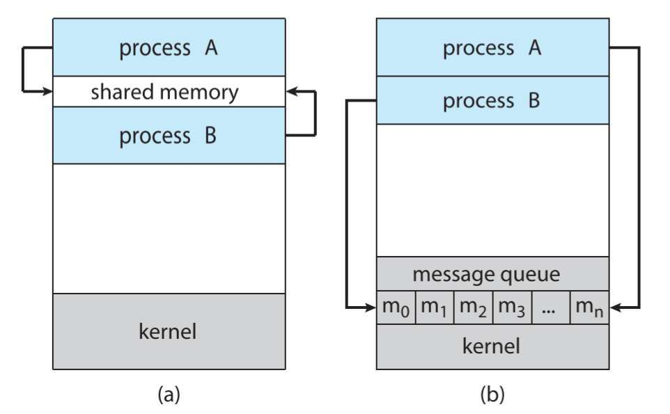

* **(a) 消息传递 (Message Passing)**：
    * **通信方式**：进程间不共享任何内存变量，而是通过操作系统内核提供的系统调用（如 `send` 与 `receive`）进行信息交换。
    * **运行特征**：发送进程将数据打包复制给内核，内核暂存到消息队列，再由内核复制给接收进程。
    * **优缺点**：需要频繁陷入内核态，伴随多次内存拷贝开销，在大数据量传输时较慢；但由操作系统统一调度管控，不会发生并发写冲突，特别适用于分布式网络环境或交换少量数据。
* **(b) 共享内存 (Shared Memory)**：
    * **通信方式**：由通信双方发起系统调用，让操作系统将同一段物理内存同时映射到各自的虚拟地址空间中。
    * **运行特征**：内存区域建立后，数据的读写如同访问自己的普通变量一样，全在用户态直接操作。
    * **优缺点**：无需内核中转与数据拷贝，通信速度与数据吞吐率极高；缺点是操作系统退出介入，并发读写时的互斥访问与同步控制完全交由应用程序开发者自行负责。

---

**2. 消息传递系统的核心设计问题**

​	在构建消息传递链路 (Communication Link) 时，操作系统必须在底层解决以下设计问题：

* 链路如何建立？
* 一条链路能否与两个以上的进程关联？
* 每一对通信进程之间可以存在多少条链路？
* 链路的缓冲区容量是多少？
* 链路能够容纳的消息尺寸是固定长度还是可变长度？
* 链路是单向通信还是双向通信？

​	根据进程寻址方式的不同，消息传递分为直接通信与间接通信：

**直接通信 (Direct Communication)**：

​	发送与接收双方必须显式指出通信对象的进程标识：

* `send(P, message)`：直接向进程 P 发送消息；
* `receive(Q, message)`：从进程 Q 接收消息。

​	**链路特征**：通信进程之间会自动隐式建立物理或逻辑链路；每一条链路严格唯一绑定一对进程；两个进程之间只能存在一条通信链路；链路通常是全双工双向的。  
​	**局限性**：高耦合。进程名称若因重启或重构发生变化，所有相关的调用代码都要修改。

**间接通信 (Indirect Communication)**：

​	通过中介容器——**邮箱或端口 (Mailbox / Port)** 来解耦通信：

* 每个邮箱拥有系统全局唯一的 ID；
* 只有共享同一个邮箱的进程之间才能互相通信；
* 原语定义：`send(A, message)` 发送消息至邮箱 A；`receive(A, message)` 从邮箱 A 读取消息。

​	**链路特征**：只有当双方共享同一邮箱时链路才建立；一条链路可以关联多个不同的进程；一对进程之间可以通过多个不同邮箱建立多条通信链路；支持灵活的多对多通信模式。

> ​	**邮箱共享引发的归属争议与解决策略**：  
> ​	若进程 P1 向邮箱 A 发送了一条消息，而进程 P2 和 P3 都在监听该邮箱，那么这条消息究竟应该分给谁？课件给出了三种经典解决策略：  
> ​	1. 限制链路规则：强制规定一条邮箱链路最多只能关联两个进程；  
> ​	2. 独占式接收：系统同一时刻只允许一个进程执行接收操作，其余排队；  
> ​	3. 系统随机仲裁：由操作系统随机指定一个接收方，并将接收者身份通知发送方。

---

**3. 同步机制：阻塞与非阻塞 (Synchronization)**

​	消息传递操作在执行时序上可以配置为阻塞或非阻塞模式，即同步 (Synchronous) 与异步 (Asynchronous)：

* **阻塞发送 (Blocking send / Synchronous)**：发送方发出消息后，进程主动挂起等待，直到消息被接收方（或消息队列）确认接收后才恢复执行；
* **阻塞接收 (Blocking receive / Synchronous)**：接收方调用接收原语后挂起等待，直到链路中有可用消息到达才被唤醒；
* **非阻塞发送 (Non-blocking send / Asynchronous)**：发送方将消息移交给系统后立即返回，无需停顿，继续执行后续代码；
* **非阻塞接收 (Non-blocking receive / Asynchronous)**：接收方尝试读取消息，若有则立即返回有效消息；若当前无消息则立刻返回一个空值 (null)，绝不卡顿进程。

---

**4. 缓冲容量机制 (Buffering)**

​	通信链路背后挂载的消息队列容量，直接决定了发送方的阻塞行为：

* **零容量 (Zero capacity)**：链路队列长度为 0，即链路无法暂存任何消息。发送方必须阻塞等待，直到接收方正好也调用了接收。双方在同一时刻完成面对面交接，这种时序同步现象被称为**会合 (Rendezvous)**；
* **有界容量 (Bounded capacity)**：链路配备长度为 $n$ 的固定队列。若队列未满，发送方将消息放入队列后即可离开；若队列已被塞满，发送方必须挂起等待空位；
* **无界容量 (Unbounded capacity)**：链路队列在理论上具备无限容量。发送方发送任何消息均能立即放入队列，发送方永远不会因为缓冲区满而被阻塞。

---

### Client-Server Communication

​	前面的 IPC 机制多用于同一台主机内部的进程间通信。当进程分布在不同的物理计算机上，或者采用客户机-服务器 (Client-Server) 分布式架构时，操作系统与应用层提供了更高层级的通信抽象技术。

**1. 套接字 (Sockets)**

​	套接字是网络分布式通信的最底层基石，被严格定义为**网络通信的端点 (Endpoint for communication)**。

* **构成结构**：套接字由 **IP 地址** 与 **端口号 (Port)** 拼接而成。例如 `161.25.19.8:1625` 表示主机 161.25.19.8 上监听或使用的 1625 号端口；
* **通信形式**：网络上任意两个进程之间的通信，本质上都是由**一对套接字**（客户端套接字与服务端套接字）建立起的双向通信通道。

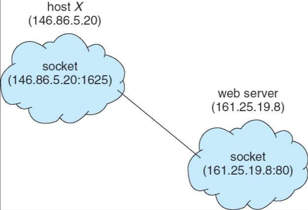

* **端口号划分惯例**：
    * 服务端公认端口 (Well-known ports)：系统通常为特定的标准网络服务保留小于 1024 的端口号。例如 HTTP 服务固定使用 80 端口，SSH 服务固定使用 22 端口，FTP 使用 21 端口；
    * 客户端临时端口 (Ephemeral ports)：当客户端发起连接时，操作系统会自动从大于 1024 的端口池中动态分配一个未被占用的端口号（例如图中客户端主机分配的 1625 端口）。
* **底层特点**：套接字传输的是底层的无格式无结构字节流 (TCP) 或数据报 (UDP)，上层应用程序需要自行制定协议来解析字节含义。

---

**2. 远程过程调用 (Remote Procedure Calls, RPC)**

​	为了让网络分布式通信更加符合程序员的编程直觉，RPC 将网络数据收发过程进行了高级封装，使得**调用远程计算机上的函数就像调用本地普通函数一样透明自然**。

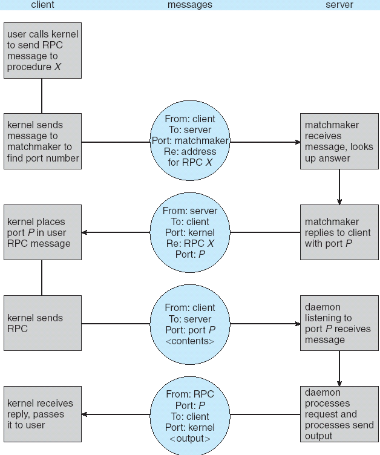

​	RPC 依赖客户端和服务端的一对**存根 (Stub)** 来屏蔽底层的网络通信细节，其完整的执行过程如下：

1. **客户端调用**：客户端用户程序像平常一样发起普通的本地函数调用，该调用直接进入客户端存根 (Client-side stub)；
2. **参数封送 (Marshalling)**：客户端存根在本地拦截该调用，负责查找目标服务器的网络地址，并将函数名、函数参数等包装为平台无关的标准网络数据包格式；
3. **内核网络传输**：客户端存根调用本地操作系统内核，通过网络将打包好的消息发送给远程服务器；
4. **服务端接收**：远程服务端的操作系统内核收到数据包，并将其转发给对应的服务端存根 (Server-side stub)；
5. **解包执行 (Unmarshalling)**：服务端存根拆解数据包，将参数还原出来，并在服务器本地调用真实的函数过程进行计算；
6. **结果回传**：服务端函数计算完毕后，将返回值交给服务端存根。服务端存根再次将执行结果封送打包，通过网络原路回传给客户端存根；
7. **客户端接收**：客户端存根解包结果，最终将结果作为函数返回值交付给最初的客户端调用方。

---

**3. 远程方法调用 (Remote Method Invocation, RMI)**

​	RMI 是 Java 语言体系中类似于 RPC 的远程通信机制，两者的核心区别在于编程范式：

* **RPC 基于面向过程 (Procedural-based)**：主要用于 C 语言等传统系统编程，远程调用的是具体的函数过程；
* **RMI 基于面向对象 (Object-based)**：专为 Java 设计，允许本地 Java 虚拟机上的程序直接调用位于远程服务器上的 **Java 对象的成员方法**。

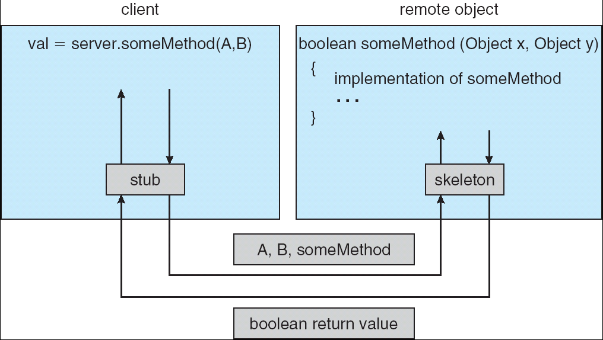

* **参数传递差异**：
    * 在传统 RPC 中，传递给远程过程的参数只能是普通的基础数据类型（整型、字符、数组等）；
    * 在 Java RMI 中，除了基本数据类型外，还可以直接将**完整的 Java 对象**作为参数传递。如果传递的是本地对象，Java 会通过对象序列化 (Serialization) 将对象深度打包传过去；如果传递的是远程对象，则直接传递该远程对象的引用。
* **架构演进**：在早期 Java 体系中，服务端需要对应的骨架 (Skeleton) 类配合存根工作；自 Java 2 (JDK 1.2) 引入动态反射技术后，服务端已不再需要生成骨架组件。

---

**4. 补充知识：macOS 中的 1 号根进程 launchd**

​	课件最后展示了在苹果 macOS 操作系统中查看进程树根节点的实际命令：

```bash
$ ps -eaf | grep launchd
  0  1  0   0  3 919  ??   33:55.81 /sbin/launchd
```

​	在类 UNIX 系统中，1 号根进程因系统分支而异：
* 传统 Linux 系统：经典的 `init`；
* 现代 Linux 发行版（如 Ubuntu、CentOS）：统一采用 `systemd`；
* 苹果 macOS 系统：采用由苹果研发的 `/sbin/launchd` 作为 1 号进程，负责接管整个用户界面的启动、后台服务的编排调度，以及替系统中所有孤儿进程收尸领养。
