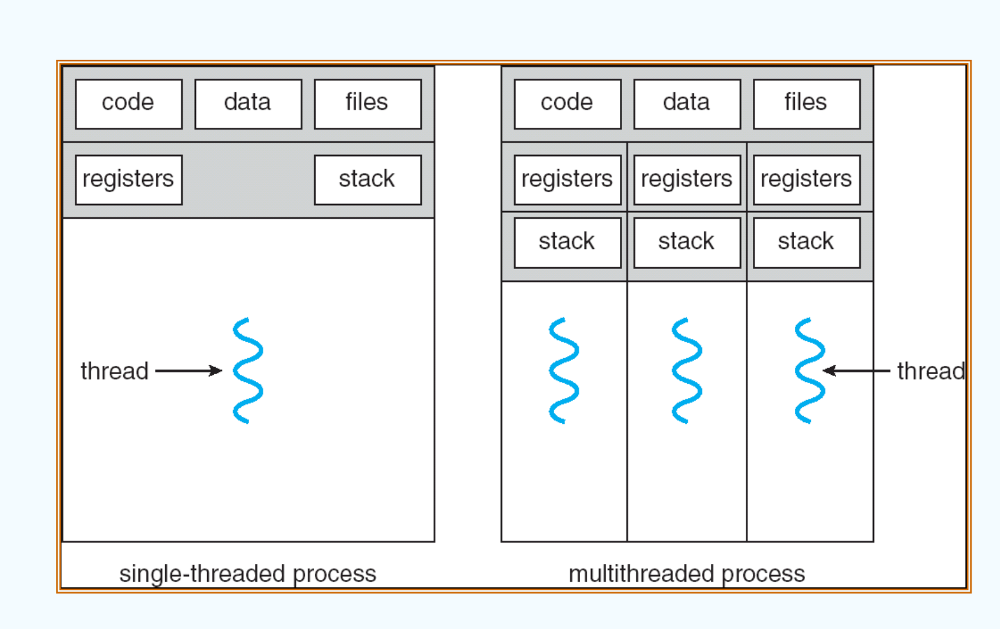
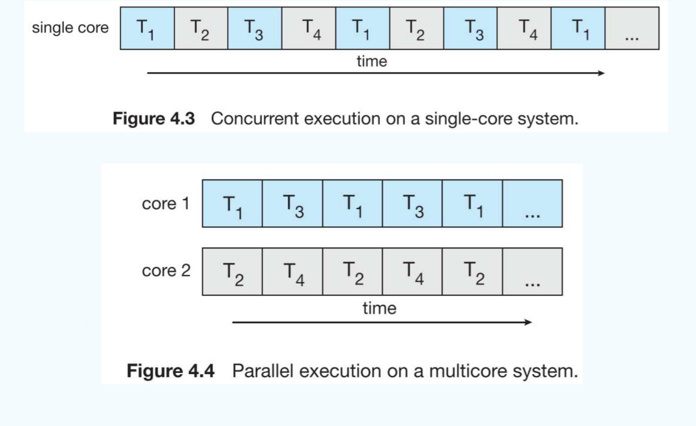
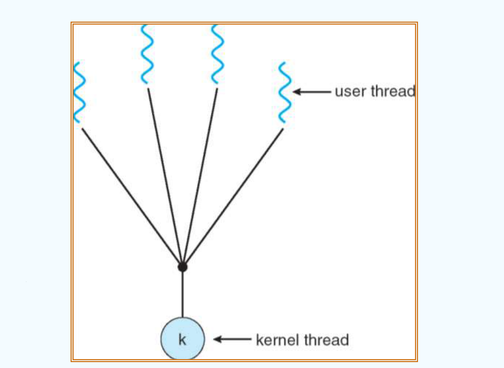
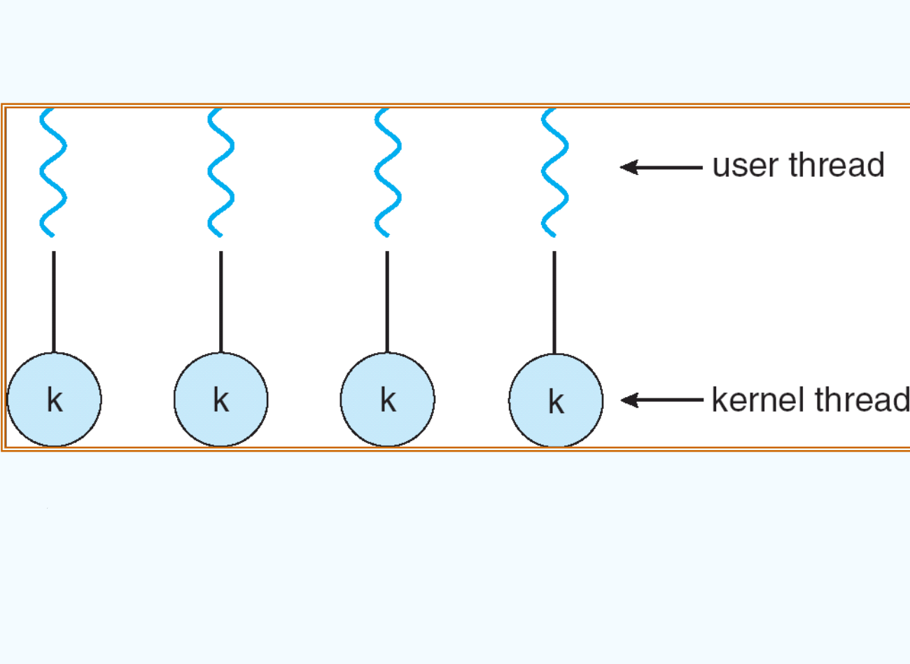
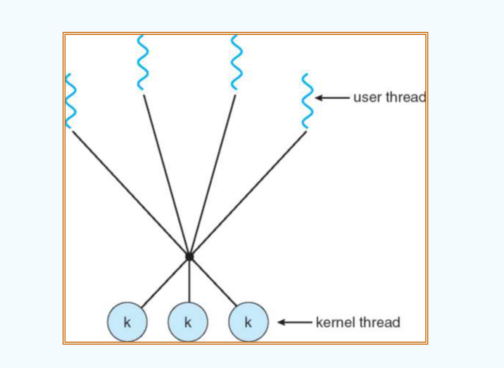
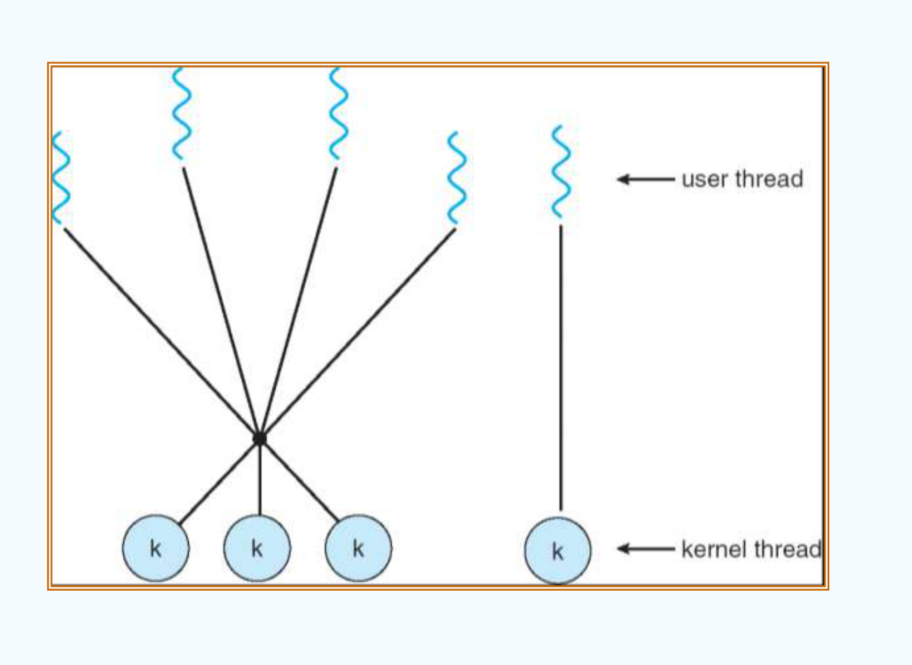
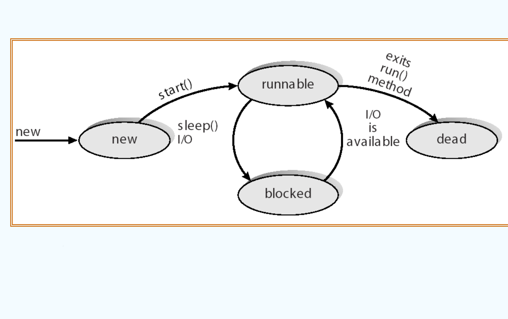

# CH4

## Threads

### Overview

在现代操作系统中，绝大多数并发应用都是以多线程形式运行的。线程是 CPU 调度的基本单位，也是进程内部一条独立的执行流。

#### 1. 动机与背景：为什么需要线程？

课件以开发一个 Web 浏览器为例展示了传统单线程设计的核心痛点：

```c
Main() {
    while (1) {
        RetrieveData();    // 从网络拉取数据，阻塞 1 秒
        DisplayData();     // 渲染并显示数据，阻塞 1 秒
        GetInputEvents();  // 获取用户输入事件，阻塞 1 秒
    }
}
```

在单线程架构下，这三个操作只能串行排队。当用户点击界面按钮时，主循环可能正卡在网络阻塞中，导致界面失去响应长达数秒。

如果试图将每个操作切成极小的碎片交替执行，代码中就会充斥着大量的状态轮询与条件检查，例如调用 `CheckData()`，这不仅使得逻辑极其冗杂低效，而且依然难以做到真正的实时响应。

* **核心矛盾**：为了保证交互灵敏，希望将任务切得越细越好；为了保证系统吞吐与效率，又希望大段连续执行代码。
* **操作系统的解法**：由操作系统引入**线程 (Thread)** 机制。程序只需为每个独立职能创建独立线程，具体的碎片切片与调度工作全权交由操作系统处理。

```c
Main() {
    CreateThread(RetrieveData());
    CreateThread(DisplayData());
    CreateThread(GetInputEvents());
    WaitForThreads();
}
```

---

#### 2. 单线程进程与多线程进程 (Single & Multithreaded Processes)

进程是**操作系统分配资源的基本单位**，而线程是 **CPU 调度的基本单位**。

<div align="center">



</div>

同一个进程内部的所有线程共享该进程的系统资源，但每个线程必须维护自身独立的执行上下文：

* **同进程内所有线程共享的资源**：
    - **代码段 (Code)**：执行相同的程序指令；
    - **数据段 (Data)**：共享全局变量与静态变量；
    - **操作系统资源 (Files)**：共享打开的文件描述符、网络套接字等句柄。
* **每个线程独占私有的执行状态**：
    - **线程标识符 (Thread ID, TID)**：用于唯一区分线程；
    - **程序计数器 (Program Counter, PC)**：记录当前线程下一条将要执行的指令地址；
    - **寄存器集合 (Registers)**：保存当前线程专属的工作寄存器内容；
    - **运行时栈 (Stack)**：存放该线程自身函数调用的局部变量与返回地址。

---

#### 3. 多线程的四大核心收益 (Benefits)

* **响应性 (Responsiveness)**：在交互式图形界面或网络服务中，耗时的后台任务，例如大文件下载或复杂计算，可以在专属工作线程中运行，主 UI 线程依然能够实时响应用户的按键与点击。
* **资源共享 (Resource Sharing)**：进程间通信 (IPC) 必须借助内核管道、消息队列或显式申请共享内存，开销繁琐；而同一进程内的线程天然共享代码段与全局内存，数据交换直接高效。
* **经济性 (Economy)**：创建进程需要分配完整的独立虚拟地址空间与 PCB，开销昂贵；而创建线程只需分配极小的栈和私有寄存器空间。同时，线程间的上下文切换无需刷新页表与清空快表 (TLB)，切换成本远低于进程上下文切换。
* **充分利用多处理器架构 (Utilization of MP Architectures)**：单线程进程无论部署在拥有多少核 CPU 的超级计算机上，同一瞬间也只能跑在一个物理核心上；多线程技术使得进程内的多个线程能够真正分散到多个物理核心上并行奔跑。

---

#### 4. 并发 vs 并行 (Concurrency vs. Parallelism)

<div align="center">



</div>

* **并发 (Concurrency)**：在单核 CPU 上，操作系统通过时间片轮转等调度算法，在极短时间内快速交替执行多个任务。在宏观上看所有任务似乎都在同时进行，但在微观的某一瞬间，CPU 核心上只有一个任务真正在跑。
* **并行 (Parallelism)**：在多核 CPU 上，硬件具备在物理同一瞬间让多个核心分别执行不同任务的能力。
* **本质区别**：并发强调的是程序结构上能够同时推进多个任务，并行强调的是物理硬件在同一时刻真正同时执行。

---

### Multithreading Models

操作系统实现多线程时，存在用户空间与内核空间两个不同层级的线程概念。

#### 1. 用户级线程与内核级线程

* **用户线程 (User Threads)**：
    - 由位于用户空间的线程库负责创建与调度，例如 POSIX Pthreads、Win32 以及 Java 线程库；
    - 内核对其存在完全无感知，线程切换不需要陷入内核态，切换速度极快；
    - 致命缺陷：如果某个用户线程发起了一个阻塞式系统调用，例如读取磁盘，由于内核只认整个进程，会导致该进程内的所有其他线程全部被强制连带挂起。
* **内核线程 (Kernel Threads)**：
    - 由操作系统内核直接提供支持与管理调度；
    - 现代绝大多数主流操作系统（Linux、Windows、macOS）均在内核层支持内核线程；
    - 优点是某个线程阻塞时内核可以调度同一进程的其他线程继续跑；缺点是线程创建、销毁和上下文切换必须通过系统调用陷入内核态，开销相对较大。

---

#### 2. 生动比喻：运动会与班级比赛模型

课件特别用运动会比赛的生动比喻阐明了进程、线程与 CPU 核心之间的映射本质：

* **参赛班级** = 进程 (Process)，拥有专属的班级号 (Process ID)；
* **班级成员** = 线程 (Thread)，班级内部可以有多名学生；
* **运动场跑道** = CPU 核心 (CPU core)，每条跑道同一时刻只能容纳一名运动员跑步；
* **上场资格号码簿** = 内核线程凭证 (Kernel Thread / LWP ID)，裁判即内核调度器只认号码簿，只调度佩戴号码簿的运动员上跑道；
* **跑步** = 运行态 (Running)；
* **下场排队打水喝** = 等待 I/O (Wait I/O)，打水过程处于阻塞等待状态，必须让出跑道；
* **等待上跑道** = 就绪态 (Ready)。

根据号码簿即内核凭证的发放与绑定规则，衍生出三种经典的多线程映射模型：

---

#### 3. 三大经典多线程模型

##### 多对一模型 (Many-to-One Model)

将多个用户级线程全部映射到单个内核线程上。

<div align="center">



</div>

* **班级比喻**：组委会给整个班级只发了一张号码簿。班级内部自行选出一名成员佩戴号码簿上场。如果当前上场的成员跑累了去排队打水喝，由于全班只有这一张号码簿，其他同学全被卡在场下，谁也无法上跑道。
* **特征**：线程管理在用户空间完成，调度极为高效；但完全无法发挥多核 CPU 的并行能力，且一个线程阻塞会导致整个进程全体阻塞。
* **典型实例**：早期 Solaris Green Threads、GNU Portable Threads。

##### 一对一模型 (One-to-One Model)

每一个用户级线程严格对应一个独立的内核级线程。

<div align="center">



</div>

* **班级比喻**：班级里的每位同学都可以向组委会申请专属号码簿。每个人都可以独立登上不同的跑道奔跑，某位同学去打水喝绝不影响其他同学继续跑步。
* **特征**：并发度最高，能充分释放多核 CPU 的硬件性能；缺点是每创建一个用户线程都要在内核中分配对应的控制块与栈空间，线程数量过多时会给内核带来沉重开销，因此系统会对总线程数设有限制。
* **典型实例**：现代主流操作系统事实上的通用标准，包括 Linux、Windows NT/2000/XP/10/11、Solaris 9 及以上。

##### 多对多模型 (Many-to-Many Model)

将 $M$ 个用户级线程多路复用到 $N$ 个内核级线程上，通常满足 $M \ge N$。

<div align="center">



</div>

* **班级比喻**：组委会为每个班级限量发放若干个号码簿，比如每班限发 2 个。班级内部自行挑选当前能跑的成员佩戴号码簿上场。内核依据号码簿在跑道上排班调度。
* **特征**：兼具灵活性与高并发。开发者可以根据业务需要随心创建任意多的用户线程，而无需担心耗尽内核资源；内核只需维护适量数量的内核线程。
* **典型实例**：Solaris 8 早期版本、Windows 线程纤程 (ThreadFiber)、Go 语言运行时的 GMP 协程调度模型。

##### 二级模型 (Two-level Model)

多对多模型的一种特殊变体。在整体维持多对多复用的同时，允许对某些要求极高、不能被挤占的关键用户线程进行特批，将其永久绑定到某个专属的内核线程上。

<div align="center">



</div>

* **典型实例**：IRIX、HP-UX、Tru64 UNIX、Solaris 8 及更早版本。

---

### Threading Issues

在多线程环境下，传统面向进程的机制设计会引发一系列新的边界问题与设计抉择。

#### 1. fork() 与 exec() 的语义分歧

在多线程进程中，若某个线程调用了 `fork()` 系统调用，新派生出来的子进程应该复制什么？

* 选项 A：完整克隆原父进程中的所有线程；
* 选项 B：仅克隆调用了 `fork()` 的那一个单线程。

部分 UNIX 系统同时提供了两套版本的 `fork()`。在实际工程中，通常遵循如下准则：
- 如果 `fork()` 之后立即调用 `exec()`：则仅复制当前调用线程即可。因为 `exec()` 会立即用新程序彻底覆盖掉子进程的原有地址空间，提前克隆其他线程纯属无用功；
- 如果 `fork()` 之后不调用 `exec()`：则子进程完整复制所有线程，以便继续并发执行。

---

#### 2. 信号处理 (Signal Handling)

在 UNIX 系统中，**信号 (Signal)** 是一种向进程通知特定事件发生的异步通知机制。信号的处理遵循统一范式：事件产生信号 -> 信号投递到进程 -> 信号处理程序 (Signal Handler) 响应处理。

当信号产生时，多线程进程面临四种投递策略抉择：

* 投递给该信号专门适用的目标线程：主要针对由特定线程触发的同步错误信号，例如除以零浮点异常或非法内存访问；
* 投递给进程内的所有线程，例如强制终止进程的 Ctrl+C 或 SIGKILL 信号；
* 投递给进程内部的某几个特定线程；
* 在进程内指定一个专门的控制线程，统一负责接收并分发进程的所有信号。

---

#### 3. 线程取消 (Thread Cancellation)

线程取消指的是在某个工作线程尚未自然结束前，由外界主动提前终止它的操作。例如用户在 Web 页面点击取消加载按钮，或者多个并发线程搜索同一目标时，其中一个线程已经找到答案，其余线程需立即终止。

线程取消存在两种截然不同的方式：

* **异步取消 (Asynchronous cancellation)**：立即强制终止目标线程。这种方式极其危险，若目标线程正在更新共享数据或持有互斥锁，强行中断会导致系统数据毁损或发生死锁。
* **延迟取消 (Deferred cancellation)**：目标线程定期主动检查一个取消标志位。目标线程只有在运行到明确预设的安全检查点 (Cancellation Point) 时，才体面地释放自身占用的资源并退出。

---

#### 4. 线程池 (Thread Pools)

在传统的高并发服务端中，如果每来一个客户端请求就临时创建一个新线程，当并发量极大时会引发严重的性能瓶颈与内存耗尽风险。

**线程池的工作机制**：在系统启动时预先创建一定数量的工作线程放入池中处于待命状态。当任务到来时，从池中取出一个空闲线程服务该任务；任务处理完毕后，线程不被销毁，而是重新返回池中等待下一个任务分配。

* **核心优势**：
    - **服务响应更迅速**：省去了频繁创建与销毁线程的系统开销；
    - **系统资源安全可控**：将并发线程的总数严格限定在线程池容量之内，防止突发流量冲垮系统。

---

#### 5. 线程特定数据 (Thread-Specific Data, TSD / TLS)

多线程的一大优势是共享全局变量，但在某些特殊业务场景下，每个线程需要拥有一份属于自己的私有全局变量副本，例如每个线程独立的事务 ID 或错误码 `errno`。

现代系统通过**线程局部存储 (Thread-Local Storage, TLS)** 来满足这一需求。TLS 变量在生命周期上类似于静态全局数据，但在作用域上与具体线程严格绑定。在使用线程池等开发人员无法自由控制线程创建过程的架构中，TLS 尤为关键。

---

#### 6. 调度器激活与轻量级进程 (Scheduler Activations & LWP)

在多对多模型与二级模型中，为了维持用户态线程库与内核之间的协同平衡，操作系统引入了**轻量级进程 (Lightweight Process, LWP)** 机制。

* **LWP 的定位**：位于用户空间线程库与内核线程之间的一种中间数据结构。对于用户线程而言，LWP 就像是一个虚拟的 CPU 处理器；而 LWP 底层直接绑定到一个内核线程上。
* **上呼机制 (Upcall)**：当内核检测到某个用户线程即将执行阻塞操作时，内核会主动向上发送一个通信通知，称为**上呼 (Upcall)**。
* **上呼处理流程**：用户空间的线程库通过上呼处理程序 (Upcall Handler) 在另一个新的可用 LWP 上激活运行，接管被阻塞线程的上下文，并将其他处于就绪队列的用户线程重新安排到空闲 LWP 上执行，从而避免因底层内核线程阻塞而浪费宝贵的 CPU 算力。

---

### Thread Libraries and OS Implementations

#### 1. POSIX Pthreads

Pthreads 是由 IEEE POSIX 1003.1c 规范定义的线程创建与同步标准 API。

* **标准性质**：Pthreads 只是一个接口规范，仅规定了 API 函数的行为与调用签名，具体的底层实现既可以是用户级线程库，也可以是内核级线程库；
* **支持平台**：在类 UNIX 操作系统中作为标准的系统线程库被原生支持，包括 Linux、macOS 与 Solaris。

---

#### 2. Windows 线程实现

Windows 系统严格采用**一对一的多线程模型**。每个线程拥有自身的独立线程上下文 (Thread Context)，包含唯一的 TID、寄存器集合、独立的用户栈与内核栈以及线程私有数据区。

内核中主要由三个核心数据结构共同描述一个线程：

* **ETHREAD (Executive Thread Block)**：执行体线程块，位于内核态空间，包含指向其所属进程的指针、线程起始地址等高级控制信息；
* **KTHREAD (Kernel Thread Block)**：内核线程块，嵌入在 ETHREAD 内部，包含线程调度与同步所需的核心底层信息；
* **TEB (Thread Environment Block)**：线程环境块，位于用户态空间，存放线程在用户模式下运行所需的私有数据，例如线程私有异常处理列表。

---

#### 3. Linux 线程机制

Linux 内核的设计哲学极为精炼，在底层并没有专门为线程定义一套完全异构的数据结构，而是统一将进程和线程都视为**任务 (task)**。

* **统一抽象**：Linux 内核用同一个结构体 `struct task_struct` 来统一表示系统中的每一个任务；
* **clone() 系统调用**：Linux 中线程的创建本质上通过 `clone()` 系统调用完成。`clone()` 极其灵活，通过传入不同组合的控制标志位，可以细粒度地定制子任务与父任务之间共享资源的边界：
    - `CLONE_VM`：共享虚拟内存地址空间；
    - `CLONE_FS`：共享文件系统上下文信息；
    - `CLONE_FILES`：共享已打开的文件描述符表；
    - `CLONE_SIGHAND`：共享信号处理程序。
* 若上述标志位全部置位，则生成的子任务行为表现为轻量级线程；若全部不置位，则生成的子任务行为表现为完全隔离的独立子进程。

---

#### 4. Java 线程与生命周期状态

Java 语言在语言运行时级别原生支持多线程，所有 Java 线程由 JVM 统一调度管理。

* **创建方式**：
    1. 继承 `Thread` 类并重写 `run()` 方法；
    2. 实现 `Runnable` 接口并传入 `Thread` 实例。
* **线程生命周期状态转换**：

<div align="center">



</div>

- **New**：线程对象通过 `new` 操作符创建完成，尚未调用 `start()`；
- **Runnable**：调用 `start()` 后进入可运行状态，在 JVM 内部争夺 CPU 时间片执行；
- **Blocked / Waiting**：线程因为等待 I/O 完成、获取同步锁失败，或主动调用了 `sleep()` / `wait()` 方法而进入阻塞挂起状态；当等待的事件就绪后，例如 I/O 资源到达或互斥锁被释放，重新回到 Runnable 状态；
- **Terminated / Dead**：线程的 `run()` 方法正常执行完毕返回，或者抛出未捕获的异常退出，线程生命周期终止。
